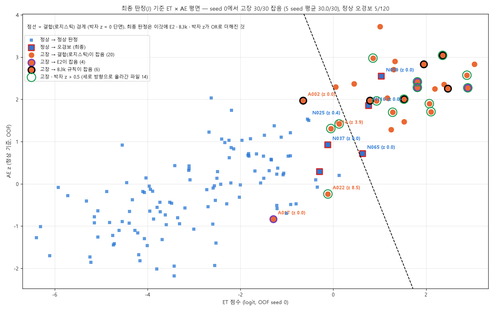
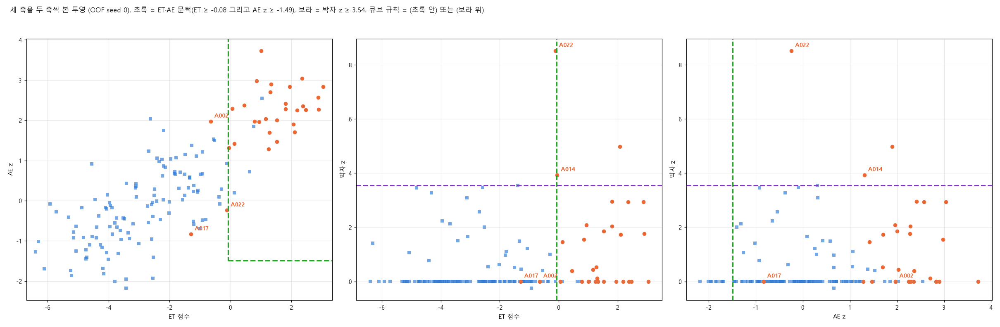

# EXP-044 질문답 — AE 평면 크롭 · 큐브(축에 평행한 경계) 결합

README가 아니라 질문에 답하는 메모다. 수치는 모두 중첩 CV(바깥 5 × 안쪽 4, seed 5개) 또는 같은 분할의 OOF seed 0이고, 8.3k 규칙 문턱은 라벨을 본 뒤 정한 사후 값이다.

## 0. "재현율 1인데 그림은 왜 안 그렇게 나왔나"

**재현율 1.000은 맞다.** 최종 판정(J)은 5개 seed 모두 고장 30개를 전부 잡았다(seed별 30/30). 오경보는 seed별 5 · 5 · 1 · 3 · 4개(120개 중, 평균 0.030).

그림이 그렇게 안 보인 이유는 **이전 평면 그림이 최종 판정이 아니라 로지스틱 한 부분의 경계(박자 z = 0 단면)만 칠했기 때문**이다. 최종 판정은 `로지스틱(ET, 박자 z, AE) OR E2 OR 8.3k 규칙`이라서 경계 바깥(파란 쪽)에 있는 고장도 E2나 8.3k가 잡는다. 박자 z가 큰 고장(022 등)은 세로 방향으로 올라가 있어서 이 단면에는 아예 안 나온다.

새 그림은 최종 판정 기준으로 다시 그렸다. 고장 30개를 누가 잡았는지(seed 0) 색 테두리로 구분한다.

| 잡은 부품 | 고장 수 | 예 |
|---|---|---|
| 결합(로지스틱) | 20 | 대부분 오른쪽 위 |
| 8.3k 규칙 | 6 | 002 003 006 010 029 030 |
| E2 | 4 | 017 외 (004 011 019) |
| 못 잡음 | 0 | |

- 점선 바깥(파란 쪽)에 있는 고장: 002(8.3k), 017(E2), 022(박자 z 8.5, 초록 원)가 대표적이다. ET · AE 두 축만 보면 이 셋은 정상 속에 있다.
- 초록 원은 박자 z > 0.5인 고장(14개)이다. 이 평면에서는 z가 안 보이므로 표시해 두었다.
- 정상 오경보(빨간 테두리)는 이 seed에서 5개: 037 065 116 059 095 (그림에서 ET·AE 좌표로 읽은 이름이라 확실치 않으면 `오류분석_표.md`와 대조).

## 1. AE 위에 공간 남기지 말고 크롭

위 그림이 크롭한 것이다. 세로(AE z) 범위를 −3~12에서 **데이터 범위(약 −2.5~4)**로 줄였고 가로도 데이터 범위에 맞췄다. README의 `logistic_plane`(EXP-044 폴더 `figs/logistic_plane.png`)도 이 범위로 교체했다.

## 2. AE × ET 평면 + 박자 z 축, 큐브 자르듯 경계를 나누면 안 되나

**된다. 해 봤고, 지금 로지스틱보다 낮다.** 실행 전에 두 구성을 정했다(둘 다 E2 · 8.3k는 J와 같이 OR).

- **B1 큐브**: 고장 = (ET ≥ t_e **그리고** AE z ≥ t_a) **또는** 박자 z ≥ t_z. 문턱 3개는 학습 폴드 안쪽 OOF 점수에서 F2 최대가 되게 격자 탐색.
- **B2 트리**: 깊이 3 결정 트리(축에 평행한 경계의 일반형, 같은 3입력).

| 결합 방식 | F2 | 재현율 | 오경보율 | 자주 놓침 · 틀림 |
|---|---|---|---|---|
| **J 로지스틱 (EXP-044)** | **0.977 ± 0.010** | 1.000 | 0.030 | 오경보 116 5/5 · 065 4/5 · 059 3/5 |
| B1 큐브 | 0.932 ± 0.040 | 0.953 | 0.040 | 미탐 005 3/5 · 014 2/5, 오경보 116 5/5 · 059 065 4/5 · 025 037 3/5 |
| B2 깊이 3 트리 | 0.908 ± 0.019 | 0.953 | 0.075 | 미탐 022 4/5 · 005 2/5, 오경보 12개 이상 |

(3차원 그림 [큐브_경계_3d.png](figs/큐브_경계_3d.png)도 만들었지만 읽기 어려워 투영 3장을 쓴다.)

**왜 큐브가 못한가**
1. **전체 150개로 문턱을 고르면 AE 조건이 사라진다.** ET ≥ −0.08, AE z ≥ **−1.49**, 박자 z ≥ 3.54가 나왔다. AE z ≥ −1.49는 거의 모든 파일이 만족해서 큐브가 사실상 "ET ≥ −0.08 **또는** 박자 z ≥ 3.54", 즉 ㄱ자(EXP-041 C-max와 같은 모양)로 줄어든다. AE는 아무 일도 못 한다.
2. **AE의 역할은 대각선이다.** AE는 "ET가 0.1~1.0으로 애매한 정상"의 점수를 **아래로 밀어 내리는** 보정이라서, 경계는 ET가 클수록 AE 문턱이 내려가는 대각선이다(점선). 축에 평행한 경계로는 이것을 계단으로 흉내 내야 하는데, 고장 30개 · 계단 하나에 점 몇 개 안 걸려서 문턱이 폴드마다 흔들린다(sd 0.040, J는 0.010).
3. **박자 z 방향은 큐브가 잘 맞는다.** 022 · 014는 박자 z가 3.5 이상으로 따로 떠 있어서 z 문턱 하나로 잡힌다(투영 그림 가운데·오른쪽). 한 축에 한 고장 유형이 따로 몰려 있으면 큐브가 좋다는 뜻이다. 그런데 ET 쪽은 정상과 고장이 대각선으로 겹쳐 있어서 로지스틱이 낫다.

**섞어 쓰면**: "로지스틱(ET, AE) **OR** 박자 z ≥ t_z"처럼 대각선 부분은 로지스틱, 박자 z는 축에 평행한 문턱으로 나누는 구성이 자연스럽다. 지금 J는 박자 z를 로지스틱 안에 선형으로 넣었을 뿐이라 이 둘이 얼마나 다른지는 아직 안 쟀다. 이 구성은 아직 돌리지 않았다.

## 재현
- 스크립트: [큐브_경계.py](큐브_경계.py)(B1 · B2 중첩 CV, 결과 [큐브_결과.json](figs/큐브_결과.json)), [큐브_그림_다시.py](큐브_그림_다시.py)(최종 판정 그림 · 투영)
- 그림: [ET_AE_평면_최종판정.png](figs/ET_AE_평면_최종판정.png) · [큐브_투영.png](figs/큐브_투영.png) · [큐브_경계_3d.png](figs/큐브_경계_3d.png)
- B1 · B2 클래스는 이 스크립트 안에만 있고 `src/`에는 넣지 않았다(실험 기록용 아님, 질문 확인용).

## 3. 10 kHz 대역(8–12.5 kHz 옥타브 칸)을 안 본다면 (11-22, 가정 실험)

ET 입력에서 H10(울림 8–12.5k)과 H15(몫 8–12.5k) 두 피처를 뺐다. 고정 격자가 옥타브 4칸이라 9.5–12.5 kHz만 따로 뺄 수는 없다. 8.3k 규칙(8.0–8.7 kHz)과 AE 입력(스펙트럼 전체), 봉우리 피처 H16 · H17은 그대로다. 같은 중첩 CV(바깥 5 × seed 5).

| 구성 | F2 | 재현율 | 오경보율 | 자주 틀림 (2회+) |
|---|---|---|---|---|
| J (원래, EXP-044) | 0.977 ± 0.010 | 1.000 | 0.030 | 오경보 116 5/5 · 065 4/5 · 059 3/5 · 025 037 2/5 |
| **J′ (8–12.5k 피처 제거)** | **0.982 ± 0.008** | 0.993 | **0.017** | 오경보 059 3/5 · 116 3/5 · 025 2/5 |
| K (원래, 결합만) | 0.916 ± 0.015 | 0.927 | 0.033 | 미탐 002 017 5/5 · 009 1/5 |
| K′ (제거, 결합만) | 0.888 ± 0.013 | 0.887 | 0.027 | 미탐 002 017 029 5/5 · 028 2/5, 오경보 059 095 4/5 |

- **전체 시스템(J′)은 나빠지지 않는다**(+0.005, sd 안). 오경보율이 0.030에서 0.017로 줄고 065 · 037 · 095 · 106 오경보가 사라진다. 원인은 065가 H10 · H15 모두 정상 95% 위(오류분석 표)였기 때문으로 보인다.
- **결합만(K′)은 −0.028 나빠진다.** 8.3 kHz 근처 고장 029가 ET로는 5/5 미탐이 된다(원래는 잡았음). 즉 H10 · H15는 8.3k 규칙이 이미 잡는 고장(029 등)을 ET가 따로 잡게 해 주던 중복 피처다. 8.3k 규칙이 있는 구성에서는 없어도 된다.
- 두 피처의 원래 ET 중요도는 H15 0.086(15개 중 5위), H10 0.064(8위)로 작지 않다.
- **주의**: 이 가정은 오경보 파일을 본 뒤 떠올린 사후 실험이다. 0.977 → 0.982는 sd 안이고 사전에 정한 구성이 아니라서 채택 근거가 아니다. 채택하려면 새 EXP에서 "H10 · H15 제거"를 사전 구성으로 두고 같은 선택 규칙(sd를 넘게 좋을 때)으로 다시 본다. 그래도 059(9 kHz 약감쇠 울림)는 H10 · H15를 빼도 3/5로 남는다.
- 스크립트 [10k제외_가정.py](10k제외_가정.py), 로그 [figs/10k제외_log.txt](figs/10k제외_log.txt).
