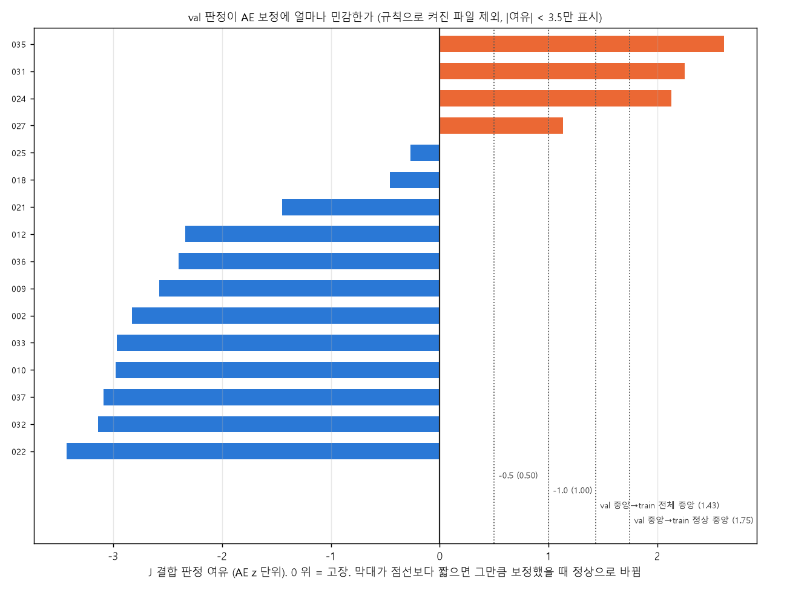

# EXP-044 질문답 — val 이동: AE 보정 민감도(①) · ET 이동의 출처(②)

README가 아니라 질문에 답하는 메모다(11-22). val 라벨은 쓰지 않았다. J는 train 150 전체로 학습했다. 스크립트 [val이동_민감도.py](val이동_민감도.py), 로그 [figs/val이동_민감도_log.txt](figs/val이동_민감도_log.txt), 파일별 표 [figs/val이동_파일별.csv](figs/val이동_파일별.csv)

## 결론
1. **J의 val 판정은 AE 보정에 거의 둔감하다.** val AE z를 train 정상 중앙까지 끌어내려도(−1.75) 10개 → 9개이고, 바뀌는 파일은 027 하나다. → 회의 안건 "val AE 이동 처리"는 J에서는 결과를 거의 바꾸지 않는다.
2. **J′(H10 · H15 제거)는 AE 보정에 민감하다**(보정 없음 14개 → 보정 후 11개, 012 · 025 · 037이 오락가락). AE 계수가 0.553 → 0.819로 커지기 때문이다. 또 ②에서 H10 · H15는 val ET 이동의 원인이 아니었다. → J′는 후보에서 뺀다.
3. **J 점수에서 val 이동의 큰 몫은 AE가 아니라 ET다.** val ET logit 중앙 −0.95 (train 정상 OOF −2.71). 결합 점수로 환산하면 ET 이동 1.53 × 1.76 ≈ **+2.7**, AE 이동 0.553 × 1.75 ≈ +1.0. (00_NOW의 "주원인은 AE"는 이전 계산 기준이다.)
4. **ET 이동은 피처 분포 차이만으로 전부 설명된다.** val의 모든 열을 train 정상 분포로 분위 맞춤하면 val ET 중앙이 −2.69로 정상과 같아진다. 큰 몫은 H9(충격 울림 4–8 kHz 비율, val이 **낮음**), H8(울림 2–4 kHz 비율, 높음), H3(1–2 kHz 첨도), H16 · H17(봉우리 높이 · 폭), H5(4–8 kHz 첨도) 순이다. 즉 **val은 충격이 더 낮은 주파수(2–4 kHz)로 울린다.**
5. **"val에 고장이 많아서"만으로는 설명이 안 된다.** 피처마다 추정 고장 비율이 0 %(H10)에서 85 %(H13)까지 엇갈린다. H5 · H16 · H17은 26–32 %로 비슷하다. 그런데 H13(2–4 kHz 파워 몫)은 val의 38 %가 정상 95 % 분위를 넘는다(고장 비율 85 %가 있어야 나오는 값). → **2–4 kHz 쪽으로 기운 측정 조건 차이 + 고장 약 25–30 %**가 함께 있다고 보는 것이 가장 자연스럽다. 단, val 고장이 train 고장과 닮았다는 가정 위의 추정이다.

## ① AE 보정 민감도

| 보정 | J 고장 수 | J 고장 파일 | J′ 고장 수 | J′ 고장 파일 |
|---|---|---|---|---|
| 그대로 (0) | 10 | 001 004 013 016 017 024 027 031 035 039 | 14 | 001 004 012 013 016 017 018 024 025 027 031 035 037 039 |
| -0.5 | 10 | 같음 | 12 | 012 · 037 빠짐 |
| -1.0 | 10 | 같음 | 12 | 012 · 037 빠짐 |
| val 중앙 → train 전체 중앙 (-1.43) | 9 | 027 빠짐 | 11 | 012 · 025 · 037 빠짐 |
| val 중앙 → train 정상 중앙 (-1.75) | 9 | 027 빠짐 | 11 | 012 · 025 · 037 빠짐 |

- ET 단독(ET ≥ −0.09)은 11개: J의 10개에서 001(8.3k)이 빠지고 025 · 036이 들어간다.
- 보정은 AE를 **내리는** 방향뿐이라 고장 판정을 지우기만 한다. 위험은 반대쪽, 즉 경계 바로 아래의 정상 판정이다: **025(여유 −0.27), 018(−0.46)**, 021(−1.45). 여유는 AE z 단위이고, ET logit으로 바꾸면 025는 +0.10, 018은 +0.17만 올라도 고장이 된다.

막대 = J 결합 판정 여유(AE z 단위, 규칙으로 켜진 001 제외). 주황 = 고장 판정. 주황 막대가 점선보다 짧으면 그만큼 보정했을 때 정상으로 바뀐다(027만 해당).

## ② ET 이동의 출처

| 피처 | ET 중요도 | val 중앙 백분위 | val 중 정상 95위 초과 | train 고장 중앙 백분위 | ET 하락 (정상 분포로 맞춤) |
|---|---|---|---|---|---|
| H9 울림 4–8k | 0.133 | 33 | 0 % | 26 | 0.35 |
| H8 울림 2–4k | 0.098 | 78 | 25 % | 92 | 0.31 |
| H3 첨도 1–2k | 0.133 | 74 | 10 % | 88 | 0.26 |
| H17 봉우리 폭 | 0.069 | 80 | 15 % | 92 | 0.17 |
| H5 첨도 4–8k | 0.050 | 69 | 15 % | 74 | 0.16 |
| H16 봉우리 높이 | 0.105 | 74 | 18 % | 95 | 0.16 |
| H10 울림 8–12.5k | 0.064 | 95 | 5 % | 97 | 0.15 |
| H15 몫 8–12.5k | 0.086 | 54 | 12 % | 93 | 0.08 |
| 나머지 7개 | | | | | ≤ 0.06 |

- 백분위 = train 정상 분포 안에서의 위치(50이면 정상과 같음). ET 하락 = val의 그 열 하나만 train 정상 분포로 맞췄을 때 val ET 중앙이 내려가는 양.
- J′의 val ET 중앙은 −0.98로 J(−0.95)와 같다. H10 · H15를 빼도 ET 이동은 그대로다.

## 혼합 비율 추정 (②-b)

| 피처 | train 고장 중 정상 95위 초과 | val 중 초과 | 추정 고장 비율 |
|---|---|---|---|
| H5 첨도 4–8k | 37 % | 15 % | 32 % |
| H10 울림 8–12.5k | 67 % | 5 % | 0 % |
| H13 몫 2–4k | 43 % | 38 % | 85 % |
| H15 몫 8–12.5k | 47 % | 12 % | 18 % |
| H16 봉우리 높이 | 53 % | 18 % | 26 % |
| H17 봉우리 폭 | 40 % | 15 % | 29 % |

추정 고장 비율 = (val 초과 − 5 %) / (train 고장 초과 − 5 %). 고장이 섞인 것만이 이유라면 피처마다 값이 비슷해야 한다.
