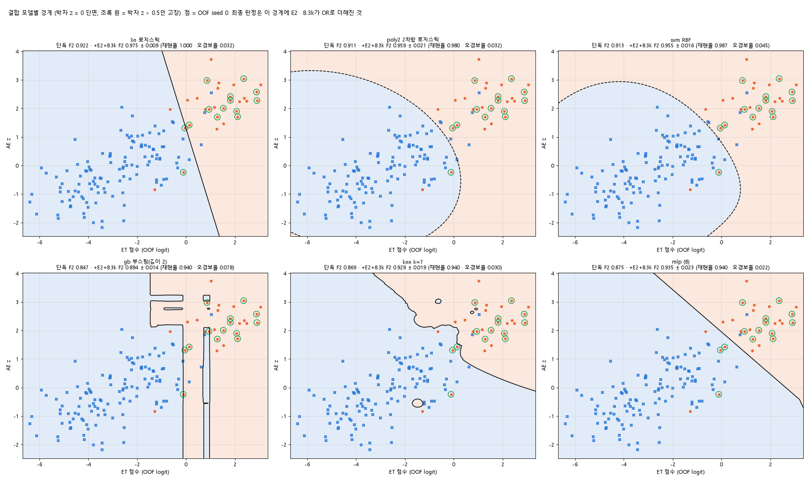
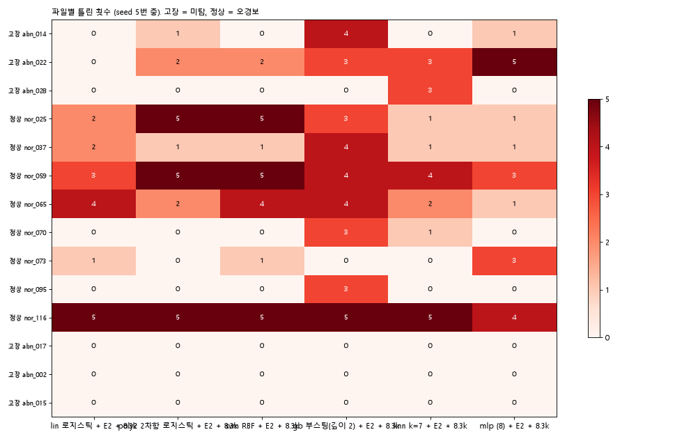
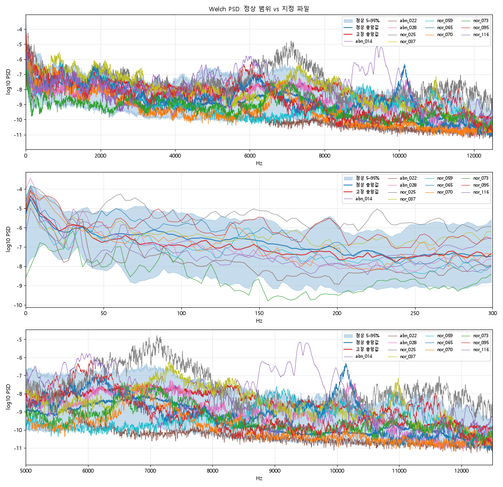

# EXP-045 결합 모델 비교 — 로지스틱 vs 비선형 (같은 3입력)

노션 카드 (실험 DB에 그대로 옮긴다)

| 팀원 | 모델 | F2 점수 | 변경 사항 | 메모 |
|---|---|---|---|---|
| 이동훈 | 결합(ET OOF logit · 박자 z · AE z) = lin · poly2 · SVM-RBF · 부스팅 · kNN · MLP, 각각 단독 / + E2 + 8.3k | 0.975 ± 0.009 | EXP-044의 결합 로지스틱을 비선형 모델로 바꿈 (하이퍼파라미터 고정, 문턱 = 안쪽 OOF F2 최대) (H3, H2) |  |

- 가설: H3, H2 ([물리가설](../../../1_기준·기록/물리가설.md))
- 실행: 2026-11-22 · git `bfc87b8+수정중` · 코드 [run.py](자료/run.py)
- 평가: 중첩 CV (바깥 5 × 안쪽 4, seed 5개). 자주 놓침 = seed 5번 중 3번 이상

## 결과

| 구성 | F2 | 재현율 | 오경보율 | 정밀도 | F2 (고장 10%·40%) | 자주 놓침 | 오경보 3회+ |
|---|---|---|---|---|---|---|---|
| 중첩: lin 로지스틱 + E2 + 8.3k | 0.975 ± 0.009 | 1.000 | 0.032 | 0.889 | 0.946 · 0.991 | — | 3 |
| 중첩: lin 로지스틱 단독 | 0.922 ± 0.009 | 0.933 | 0.032 | 0.882 | 0.894 · 0.937 | 002 017 | 3 |
| 중첩: poly2 2차항 로지스틱 + E2 + 8.3k | 0.959 ± 0.021 | 0.980 | 0.032 | 0.886 | 0.931 · 0.975 | — | 3 |
| 중첩: poly2 2차항 로지스틱 단독 | 0.911 ± 0.028 | 0.920 | 0.032 | 0.879 | 0.884 · 0.926 | 002 017 | 3 |
| 중첩: svm RBF + E2 + 8.3k | 0.955 ± 0.016 | 0.987 | 0.045 | 0.848 | 0.915 · 0.976 | — | 4 |
| 중첩: svm RBF 단독 | 0.913 ± 0.029 | 0.933 | 0.045 | 0.841 | 0.874 · 0.933 | 002 017 | 4 |
| 중첩: gb 부스팅(깊이 2) + E2 + 8.3k | 0.894 ± 0.014 | 0.940 | 0.078 | 0.753 | 0.833 · 0.929 | 014 022 | 7 |
| 중첩: gb 부스팅(깊이 2) 단독 | 0.847 ± 0.009 | 0.880 | 0.078 | 0.741 | 0.788 · 0.880 | 002 014 017 022 | 7 |
| 중첩: knn k=7 + E2 + 8.3k | 0.929 ± 0.019 | 0.940 | 0.030 | 0.890 | 0.902 · 0.943 | 022 028 | 2 |
| 중첩: knn k=7 단독 | 0.869 ± 0.018 | 0.867 | 0.030 | 0.882 | 0.844 · 0.882 | 002 017 022 028 | 2 |
| 중첩: mlp (8) + E2 + 8.3k | 0.935 ± 0.023 | 0.940 | 0.022 | 0.916 | 0.915 · 0.945 | 022 | 3 |
| 중첩: mlp (8) 단독 | 0.875 ± 0.022 | 0.867 | 0.022 | 0.910 | 0.856 · 0.885 | 002 017 022 | 3 |
| 중첩: J \| EXP-044 값 (TwoAE 로지스틱) | 0.977 ± 0.010 | 1.000 | 0.030 | 0.895 | 0.949 · 0.991 | — | 3 |

## 해석

**로지스틱을 비선형 결합으로 바꿔도 좋아지지 않는다. 같은 3입력(ET · 박자 z · AE z)에서 로지스틱(lin)이 가장 좋고(+E2 + 8.3k F2 0.975 ± 0.009), 비선형 5종은 모두 lin보다 0.016~0.081 낮다(전부 lin의 sd 0.009를 넘게 나쁨).** 실행 전 고정한 선택 규칙(비선형이 lin을 sd 넘게 이길 때만 교체 논의)에 따라 교체하지 않는다. 경계가 거의 선형(대각선)인 문제라서 유연한 모델은 점이 적은 150개(고장 30개)에서 경계 모양을 잘못 배운다.

<!-- key-figs: 자동 (save_fig key=True) -->

*logistic_plane* — 결합 모델 6종의 ET × AE 평면 경계 (박자 z = 0 단면, 데이터 범위로 크롭)

<!-- /key-figs -->

### 읽는 법과 상세 (손으로 씀)
**그림 읽는 법.** 6칸이 결합 모델 6종이다. 각 칸은 ET × AE 평면(박자 z = 0 단면)의 경계이고, 파랑 = 정상 판정 쪽, 주황 = 고장 판정 쪽, 초록 원 = 박자 z > 0.5인 고장(세로로 올라간 파일). 최종 판정은 이 경계에 E2 · 8.3k가 OR로 더해진 것이라 단독 F2와 +E2+8.3k F2를 제목에 같이 적었다.

| 결합 모델 | 단독 F2 | + E2 + 8.3k F2 | 재현율 | 오경보율 | + E2 + 8.3k의 미탐 (seed 5번 중) | 읽기 |
|---|---|---|---|---|---|---|
| lin 로지스틱 | 0.922 ± 0.009 | **0.975 ± 0.009** | 1.000 | 0.032 | 없음 | 기준 |
| poly2 (2차 항) | 0.911 ± 0.028 | 0.959 ± 0.021 | 0.980 | 0.032 | 014 1/5 · 022 2/5 | 경계가 곡선이 되며 022 · 014를 가끔 놓치고, 정상 025가 5/5 오경보 |
| svm RBF | 0.913 ± 0.029 | 0.955 ± 0.016 | 0.987 | 0.045 | 022 2/5 | 정상 065 · 025 오경보 증가 |
| gb 부스팅(깊이 2) | 0.847 ± 0.009 | 0.894 ± 0.014 | 0.940 | 0.078 | 014 4/5 · 022 3/5 · 005 · 009 1/5 | 경계가 축에 평행한 막대 모양이라 AE 보정이 사라짐(EXP-044 큐브와 같은 증상). 오경보 7개 |
| knn k=7 | 0.869 ± 0.018 | 0.929 ± 0.019 | 0.940 | 0.030 | 022 · 028 3/5 · 005 2/5 · 027 1/5 | 점이 적어 경계가 들쭉날쭉. 오경보는 적지만 고장을 놓침 |
| mlp (8) | 0.875 ± 0.022 | 0.935 ± 0.023 | 0.940 | 0.022 | 022 5/5 · 005 · 009 · 014 · 025 1/5 | 거의 직선이지만 022(박자 z 큰 한 점)를 학습 못 함, 오경보율 최저 0.022 |

- **022가 갈림길이다.** 022는 박자 z 8.5로 입력 공간에서 유일하게 멀리 떨어진 점이라, 비선형 모델은 이 한 점 주변을 학습 폴드마다 다르게 그린다(poly2 · svm · mlp · knn · gb 모두 022를 2~5/5 놓침). 로지스틱은 박자 z 계수가 선형이라 이 점을 안정적으로 올린다.
- **단독과 + E2 + 8.3k의 차이(약 +0.05)는 결합 모델과 무관하게 비슷하다.** 002 · 017은 어떤 결합도 못 잡고 8.3k · E2가 잡는다. 결합 모델을 바꿔서 이 두 파일을 잡을 수는 없다.
- **오경보 116 · 059는 6종 모두에서 3회 이상 남고**(065는 lin · poly2 · svm · gb에서 남음), 결합 모델을 바꿔도 이 파일들이 고장 쪽 점수를 받는다는 뜻이라 입력(ET · AE) 쪽 문제다.
- lin의 이 실험 값(0.975)은 EXP-044의 J(0.977)와 문턱 정하는 절차가 약간 달라(여기는 결합 점수의 안쪽 OOF 문턱) 0.002 차이가 난다.

**한계.** 비선형 모델의 하이퍼파라미터는 고정값(SVM C = 1, 부스팅 100그루 · 깊이 2, kNN k = 7, MLP 은닉 8)이며 튜닝하지 않았다. 튜닝하면 좀 나아질 수 있지만, 150개 표본에서 튜닝용 분할을 더 쪼개면 같은 과적합 문제가 생긴다. 이 실험에서는 val을 채점하지 않았다(교체하지 않으므로 EXP-044의 J 판정이 그대로다).

## 그림

### hard_files
어느 파일이 결합 모델별(+E2+8.3k)에서 맞고 틀리는가

### psd_missed
자주 틀린 파일의 PSD가 정상 5–95% 범위 밖으로 나가는 주파수

