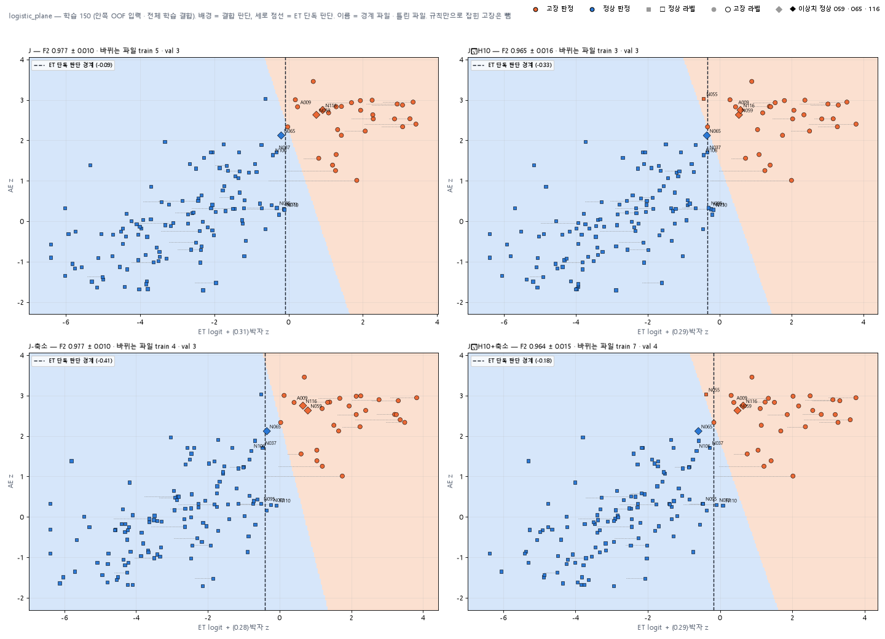
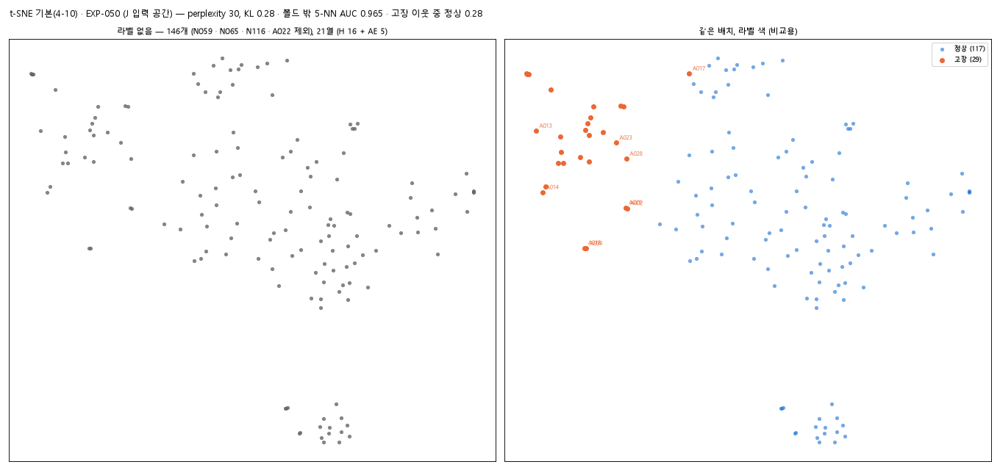
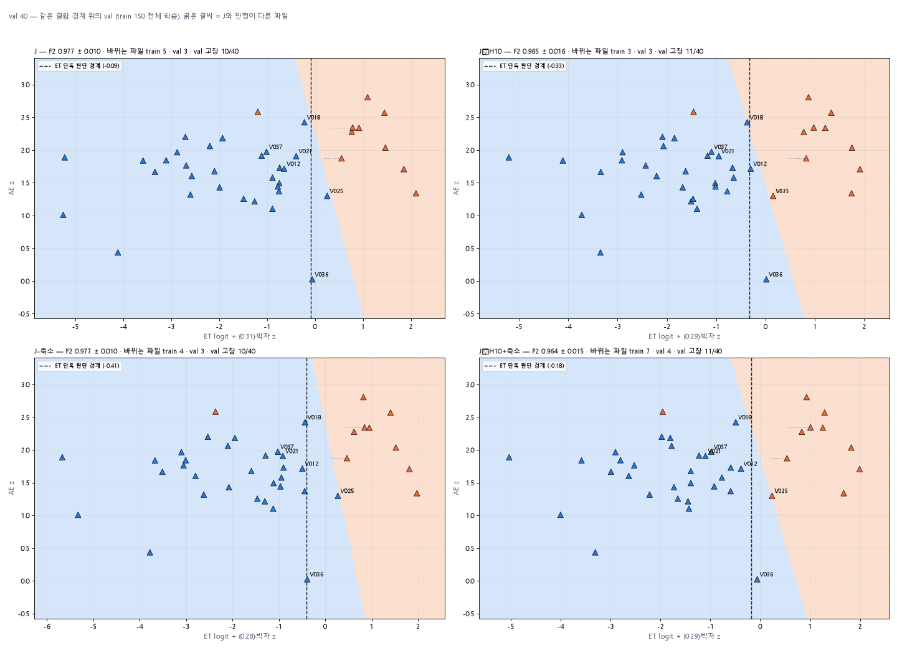

# EXP-050 울림 비율 축소 × H10 빼기 (2×2)

노션 카드 (실험 DB에 그대로 옮긴다)

| 팀원 | 모델 | F2 점수 | 변경 사항 | 메모 |
|---|---|---|---|---|
| 이동훈 | J-축소: ET(H 피처, 울림 비율 H7–H10 충격 수 축소 α=3) + 박자 z + AE z → 로지스틱 OR E2 OR 8.3k (비교: J · J−H10 · J−H10+축소) | 0.977 ± 0.010 | J의 ET 입력에서 울림 비율 H7–H10을 충격 수로 축소(α=3 사전 고정), H10 제외와 2×2. 같은 분할 full. 대표 구성 = J-축소(11-22 판정 뒤 main 변경, 재실행 없음) (H1, H2) | **J-축소 채택, 이후 기준 구성(사용자 11-22). F2는 J와 같은 0.977 ± 0.010이고, val 결합 고장 수의 부트스트랩 범위가 8–21에서 8–14로 좁아진다. H10 빼기는 0.965 · 0.964로 떨어져 쓰지 않는다.** |

## 주요 변경점 (기준 실험 대비)

- 울림 비율 축소 (k + 3·p0)/(n + 3), p0 = 폴드 안 학습 정상
- H10 제외
- 두 변경의 2×2
- 흔들림 잣대 (a) 판정 바뀌는 파일 · (b) 부트스트랩 w_AE

- 가설: H1, H2 ([물리가설](../../../1_기준·기록/물리가설.md))
- 실행: 2026-11-22 · git `1081bae+수정중` · 코드 [run.py](자료/run.py)
- 평가: 중첩 CV (바깥 5 × 안쪽 4) · 모드 seed 5 · ET 300. 자주 놓침 · 오경보 n회+ = seed 과반. quick 수치는 선별용, 기록 수치는 QE_FULL=1

## 결과

| 구성 | F2 | 재현율 | 오경보율 | 정밀도 | F2 (고장 10%·40%) | 자주 놓침 | 오경보 3회+ |
|---|---|---|---|---|---|---|---|
| J-축소 | 0.977 ± 0.010 | 1.000 | 0.030 | 0.895 | 0.949 · 0.991 | — | 4 |

## 해석

**J-축소 채택, 이후 기준 구성(사용자 11-22). F2는 J와 같은 0.977 ± 0.010이고, val 결합 고장 수의 부트스트랩 범위가 8–21에서 8–14로 좁아진다. H10 빼기는 0.965 · 0.964로 떨어져 쓰지 않는다.**

<!-- key-figs: 자동 (save_fig key=True) -->

*logistic_plane* — J · J−H10 · J-축소 · J−H10+축소의 결합 경계 (2×2)

*tsne_라벨* — 기본 t-SNE(4-10). 빨간 원 = J 오경보

<!-- /key-figs -->

대표 구성은 처음 run.py에서 J−H10+축소였는데, 판정 뒤 J-축소로 바꿨다(result.json `main`만 바꾸고 다시 실행하지 않음). 판단 기준(sd 넘는 개선 또는 새로 잡은 고장)만으로는 J를 sd 넘게 넘는 구성이 없다. 채택 근거는 네 가지다. F2가 J와 같고, val 판정이 덜 흔들리며, 충격 4–6개 고장 5개를 모두 5/5로 유지하고, 바뀌는 것은 오경보가 나는 파일뿐이다. J−H10+축소는 0.964 ± 0.015로 J보다 0.013 낮다. 떨어진 몫은 H10 빼기에서 나왔다(J−H10만 해도 0.965, A028 · A009를 가끔 놓침). 축소만 한 J-축소는 J와 F2 · 재현율 · 오경보율이 같다(0.977 ± 0.010 · 1.000 · 0.030). 오경보가 난 파일만 바뀌었다(065 4 → 3, 095 · 106 1 → 0, 025 2 → 3, 073 · 110 0 → 1). 축소로 충격 4–6개 고장 신호가 약해질 걱정(6-4)은 실제로 일어나지 않았다(A003 · 016 · 017 · 023 · 030 모두 5/5). 축소에서 남는 효과는 val 판정이 덜 흔들린다는 점 하나다. 결합기를 부트스트랩하면 J의 val 결합 고장 수가 8–21개에서 움직이는데, 축소를 하면 8–14개로 좁아진다.

### 그림 읽는 법
- **logistic_plane**: 2×2 배치(왼쪽 위 J · 오른쪽 위 J−H10 · 왼쪽 아래 J-축소 · 오른쪽 아래 J−H10+축소). 가로 = ET logit + 박자 z 몫, 세로 = AE z. 배경은 결합 판단(파랑 정상 · 주황 고장), 세로 점선은 ET만 쓴 판단 경계다. 이름이 붙은 점은 경계 파일이다. 축소를 하면(아래 줄) N037 · N106 · N110 · N095가 ET 경계 왼쪽으로 조금 물러난다. 그래도 결합 경계는 거의 그대로다. (제목의 "−" 기호는 글꼴에 없어서 네모로 보인다. J▯H10 = J−H10)
- **tsne_라벨**: 기본 t-SNE(4-10). 구성마다 다르지 않아서 J 오경보만 표시했다

### 흔들림 잣대 (사전 합의, claude-af 정의)
| 구성 | (a) 판정이 바뀌는 train · val | (a) 파일 | (b) w_AE 5–95 % | (b) 문턱 5–95 % | (b) val 결합 고장 수 5–95 % (규칙 켜진 val 포함) | 결합 계수 ET · 박자 · AE |
|---|---|---|---|---|---|---|
| J | 5 · 3 | N037 N065 N095 N110 A028 · V018 V025 V036 | −0.34 – 1.85 | −0.66 – 1.84 | 8 – 21 | 1.53 · 0.48 · 0.55 |
| J−H10 | 3 · 3 | N116 A009 A028 · V012 V018 V025 | −0.34 – 1.97 | −0.90 – 1.91 | 9 – 20 | 1.53 · 0.45 · 0.59 |
| J-축소 | 4 · 3 | N025 N037 N065 N110 · V012 V018 V025 | −0.37 – 1.69 | −0.49 – 1.75 | **8 – 14** | 1.64 · 0.46 · 0.47 |
| J−H10+축소 | 7 · 4 | N037 N065 N073 N095 N110 A022 A028 · V012 V018 V025 V036 | −0.34 – 1.96 | −0.75 – 1.96 | 8 – 19 | 1.51 · 0.43 · 0.58 |

- (a) = 바깥 폴드 모델 5개와 전체 모델 1개, 모두 6개를 같은 좌표에 적용해서 min < 0 ≤ max인 파일을 센 값. 규칙(E2 · 8.3k)이 켜진 파일은 뺐다. (b) = 전체 모델의 결합 입력을 300번 부트스트랩해 로지스틱과 F2 문턱을 다시 맞춘 값(RandomState 0)
- (b)의 val 고장 수는 규칙이 켜진 val도 포함해서 셌다. 그래서 claude-af가 정의한 "폴드 경계 6모델, 규칙 켜진 val 제외" 범위와 바로 비교할 수 없다
- p0(전체 학습 정상에서 잰 울림 대역 비율, H7 1–2k · H8 2–4k · H9 4–8k · H10 8–12.5k) = 0.112 · 0.040 · 0.835 · 0.013. 정상 충격은 대부분 4–8 kHz로 운다. 충격이 적은 파일일수록 비율이 이 값 쪽으로 크게 당겨진다(충격 1개면 비율의 3/4이 p0). 폴드 안에서는 p0를 그 폴드 학습 정상으로 다시 잰다

### val
- val 고장 판정 수: J 10 · J−H10 11 · J-축소 10 · J−H10+축소 11. 구성마다 다른 파일은 025 하나다(H10을 빼면 여유 −0.15 → +0.13으로 고장)
- 축소가 6-4 유형 A val 경계 파일에 준 영향(J → J-축소 여유, 결합 점수 − 문턱): 018 −0.25 → −0.72 · 036 −1.33 → −1.77 · 037 −1.71 → −1.89 · 021 −0.80 → −1.75. 반대로 025 −0.15 → −0.09 · 012 −1.29 → −1.15는 조금 올랐다. 판정이 바뀐 파일은 없다

### 주의
- α = 3은 실행 전에 고정했다(돌려 보고 고르지 않음). 축소 아이디어는 val 분포를 보고 나왔다(충격 1–3개 val 9/17이 4 kHz 아래로 절반 이상 울림, 라벨은 쓰지 않음). 그래서 주 잣대는 train 중첩 CV이고 val 판정은 보조다
- 충격 0개 파일은 기존 값 −1을 그대로 둔다

## 그림

### val_판정
네 구성의 val 판정

## 중간 단계 결과 (비교 · 절제 · 이전 실험 값)

| 구성 | F2 | 재현율 | 오경보율 | 정밀도 | F2 (고장 10%·40%) | 자주 놓침 | 오경보 3회+ |
|---|---|---|---|---|---|---|---|
| J | 0.977 ± 0.010 | 1.000 | 0.030 | 0.895 | 0.949 · 0.991 | — | 3 |
| J−H10 | 0.965 ± 0.016 | 0.987 | 0.032 | 0.890 | 0.936 · 0.980 | — | 3 |
| J−H10+축소 | 0.964 ± 0.015 | 0.980 | 0.025 | 0.911 | 0.941 · 0.977 | — | 2 |