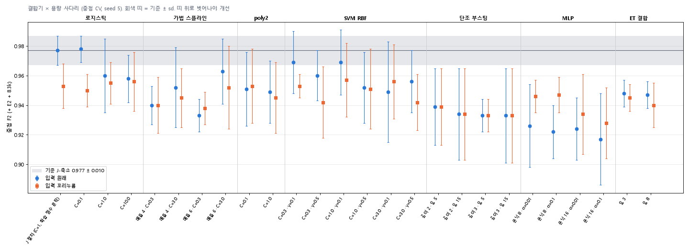
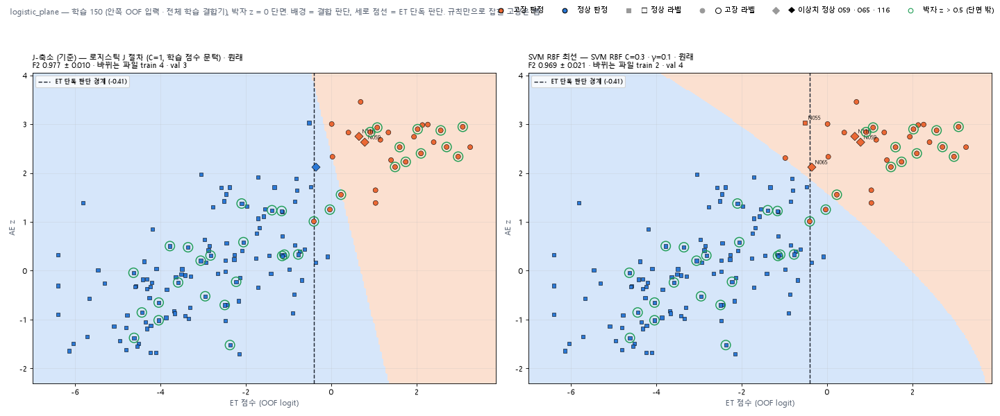
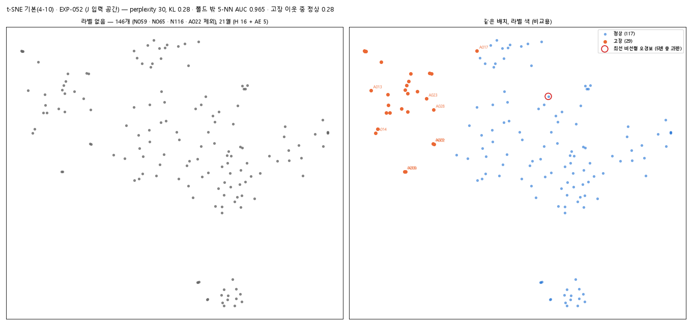
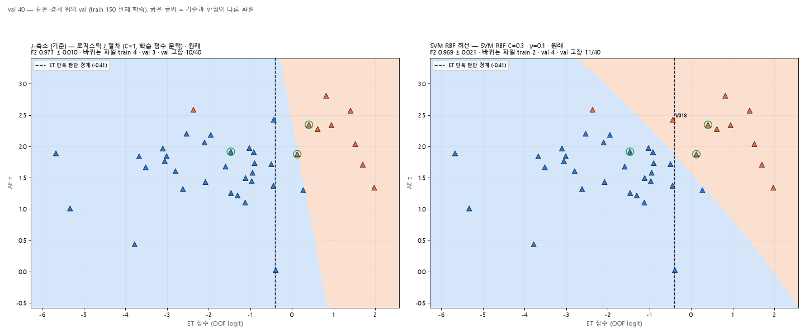
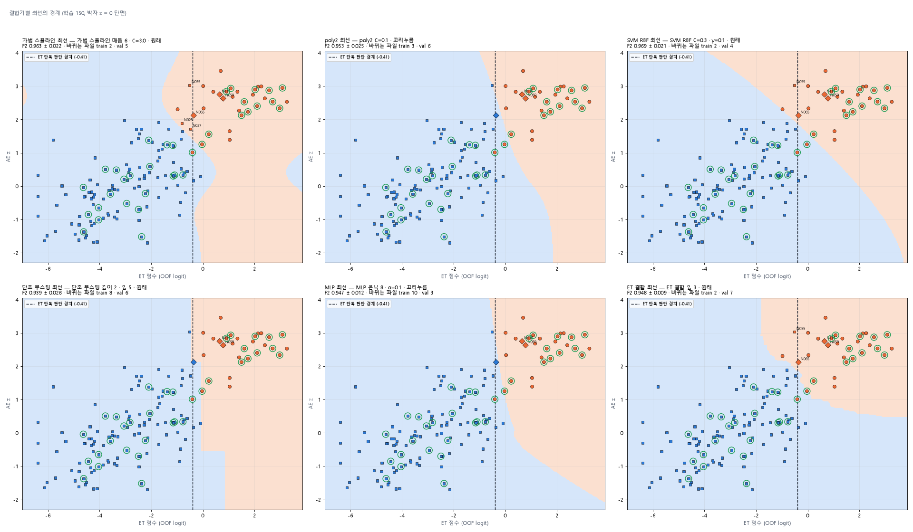

# EXP-052 비선형 결합 재실험 (기준 J-축소)

노션 카드 (실험 DB에 그대로 옮긴다)

| 팀원 | 모델 | F2 점수 | 변경 사항 | 메모 |
|---|---|---|---|---|
| 이동훈 | J-축소의 결합기 교체: 로지스틱 · 가법 스플라인 · poly2 · SVM-RBF · 단조 부스팅 · MLP · ET 결합 (용량 사다리 × 입력 변환 2), OR E2 OR 8.3k | 0.969 ± 0.021 | EXP-045 재실험: 기준 J-축소 · 용량 사다리(튜닝 없이 전부 보고) · 꼬리 누르기 변환(022) · 단조 제약 · val 흔들림 (H1, H2, H3) |  |

## 주요 변경점 (기준 실험 대비)

- 기준 J → J-축소
- 결합기마다 용량 사다리 (값 하나 → 2–6칸)
- 입력 꼬리 누르기 sign·log1p (모든 결합기 공통)
- 단조 제약 부스팅 · 가법 스플라인 추가, kNN 제외
- val 흔들림 (a)(b) 추가

- 가설: H1, H2, H3 ([물리가설](../../../1_기준·기록/물리가설.md))
- 실행: 2026-11-22 · git `ac7d42f+수정중` · 코드 [run.py](자료/run.py)
- 평가: 중첩 CV (바깥 5 × 안쪽 4) · 모드 seed 2 · ET 100 / seed 5 · ET 300. 자주 놓침 · 오경보 n회+ = seed 과반. quick 수치는 선별용, 기록 수치는 QE_FULL=1

## 결과

| 구성 | F2 | 재현율 | 오경보율 | 정밀도 | F2 (고장 10%·40%) | 자주 놓침 | 오경보 3회+ |
|---|---|---|---|---|---|---|---|
| J-축소 (로지스틱 J 절차) — 기준 | 0.977 ± 0.010 | 1.000 | 0.030 | 0.895 | 0.949 · 0.991 | — | 4 |
| 로지스틱 최선 (C=0.1 · 원래) | 0.978 ± 0.009 | 1.000 | 0.028 | 0.900 | 0.951 · 0.992 | — | 3 |
| 가법 스플라인 최선 (매듭 6 · C=3.0 · 원래) | 0.963 ± 0.022 | 0.987 | 0.033 | 0.882 | 0.933 · 0.979 | — | 3 |
| poly2 최선 (C=0.1 · 원래) | 0.967 ± 0.020 | 0.983 | 0.025 | 0.908 | 0.944 · 0.979 | — | 2 |
| SVM RBF 최선 (C=0.3 · γ=0.1 · 원래) | 0.969 ± 0.021 | 0.987 | 0.027 | 0.904 | 0.944 · 0.981 | — | 3 |
| 단조 부스팅 최선 (깊이 2 · 잎 15 · 원래) | 0.941 ± 0.026 | 0.967 | 0.042 | 0.853 | 0.905 · 0.961 | — | 1 |
| MLP 최선 (은닉 16 · α=0.01 · 원래) | 0.947 ± 0.007 | 0.950 | 0.017 | 0.936 | 0.931 · 0.955 | 022 | 1 |
| ET 결합 최선 (잎 8 · 원래) | 0.954 ± 0.006 | 0.967 | 0.025 | 0.907 | 0.931 · 0.966 | 022 | 2 |
| poly2 최선 (C=0.1 · 꼬리누름) | 0.953 ± 0.025 | 0.973 | 0.033 | 0.880 | 0.923 · 0.969 | 022 | 4 |
| 단조 부스팅 최선 (깊이 2 · 잎 5 · 원래) | 0.939 ± 0.026 | 0.973 | 0.053 | 0.827 | 0.892 · 0.963 | — | 5 |
| MLP 최선 (은닉 8 · α=0.1 · 꼬리누름) | 0.947 ± 0.012 | 0.960 | 0.027 | 0.901 | 0.923 · 0.960 | 022 | 4 |
| ET 결합 최선 (잎 3 · 원래) | 0.948 ± 0.009 | 0.967 | 0.033 | 0.880 | 0.918 · 0.963 | 022 | 3 |

## 해석

**비선형 결합기는 J-축소를 넘지 못한다 → 로지스틱 유지 (실행 전 교체 규칙).** 7종 × 26칸 × 입력 2 = 52칸 중 기준(0.977 ± 0.010)을 sd 넘게 넘은 칸 0, sd 안 4칸(로지스틱 2 · SVM 2), 나머지 48칸은 sd 넘게 나쁨. 최선 비선형 SVM RBF(C 0.3 · γ 0.1) 0.969 ± 0.021은 평균이 낮고 sd가 2배, val 흔들림도 넓다(결합만 val 고장 5–95 % 9–15 vs 기준 8–13, val 고장 11 vs 10). 022 꼬리 누르기는 대부분 칸에서 오히려 낮아졌다. J-축소 재현 확인: 이 실행 0.977 ± 0.010 = EXP-050.

<!-- key-figs: 자동 (save_fig key=True) -->

*사다리* — 결합기 7종 × 용량 사다리 × 입력 변환 2의 중첩 F2 (회색 띠 = J-축소 ± sd)

*logistic_plane* — 기준 J-축소 vs 최선 비선형 결합의 경계 (ET × AE, 박자 z = 0 단면)

*tsne_라벨* — 기본 t-SNE(4-10). 빨간 원 = 최선 비선형 오경보

<!-- /key-figs -->

## 그림

### val_판정
기준과 최선 비선형의 val 판정

### 결합기별_경계
결합기별 최선 칸의 경계 6종

## 중간 단계 결과 (비교 · 절제 · 이전 실험 값)

| 구성 | F2 | 재현율 | 오경보율 | 정밀도 | F2 (고장 10%·40%) | 자주 놓침 | 오경보 3회+ |
|---|---|---|---|---|---|---|---|
| 사다리: 로지스틱 J 절차 (C=1, 학습 점수 문턱) · 원래 | 0.977 ± 0.010 | 1.000 | 0.030 | 0.895 | 0.949 · 0.991 | — | 4 |
| 사다리: 로지스틱 J 절차 (C=1, 학습 점수 문턱) · 꼬리누름 | 0.953 ± 0.015 | 0.980 | 0.040 | 0.863 | 0.918 · 0.972 | 022 | 5 |
| 사다리: 로지스틱 C=0.1 · 원래 | 0.978 ± 0.009 | 1.000 | 0.028 | 0.900 | 0.951 · 0.992 | — | 3 |
| 사다리: 로지스틱 C=0.1 · 꼬리누름 | 0.950 ± 0.011 | 0.967 | 0.030 | 0.892 | 0.923 · 0.964 | 022 | 4 |
| 사다리: 로지스틱 C=1.0 · 원래 | 0.960 ± 0.025 | 0.987 | 0.038 | 0.868 | 0.925 · 0.978 | — | 6 |
| 사다리: 로지스틱 C=1.0 · 꼬리누름 | 0.955 ± 0.014 | 0.987 | 0.045 | 0.849 | 0.915 · 0.976 | — | 6 |
| 사다리: 로지스틱 C=10.0 · 원래 | 0.958 ± 0.016 | 0.980 | 0.033 | 0.886 | 0.928 · 0.974 | — | 5 |
| 사다리: 로지스틱 C=10.0 · 꼬리누름 | 0.956 ± 0.020 | 0.980 | 0.037 | 0.874 | 0.923 · 0.973 | — | 3 |
| 사다리: 가법 스플라인 매듭 4 · C=0.3 · 원래 | 0.940 ± 0.013 | 0.960 | 0.037 | 0.869 | 0.907 · 0.957 | 022 | 3 |
| 사다리: 가법 스플라인 매듭 4 · C=0.3 · 꼬리누름 | 0.940 ± 0.019 | 0.960 | 0.037 | 0.870 | 0.907 · 0.957 | 022 | 5 |
| 사다리: 가법 스플라인 매듭 4 · C=3.0 · 원래 | 0.952 ± 0.027 | 0.973 | 0.035 | 0.875 | 0.920 · 0.968 | 022 | 3 |
| 사다리: 가법 스플라인 매듭 4 · C=3.0 · 꼬리누름 | 0.945 ± 0.020 | 0.967 | 0.037 | 0.870 | 0.913 · 0.962 | 022 | 5 |
| 사다리: 가법 스플라인 매듭 6 · C=0.3 · 원래 | 0.933 ± 0.011 | 0.953 | 0.038 | 0.862 | 0.900 · 0.951 | 022 | 4 |
| 사다리: 가법 스플라인 매듭 6 · C=0.3 · 꼬리누름 | 0.938 ± 0.011 | 0.960 | 0.040 | 0.858 | 0.902 · 0.956 | 022 | 5 |
| 사다리: 가법 스플라인 매듭 6 · C=3.0 · 원래 | 0.963 ± 0.022 | 0.987 | 0.033 | 0.882 | 0.933 · 0.979 | — | 3 |
| 사다리: 가법 스플라인 매듭 6 · C=3.0 · 꼬리누름 | 0.952 ± 0.028 | 0.980 | 0.042 | 0.855 | 0.915 · 0.972 | — | 5 |
| 사다리: poly2 C=0.1 · 원래 | 0.951 ± 0.025 | 0.967 | 0.028 | 0.898 | 0.926 · 0.965 | — | 2 |
| 사다리: poly2 C=0.1 · 꼬리누름 | 0.953 ± 0.025 | 0.973 | 0.033 | 0.880 | 0.923 · 0.969 | 022 | 4 |
| 사다리: poly2 C=1.0 · 원래 | 0.949 ± 0.021 | 0.967 | 0.032 | 0.885 | 0.920 · 0.964 | — | 4 |
| 사다리: poly2 C=1.0 · 꼬리누름 | 0.945 ± 0.024 | 0.960 | 0.030 | 0.890 | 0.918 · 0.959 | 022 | 4 |
| 사다리: SVM RBF C=0.3 · γ=0.1 · 원래 | 0.969 ± 0.021 | 0.987 | 0.027 | 0.904 | 0.944 · 0.981 | — | 3 |
| 사다리: SVM RBF C=0.3 · γ=0.1 · 꼬리누름 | 0.953 ± 0.008 | 0.967 | 0.027 | 0.902 | 0.928 · 0.965 | 022 | 3 |
| 사다리: SVM RBF C=0.3 · γ=0.5 · 원래 | 0.960 ± 0.017 | 0.987 | 0.038 | 0.869 | 0.925 · 0.978 | — | 3 |
| 사다리: SVM RBF C=0.3 · γ=0.5 · 꼬리누름 | 0.942 ± 0.024 | 0.967 | 0.042 | 0.855 | 0.905 · 0.961 | 022 | 5 |
| 사다리: SVM RBF C=1.0 · γ=0.1 · 원래 | 0.969 ± 0.022 | 0.987 | 0.027 | 0.904 | 0.944 · 0.981 | — | 2 |
| 사다리: SVM RBF C=1.0 · γ=0.1 · 꼬리누름 | 0.957 ± 0.025 | 0.980 | 0.035 | 0.878 | 0.925 · 0.974 | — | 5 |
| 사다리: SVM RBF C=1.0 · γ=0.5 · 원래 | 0.952 ± 0.024 | 0.980 | 0.042 | 0.856 | 0.915 · 0.972 | — | 3 |
| 사다리: SVM RBF C=1.0 · γ=0.5 · 꼬리누름 | 0.951 ± 0.027 | 0.980 | 0.043 | 0.853 | 0.912 · 0.971 | — | 5 |
| 사다리: SVM RBF C=3.0 · γ=0.1 · 원래 | 0.949 ± 0.034 | 0.967 | 0.032 | 0.886 | 0.920 · 0.964 | — | 3 |
| 사다리: SVM RBF C=3.0 · γ=0.1 · 꼬리누름 | 0.956 ± 0.025 | 0.980 | 0.037 | 0.872 | 0.923 · 0.973 | — | 6 |
| 사다리: SVM RBF C=3.0 · γ=0.5 · 원래 | 0.956 ± 0.021 | 0.980 | 0.037 | 0.872 | 0.923 · 0.973 | — | 3 |
| 사다리: SVM RBF C=3.0 · γ=0.5 · 꼬리누름 | 0.942 ± 0.019 | 0.973 | 0.048 | 0.835 | 0.900 · 0.964 | 022 | 5 |
| 사다리: 단조 부스팅 깊이 2 · 잎 5 · 원래 | 0.939 ± 0.026 | 0.973 | 0.053 | 0.827 | 0.892 · 0.963 | — | 5 |
| 사다리: 단조 부스팅 깊이 2 · 잎 5 · 꼬리누름 | 0.939 ± 0.026 | 0.973 | 0.053 | 0.827 | 0.892 · 0.963 | — | 5 |
| 사다리: 단조 부스팅 깊이 2 · 잎 15 · 원래 | 0.934 ± 0.031 | 0.960 | 0.045 | 0.845 | 0.895 · 0.955 | 022 | 4 |
| 사다리: 단조 부스팅 깊이 2 · 잎 15 · 꼬리누름 | 0.934 ± 0.031 | 0.960 | 0.045 | 0.845 | 0.895 · 0.955 | 022 | 4 |
| 사다리: 단조 부스팅 깊이 3 · 잎 5 · 원래 | 0.933 ± 0.011 | 0.967 | 0.053 | 0.823 | 0.887 · 0.958 | 022 | 5 |
| 사다리: 단조 부스팅 깊이 3 · 잎 5 · 꼬리누름 | 0.933 ± 0.011 | 0.967 | 0.053 | 0.823 | 0.887 · 0.958 | 022 | 5 |
| 사다리: 단조 부스팅 깊이 3 · 잎 15 · 원래 | 0.933 ± 0.032 | 0.960 | 0.047 | 0.840 | 0.892 · 0.954 | 022 | 4 |
| 사다리: 단조 부스팅 깊이 3 · 잎 15 · 꼬리누름 | 0.933 ± 0.032 | 0.960 | 0.047 | 0.840 | 0.892 · 0.954 | 022 | 4 |
| 사다리: MLP 은닉 8 · α=0.01 · 원래 | 0.926 ± 0.028 | 0.933 | 0.027 | 0.898 | 0.902 · 0.938 | 022 | 4 |
| 사다리: MLP 은닉 8 · α=0.01 · 꼬리누름 | 0.946 ± 0.011 | 0.960 | 0.028 | 0.895 | 0.920 · 0.960 | 022 | 4 |
| 사다리: MLP 은닉 8 · α=0.1 · 원래 | 0.922 ± 0.018 | 0.933 | 0.032 | 0.882 | 0.894 · 0.937 | 022 | 4 |
| 사다리: MLP 은닉 8 · α=0.1 · 꼬리누름 | 0.947 ± 0.012 | 0.960 | 0.027 | 0.901 | 0.923 · 0.960 | 022 | 4 |
| 사다리: MLP 은닉 16 · α=0.01 · 원래 | 0.924 ± 0.021 | 0.940 | 0.037 | 0.868 | 0.892 · 0.941 | 022 | 4 |
| 사다리: MLP 은닉 16 · α=0.01 · 꼬리누름 | 0.934 ± 0.027 | 0.947 | 0.030 | 0.889 | 0.907 · 0.948 | 022 | 2 |
| 사다리: MLP 은닉 16 · α=0.1 · 원래 | 0.917 ± 0.031 | 0.933 | 0.038 | 0.861 | 0.884 · 0.935 | 022 | 4 |
| 사다리: MLP 은닉 16 · α=0.1 · 꼬리누름 | 0.928 ± 0.024 | 0.940 | 0.032 | 0.882 | 0.900 · 0.942 | 009 022 | 2 |
| 사다리: ET 결합 잎 3 · 원래 | 0.948 ± 0.009 | 0.967 | 0.033 | 0.880 | 0.918 · 0.963 | 022 | 3 |
| 사다리: ET 결합 잎 3 · 꼬리누름 | 0.945 ± 0.009 | 0.967 | 0.037 | 0.870 | 0.913 · 0.962 | 022 | 5 |
| 사다리: ET 결합 잎 8 · 원래 | 0.947 ± 0.009 | 0.967 | 0.035 | 0.875 | 0.915 · 0.963 | 022 | 5 |
| 사다리: ET 결합 잎 8 · 꼬리누름 | 0.940 ± 0.015 | 0.960 | 0.037 | 0.869 | 0.907 · 0.957 | 022 | 5 |