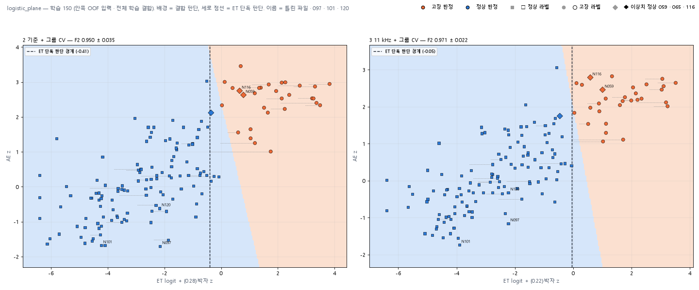
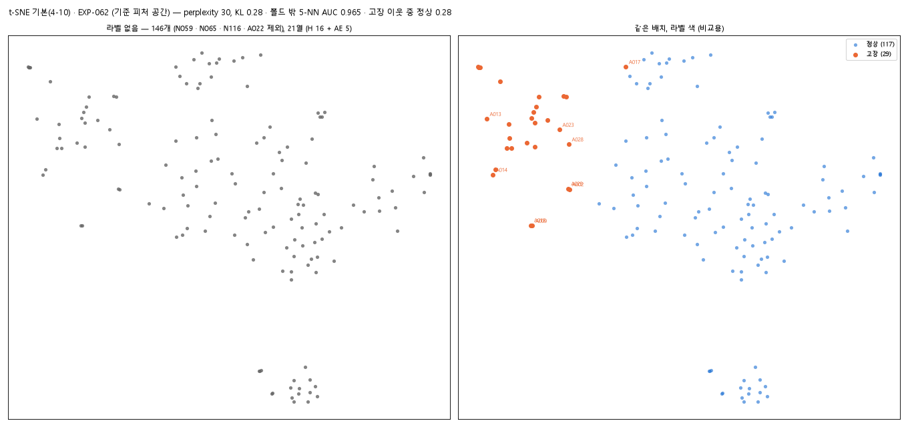
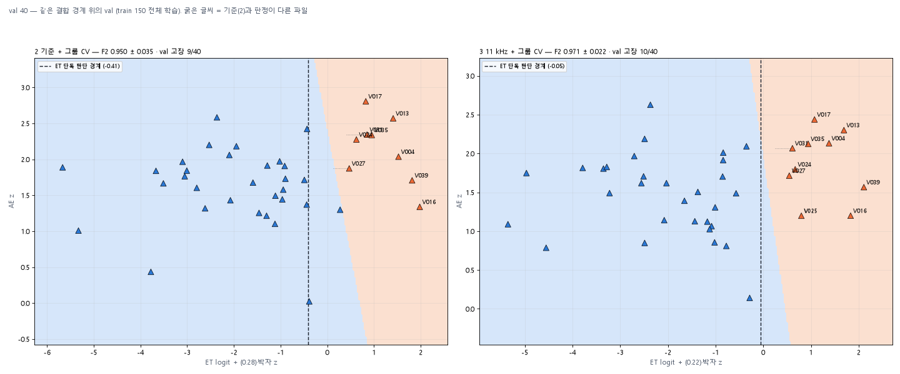

# EXP-062 11 kHz 상한 · 그룹 CV

노션 카드 (실험 DB에 그대로 옮긴다)

| 팀원 | 모델 | F2 점수 | 변경 사항 | 메모 |
|---|---|---|---|---|
| 이동훈 | J-축소 + K83 (src/final.py JShrink) · 11 kHz 상한 변형 | 0.971 ± 0.022 | CV 그룹(097 · 101 · 120 한 그룹) → 전처리 11 kHz 상한 + 검출기 1–11 kHz 대역통과. 이상치 학습 포함, full |  |

## 주요 변경점 (기준 실험 대비)

- CV 그룹: 097 · 101 · 120 한 그룹 (나머지 파일당 1그룹)
- 11 kHz 상한: 검출 · 울림 · H18 입력 1–11 kHz 대역통과, 옥타브 마지막 칸 8–11 kHz, 몫 분모 · 봉우리 · AE 입력 ≤ 11 kHz
- 이상치 정상 059 · 065 · 116 학습 포함 (11-25)
- 모델 코드 = 제출용 JShrink (8.3k 규칙 K83 포함)

- 가설: — ([물리가설](../../../1_기준·기록/물리가설.md))
- 실행: 2026-11-25 · git `bd9a50a+수정중` · 코드 [run.py](자료/run.py)
- 평가: 중첩 CV (바깥 5 × 안쪽 4) · 모드 seed 5 · ET 300. 자주 놓침 · 오경보 n회+ = seed 과반. quick 수치는 선별용, 기록 수치는 QE_FULL=1

## 결과

| 구성 | F2 | 재현율 | 오경보율 | 정밀도 | F2 (고장 10%·40%) | 자주 놓침 | 오경보 3회+ |
|---|---|---|---|---|---|---|---|
| 1 기준 (파일 그룹) | 0.977 ± 0.010 | 1.000 | 0.030 | 0.895 | 0.949 · 0.991 | — | 4 |
| 2 기준 + 그룹 CV | 0.950 ± 0.035 | 0.967 | 0.030 | 0.890 | 0.923 · 0.964 | — | 2 |
| 3 11 kHz + 그룹 CV | 0.971 ± 0.022 | 0.987 | 0.023 | 0.914 | 0.949 · 0.982 | — | 2 |

## 해석

같은 그룹 분할에서 11 kHz 상한(3)은 기준(2)보다 0.950 ± 0.035 → 0.971 ± 0.022 (+0.021, sd 안). 놓침 5회 → 2회, 오경보 18회 → 14회. 그룹 CV(2)가 파일 그룹(1, 0.977 = EXP-050 그대로, K83은 train에서 바뀌는 것 없음)보다 낮은 것은 분할이 바뀐 탓이 섞여 있다(097 · 101 · 120은 셋 다 오경보 0회).

<!-- key-figs: 자동 (save_fig key=True) -->

*logistic_plane* — 기준(2) vs 11 kHz 상한(3)의 결합 경계 (1은 전체 학습 모델이 2와 같음)

*tsne_라벨* — 기본 t-SNE(4-10, 기준 피처). 빨간 원 = 11 kHz 구성 오경보

<!-- /key-figs -->

- 그림: 왼쪽 = 기준(2), 오른쪽 = 11 kHz(3). 1은 전체 학습 모델이 2와 같아 뺐다. 11 kHz에서 결합 계수 ET 1.64 → 1.76 · 박자 0.46 → 0.39 · AE 0.47 → 0.41, 문턱 1.14 → 1.03
- 파일별 (seed 5번 중 횟수)
  - 1: 놓침 없음 · 오경보 116 5 · 025 · 059 · 065 3 · 037 2 · 073 · 110 1
  - 2: 놓침 022 2 · 009 · 014 · 028 1 · 오경보 059 · 116 5 · 065 2 · 016 · 025 · 037 · 055 · 073 · 106 1
  - 3: 놓침 021 · 028 1 · 오경보 059 · 116 5 · 065 2 · 016 · 055 1
- 규칙(전체 학습): E2 = A004 · A011 · A017 · A019, 8.3k = A002 · A003 · A006 · A010 · A029 · A030 — 세 구성 같음, 정상 0. val에서는 E2 · 8.3k 모두 0개
- val(라벨 없음, 고르지 않음): 고장 판정 9 · 9 · 10. 바뀐 파일은 V025 하나(여유 −0.09 → +1.08, 3에서 고장). 표 [val_판정.md](자료/val_판정.md)
- 한계: JShrink 안쪽 4겹 OOF(결합 입력 만들기)는 그룹을 쓰지 않는다(FinalJ와 같음). 오류분석_표는 "seed 하나라도 틀린 정상 · 5번 모두 놓친 고장" 기준이라 한두 번 놓친 고장은 위 목록에만 있다

## 그림

### val_판정
기준 vs 11 kHz 상한의 val 판정

