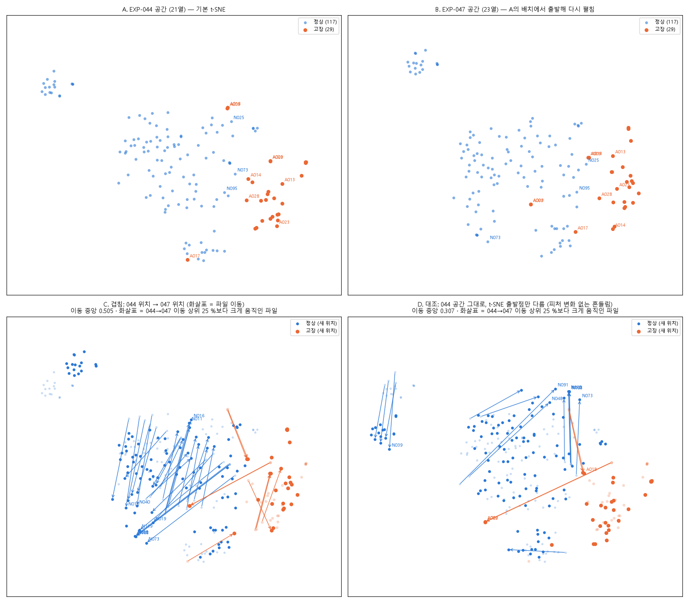
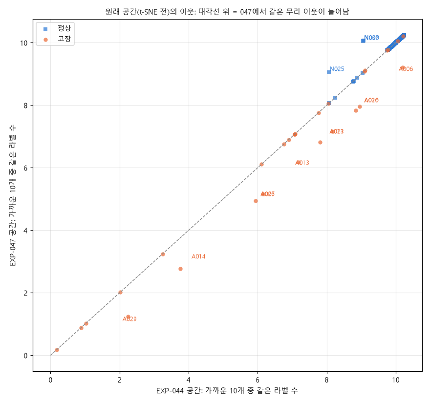
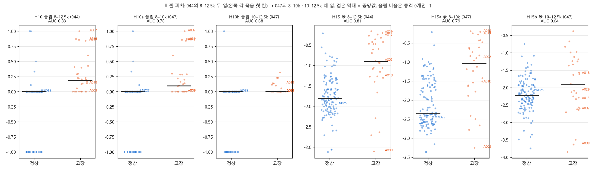
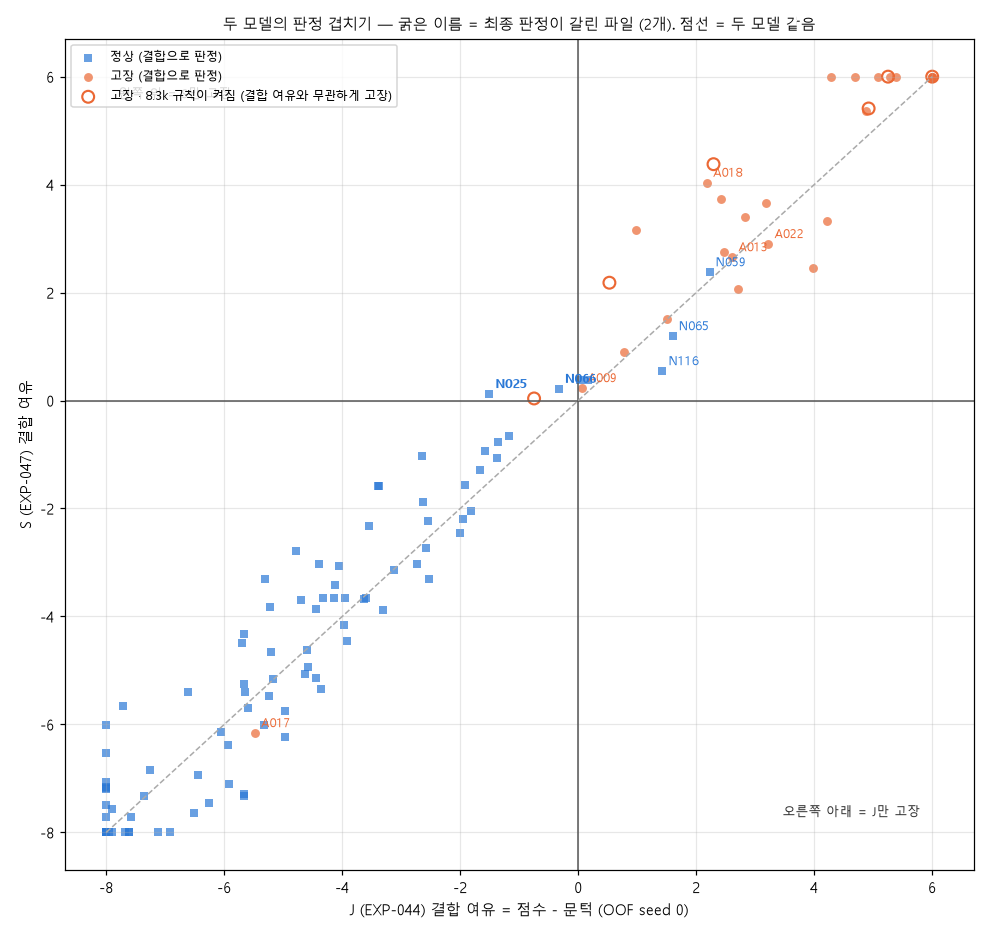

# EXP-044(J) vs EXP-047(S) — t-SNE로 모델을 고를 수 있나, 피처를 다듬어서 무엇이 달라졌나 (11-22)

**결론: t-SNE 지도의 차이로 더 좋은 모델을 고를 수는 없다. 두 지도는 t-SNE를 다시 돌릴 때 생기는 흔들림 안에서만 다르다. 047의 확실한 차이는 두 가지다. ① 정상끼리의 이웃이 조금 더 깨끗해진다(원래 공간에서 정상의 이웃 중 고장 0.005 → 0.002). ② 대신 고장끼리의 이웃은 조금 흐려진다(고장 10개가 같은 고장 이웃을 하나씩 잃음). 규칙이 맡는 고장(002 · 029, 8.3k 고장 전부 + 017)을 빼고 봐도 047이 더 잘 가르지 않는다. 두 모델의 판정은 거의 같고(결합 여유 상관 0.977), 갈린 파일은 정상 025 · 066이다. 둘 다 047만 오경보한다.**

코드 [run.py](run.py), 수치 [log.txt](log.txt). 지도 = 146개(059 · 065 · 116 · 022 제외), 두 공간 모두 기본 t-SNE 공간(`src.exp2util.tsne_space`)이다. 044는 H 16열 + AE 5열 = 21열, 047은 H10 · H15를 4열로 쪼개 23열이다.

## 1. 같은 출발점으로 펼쳐 겹치기

- **읽는 법**: A와 B는 같은 출발점에서 같은 절차로 펼친 지도다. 그래서 위치 차이는 피처 차이에서만 온다. C의 화살표는 파일이 044 위치에서 047 위치로 옮겨 간 것이다. D는 대조로, 044 공간을 그대로 두고 t-SNE 출발점만 바꾼 것이다.
- 피처를 바꾸면 지도가 움직이긴 한다. 이동 중앙이 0.51로, 출발점만 바꿨을 때(0.31)보다 크다. 하지만 **대부분 정상 무리 안에서 정상끼리 자리를 바꾼 것**이다(N092 · N118 · N103 · N073 …).
- 고장 중에서는 **002 · 029가 고장 무리에서 정상 무리 가운데로 이동**했다. 8–12.5 kHz 옥타브 한 칸이 이 둘(8.3 kHz 모드 고장)을 고장 쪽으로 묶어 주던 열이었다. 009 · 018은 고장 무리 쪽으로 조금 내려왔다.
- 047 지도에서 "경계에 놓인 고장 2개"로 보이는 002 · 029는 047이 정상 쪽으로 밀어낸 파일이다. 판정은 8.3k 규칙이 맡는다.

## 2. 지도의 차이가 흔들림보다 큰가 (숫자)

| 공간 | 원래 공간: 고장 이웃 중 정상 | 원래 공간: 정상 이웃 중 고장 | 원래 공간: 5-NN AUC | 2차원 지도 (seed 5): 고장 이웃 중 정상 | 2차원 지도: 정상 이웃 중 고장 |
|---|---|---|---|---|---|
| 044 (150 − 4) | 0.276 | 0.005 | 0.965 | 0.179 ± 0.044 | 0.017 ± 0.004 |
| 047 | 0.283 | **0.002** | 0.963 | 0.167 ± 0.023 | 0.020 ± 0.004 |
| 044, 002 · 029 제외 | 0.237 | 0.005 | 0.972 | 0.150 ± 0.028 | 0.018 ± 0.002 |
| 047, 002 · 029 제외 | 0.244 | **0.002** | 0.966 | 0.167 ± 0.021 | 0.017 ± 0.005 |
| 044, 규칙 고장 7개 제외 | 0.273 | 0.002 | 0.994 | 0.176 ± 0.021 | 0.014 ± 0.002 |
| 047, 규칙 고장 7개 제외 | 0.291 | 0.002 | 0.989 | 0.171 ± 0.009 | 0.016 ± 0.003 |

- "원래 공간"은 t-SNE 전 21 · 23차원에서 잰 값이고, "2차원 지도"는 t-SNE를 seed 5개로 돌려 그 지도 위에서 잰 값이다.
- 2차원 지도에서의 차이(0.179 vs 0.167 등)는 seed 간 표준편차(0.02–0.04) 안이다. 그림을 보고 느끼는 차이는 이 흔들림 크기다.
- 047이 일관되게 나은 것은 원래 공간의 "정상 이웃 중 고장"뿐이다(0.005 → 0.002). 정상 007 · 025 · 030이 고장 이웃 하나를 잃었다. 반대로 고장 10개(005 006 011 013 014 016 020 023 027 029)는 같은 고장 이웃을 하나씩 잃었다.

## 3. 바뀐 피처

- 044의 두 열(H10 울림 8–12.5k, H15 몫 8–12.5k)이 047에서 8–10k와 10–12.5k로 나뉘었다.
- 고장을 가르는 힘은 대부분 **8–10 kHz 칸**에 남는다(H10a 0.78, H15a 0.79).
- 10–12.5 kHz 칸은 약하다(0.68, 0.64). 이 칸에서는 정상과 고장이 많이 겹친다.
- 그래서 합친 칸(0.83, 0.81)보다 각 칸이 약하다. 009 · 018 · 013의 "8–9k ↑ · 11–12.5k ↓" 대비는 이 세 파일에만 있는 모양이다.

## 4. 두 모델 판정 겹치기

- 가로 = J의 결합 여유(점수 − 문턱), 세로 = S의 결합 여유. OOF seed 0 기준이다. 점선 위에 있으면 두 모델 판정이 같다.
- 거의 모든 파일이 점선 근처에 있다(상관 0.977).
- 판정이 갈린 것은 **정상 025 · 066** 두 개다. J는 정상, S는 오경보로 판정했다. 이 seed에서 J의 오경보는 5개, S는 7개다.
- 고장은 둘 다 30/30을 잡았다. 009 · 018 · 013은 두 모델 모두 문턱 위에서 넉넉하게 잡는다.

## 해석용이성 비교
- **t-SNE는 모델이 아니라 피처 공간의 그림**이다. 044와 047은 21열 중 2열만 다르고, 결합(로지스틱 · 규칙)은 지도에 나오지 않는다. 그래서 지도는 "피처를 바꾸면 어떤 파일이 어디로 움직이나"를 설명하는 데 쓰고, 모델 선택은 중첩 CV와 오류 표로 한다.
- 해석하기 쉬운 쪽은 **044**다. 8.3 kHz 모드 고장(002 · 029)이 고장 무리 옆에 붙어 있어, "고장 = 왼쪽 무리"라는 설명이 규칙 고장까지 이어진다. 047은 이 둘을 정상 무리 안에 두므로 "규칙이 따로 잡는다"는 설명이 하나 더 필요하다.
- 047에서 얻을 점은 "정상이 조금 더 깨끗하게 뭉친다"는 것이다. 다만 숫자로는 정상 3개의 이웃 하나 차이다.
