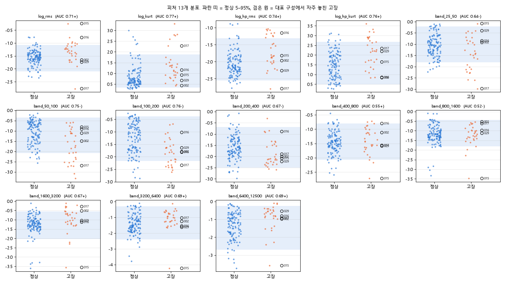
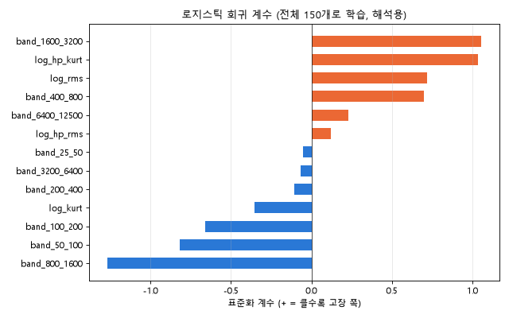
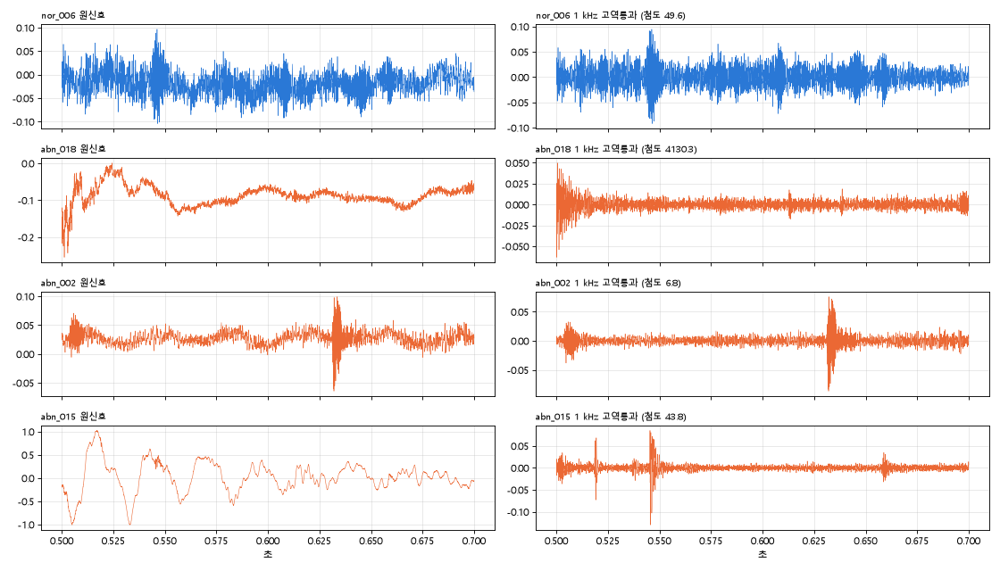
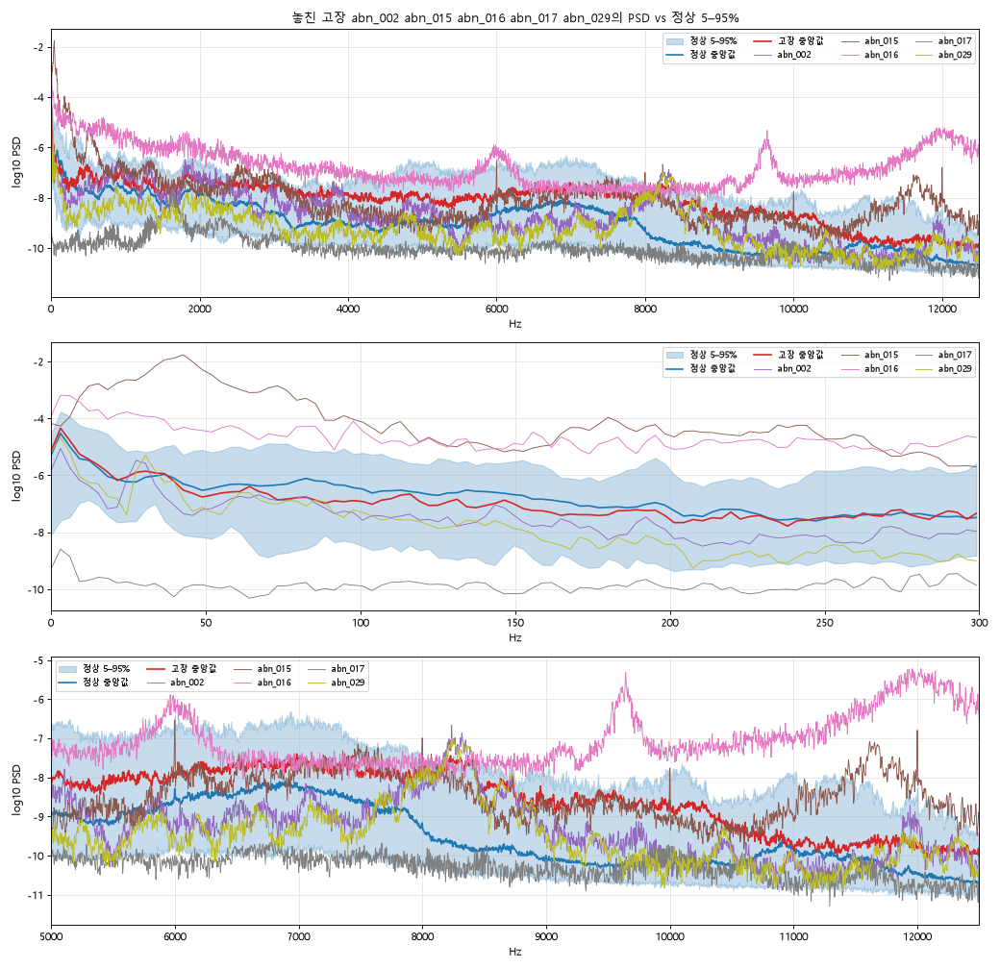
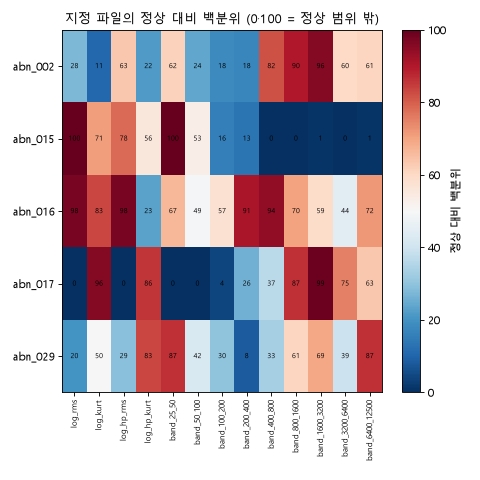
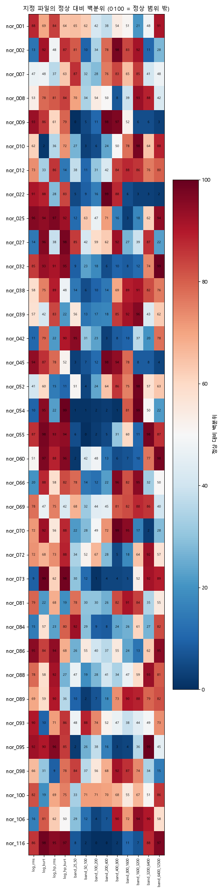

# EXP-008 RMS·첨도·고역통과·대역 에너지 + 로지스틱 회귀

노션 카드 (실험 DB에 그대로 옮긴다)

| 팀원 | 모델 | F2 점수 | 변경 사항 | 메모 |
|---|---|---|---|---|
| 이동훈 | 로지스틱 회귀 (L2, C=1) | 0.672 ± 0.049 | RMS·첨도·1 kHz 고역통과 RMS·첨도·옥타브 대역 에너지 비율 13개 + 로지스틱 | 기본 지표 13개 + 로지스틱은 0.672로 ET 계열(0.82대)보다 크게 낮다. 오경보율 0.31이 주원인이고, 놓친 고장은 피처 방향이 다른 고장과 반대라 선형 경계로는 못 잡는다 |

- 가설: — ([물리가설](../../../1_기준·기록/물리가설.md))
- 실행: 2026-11-13 · git `1771fbd+수정중` · 코드 [run.py](run.py)
- 평가: 중첩 CV (바깥 5 × 안쪽 4, seed 5개). 자주 놓침 = seed 5번 중 3번 이상

## 결과

| 구성 | F2 | 재현율 | 오경보율 | 정밀도 | F2 (고장 10%·40%) | 자주 놓침 | 오경보 3회+ |
|---|---|---|---|---|---|---|---|
| 13개 (RMS·첨도·HP 1k·대역 9) C=1 | 0.672 ± 0.049 | 0.813 | 0.310 | 0.398 | 0.535 · 0.770 | 002 015 016 017 029 | 35 |
| RMS·첨도만 (2) | 0.623 ± 0.011 | 0.747 | 0.312 | 0.377 | 0.494 · 0.716 | 002 014 017 020 022 028 029 | 38 |
| RMS·첨도 + HP 1k (4) | 0.628 ± 0.014 | 0.793 | 0.380 | 0.344 | 0.483 · 0.740 | 002 015 017 020 022 029 | 48 |
| 대역 에너지만 (9) | 0.659 ± 0.026 | 0.887 | 0.460 | 0.328 | 0.491 · 0.795 | 006 015 | 53 |
| 13개, C 안쪽 CV 선택 | 0.660 ± 0.015 | 0.807 | 0.327 | 0.382 | 0.521 · 0.761 | 002 015 016 017 023 029 | 39 |
| 13개, HP 차단 500 Hz | 0.653 ± 0.029 | 0.800 | 0.332 | 0.377 | 0.514 · 0.755 | 002 015 016 017 023 029 | 41 |
| 13개, HP 차단 2000 Hz | 0.654 ± 0.017 | 0.820 | 0.362 | 0.363 | 0.508 · 0.765 | 002 006 015 016 017 023 029 | 42 |
| 13개, HP 차단 5000 Hz | 0.664 ± 0.020 | 0.813 | 0.327 | 0.387 | 0.525 · 0.767 | 006 015 016 017 029 | 39 |

## 그림

### feature_strip
13개 피처에서 정상·고장이 갈리는가, 놓친 고장은 정상 띠 안에 있는가



### lr_coef
모델이 어떤 피처를 고장 쪽 근거로 쓰는가 (상관된 피처끼리는 계수가 나눠지거나 부호가 바뀔 수 있음)



### highpass_wave
고역통과로 저주파 운동을 빼면 충격이 드러나는가 (0.5–0.7초 확대, 위: 정상 대표·고장 HP 첨도 최대, 아래: 놓친 고장)



### psd_missed
놓친 고장의 PSD가 정상 범위(파란 띠) 밖으로 나가는 주파수가 있는가



### missed_percentile
놓친 고장의 13개 피처가 정상 분포에서 몇 백분위인가 (0·100 근처여야 잡을 수 있음)



### fp_percentile
자주 오경보한 정상 파일의 피처 백분위 (어느 피처가 정상 범위 끝에 있어 고장처럼 보였나)



## 단변량 AUC (참고, 전체 데이터. 방향 + = 고장에서 큼)

```
           feat   auc dir
       log_kurt 0.768   +
   band_100_200 0.765   -
    log_hp_kurt 0.757   +
    band_50_100 0.752   -
     log_hp_rms 0.740   +
        log_rms 0.706   +
band_6400_12500 0.694   +
 band_3200_6400 0.686   +
 band_1600_3200 0.668   +
   band_200_400 0.666   -
     band_25_50 0.636   -
   band_400_800 0.554   +
  band_800_1600 0.524   -
```

## 로지스틱 계수 (전체 데이터, 표준화)

```
band_1600_3200     1.052
log_hp_kurt        1.033
log_rms            0.720
band_400_800       0.698
band_6400_12500    0.231
log_hp_rms         0.120
band_25_50        -0.051
band_3200_6400    -0.066
band_200_400      -0.107
log_kurt          -0.352
band_100_200      -0.657
band_50_100       -0.820
band_800_1600     -1.267
```

## 대표 구성 놓친 고장·오경보

```
자주 놓침(3회+, 5개): abn_002 abn_015 abn_016 abn_017 abn_029
자주 오경보(3회+, 35개): nor_001 nor_002 nor_007 nor_008 nor_009 nor_010 nor_012 nor_022 nor_025 nor_027 nor_032 nor_038 nor_039 nor_042 nor_045 nor_052 nor_054 nor_055 nor_060 nor_066 nor_069 nor_070 nor_072 nor_073 nor_081 nor_084 nor_086 nor_088 nor_089 nor_093 nor_095 nor_098 nor_100 nor_106 nor_116
```

## 메모
기본 지표 13개 + 로지스틱은 0.672로 ET 계열(0.82대)보다 크게 낮다. 오경보율 0.31이 주원인이고, 놓친 고장은 피처 방향이 다른 고장과 반대라 선형 경계로는 못 잡는다

### 설정 (라벨 보기 전에 고정)
- 전처리: 파일 평균 제거
- 피처 13개: log RMS · log 첨도 / 1 kHz 고역통과(Butterworth 4차, 영위상) 후 log RMS · log 첨도 / 옥타브 대역(25–12500 Hz, 9개) 에너지 비율 log10
- 모델: StandardScaler + 로지스틱(L2, C=1, class_weight=balanced). 임계값은 안쪽 OOF F2 최대
- 대표 구성은 미리 정한 "13개 · C=1 · 1 kHz". 나머지 7개 구성은 해석용 (최고점을 대표로 바꾸지 않음)

### 해석
1. **피처 묶음 기여**: RMS·첨도 2개 0.623 → +고역통과 0.628 (거의 그대로) → +대역 13개 0.672. 대역 에너지만으로도 0.659(재현율 0.887). 스펙트럼 모양(대역 비율)이 크기·첨도보다 정보가 많다
2. **C·차단 주파수 민감도 작음**: C 안쪽 선택 0.660, 차단 500/2000/5000 Hz 0.653–0.664. 모두 대표 구성의 ±1 sd 안 → 설정 문제 아님
3. **오경보가 핵심 약점**: 오경보율 0.31 (정상 35개가 5번 중 3번 이상 오경보). 정상 분포가 넓게 퍼져 있어(feature_strip 파란 점) 고장 쪽으로 기운 정상이 많다. F2가 재현율을 4배 무겁게 보므로 안쪽 CV가 임계값을 낮게 잡는 것도 한몫
4. **놓친 고장 5개 (002 015 016 017 029)는 "반대 방향" 고장**: missed_percentile에서
   - 015: RMS 100백분위(정상보다 큼)인데 800 Hz 이상 대역 비율은 0–1백분위(정상보다 작음) → 대다수 고장(고주파 비율↑)과 반대
   - 017: RMS·고역통과 RMS 0백분위(정상보다 작음) → 대다수 고장(RMS↑)과 반대
   - 002·029: 대부분 피처가 정상 20–90백분위 안 → 이 13개로는 정상과 구분 불가
   로지스틱은 피처마다 한 방향(클수록 고장 또는 작을수록 고장)만 쓰므로, 정상 범위 **양쪽 바깥**으로 벗어나는 고장을 함께 잡지 못한다
5. **계수 부호 주의**: log_kurt는 단변량 AUC 0.77(고장에서 큼)인데 계수는 음수. log_hp_kurt와 강하게 상관되어 계수가 나눠진 결과라, 계수를 피처 중요도로 읽으면 안 된다

### 다음에 해볼 것
- 방향 문제: 피처를 "정상 중앙값에서 벗어난 정도"(|robust z|, 폴드 안 정상으로 계산)로 바꾸면 선형 모델도 양쪽 이탈을 잡을 수 있다
- 같은 13개 피처로 트리 모델(ET)을 돌려 피처 탓인지 모델 탓인지 분리
