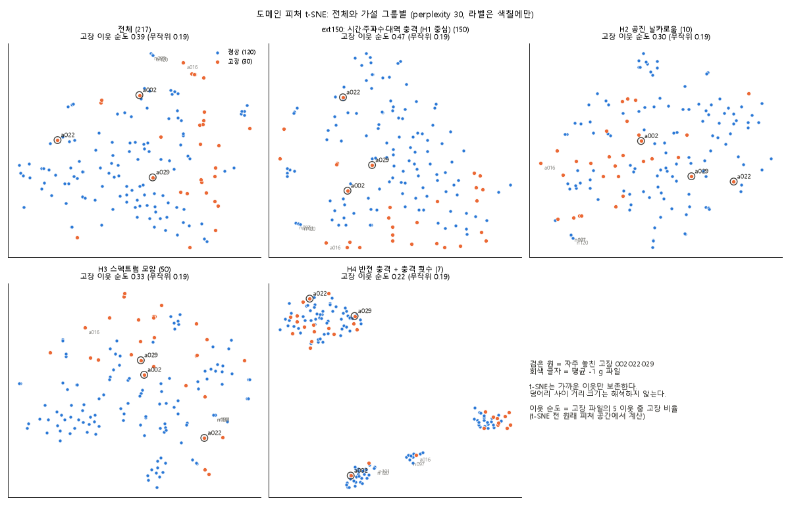
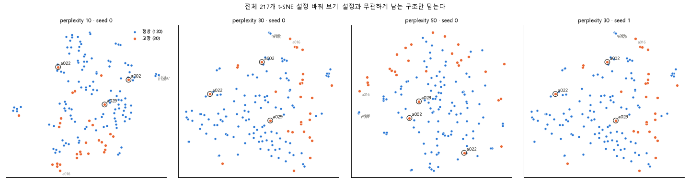
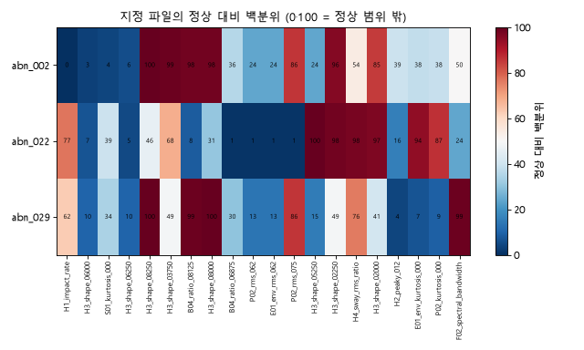

# EXP-010 도메인 피처 전체 t-SNE

노션 카드 (실험 DB에 그대로 옮긴다)

| 팀원 | 모델 | F2 점수 | 변경 사항 | 메모 |
|---|---|---|---|---|
| 이동훈 | — (비지도 시각화) |  | 도메인 피처 전체(ext150 + phys H2·H3·H4)와 가설 그룹별 t-SNE (H1, H2, H3, H4) |  |

- 가설: H1, H2, H3, H4 ([물리가설](../../../1_기준·기록/물리가설.md))
- 실행: 2026-11-13 · git `1771fbd+수정중` · 코드 [run.py](run.py)

## 그림

### psd_focus
놓친 고장의 PSD가 정상 범위(파란 띠) 밖으로 나가는 주파수가 있는가


### tsne_groups
어느 피처 그룹에서 고장이 정상과 따로 모이는가. 놓친 고장 3개는 그룹마다 정상 속에 있는가



### tsne_all_stability
perplexity·seed를 바꿔도 고장 무리·놓친 고장 위치가 그대로인가



### focus_extreme
놓친 고장 3개가 정상 분포 끝(0·100 근처)에 걸리는 피처가 무엇인가 (파일별 상·하위 4개)



## 이웃 순도 (고장 파일의 5 이웃 중 고장 비율, 무작위 0.19)

```
                                그룹  피처수  순도_원공간  순도_tSNE  a002  a022  a029
                          전체 (217)  217   0.393    0.527   0.0   0.0   0.2
ext150: 시간·주파수·대역 충격 (H1 중심) (150)  150   0.467    0.473   0.2   0.0   0.0
                   H2 공진 날카로움 (10)   10   0.300    0.360   0.4   0.0   0.4
                   H3 스펙트럼 모양 (50)   50   0.333    0.487   0.0   0.0   0.4
              H4 반전 충격 + 충격 횟수 (7)    7   0.220    0.267   0.0   0.2   0.0
```

## 메모
- 도메인 피처 전체 217개(ext150 150 + phys 67)로 펼쳐도 고장이 한 덩어리로 모이지 않는다. 고장은 가장자리에 흩어지는 경향(perplexity·seed를 바꿔도 같음)
- 고장 이웃 순도(무작위 0.19): ext150 0.47 > 전체 0.39 > H3 0.33 > H2 0.30 > H4 0.22. phys를 더하면 오히려 순도가 내려감 → 거리 기반에서는 정보 없는 피처가 희석시킨다 (트리 모델과 다름)
- H4는 t-SNE에서 섬 4개로 갈라지지만 섬마다 정상·고장이 섞여 있어(순도 0.22 ≈ 무작위) 고장과 무관한 구조. 섬은 H4_rev_count 같은 이산값 때문으로 추정 (미확인)
- 놓친 고장 002·022·029: 모든 그룹에서 이웃 5개가 거의 다 정상(고장 비율 0–0.4)
- 217개 중 정상 범위 밖(백분위 0·100) 피처 수: 002 2개, 022 1개, 029 2개. 우연 기대값 약 3.6개보다 적다 → 이 세 파일은 지금 피처로는 정상과 통계적으로 구별되지 않는다. 잡히는 고장 009·015·017은 27–33개
- 단, 002와 029가 같은 H3_shape_08250(8.25–8.5 kHz 모양)에서 둘 다 정상 최댓값 위. EXP-005의 8.2–8.4 kHz 협대역 피크(H2)와 같은 곳 → 이 대역의 좁은 피크를 정밀하게 재는 피처가 다음 후보
- 022는 H3_shape_05250만 100, P02·E01 625 Hz–1.25 kHz 대역 RMS가 1 백분위로 낮음(조용한 고장)
