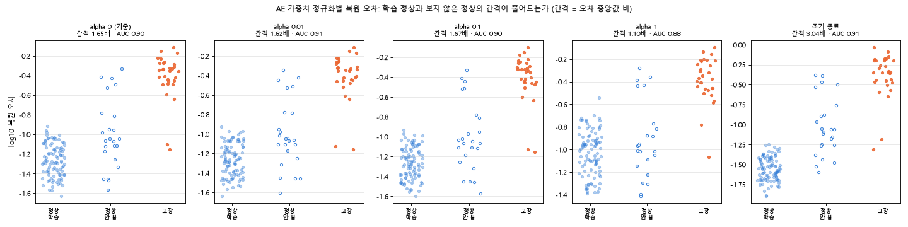
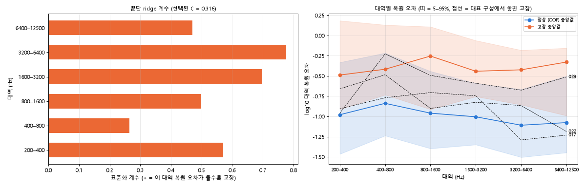
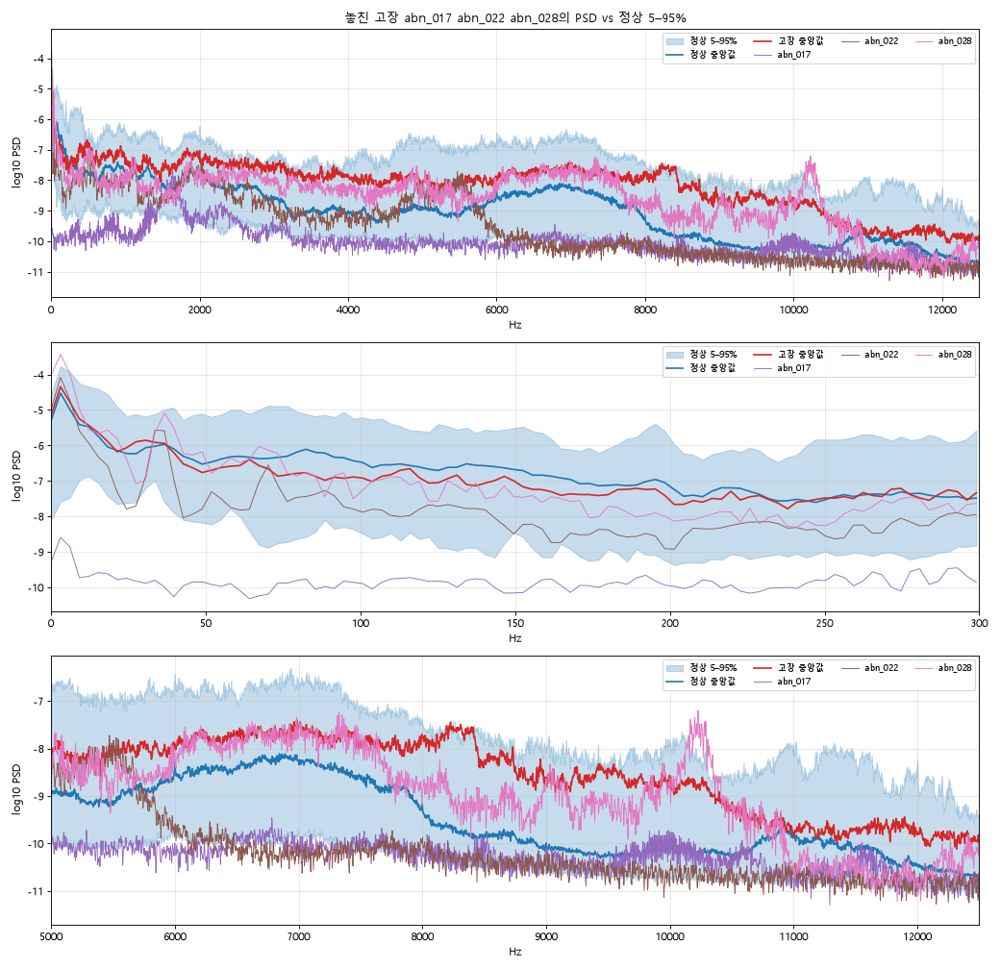

# EXP-013 스펙트럼 AE 정규화 — 가중치 L2·조기 종료 vs 끝단 ridge

노션 카드 (실험 DB에 그대로 옮긴다)

| 팀원 | 모델 | F2 점수 | 변경 사항 | 메모 |
|---|---|---|---|---|
| 이동훈 | 스펙트럼 AE + 끝단 L2 로지스틱 | 0.794 ± 0.050 | EXP-012 AE의 대역별 복원 오차(6개, 폴드 안 OOF) → L2 로지스틱 | 정규화로는 개선되지 않았다. 끝단 ridge(6대역)는 0.794로 오히려 하락, 가중치 L2·조기 종료는 기준(0.832)의 ±1 sd 안. 오탐 정상 7개는 모든 구성에서 그대로라 과적합이 아니라 원래 특이한 정상이다 |

- 가설: — ([물리가설](../../../1_기준·기록/물리가설.md))
- 실행: 2026-11-13 · git `1771fbd+수정중` · 코드 [run.py](run.py)
- 평가: 중첩 CV (바깥 5 × 안쪽 4, seed 5개). 자주 놓침 = seed 5번 중 3번 이상

## 결과

| 구성 | F2 | 재현율 | 오경보율 | 정밀도 | F2 (고장 10%·40%) | 자주 놓침 | 오경보 3회+ |
|---|---|---|---|---|---|---|---|
| B. 끝단 ridge: 대역 6개 오차 → L2 로지스틱 | 0.794 ± 0.050 | 0.873 | 0.155 | 0.587 | 0.697 · 0.855 | 017 022 028 | 16 |
| B. 끝단 ridge: bin 1025개 오차 → L2 로지스틱 | 0.832 ± 0.022 | 0.867 | 0.085 | 0.720 | 0.769 · 0.868 | 014 017 022 029 | 9 |
| 기준 EXP-012 (alpha 0, 60 epoch) | 0.832 ± 0.027 | 0.853 | 0.068 | 0.758 | 0.780 · 0.861 | 005 014 017 022 | 7 |
| A. AE 가중치 L2 alpha 0.01 | 0.828 ± 0.020 | 0.847 | 0.067 | 0.762 | 0.777 · 0.856 | 005 014 017 022 | 7 |
| A. AE 가중치 L2 alpha 0.1 | 0.841 ± 0.023 | 0.867 | 0.072 | 0.756 | 0.786 · 0.871 | 005 014 017 022 | 7 |
| A. AE 가중치 L2 alpha 1 | 0.806 ± 0.013 | 0.833 | 0.085 | 0.714 | 0.744 · 0.840 | 005 014 017 022 025 | 9 |
| A. AE 조기 종료 | 0.826 ± 0.017 | 0.847 | 0.070 | 0.755 | 0.773 · 0.855 | 005 014 017 022 028 | 6 |

## 그림

### overfit_gap
정규화를 세게 할수록 학습 정상·보지 않은 정상의 간격(과적합)이 줄고, 고장과의 분리는 유지되는가



### ridge_head
끝단 ridge가 어느 대역의 복원 오차를 고장 근거로 쓰는가, 놓친 고장은 대역 오차가 정상 띠 안인가



### psd_missed
놓친 고장의 PSD가 정상 범위(파란 띠) 밖으로 나가는 주파수가 있는가



## 구성별 미탐·오탐 파일 (seed 5번 중 3번 이상)

```
B. 끝단 ridge: 대역 6개 오차 → L2 로지스틱
  미탐: 017 022 028
  오탐: 009 010 022 025 030 037 039 045 054 055 059 062 065 072 106 116
B. 끝단 ridge: bin 1025개 오차 → L2 로지스틱
  미탐: 014 017 022 029
  오탐: 025 045 054 055 059 062 086 106 116
기준 EXP-012 (alpha 0, 60 epoch)
  미탐: 005 014 017 022
  오탐: 025 039 055 059 062 106 116
A. AE 가중치 L2 alpha 0.01
  미탐: 005 014 017 022
  오탐: 025 039 055 059 062 106 116
A. AE 가중치 L2 alpha 0.1
  미탐: 005 014 017 022
  오탐: 025 039 055 059 062 106 116
A. AE 가중치 L2 alpha 1
  미탐: 005 014 017 022 025
  오탐: 039 055 059 060 062 065 072 106 116
A. AE 조기 종료
  미탐: 005 014 017 022 028
  오탐: 025 039 055 059 062 106
```

## 과적합 간격 (정상 96개 학습)

```
alpha 0 (기준)   보지 않은 정상/학습 정상 오차 중앙값 비 = 1.65 · 보지 않은 정상 vs 고장 AUC = 0.901
alpha 0.01     보지 않은 정상/학습 정상 오차 중앙값 비 = 1.62 · 보지 않은 정상 vs 고장 AUC = 0.906
alpha 0.1      보지 않은 정상/학습 정상 오차 중앙값 비 = 1.67 · 보지 않은 정상 vs 고장 AUC = 0.903
alpha 1        보지 않은 정상/학습 정상 오차 중앙값 비 = 1.10 · 보지 않은 정상 vs 고장 AUC = 0.882
조기 종료          보지 않은 정상/학습 정상 오차 중앙값 비 = 3.04 · 보지 않은 정상 vs 고장 AUC = 0.910
```

## 끝단 ridge 계수 (전체 데이터, 6대역)

```
200–400      +0.571
400–800      +0.264
800–1600     +0.499
1600–3200    +0.699
3200–6400    +0.776
6400–12500   +0.470
C = 0.316
```

## 메모
정규화로는 개선되지 않았다. 끝단 ridge(6대역)는 0.794로 오히려 하락, 가중치 L2·조기 종료는 기준(0.832)의 ±1 sd 안. 오탐 정상 7개는 모든 구성에서 그대로라 과적합이 아니라 원래 특이한 정상이다

### 해석
1. **대표 구성(끝단 ridge, 6대역) 0.794**: 재현율은 0.873으로 가장 높지만 오경보율이 0.068 → 0.155로 두 배. 6대역 계수가 모두 + (모든 대역 오차가 고장 근거)라서 오차 평균과 같은 정보를 쓰되, 임계값이 더 낮게 잡혔다. 학습 정상 오차(AE 1개, OOF)와 테스트 오차(AE 4개 평균)의 산포가 다른 것도 원인 후보
2. **bin 1025개 ridge 0.832**: 기준과 같음. 끝단에 분류기를 얹어도 복원 오차 평균 이상의 정보를 못 얻는다
3. **가중치 L2**: alpha 0.01 0.828 / 0.1 0.841 / 1 0.806. 0.1이 가장 높지만 기준과 차이 +0.009 < sd 0.023이고 격자 3개 중 최고라 선택 편향 → 채택 근거 없음. alpha 1은 간격을 1.65 → 1.10배로 줄였지만 overfit_gap 그림에서 보듯 **학습 정상 오차가 올라가서**(덜 학습) 줄어든 것이고, 보지 않은 정상은 그대로 퍼져 있다 → AUC 0.90 → 0.88, F2 하락
4. **조기 종료는 정규화가 안 됐다**: 간격이 오히려 3.04배로 커짐. 검증 10%를 "구간" 단위로 뽑아서, 같은 파일의 겹치는 구간이 학습·검증에 나뉘어 들어가 검증 오차가 학습 오차를 따라간다(누수) → 더 오래 학습. 하려면 파일 단위로 검증을 나눠야 한다
5. **핵심 — 오탐은 과적합 탓이 아니다**: 오탐 정상 025 039 055 059 062 106 116이 alpha·조기 종료·끝단 ridge 어느 구성에서도 거의 그대로다. 보지 않은 정상 중 일부는 오차가 고장 수준(-0.4)까지 올라가는데, 정규화 세기와 무관하게 같은 위치다. 즉 "AE가 정상을 외워서"가 아니라 이 정상 파일들의 스펙트럼이 다른 정상과 실제로 다르다
6. 미탐 017·022는 모든 구성에서 놓침. 대역별 복원 오차도 정상 띠 안(ridge_head 오른쪽) → AE 계열로는 잡을 수 없는 고장

### 다음 후보
- 오탐 정상 7개를 정상 5–95% 범위와 겹쳐 그려 무엇이 다른지 확인 (측정 조건? 단발 충격?)
- 017·022는 AE가 아닌 다른 정보원(피처 모델)과 결합할 때만 기대 가능
