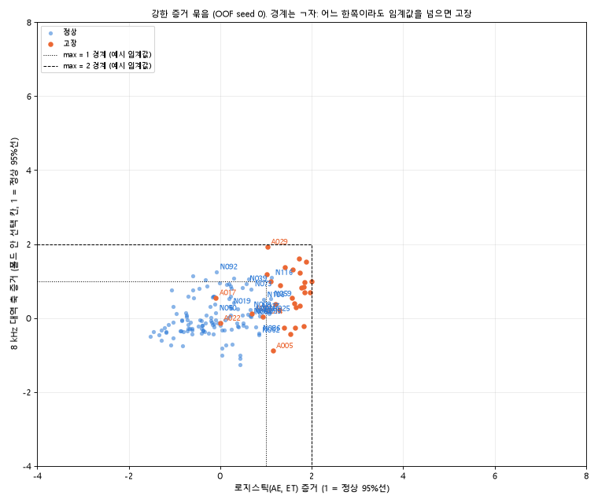
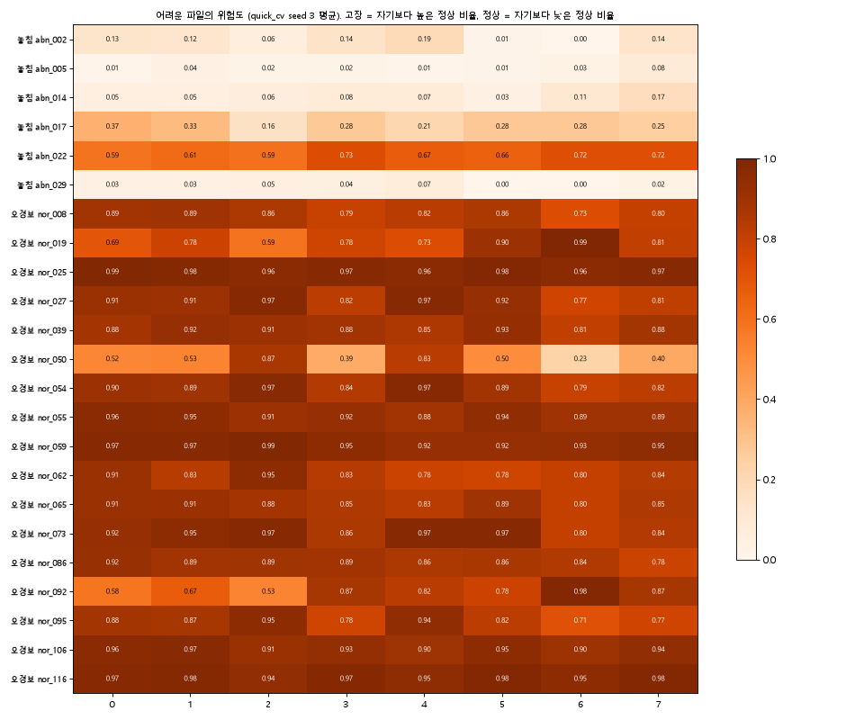
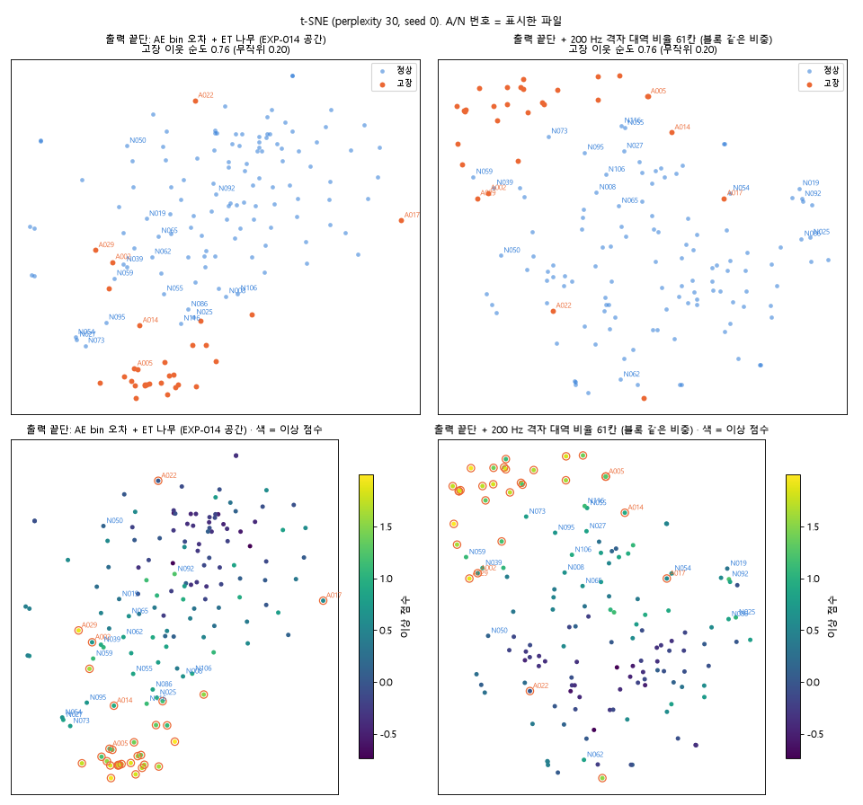
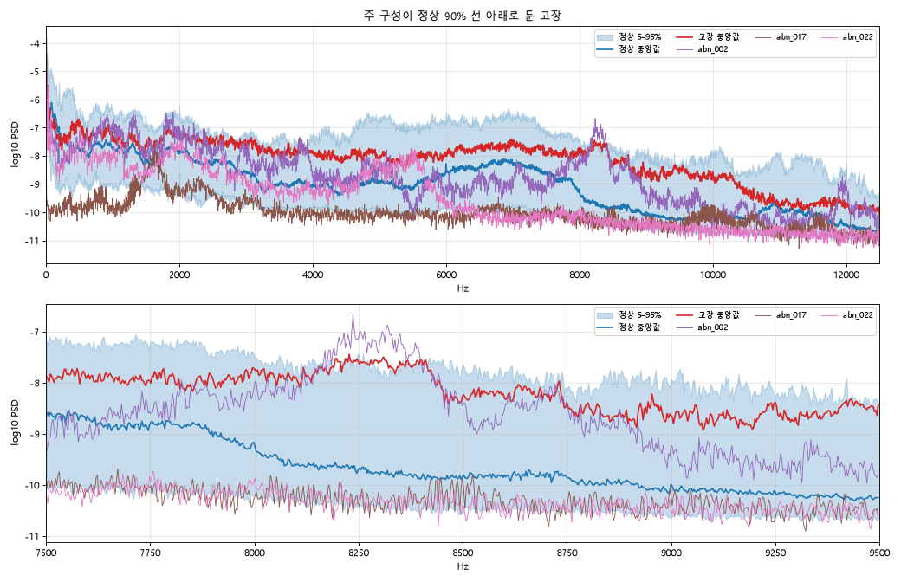

# EXP-017 강한 증거 묶음 결합 + 8.25 kHz 대역 축 (2-10)

노션 카드 (실험 DB에 그대로 옮긴다)

| 팀원 | 모델 | F2 점수 | 변경 사항 | 메모 |
|---|---|---|---|---|
| 이동훈 | ET + AE → 로지스틱 ∨ 8 kHz 대역 축 (강한 증거 최댓값) | 0.815 ± 0.034 | EXP-014 로지스틱 점수와 200 Hz 격자 대역 비율 축(폴드 안 선택)을 정상 95%선 기준으로 맞춰 최댓값 (H1, H2, H3) |  |

- 가설: H1, H2, H3 ([물리가설](../../../1_기준·기록/물리가설.md))
- 실행: 2026-11-14 · git `1771fbd+수정중` · 코드 [run.py](run.py)
- 평가: 중첩 CV (바깥 5 × 안쪽 4, seed 5개). 자주 놓침 = seed 5번 중 3번 이상

## 결과

| 구성 | F2 | 재현율 | 오경보율 | 정밀도 | F2 (고장 10%·40%) | 자주 놓침 | 오경보 3회+ |
|---|---|---|---|---|---|---|---|
| 중첩: 3 강한 증거: 로지스틱 ∨ 8k 격자 (주) | 0.815 ± 0.034 | 0.887 | 0.138 | 0.622 | 0.723 · 0.870 | 002 014 017 022 | 16 |
| 중첩: 0 기준: 로지스틱(AE, ET) (EXP-014) (같은 코드로 재계산) | 0.857 ± 0.031 | 0.880 | 0.063 | 0.780 | 0.807 · 0.884 | 002 014 017 022 | 6 |

## 그림

### strong_evidence
A002·A029가 위쪽(8 kHz 축)으로 올라가 ㄱ자 경계를 넘는가, N059·N062는 아래에 남는가, 새로 위로 올라오는 정상(N019·N092)은 몇 개인가



### hard_files
강한 증거 묶음(2·3·4)이 002·029·017을 옅게 하는가, 오경보(특히 019·092·059·062)를 진하게 하지 않는가



### tsne
대역 비율을 더하면 002·029가 고장 무리 쪽으로 가는가. 2행 색 = 주 구성(강한 증거 ∨ 8k)의 OOF 점수(seed 0)



### psd_missed
놓친 고장의 PSD가 정상 범위(파란 띠) 밖으로 나가는 주파수가 있는가 (아래: 7.5–9.5 kHz 확대)



## quick_cv 결과 (5-fold × seed 3, 임계값 없음)

```
0 기준: 로지스틱(AE, ET) (EXP-014)               PR-AUC 0.929 ± 0.000 · ROC-AUC 0.960 ± 0.001
1 로지스틱(AE, ET, 8k 격자) — 선형 입력              PR-AUC 0.924 ± 0.005 · ROC-AUC 0.959 ± 0.001
2 강한 증거: 로지스틱 ∨ AE ∨ ET (8k 없이)            PR-AUC 0.926 ± 0.005 · ROC-AUC 0.965 ± 0.004
3 강한 증거: 로지스틱 ∨ 8k 격자 (주)                  PR-AUC 0.923 ± 0.006 · ROC-AUC 0.955 ± 0.002
4 강한 증거: 로지스틱 ∨ ET ∨ 8k 격자                 PR-AUC 0.919 ± 0.010 · ROC-AUC 0.956 ± 0.006
5 [사후] 로지스틱(AE, ET, 8.2–8.4k)              PR-AUC 0.948 ± 0.002 · ROC-AUC 0.966 ± 0.000
6 [사후] 강한 증거: 로지스틱 ∨ 8.2–8.4k              PR-AUC 0.924 ± 0.002 · ROC-AUC 0.958 ± 0.001
7 q 민감도: 3을 q = 99로                        PR-AUC 0.891 ± 0.014 · ROC-AUC 0.945 ± 0.006
```

## 0 정상 90% 선 아래 고장 · 정상 상위 5%

```
고장: 002 017 022
정상: 025 055 059 106 116
```

## 1 정상 90% 선 아래 고장 · 정상 상위 5%

```
고장: 002 017 022
정상: 025 059 073 106 116
```

## 2 정상 90% 선 아래 고장 · 정상 상위 5%

```
고장: 017 022
정상: 025 027 054 059 073
```

## 3 정상 90% 선 아래 고장 · 정상 상위 5%

```
고장: 002 017 022
정상: 025 059 116
```

## 4 정상 90% 선 아래 고장 · 정상 상위 5%

```
고장: 002 017 022
정상: 025 027 054 073
```

## 5 정상 90% 선 아래 고장 · 정상 상위 5%

```
고장: 017 022
정상: 025 073 106 116
```

## 6 정상 90% 선 아래 고장 · 정상 상위 5%

```
고장: 014 017 022
정상: 019 025 088 092 116 119
```

## 7 정상 90% 선 아래 고장 · 정상 상위 5%

```
고장: 002 014 017 022
정상: 025 116
```

## 폴드 안에서 고른 200 Hz 격자 칸 (quick_cv 학습 분할 15개)

```
G08200 ×6 · G09600 ×9
```

## 메모
강한 증거 묶음은 희석을 줄이지 못하고 오경보만 늘렸다. 주 구성의 중첩 F2는 0.815 ± 0.034로, 기준 0.857보다 낮고 오경보율은 0.063에서 0.138로 두 배다. 회색지대 고장은 어느 축에서도 "강한" 증거가 아니라 정상 꼬리를 겨우 넘는 정도라서, OR을 허용하면 정상 꼬리도 함께 넘어온다

### 평가 방식
- 구성 비교는 quick_cv(5-fold × seed 3)로 했다
- 주 구성(3, 실행 전 지정)과 기준(0)은 중첩 CV까지 돌렸다. 기준은 같은 코드로 다시 계산해 EXP-014와 똑같이 0.857 ± 0.031이 나왔다 → 공용 모듈로 옮긴 코드가 같은 결과를 낸다
- [사후] 구성(5·6)은 2-10에서 그림을 보고 고른 대역이라 채택 근거로 쓰지 않는다

### 해석
1. **주 구성(로지스틱 ∨ 8k 격자)**
   - quick_cv 0.923, 중첩 F2 0.815. 재현율은 0.887로 거의 같지만 오경보율이 0.138로 두 배다
   - 놓치는 고장(002 014 017 022)은 그대로다
2. **왜 강한 증거가 안 통하나 (strong_evidence)**
   - 1 = 정상 95%선인 척도에서 A029가 8k 축 1.9이고, A002는 그보다 낮다
   - 그런데 정상 N092·N039·N019·N116도 1.0–1.2에 있다(2-10에서 본 "바로 아래 nor_019·092")
   - 회색지대 고장은 정상 꼬리에서 **조금** 벗어날 뿐 강하게 벗어나지 않는다. 그래서 ㄱ자 경계는 고장 몇 개를 얻는 대신 정상 꼬리 여러 개를 함께 넘긴다
   - "한쪽이 강하게 고장"인 경우가 데이터에 없으면 묶음 결합은 OR과 같아진다
3. **격자 칸 선택이 불안정하다**: 학습 분할 15개 중 8.2 kHz 칸 6번, 9.6 kHz 칸 9번. 2-10 단변량 AUC 1·2위(0.79 동률)가 폴드마다 뒤바뀐다. 9.6 kHz가 뽑히면 002·029에 특이적인 축이 아니게 된다
4. **8.2–8.4 kHz를 선형 입력으로 넣은 사후판 0.948 ± 0.002**
   - 지금까지 quick_cv 최고 점수이고, 정직판(격자 선택, 0.924)과의 차이가 0.024다
   - 이 차이는 "라벨을 보고 대역을 고른 이득"의 추정치다. 원칙 3에 따라 채택하지 않는다
   - 물리 근거(H2′: 8.3 kHz 모드가 고장에서 크게 들뜸)는 있다. 하지만 근거가 같은 150개 파일에서 나왔다
5. **q = 99(더 엄격)는 0.891로 더 나쁘다**: 정상 OOF 90여 개에서 99%선은 사실상 최댓값이라 추정이 흔들린다
6. 강한 증거 2(로지스틱 ∨ AE ∨ ET)는 0.926으로 기준과 같다. 017·002는 조금 나아지지만 ET 쪽 오경보(027 054 073)가 올라와 맞바꾼다

### 결론
- 희석의 원인은 결합 규칙이 아니라, 회색지대 고장의 증거가 어느 축에서도 약하다는 데 있다. 결합 규칙을 바꿔도 점수가 고장 쪽과 정상 쪽을 맞바꿀 뿐이다
- 최종 후보는 **EXP-014 로지스틱 결합 그대로**: 중첩 F2 0.857 ± 0.031, 재현율 0.880, 오경보율 0.063
- 8.25 kHz 축은 "사후 관찰, 미검증 가설 H2′"로 발표에 남긴다. 확인하려면 이 데이터 밖의 파일이 필요하다(test 공개 후 비교만, 모델 선택에는 쓰지 않음)
