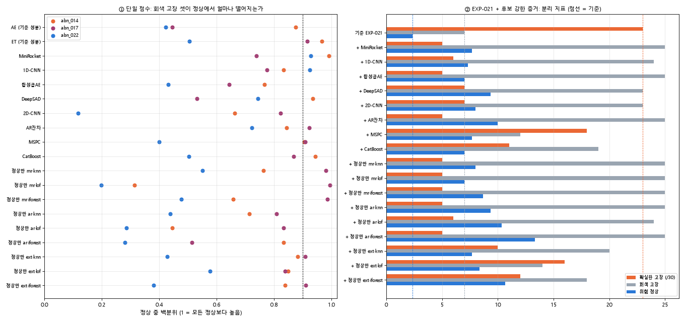

# EXP-023 회색 고장 014·017·022 전용 모델 찾기 (국소 이상 + 강한 증거 결합)

노션 카드 (실험 DB에 그대로 옮긴다)

| 팀원 | 모델 | F2 점수 | 변경 사항 | 메모 |
|---|---|---|---|---|
| 이동훈 | EXP-021 + 후보 단일 점수(정상만 학습 국소 이상 포함)를 강한 증거(max, 정상 99%선)로 |  | EXP-021 결합은 그대로, 후보가 정상 99%선을 넘을 때만 고장으로 올림 (H1, H2, H3) |  |

- 가설: H1, H2, H3 ([물리가설](../../../1_기준·기록/물리가설.md))
- 실행: 2026-11-14 · git `8e4525e+수정중` · 코드 [run.py](run.py)

## 해석

세 파일을 한 모델로 정상과 가르는 방법은 없었다. 단일 점수 19개 중 셋 다 정상 중 0.90을 넘는 것은 0개이고, 파일마다 잡는 모델이 다르다. 강한 증거(OR) 결합은 17개 모두 기준보다 나빠졌다(확실한 고장 23 → 5–18). 통과 조건을 만족한 결합이 없어 중첩 CV는 하지 않았다 → 기각

1. **① 단일 점수 (정상 중 백분위, 1 = 모든 정상보다 높음)**

   | 고장 | 가장 잘 보는 모델 | 그 위에 있는 정상 수 (약) | 기준 성분 |
   |---|---|---|---|
   | 014 | MiniRocket 0.99 · ET 0.97 | 1–4개 | AE 0.88 · ET 0.97 |
   | 017 | 정상만 MiniRocket LOF 0.99 · iforest 0.99 · kNN 0.98 · ET 0.92 · AR잔차 0.92 | 1–2개 | **AE 0.44** · ET 0.92 |
   | 022 | MiniRocket 0.93 · 1D-CNN 0.92 | **8–10개** | AE 0.42 · ET 0.51 |

   - **014·017은 ET 하나로 이미 0.92–0.97이다.** EXP-021에서 회색인 이유는 모델이 없어서가 아니라 AE와 섞을 때 AE가 끌어내리기 때문이다(017 AE 0.44)
   - 017은 정상만 학습한 MiniRocket 이상 점수(LOF·iforest)에서 0.99다. "다수 고장과 닮지 않았지만 정상 무리 밖"인 파일이다
   - **022는 어떤 모델에서도 정상 8개 이상이 위에 있다.** 확실한 분리는 불가능하고, 잡으려면 오경보 8개 정도를 감수해야 한다
2. **② 강한 증거 결합이 모두 실패한 이유**
   - max 결합은 고장만 올리는 게 아니라, 후보 점수가 높은 정상도 그대로 올린다. 후보마다 정상 꼬리(정상 중 상위 1–5%)가 서로 다른 파일이라 꼬리가 합쳐진다(EXP-017과 같은 교훈)
   - 그래서 "모든 정상보다 높음" 기준의 확실한 고장이 23 → 5–18로 줄었다. 위험 정상도 2.3 → 7–13으로 늘었다
   - 017은 + MiniRocket iforest 0.98 · LOF 0.96으로 올라갔지만, 같은 결합에서 회색 고장이 25개가 됐다
3. **결론 (모델 단위)**
   - 세 파일은 서로 다른 축에서만 정상과 떨어진다. 한 파일을 올리는 모델은 다른 정상 몇 개도 같이 올린다 → 모델을 더 붙이는 방식으로는 확실한 분리를 만들 수 없다
   - 남은 선택지
     - (a) 017: "AE를 덜 믿어야 하는 파일"을 라벨 없이 구분하는 조건(게이트)을 찾는다
     - (b) 022: 파형 단서를 피처로 정의한다. 모델로는 오경보 8개가 대가다
     - (c) 022는 현재 정보로 분리 불가로 받아들이고 발표에 근거와 함께 남긴다

### gray_targets
어떤 모델이 014·017·022를 정상 무리 밖(0.9+)으로 보내는가, 강한 증거로 붙이면 회색 고장이 줄고 오경보는 늘지 않는가

