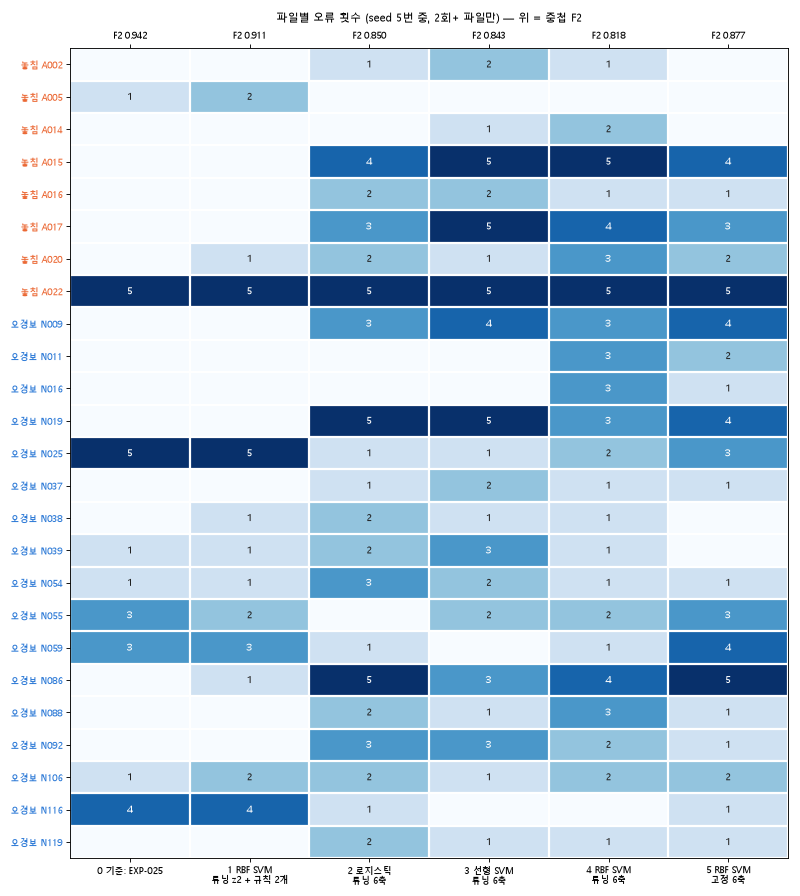
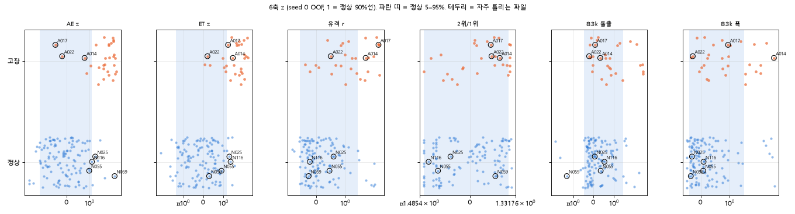
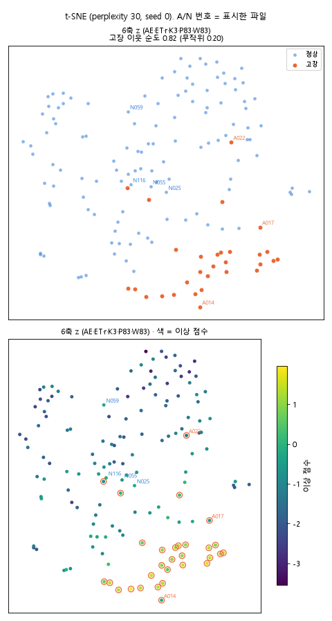
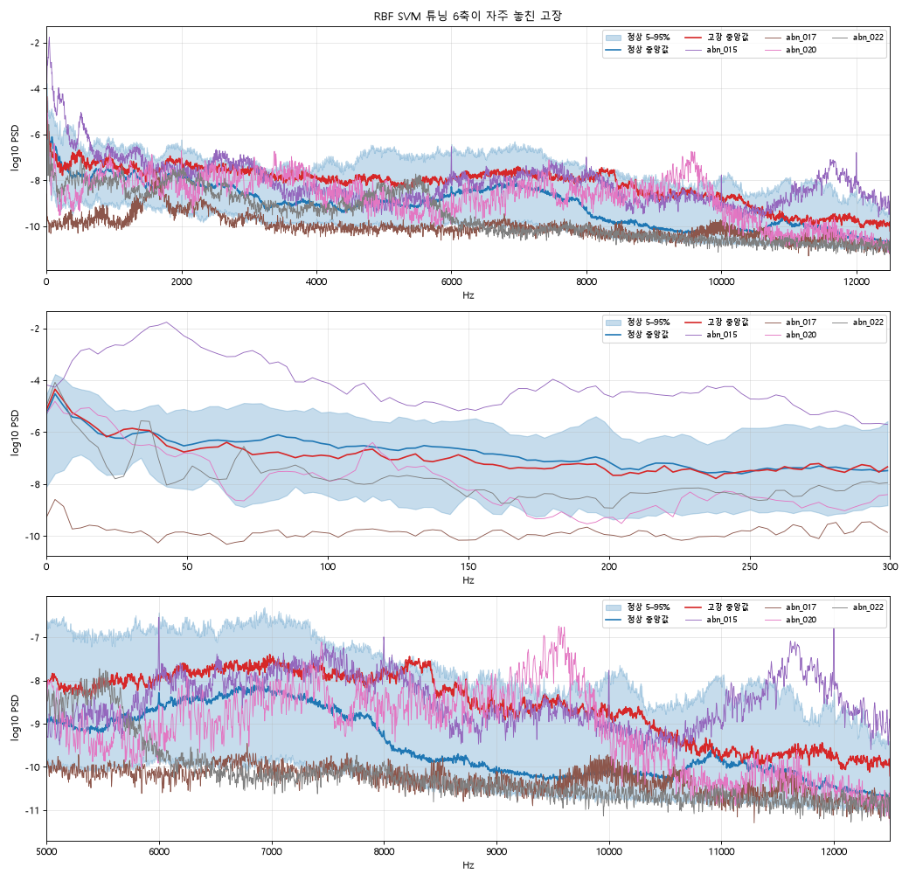

# EXP-026 SVM 경계 + 튜닝 — 규칙 대신 규칙 축을 연속 입력으로 (6축)

노션 카드 (실험 DB에 그대로 옮긴다)

| 팀원 | 모델 | F2 점수 | 변경 사항 | 메모 |
|---|---|---|---|---|
| 이동훈 | ET + 스펙트럼 AE + 규칙 축 4개 → RBF SVM (C·γ 안쪽 CV 튜닝) | 0.818 ± 0.040 | EXP-025의 '로지스틱 C=1 + 손 규칙 2개'를 6축 연속 입력 + 튜닝된 경계(로지스틱·선형/RBF SVM)로 교체 (H1, H2, H3) | SVM과 하이퍼파라미터 튜닝은 어느 구성도 기준 EXP-025(0.942 ± 0.012)를 넘지 못했다. 경계만 RBF SVM으로 바꾸면 0.911 ± 0.047로 같은 파일(022·025·116)을 틀리면서 흔들림만 커졌다. 규칙 2개를 버리고 규칙 축을 연속 입력 6축으로 넣으면 0.818–0.877로 떨어졌고, 기준이 잡던 고장 015·017·020을 놓쳤으며(017은 유격 규칙, 015·020은 2축 로지스틱이 잡던 파일) 새 오경보(009·019·086·092)가 생겼다. 튜닝한 RBF(0.818)는 고정 RBF(0.877)보다도 낮았다. 하나 건진 것은, 6축 구성에서 N-A 오경보 025(5→1–3회)와 116(4→0–1회)이 줄었다는 점이다 |

- 가설: H1, H2, H3 ([물리가설](../../../1_기준·기록/물리가설.md))
- 실행: 2026-11-16 · git `875e511+수정중` · 코드 [run.py](run.py)
- 평가: 중첩 CV (바깥 5 × 안쪽 4, seed 5개). 자주 놓침 = seed 5번 중 3번 이상

## 결과

| 구성 | F2 | 재현율 | 오경보율 | 정밀도 | F2 (고장 10%·40%) | 자주 놓침 | 오경보 3회+ |
|---|---|---|---|---|---|---|---|
| 중첩: 0 기준: EXP-025 (로지스틱 z2 + 규칙 2개) | 0.942 ± 0.012 | 0.960 | 0.033 | 0.880 | 0.913 · 0.958 | 022 | 4 |
| 중첩: 1 RBF SVM 튜닝 z2 + 규칙 2개 | 0.911 ± 0.047 | 0.927 | 0.038 | 0.864 | 0.879 · 0.930 | 022 | 3 |
| 중첩: 2 로지스틱 튜닝 6축 | 0.850 ± 0.026 | 0.880 | 0.075 | 0.755 | 0.792 · 0.881 | 015 017 022 | 5 |
| 중첩: 3 선형 SVM 튜닝 6축 | 0.843 ± 0.040 | 0.853 | 0.053 | 0.805 | 0.800 · 0.865 | 015 017 022 | 5 |
| 중첩: 4 RBF SVM 튜닝 6축 (주) | 0.818 ± 0.040 | 0.833 | 0.067 | 0.769 | 0.767 · 0.845 | 015 017 020 022 | 6 |
| 중첩: 5 RBF SVM 고정 6축 (C=1, γ=scale) | 0.877 ± 0.026 | 0.900 | 0.058 | 0.797 | 0.829 · 0.902 | 015 017 022 | 6 |

## 해석

SVM과 하이퍼파라미터 튜닝은 어느 구성도 기준 EXP-025(0.942 ± 0.012)를 넘지 못했다. 경계만 RBF SVM으로 바꾸면 0.911 ± 0.047로 같은 파일(022·025·116)을 틀리면서 흔들림만 커졌다. 규칙 2개를 버리고 규칙 축을 연속 입력 6축으로 넣으면 0.818–0.877로 떨어졌고, 기준이 잡던 고장 015·017·020을 놓쳤으며(017은 유격 규칙, 015·020은 2축 로지스틱이 잡던 파일) 새 오경보(009·019·086·092)가 생겼다. 튜닝한 RBF(0.818)는 고정 RBF(0.877)보다도 낮았다. 하나 건진 것은, 6축 구성에서 N-A 오경보 025(5→1–3회)와 116(4→0–1회)이 줄었다는 점이다

<!-- key-figs: 자동 (save_fig key=True) -->

*error_files* — 구성별로 같은 파일을 틀리는가(정보 한계) 아니면 다른 파일을 틀리는가(경계 차이). 셀 = seed 5번 중 틀린 횟수

<!-- /key-figs -->

**그림 읽는 법**: 행은 어느 구성에서든 2회 이상 틀린 파일이다(주황 = 놓친 고장, 파랑 = 오경보 정상). 열은 구성, 셀은 seed 5번 중 틀린 횟수, 맨 위는 중첩 F2다. 진할수록 자주 틀린다. 왼쪽 두 열(규칙 있음)과 오른쪽 네 열(6축, 규칙 없음)이 틀리는 파일이 확연히 다르다.

1. **경계만 바꾸기 (구성 1)**: 틀리는 파일 묶음이 기준과 같다(022 5/5, 025 5/5, 116 4/5, 059 3/5). 대신 005·020·024·025·027을 가끔 놓쳐 sd가 0.012에서 0.047로 커졌다. 2축 z에서 RBF가 휘어 봐야 같은 정보로 같은 파일을 틀린다. EXP-015와 EXP-025 README2의 결론과 같다.
2. **규칙 → 연속 6축 (구성 2–5)**: 규칙은 AND 조건이다(돌출 ≥ 0.75 **이고** 폭 ≥ 150 Hz, r ≥ 2 **이고** 2위/1위 ≥ 0.7). 로지스틱·선형 SVM은 축을 더하기만 하므로 이 "둘 다"를 표현하지 못한다.
   - 예: 정상 019는 8.3 kHz 돌출은 크지만 폭이 92 Hz로 좁아 규칙에서는 빠지던 파일(EXP-021)인데, 6축 선형 모델에서는 5/5 오경보다.
   - RBF는 이론상 AND를 표현할 수 있지만, 고장 24개 남짓으로는 날카로운 모서리를 배우지 못했다. 그 결과 유격 규칙이 잡던 017(규칙 5/5 발화)을 놓쳤다. 015·020은 규칙과 무관한데도 놓쳤는데, AE·ET z 2축의 신호가 규칙 축 4개에 희석된 것으로 보인다.
3. **튜닝은 오히려 해롭다**: 바깥 fold마다 고른 값이 크게 흔들렸다(seed 0 기준 RBF C 1–10, γ 0.01–0.1; 로지스틱 C 0.01–0.1; 선형 SVM C 0.01–1). 학습 파일 120개 안의 4-fold PR-AUC로 고르면 그 선택 자체가 잡음에 맞춰진다. 고정 RBF(C=1)가 튜닝 RBF보다 0.06 높은 것이 그 증거다.
   - Ridge(L2)의 C 튜닝은 구성 2에서 했다. C가 0.01–0.1로 강한 규제 쪽이 골라졌지만 0.850으로 기준보다 낮았다.
   - Lasso(L1)는 이번에 돌리지 않았다. 입력 6개 중 하나를 빼는 문제라 큰 차이를 기대하기 어렵다.
4. **N-A 오경보는 줄었다 → 2위/1위 축의 정보**: 025는 2위/1위 사건 높이가 0.05–0.16인 "큰 사건 한 번"형이다(2-11). 6축 모델은 이 축을 연속값으로 보기 때문에 025·116을 끌어내린 것으로 보인다. axes6 그림에서 N025·N116은 2위/1위 축 왼쪽(낮음)에 있다. 다만 6축 모델 전체가 약해서 순이익은 없었다. **규칙은 그대로 두고 K3(또는 2-11의 '가장 큰 사건을 가린 Peak·파고율')만 기준 결합의 세 번째 열로 넣는 것**이 다음 시험 대상이다(EXP-025 README2 다음 할 일 1).
5. **022는 모든 구성에서 5/5 놓침**: axes6에서 022는 6축 모두 정상 5–95% 띠 안에 있다. 경계로 풀 수 없다는 기존 결론과 같다.

**판정 제안 (사용자 결정)**: 점수로는 기각(기준보다 sd를 넘게 낮다). 다만 해석 4(K3 연속 입력이 N-A 오경보를 낮춤)는 다음 실험의 근거로 남긴다.

**한계**
- 6축의 축 정의(8.20–8.45 kHz 대역, K1·K2)는 라벨을 본 뒤 만든 것이다. 문턱은 모델이 배웠지만 축 자체는 사후다.
- 골라진 하이퍼파라미터는 seed 0의 바깥 5-fold에서만 기록했다.
- 구성 1의 튜닝 범위(C 0.1–100, γ 0.01–1)는 z가 표준화된 축 기준이다.

## 그림

### axes6
자주 틀리는 파일(022·025·055·116 등)이 6축 중 어느 축에서라도 정상 띠 밖으로 나가는가

### tsne
6축 공간에서 022가 정상 무리 안인가, 오경보 정상 025·055·116이 고장 쪽인가. 2행 색 = RBF SVM 튜닝 OOF 점수

### psd_missed
놓친 고장의 PSD가 정상 범위(파란 띠) 밖으로 나가는 주파수가 있는가

