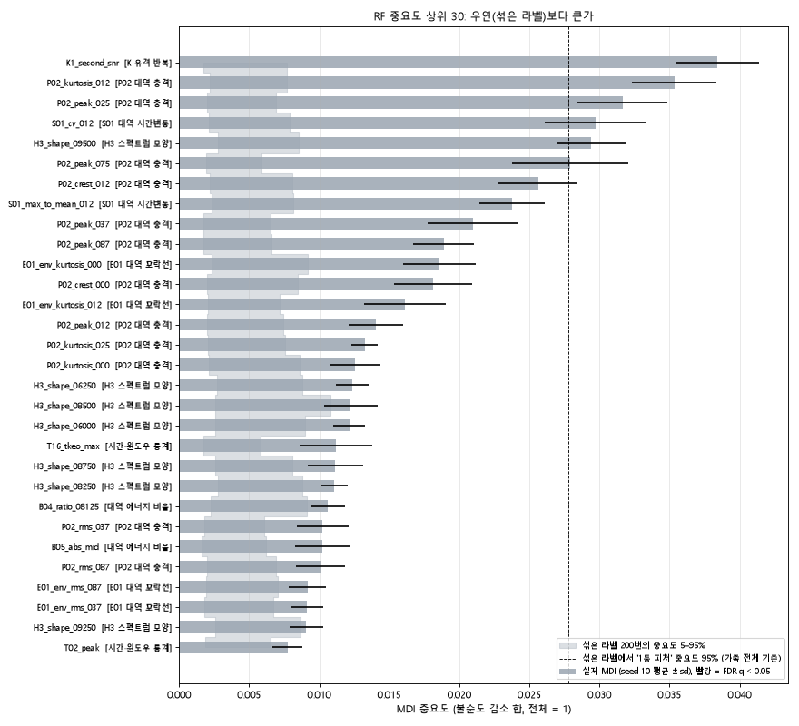
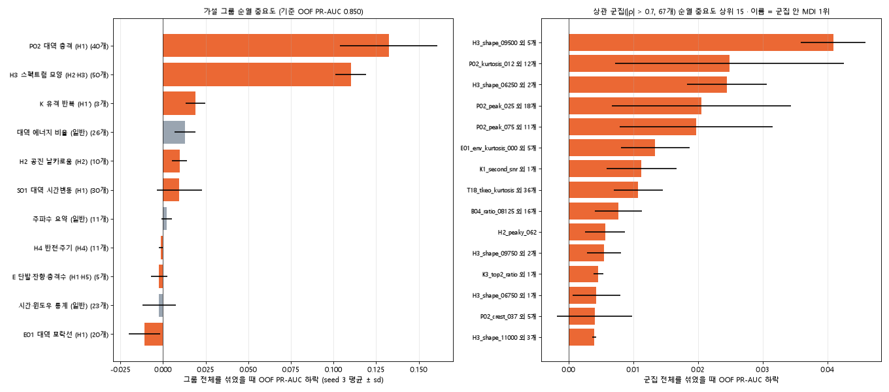
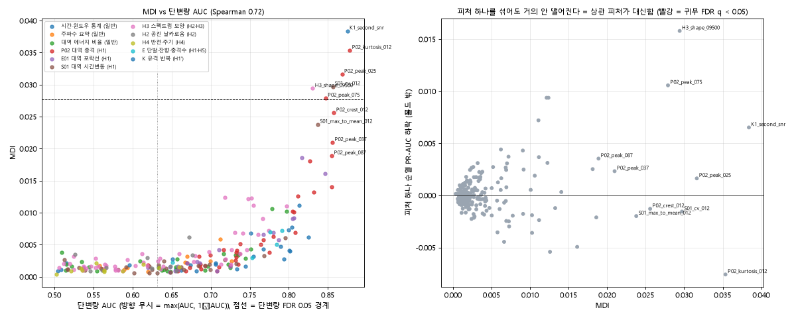
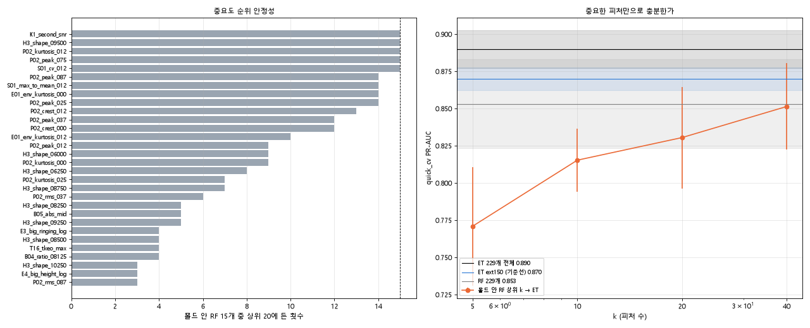
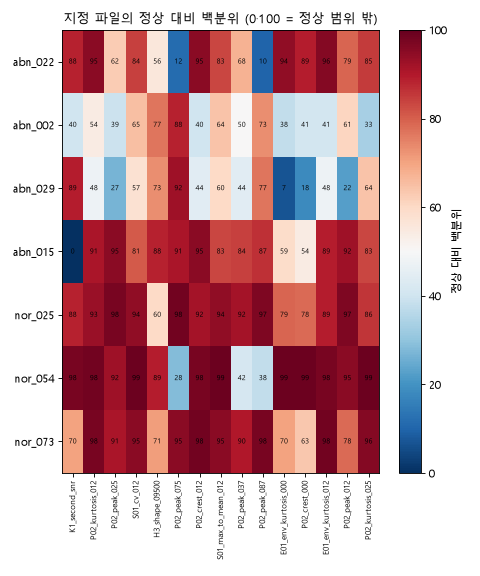
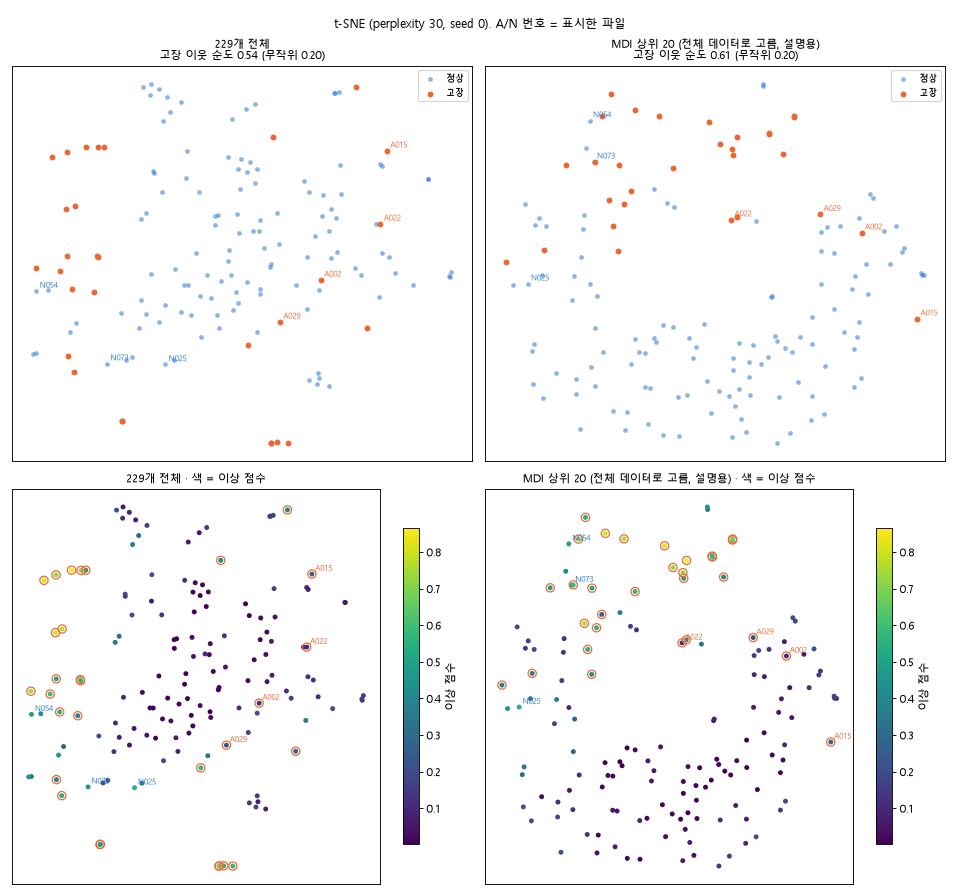
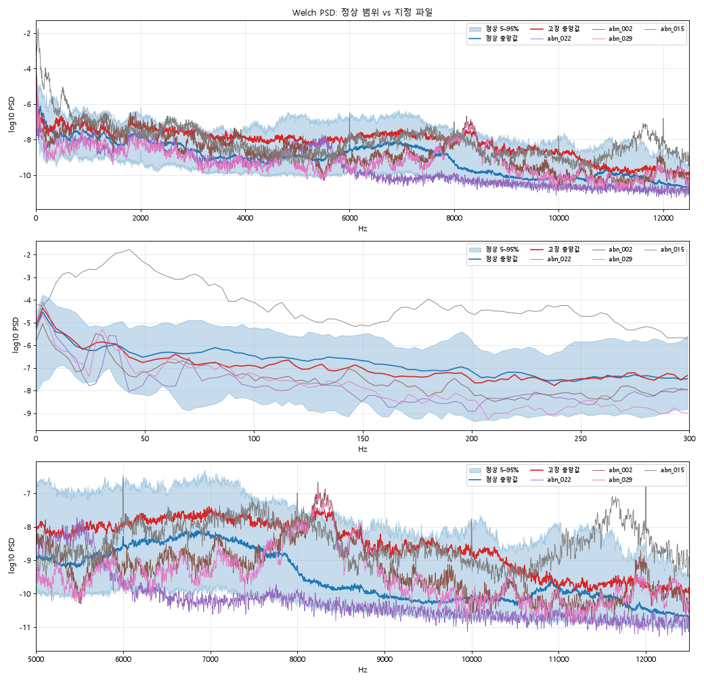

# EXP-027 Random Forest 피처 중요도 — 뽑은 피처가 정말 유의미한가

노션 카드 (실험 DB에 그대로 옮긴다)

| 팀원 | 모델 | F2 점수 | 변경 사항 | 메모 |
|---|---|---|---|---|
| 이동훈 | Random Forest (중요도 진단) · ExtraTrees (상위 k 확인) |  | 손 피처 229개의 RF 중요도(MDI·OOF 순열·군집·가설 그룹)와 귀무 중요도 검정·단변량 FDR (H1, H2, H3, H4, H5) | 유의미한 정보는 P02 1.25–3.75 kHz 충격(H1)과 H3 8.25–9.5 kHz 모양(H2·H3) 두 계열. 가족 단위 유의 5개, 상위 k만 쓰면 하락. H4는 지지 안 됨 |

- 가설: H1, H2, H3, H4, H5 ([물리가설](../../../1_기준·기록/물리가설.md))
- 실행: 2026-11-16 · git `875e511+수정중` · 코드 [run.py](run.py)

## 해석

RF 중요도는 우연보다 확실히 크지만, 중요도가 높은 것은 몇 개의 상관 덩어리 두 종류(P02 1.25–3.75 kHz 충격, H3 8.25–9.5 kHz 스펙트럼 모양)뿐이다. 그 덩어리는 정보를 여러 피처에 나눠 담고 있어서 상위 k개만 남기면 성능이 떨어진다(5개 0.771 → 40개 0.851 < 전체 0.890). 엄격한 가족 단위 검정을 통과한 피처는 5개(K1·P02_kurtosis_012·P02_peak_025·P02_peak_075·S01_cv_012)이고, 그룹으로 보면 P02(H1)와 H3 모양(H2·H3)만 성능에 크게 기여한다. H4·H5·E01·시간 통계는 다른 그룹이 이미 가진 정보 이상을 더하지 못했다.

<!-- key-figs: 자동 (save_fig key=True) -->

*null_importance* — 막대(실제 중요도)가 회색 띠(라벨을 섞었을 때 같은 피처가 얻는 중요도)와 점선(섞은 라벨에서 1등이 얻는 중요도)을 넘는가

*group_cluster_perm* — 폴드 밖에서 그 묶음을 망가뜨리면 성능이 얼마나 떨어지는가 (회색 = 가설 없는 일반 피처)

<!-- /key-figs -->

**그림 읽는 법**
- null_importance: 막대 = 실제 라벨로 학습한 RF의 MDI(seed 10 평균 ± sd). 회색 띠 = 라벨을 200번 섞었을 때 같은 피처가 얻은 MDI 5–95%. 점선 = 섞은 라벨에서 "1등 피처"가 얻은 MDI의 95%선(0.0277). 점선을 넘어야 피처 229개를 한꺼번에 검정해도(가족 단위) 우연이 아니다. 모든 막대가 회색인 것은 FDR 보정 결과가 0개여서다(아래 한계 1).
- group_cluster_perm: 폴드 밖(시험 폴드)에서 그 묶음 전체를 같은 순서로 섞었을 때 OOF PR-AUC(기준 0.850)가 얼마나 떨어지는가. 0 근처 = 다른 피처가 같은 정보를 이미 가짐.

**결과**

| 확인 | 수치 | 뜻 |
|---|---|---|
| RF 자체 성능 (quick_cv PR-AUC) | RF 229개 0.853 ± 0.030 · ET 229개 0.890 ± 0.013 · ET ext150 0.870 ± 0.008 | RF는 ET보다 약간 낮지만 중요도를 읽을 만한 수준 |
| 귀무 검정, 피처별 p < 0.05 (보정 없음) | 37 / 229 (우연 기대 11.5) | 진짜 신호가 있는 피처가 섞여 있음 |
| 귀무 검정, 가족 단위(FWER) p < 0.05 | **5개**: K1_second_snr (p 0.005) · P02_peak_075 (0.015) · P02_peak_025 (0.020) · P02_kurtosis_012 (0.025) · S01_cv_012 (0.030). 경계: H3_shape_09500 (0.065) | 가장 엄격한 기준을 통과 |
| 귀무 검정 FDR q < 0.05 | 0개 (최소 q 0.088) | 순열 200회의 해상도 한계 (아래 한계 1) |
| 단변량 Mann-Whitney FDR q < 0.05 | 156 / 229 | 정상·고장 분포 차이는 대부분 피처에 있음. 단 서로 겹친 정보 |
| 상관 군집 (\|ρ\| > 0.7) | 229개 → 67개 | 실제 독립 정보는 67묶음 이하 |
| MDI와 단변량 \|AUC\| 순위 상관 | Spearman 0.72 | RF 중요도는 대체로 "혼자서도 갈리는 피처" |
| 폴드 안 RF 15개 모두에서 상위 20 | K1 · H3_shape_09500 · P02_kurtosis_012 · P02_peak_075 · S01_cv_012 | 학습 데이터가 바뀌어도 안정 |
| 폴드 안 상위 k → ET | 5: 0.771 · 10: 0.815 · 20: 0.830 · 40: 0.851 · 전체: 0.890 | 상위 피처만으로는 부족 (EXP-011 단변량 상위 k와 같은 결론) |

**가설 그룹별 (그룹 전체 순열 PR-AUC 하락 · 그룹 하나만 ET quick_cv)**

| 그룹 (피처 수) | 순열 하락 | 그룹 단독 PR-AUC | 판정 |
|---|---|---|---|
| P02 대역 충격 H1 (40) | **0.132 ± 0.029** | 0.827 | 핵심. 혼자서도 거의 전체 성능 |
| H3 스펙트럼 모양 H2·H3 (50) | **0.110 ± 0.009** | 0.805 | 핵심. P02와 다른 정보 (둘 다 빼야 크게 하락) |
| K 유격 반복 H1′ (3) | 0.019 ± 0.006 | 0.632 | 피처당 기여 최대. 단 K1은 라벨 보고 만든 사후 피처 |
| 대역 에너지 비율 (26) | 0.013 ± 0.006 | 0.791 | 혼자는 좋지만 H3와 중복 |
| H2 공진 날카로움 (10) | 0.010 ± 0.004 | 0.439 | 혼자서는 약함, 보조 |
| S01 대역 시간변동 H1 (30) | 0.010 ± 0.013 | 0.544 | P02와 같은 군집에 묶임 → 중복 |
| 주파수 요약 (11) | 0.002 | 0.563 | 기여 없음 |
| H4 반전·주기 (11) | −0.001 | 0.484 | 기여 없음 (EXP-016과 같음) |
| E 단발·잔향·충격수 H1·H5 (5) | −0.002 | 0.664 | 단변량 차이는 있으나 결합에 더하는 것 없음 |
| 시간·윈도우 통계 (23) | −0.002 | 0.654 | P02 peak 군집과 중복 |
| E01 대역 포락선 H1 (20) | −0.011 ± 0.009 | 0.761 | 혼자는 좋지만 P02와 완전 중복 |

(무작위 분류기의 PR-AUC = 고장 비율 0.20)

**놓친 파일 (missed_percentile, psd_missed)**
- RF가 가장 못 잡는 고장 022(정상 중 순위 0.44)·002(0.39)·029(0.16)·015(0.12)는 기존 실험과 같은 파일이다.
- 002는 상위 15 피처 모두에서 정상 33–77 백분위, 029는 7–92 → 중요 피처 공간에서 정상 한가운데. 이 파일들의 정보(8.3 kHz 모드)는 중요도 상위 피처에 없다 → EXP-021 규칙이 따로 필요했던 이유.
- 015는 K1이 정상 0 백분위(가장 낮음)인데 P02는 81–95 → K1과 P02가 반대 방향을 가리킨다(2-12에 기록된 002·015의 예외와 같음).
- 점수가 가장 높은 정상 025·054·073은 P02·S01 충격 피처에서 90–99 백분위 = "큰 사건 한 번"(N-A). 중요 피처가 충격 크기를 재고 있어서 정상 단발 충격과 고장 반복 충격을 가르지 못한다.
- t-SNE: 고장 이웃 순도 229개 0.54, MDI 상위 20 0.61 (무작위 0.20). 상위 20은 전체 데이터로 고른 것이라 설명용.

**한계**
1. 귀무 순열 200회라 피처별 p의 최솟값이 1/201 = 0.005다. 13개가 이 최솟값에 묶여 BH 보정 후 q가 0.088 아래로 갈 수 없었다. FDR 0개는 "유의하지 않다"가 아니라 "검정 해상도 부족"이다. 대신 쓴 가족 단위 검정(max-null)은 FDR보다 엄격하다.
2. MDI와 귀무 검정은 150개 전체로 학습한 설명용 수치다. 성능에 대한 주장은 폴드 밖 순열·quick_cv에서만 한다.
3. K1(유격 반복)은 2-12에서 014를 분석하다가 라벨을 보고 만든 피처다. 1위라는 결과는 선택 편향을 포함한다.
4. 상관이 큰 피처끼리는 중요도를 나눠 가진다. 개별 순열 중요도가 0 근처(P02_kurtosis_012 −0.008)인 것은 쓸모없다는 뜻이 아니라 대신할 피처가 있다는 뜻이다 → 군집·그룹 단위로 판단한다.

## 그림

### agreement
MDI·단변량 AUC·개별 순열 중요도가 같은 피처를 가리키는가

### stability_topk
왼쪽: 학습 데이터가 바뀌어도 같은 피처가 상위에 오는가 / 오른쪽: 상위 k개만 써도 전체만큼 맞히는가

### missed_percentile
RF가 가장 못 잡은 고장 abn_022, abn_002, abn_029, abn_015와 점수가 가장 높은 정상 nor_025, nor_054, nor_073이 상위 15 피처에서 정상 몇 백분위인가

### tsne
중요 피처 공간에서 고장이 따로 모이는가, RF가 놓친 파일은 어디에 있는가 (색 = RF OOF 점수)

### psd_missed
RF가 가장 못 잡은 고장의 PSD가 정상 범위(파란 띠) 밖으로 나가는 주파수가 있는가

