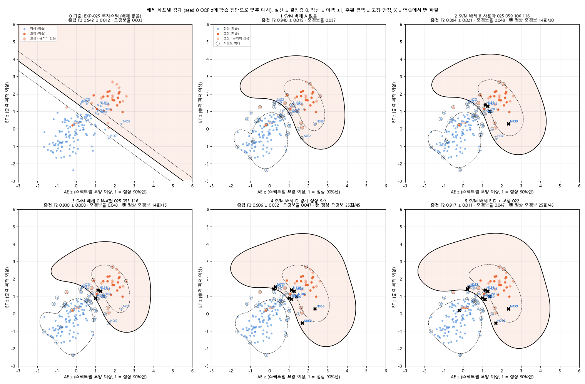
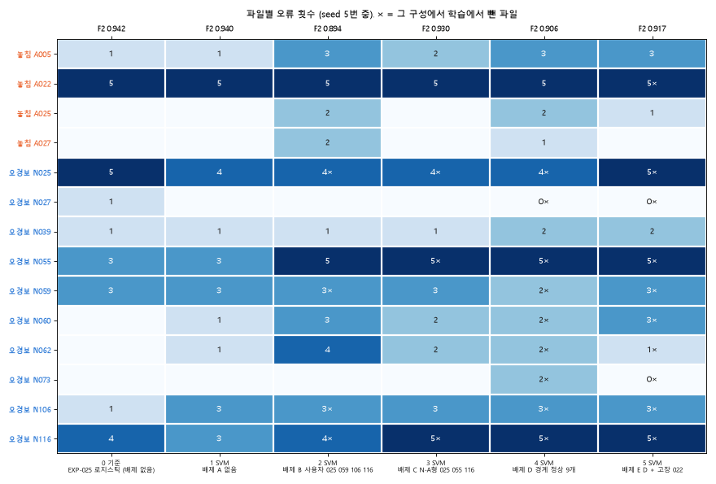
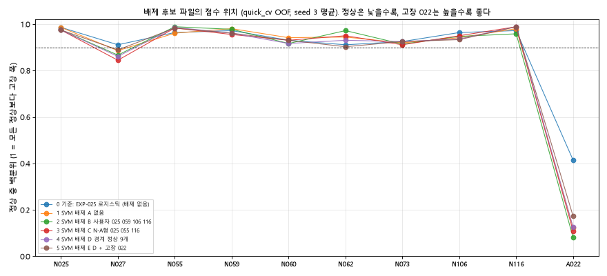
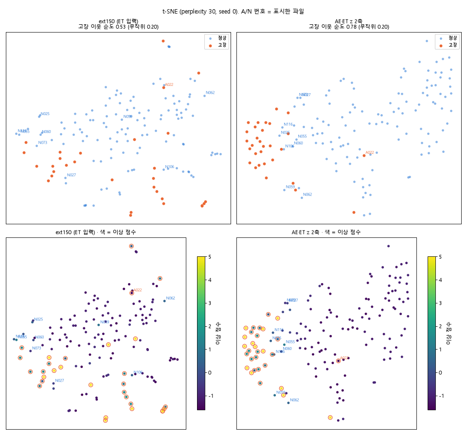
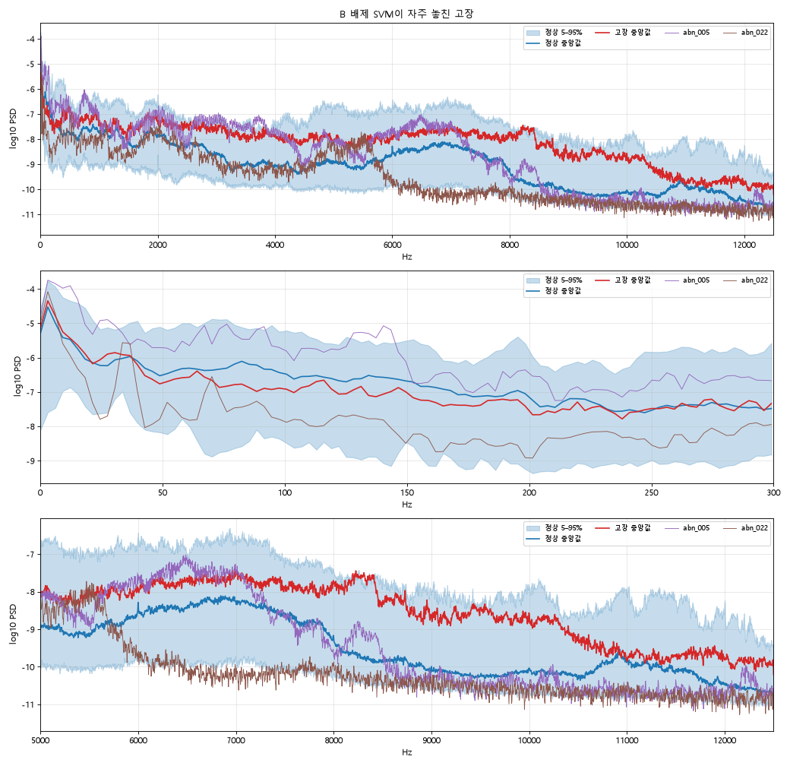

# EXP-028 SVM 배제 실험 — 못 가르는 정상을 학습에서 빼면 경계가 어떻게 바뀌나

노션 카드 (실험 DB에 그대로 옮긴다)

| 팀원 | 모델 | F2 점수 | 변경 사항 | 메모 |
|---|---|---|---|---|
| 이동훈 | ET + 스펙트럼 AE → RBF SVM(C=1) + 8.3k 규칙 + 유격 규칙, 학습에서 정상 일부 배제 | 0.894 ± 0.021 | EXP-025 경계를 RBF SVM으로, 회색 정상(025 059 106 116 등)을 학습에서만 뺌 (평가는 150개 전부) (H1, H5) | 회색 정상을 학습에서 빼면 SVM 경계가 그 자리로 밀려 들어가, 뺀 정상이 고장 영역 안에 놓인다. 그래서 어느 배제 세트도 점수를 올리지 못했다(0.894–0.930, 배제 없는 SVM 0.940, 기준 0.942). 뺀 정상의 오경보는 같거나 늘었다. 사용자 목록(025·059·106·116)을 빼면 오경보가 13회에서 14회로, N-A형(025·055·116)을 빼면 10회에서 14회로 늘었다. 대신 고장 005를 새로 놓치기 시작했다. 반면 배제 없는 RBF SVM(C=1)은 0.940으로 로지스틱과 같았다. 회색지대에서는 SVM이든 로지스틱이든 같은 파일을 틀린다 |

- 가설: H1, H5 ([물리가설](../../../1_기준·기록/물리가설.md))
- 실행: 2026-11-16 · git `28b8ed8+수정중` · 코드 [run.py](run.py)
- 평가: 중첩 CV (바깥 5 × 안쪽 4, seed 5개). 자주 놓침 = seed 5번 중 3번 이상

## 결과

| 구성 | F2 | 재현율 | 오경보율 | 정밀도 | F2 (고장 10%·40%) | 자주 놓침 | 오경보 3회+ |
|---|---|---|---|---|---|---|---|
| 중첩: 0 기준: EXP-025 로지스틱 (배제 없음) | 0.942 ± 0.012 | 0.960 | 0.033 | 0.880 | 0.913 · 0.958 | 022 | 4 |
| 중첩: 1 SVM 배제 A 없음 | 0.940 ± 0.015 | 0.960 | 0.037 | 0.871 | 0.907 · 0.957 | 022 | 5 |
| 중첩: 2 SVM 배제 B 사용자 025 059 106 116 | 0.894 ± 0.021 | 0.913 | 0.048 | 0.828 | 0.854 · 0.916 | 005 022 | 7 |
| 중첩: 3 SVM 배제 C N-A형 025 055 116 | 0.930 ± 0.008 | 0.953 | 0.043 | 0.847 | 0.892 · 0.950 | 022 | 5 |
| 중첩: 4 SVM 배제 D 경계 정상 9개 | 0.906 ± 0.032 | 0.927 | 0.047 | 0.833 | 0.867 · 0.927 | 005 022 | 4 |
| 중첩: 5 SVM 배제 E D + 고장 022 | 0.917 ± 0.011 | 0.940 | 0.047 | 0.835 | 0.877 · 0.938 | 005 022 | 6 |

## 해석

회색 정상을 학습에서 빼면 SVM 경계가 그 자리로 밀려 들어가, 뺀 정상이 고장 영역 안에 놓인다. 그래서 어느 배제 세트도 점수를 올리지 못했다(0.894–0.930, 배제 없는 SVM 0.940, 기준 0.942). 뺀 정상의 오경보는 같거나 늘었다. 사용자 목록(025·059·106·116)을 빼면 오경보가 13회에서 14회로, N-A형(025·055·116)을 빼면 10회에서 14회로 늘었다. 대신 고장 005를 새로 놓치기 시작했다. 반면 배제 없는 RBF SVM(C=1)은 0.940으로 로지스틱과 같았다. 회색지대에서는 SVM이든 로지스틱이든 같은 파일을 틀린다

<!-- key-figs: 자동 (save_fig key=True) -->

*svm_exclusion* — 정상을 빼면 경계가 그 자리로 들어가 뺀 정상(X)이 고장 영역에 들어가는가. 제목 = 150개 전부로 평가한 중첩 F2

<!-- /key-figs -->

**그림 읽는 법**
- 가로 = AE z(스펙트럼 모양 이상), 세로 = ET z(충격 피처 이상). 모든 점은 그 파일을 학습에 쓰지 않은 모델의 점수다(seed 0 OOF).
- 주황 영역 = 고장 판정, 실선 = 경계(결정값 0), 점선 = 여백 ±1, 원 테두리 = 서포트 벡터.
- 검은 X = 학습에서 뺀 파일, 연한 마름모 = 규칙이 따로 잡는 고장.
- 패널 제목의 F2와 "뺀 정상 오경보"는 이 그림이 아니라, 150개 전부로 평가한 중첩 CV(seed 5) 결과다.
- 그림의 경계는 seed 0 좌표에 맞춘 예시라 실제 fold마다의 경계와 조금 다르다.

1. **빼면 경계가 들어온다 (패널 2–5)**
   - 배제 없는 SVM(패널 1)에서 경계는 N025·N116·N106이 있는 띠(AE z 1–1.5, ET z 1–1.5)를 지난다. 그 정상들이 경계를 정상 쪽에서 막고 있다.
   - 그 점들을 빼면 막던 점이 사라지고, 경계가 그 자리를 넘어 정상 쪽으로 내려온다. 뺀 X들은 모두 주황 영역 안에 놓인다.
   - D(9개 배제)에서는 N059·N062까지 고장 영역 깊숙이 들어간다.
2. **뺀 정상은 오경보가 늘거나 그대로다 (중첩 CV, seed 5번 중 오경보 횟수)**

   | 파일 | 기준 로지스틱 | SVM 배제 없음 | B 사용자 | C N-A형 | D 9개 | E 9개 + 022 |
   |---|---|---|---|---|---|---|
   | N025 | 5 | 4 | **4** | **4** | **4** | **5** |
   | N055 | 3 | 3 | 5 | **5** | **5** | **5** |
   | N059 | 3 | 3 | **3** | 3 | **2** | **3** |
   | N106 | 1 | 3 | **3** | 3 | **3** | **3** |
   | N116 | 4 | 3 | **4** | **5** | **5** | **5** |

   (굵게 = 그 구성에서 학습에서 뺀 파일. B·C·D·E 열은 result.json `fp_counts`와 notes)

   - 빼지 않은 이웃 정상도 나빠진다: B에서 N055는 빼지 않았는데 오경보가 3회에서 5회로 늘었다. 경계가 그 근처로 들어왔기 때문이다
   - 순위로 봐도 같다(excluded_rank). 뺀 정상의 정상 중 백분위는 0.93–0.99로 그대로이거나 올랐다(N055 0.96 → 0.99, N116 0.98 → 0.99).
   - 정상을 빼서 "못 가르는 것을 포기"시켜도 평가에서는 그 파일들이 남는다. 학습에서 정상 예시가 사라졌으니 모델이 그 자리를 고장으로 본다.
3. **다른 파일까지 나빠진다**
   - 배제하면 고장 005(경계 근처, 반복 충격형)를 자주 놓치기 시작한다(B·D·E).
   - 오경보율도 0.037에서 0.043–0.048로 올랐다. 학습 정상이 줄어 안쪽 CV로 고르는 임계값이 흔들리기 때문으로 보인다(sd 0.008–0.032).
4. **022까지 빼도(E) 022는 그대로 놓친다 (5/5)**
   - 022는 정상 무리 한가운데(AE z ≈ −0.3, ET z ≈ 0.2)에 있다. 고장 예시에서 빼도 빼지 않아도 판정은 정상이다.
5. **SVM 자체는 문제가 아니다**
   - 배제 없는 RBF SVM(C=1, γ=scale)은 0.940 ± 0.015로 기준 로지스틱(0.942 ± 0.012)과 같다. 틀리는 파일도 같다(022, 025, 055, 059, 116).
   - EXP-026의 튜닝 SVM(0.911)보다 높은데, 이는 튜닝(선택 잡음)이 깎아 먹은 몫이다.
   - SVM이 비선형으로 휘어도 이 파일들은 같은 자리에 있어서 경계 모양으로는 갈리지 않는다.

**결론과 다음**
- "못 가르는 정상을 빼고 학습 → 나중에 피처로 가른다"는 순서로는 성능이 오르지 않는다. 빼는 순간 그 정상들이 확실한 오경보가 된다.
- 순서를 바꿔야 한다. 그 정상들을 **학습에 둔 채로** 그들을 가르는 피처를 먼저 추가한다(예: N-A형의 '가장 큰 사건을 가린 Peak·파고율', 2위/1위 사건 높이). 그 피처가 들어오면 SVM이든 로지스틱이든 경계가 자연스럽게 그 정상들을 정상 쪽에 둔다.

**판정 제안 (사용자 결정)**: 점수로는 기각(B 0.894, 기준보다 sd를 넘게 낮다). 그림 svm_exclusion은 "배제는 오경보를 늘린다"는 근거로 발표에 쓸 수 있다.

**한계**
- 배제 목록은 CV 오류와 라벨을 보고 고른 사후 선택이다. 다만 결론(효과 없음·악화)의 방향에는 영향이 없다.
- 경계 그림은 seed 0 좌표 하나에 맞춘 예시다.

## 그림

### error_files
뺀 정상(×)의 오경보가 줄었는가 늘었는가, 대신 다른 파일이 틀리기 시작했는가

### excluded_rank
학습에서 뺀 정상이 정상 무리 안쪽(낮은 백분위)으로 내려가는가, 아니면 더 고장 쪽으로 올라가는가

### tsne
뺀 정상 025·059·106·116이 정상 무리 가장자리인가 고장 무리 안인가. 2행 색 = 주 구성(B 배제) OOF 점수

### psd_missed
놓친 고장의 PSD가 정상 범위(파란 띠) 밖으로 나가는 주파수가 있는가

