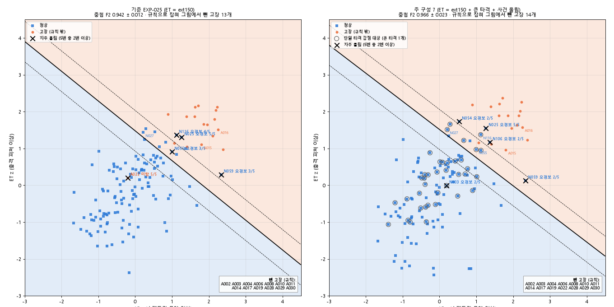
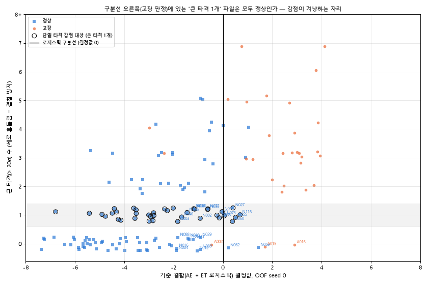
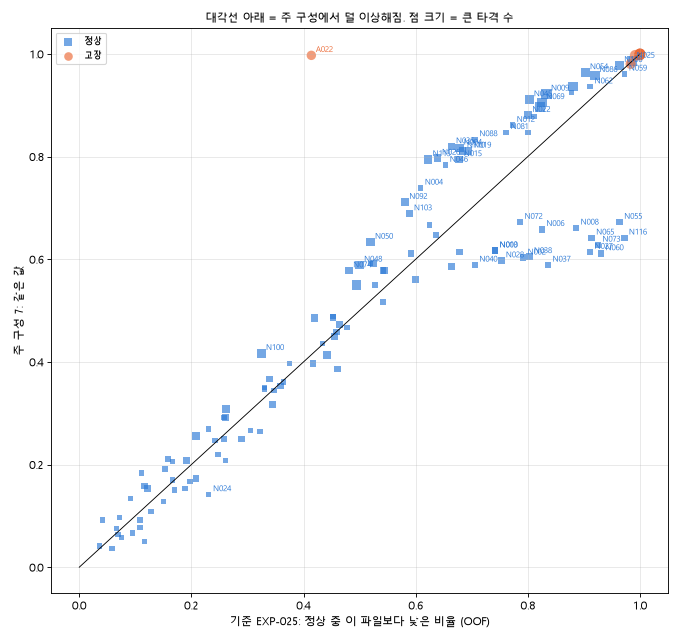
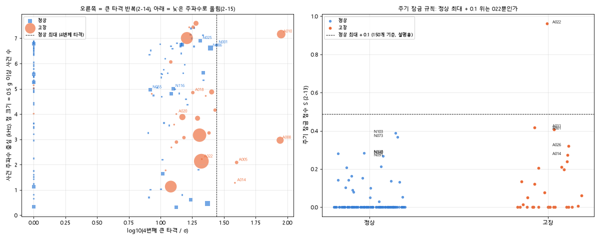
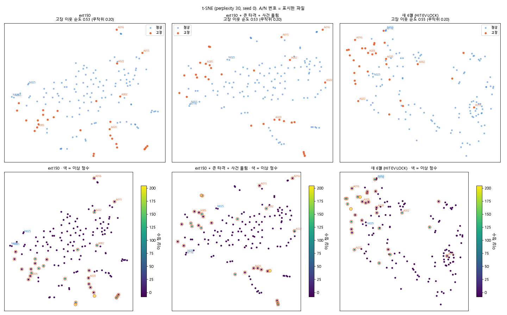
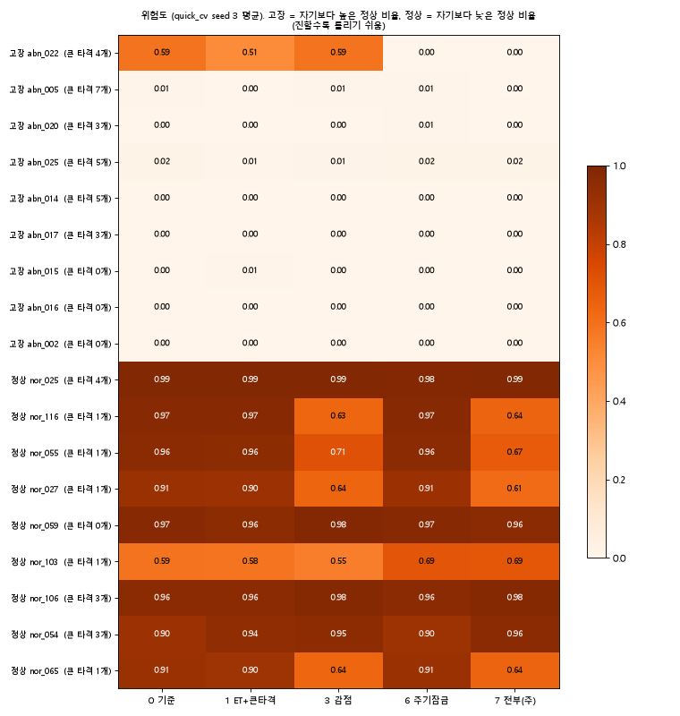
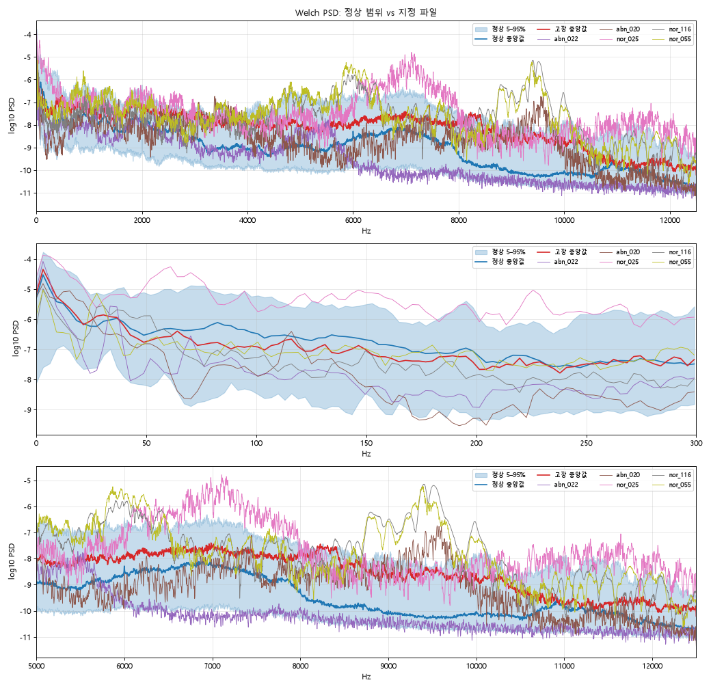

# EXP-029 큰 타격 수 · 사건 울림 · 주기 잠금 — ET와 최종 결과 변화

노션 카드 (실험 DB에 그대로 옮긴다)

| 팀원 | 모델 | F2 점수 | 변경 사항 | 메모 |
|---|---|---|---|---|
| 이동훈 | ET(+HIT·EV) + 스펙트럼 AE → 로지스틱 + 8.3k·유격·주기 잠금 규칙 + 단일 타격 감점 | 0.966 ± 0.023 | EXP-025에 큰 타격 수(2-14)·사건 울림(2-15)·주기 잠금(2-13)을 ET 입력/결합 축/규칙으로 하나씩 추가 (H1, H4) | **주 구성(ET 입력 + 큰 타격·사건 울림, 단일 타격 감점, 주기 잠금 규칙) F2 0.966 ± 0.023 (기준 0.942 ± 0.012, +0.024). 이득은 두 가지에서 나온다. (1) 주기 잠금 규칙이 022를 처음으로 잡았다(놓침 5/5 → 0/5). (2) 단일 타격 감점이 오경보 116·055를 없앴다(오경보율 0.033 → 0.023).** 큰 타격 수를 ET 입력에 넣으면 ET는 그 열을 중요도 1위로 쓴다. 하지만 ET 단독·최종 점수는 sd 안이다. 큰 타격 수를 로지스틱 축으로 넣으면 큰 타격 0개 고장 015·016을 잃는다(0.893). 문턱이 모두 사후라 점수는 낙관적이다. 주기 잠금 규칙은 정상 103도 2/5 켠다. |

- 가설: H1, H4 ([물리가설](../../../1_기준·기록/물리가설.md))
- 실행: 2026-11-16 · git `28b8ed8+수정중` · 코드 [run.py](run.py)
- 평가: 중첩 CV (바깥 5 × 안쪽 4, seed 5개). 자주 놓침 = seed 5번 중 3번 이상

## 결과

| 구성 | F2 | 재현율 | 오경보율 | 정밀도 | F2 (고장 10%·40%) | 자주 놓침 | 오경보 3회+ |
|---|---|---|---|---|---|---|---|
| 중첩: 7 전부-ET (주) | 0.966 ± 0.023 | 0.980 | 0.023 | 0.913 | 0.944 · 0.977 | — | 1 |
| 중첩: 0 기준 EXP-025 | 0.942 ± 0.012 | 0.960 | 0.033 | 0.880 | 0.913 · 0.958 | 022 | 4 |
| 중첩: 1 A-ET 입력 + 큰 타격 | 0.945 ± 0.017 | 0.960 | 0.030 | 0.890 | 0.918 · 0.959 | 022 | 2 |
| 중첩: 2 A-축 큰 타격 2축 | 0.893 ± 0.014 | 0.900 | 0.035 | 0.870 | 0.863 · 0.909 | 015 016 022 | 3 |
| 중첩: 3 A-감점 단일 타격 | 0.954 ± 0.011 | 0.960 | 0.018 | 0.930 | 0.937 · 0.962 | 022 | 2 |
| 중첩: 4 B-ET 입력 + 사건 울림 | 0.945 ± 0.015 | 0.960 | 0.030 | 0.890 | 0.918 · 0.959 | 022 | 4 |
| 중첩: 5 B-축 사건 울림 3축 | 0.939 ± 0.009 | 0.960 | 0.038 | 0.863 | 0.905 · 0.957 | 022 | 2 |
| 중첩: 6 C-규칙 주기 잠금 | 0.966 ± 0.012 | 0.993 | 0.037 | 0.874 | 0.933 · 0.984 | — | 4 |
| 중첩: 8 전부-축 | 0.927 ± 0.019 | 0.947 | 0.040 | 0.857 | 0.892 · 0.945 | 015 | 2 |

## 해석

**주 구성(ET 입력 + 큰 타격·사건 울림, 단일 타격 감점, 주기 잠금 규칙) F2 0.966 ± 0.023 (기준 0.942 ± 0.012, +0.024). 이득은 두 가지에서 나온다. (1) 주기 잠금 규칙이 022를 처음으로 잡았다(놓침 5/5 → 0/5). (2) 단일 타격 감점이 오경보 116·055를 없앴다(오경보율 0.033 → 0.023).** 큰 타격 수를 ET 입력에 넣으면 ET는 그 열을 중요도 1위로 쓴다. 하지만 ET 단독·최종 점수는 sd 안이다. 큰 타격 수를 로지스틱 축으로 넣으면 큰 타격 0개 고장 015·016을 잃는다(0.893). 문턱이 모두 사후라 점수는 낙관적이다. 주기 잠금 규칙은 정상 103도 2/5 켠다.

<!-- key-figs: 자동 (save_fig key=True) -->

*logistic_plane* — 규칙 밖 고장과 정상만 남긴 AE z × ET z 평면. 기준 → 주 구성에서 오경보 116·055가 경계 밖으로 빠지는가, 022가 규칙으로 빠지는가

<!-- /key-figs -->

**그림 읽는 법** (코드 [figs_기본.py](figs_기본.py)): 두 전문가 점수 평면이다. 가로 = AE z(스펙트럼 모양 이상), 세로 = ET z(충격 피처 이상). 값은 OOF seed 0이다. 실선 = 로지스틱 경계(결정값 0), 점선 = ±1. 주황 바탕 쪽이 고장 판정이다. 왼쪽은 기준 EXP-025, 오른쪽은 주 구성 7(ET 입력에 큰 타격·사건 울림 추가)이다.
- **규칙(8.3 kHz · 유격 반복 · 주기 잠금)으로 잡힌 고장은 그림에서 뺐다**(오른쪽 아래 상자). 경계와 무관하게 고장이 되기 때문이다. 남은 주황 점 = 로지스틱이 직접 가려야 하는 고장이다. 규칙이 켜진 정상은 오류라서 남긴다(이 seed 0 분할에서는 없음)
- × = 5번 중 2번 이상 틀린 파일. 회색 고리(오른쪽) = 단일 타격 감점 대상(큰 타격 정확히 1개)
- 기준(왼쪽): 오경보 116·025·055가 경계 바로 위, 022는 경계 아래 정상 무리 안에 있다
- 주 구성(오른쪽): **022는 주기 잠금 규칙으로 빠져 그림에 없다.** 116·055·027은 평면에서는 여전히 경계 위지만, 모두 회색 고리(큰 타격 1개)라 **감점이 경계 바깥에서 점수를 누른다** → 오경보 ×가 사라졌다. 감점은 평면의 경계를 옮기는 것이 아니라, 경계 위에 있는 단일 타격 파일만 골라 내리는 장치다
- 남은 ×: 025(큰 타격 4개, 5/5)는 감점 대상이 아니다. 054·106(큰 타격 3개)·059(0개)·103(1개, 주기 잠금 규칙에 다른 분할에서 걸림)은 각 2/5
- 큰 타격 0개 고장 015·016은 경계 오른쪽 위(AE·ET 모두 높음)라 감점 없이도 잡힌다. 그래서 감점은 "0개"가 아니라 "정확히 1개"에만 건다(보조 그림 boundary_lr: 큰 타격 1개 줄에는 고장이 0개)

### 구성별로 무엇이 바뀌었나
| 구성 | F2 | 바뀐 파일 (기준 대비, seed 5번 중) | 판정 |
|---|---|---|---|
| 1 ET 입력 + 큰 타격 | 0.945 | 오경보 116 4→3 · 055 3→2. 020 놓침 0→1 | sd 안 |
| 2 결합 축 + 큰 타격 | **0.893** | **015·016 놓침 0→5** | 하락 |
| 3 단일 타격 감점 | 0.954 | **오경보 116 4→0 · 055 3→0 · 027·065 1→0**. 고장 손실 없음 | 오경보율 0.033 → 0.018 |
| 4 ET 입력 + 사건 울림 | 0.945 | 116 4→3 | sd 안 |
| 5 결합 축 + 사건 울림 | 0.939 | 오경보 106 1→4 · 086 0→2 | sd 안 |
| 6 주기 잠금 규칙 | 0.966 | **022 놓침 5→0**. 오경보 103 0→2 (규칙이 켜짐) | 재현율 0.993 |
| **7 전부-ET (주)** | **0.966** | 022 5→0 · 116 4→0 · 055 3→0 · 059 3→2. 103 0→2 · 054 1→2 · 106 1→2 | 재현율 0.980 · 오경보율 0.023 |
| 8 전부-축 | 0.927 | 015 놓침 0→5 | 하락 |

### 질문에 대한 답
1. **큰 타격 수로 구분하면 좋아지나?** 쓰는 방식에 따라 다르다. "1개면 감점"(구성 3)은 고장을 잃지 않고 오경보만 줄였다. 큰 타격 1개 칸에 고장이 0개라서다. 연속 축으로 넣으면(구성 2) 로지스틱이 "타격이 적을수록 정상"을 배운다. 그러면 큰 타격 0개인 고장 015·016(바탕 자체가 커서 바탕 대비 타격이 안 보이는 파일, [2-5](../../../2_EDA/2-2_큰타격반복/README.md) §1)까지 정상으로 내려간다. **"0개"와 "1개"는 물리적으로 다른 상태라서 한 축의 크기로 다루면 안 된다**
2. **ET가 바뀌나?** ET는 새 열을 바로 쓴다(중요도 155개 중 큰 타격 수 1위, 4번째 타격 4위, 0.5 g 사건 수 13위, 사건 주파수 중심 67위, 감쇠 107위). 그런데 ET 단독 PR-AUC는 0.870 → 0.857–0.863으로 sd 안이거나 조금 내려갔다. 오경보 정상(116 055 027 025)의 ET 순위도 0.95 그대로다. 기존 Peak·파고율 열과 같은 정보를 다시 나눠 쓸 뿐, 단일 타격 정상을 내리지는 못한다 → **ET는 단일 타격 정상을 고장으로 미는 성질을 스스로 고치지 못한다. 감점처럼 바깥에서 거는 장치가 필요하다**
3. **2-15 사건 울림(FC·감쇠·0.5 g 사건 수)은?** ET 입력(0.945)이든 결합 축(0.939)이든 sd 안이다. 2-15에서 116·055는 FC 4.96·5.01 kHz로 문턱 바로 위였다. 연속 축으로는 이 작은 차이가 다른 정상(106·086)의 변동에 묻힌다. 116·055는 감점으로 이미 내려가므로 사건 울림이 따로 할 일이 남지 않았다
4. **022(2-13 주기 잠금)는?** 규칙(학습 정상 최대 + 0.1 이상이면 고장)이 바깥 폴드 25번 모두 022를 켰다. 대가는 정상 103이다. 정상 S 상위는 103 0.389 · 2위 0.367 · 3위 0.284다. 103과 2위 정상이 **함께** 시험 폴드에 들어가면 학습 정상 최대가 0.284로 내려가고, 문턱 0.384가 103보다 낮아진다. 그래서 2/5 켜진다. quick_cv의 "확실한 고장"이 26 → 12로 떨어진 것도 이 때문이다(103이 +100을 받는 seed에서는 그보다 높은 고장이 없다)

### 남은 오류 (주 구성, seed 5번 중)
- 놓침: 005·020·025 각 1/5 (자주 놓침 없음)
- 오경보: **025 5/5** (큰 타격 4개 = 감점 대상이 아님, 2-14 §2 "설명되지 않는 정상 7개") · 054·059·103·106 각 2/5 · 039 1/5

### 주의
- **사후 문턱 셋**: 큰 타격 20σ·"정확히 1개"(2-14 표에서 고장 0인 칸을 보고 정함), 주기 잠금 S(022를 보고 만든 정의, 2-13), 여유 0.1. 기존 8.3k·유격 규칙과 같은 "사후 문턱 예외"이므로 F2는 낙관적이다
- 감점은 큰 타격이 **정확히 1개인 test 고장**이 나오면 그 고장을 놓친다. 학습 30개에서 0개였다는 것만이 근거다. val(40개)에서 꼭 확인한다
- 주 구성 sd(0.023)가 기준(0.012)의 두 배다. 103 규칙 오작동이 seed마다 달라서다. 주기 잠금 여유를 0.1보다 키우면 103은 빠지지만, 022를 보고 다시 고르는 것이 된다
- 구성 3과 6을 따로 보면 각각 0.954·0.966이다. 둘을 합친 7도 0.966이라, F2만 보면 합친 이득이 더해지지 않았다(오경보율은 7이 가장 낮다)

## 그림

### boundary_lr
(보조) 기준 결정값 × 큰 타격 수: 큰 타격 1개 줄(회색 띠)에 고장이 없는가, 큰 타격 0개 고장(002 015 016)은 어디인가

### score_shift
오경보 정상(025 116 055)이 대각선 아래로 내려가는가, 고장이 내려가지 않는가

### new_axes
새 축에서 고장·정상이 어디에 있나 (설명용, 150개 전체 기준)

### tsne
새 열을 넣으면 고장이 더 모이는가, 오경보 정상·놓친 022는 어디인가

### hard_files
감점으로 116·055·027·065가 옅어지는가, 주기 잠금으로 022가 0이 되는가, 103이 진해지는가

### psd_missed
놓친 022·회색 020과 오경보 정상 025·116·055의 PSD가 정상 범위 밖으로 나가는 주파수가 있는가

