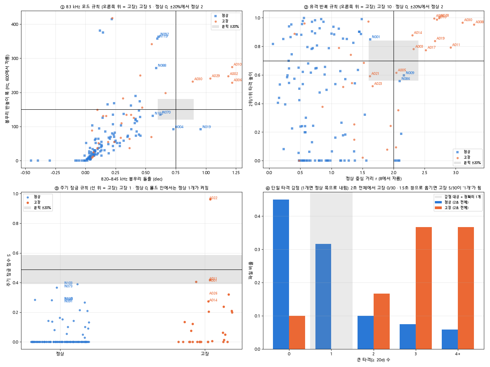
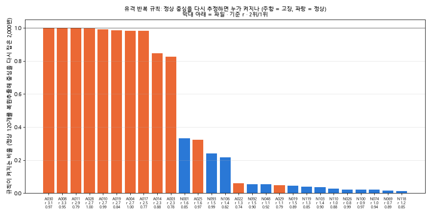
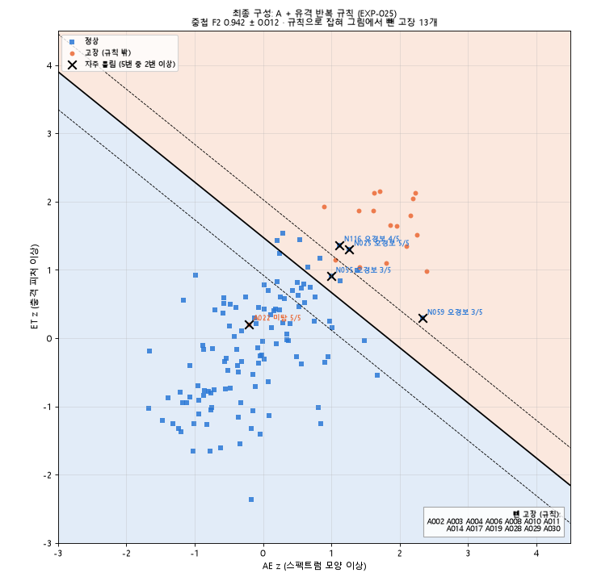
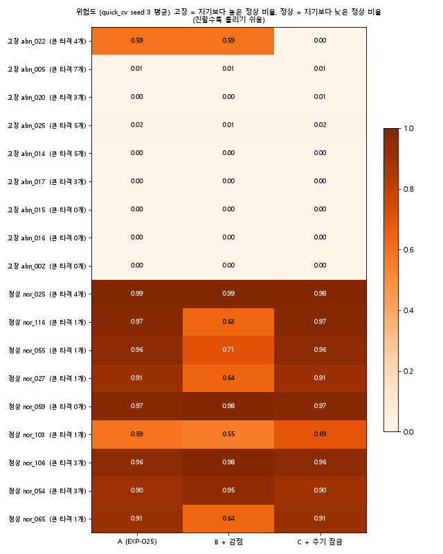
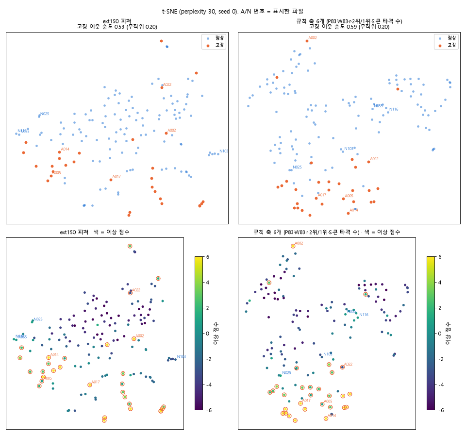
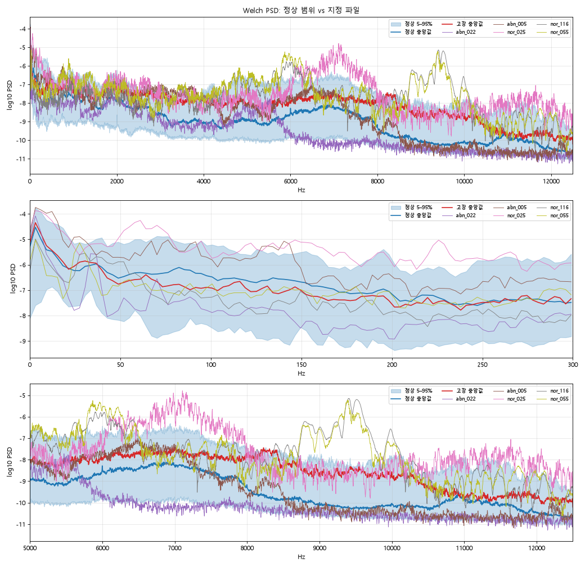

# EXP-030 최종 후보 고정 — 규칙 감사와 임계값 정책

노션 카드 (실험 DB에 그대로 옮긴다)

| 팀원 | 모델 | F2 점수 | 변경 사항 | 메모 |
|---|---|---|---|---|
| 이동훈 | ET + 스펙트럼 AE → 로지스틱 + 채택 기준을 통과한 규칙 | 0.942 ± 0.012 | 새 피처 없음. 규칙 4개(8.3k · 유격 반복 · 주기 잠금 · 단일 타격 감점)를 지지 수·문턱 ±20%·측정 구간 민감도·오류 방향으로 감사해 최종 구성 고정 (H1, H2, H4) | **최종 구성을 EXP-025(AE + ET → 로지스틱 + 8.3 kHz 모드 규칙 + 유격 반복 규칙, 중첩 F2 0.942 ± 0.012)로 고정한다. 주기 잠금 규칙은 대상 고장이 022 하나뿐이고(C2 미달), 단일 타격 감점은 정상으로 내리는 장치인데 측정 구간을 1.5초로 줄여 옮기면 고장 5개가 조건에 든다(C4 미달). 둘 다 판정에서 빼고 관찰 열로만 남긴다.** 두 장치를 모두 넣은 구성 D는 0.978 ± 0.010으로 가장 높지만 차이는 주로 학습 파일 3개(022 · 116 · 055)에서 나온다. 기존 두 규칙도 문턱 ±20% 기준(C3)에는 미달했다(±10%에서는 정상 0개) → 채택 결정(11-14)은 유지하되 여유 14–19%를 경고로 남긴다. 캐시 없이 이 PC에서 다시 계산한 값이 기록(0.857 · 0.892 · 0.942 · 0.954 · 0.966)과 같다. 임계값은 안쪽 seed 3개 중앙값을 쓴다(0.938 ± 0.014, 차이가 sd 안). |

- 가설: H1, H2, H4 ([물리가설](../../../1_기준·기록/물리가설.md))
- 실행: 2026-11-16 · git `4484252+수정중` · 코드 [run.py](run.py)
- 평가: 중첩 CV (바깥 5 × 안쪽 4, seed 5개). 자주 놓침 = seed 5번 중 3번 이상

## 결과

| 구성 | F2 | 재현율 | 오경보율 | 정밀도 | F2 (고장 10%·40%) | 자주 놓침 | 오경보 3회+ |
|---|---|---|---|---|---|---|---|
| 중첩: A + 유격 반복 규칙 (EXP-025) | 0.942 ± 0.012 | 0.960 | 0.033 | 0.880 | 0.913 · 0.958 | 022 | 4 |
| 중첩: L0 AE 단독 | 0.845 ± 0.017 | 0.907 | 0.115 | 0.665 | 0.763 · 0.893 | 014 017 022 | 13 |
| 중첩: L1 ET 단독 | 0.823 ± 0.025 | 0.867 | 0.100 | 0.686 | 0.751 · 0.864 | 002 022 029 | 12 |
| 중첩: L2 AE+ET 로지스틱 (EXP-014) | 0.857 ± 0.031 | 0.880 | 0.063 | 0.780 | 0.807 · 0.884 | 002 014 017 022 | 6 |
| 중첩: L3 + 8.3k 규칙 (EXP-021) | 0.892 ± 0.015 | 0.907 | 0.043 | 0.840 | 0.856 · 0.912 | 014 017 022 | 4 |
| 중첩: B A + 단일 타격 감점 | 0.954 ± 0.011 | 0.960 | 0.018 | 0.930 | 0.937 · 0.962 | 022 | 2 |
| 중첩: C A + 주기 잠금 규칙 | 0.966 ± 0.012 | 0.993 | 0.037 | 0.874 | 0.933 · 0.984 | — | 4 |
| 중첩: D A + 감점 + 주기 잠금 | 0.978 ± 0.010 | 0.993 | 0.022 | 0.920 | 0.957 · 0.988 | — | 2 |
| 중첩: 최종 구성 · 임계값 = 안쪽 seed 3개 중앙값 | 0.938 ± 0.014 | 0.953 | 0.032 | 0.884 | 0.910 · 0.953 | 022 | 4 |

## 해석

**최종 구성을 EXP-025(AE + ET → 로지스틱 + 8.3 kHz 모드 규칙 + 유격 반복 규칙, 중첩 F2 0.942 ± 0.012)로 고정한다. 주기 잠금 규칙은 대상 고장이 022 하나뿐이고(C2 미달), 단일 타격 감점은 정상으로 내리는 장치인데 측정 구간을 1.5초로 줄여 옮기면 고장 5개가 조건에 든다(C4 미달). 둘 다 판정에서 빼고 관찰 열로만 남긴다.** 두 장치를 모두 넣은 구성 D는 0.978 ± 0.010으로 가장 높지만 차이는 주로 학습 파일 3개(022 · 116 · 055)에서 나온다. 기존 두 규칙도 문턱 ±20% 기준(C3)에는 미달했다(±10%에서는 정상 0개) → 채택 결정(11-14)은 유지하되 여유 14–19%를 경고로 남긴다. 캐시 없이 이 PC에서 다시 계산한 값이 기록(0.857 · 0.892 · 0.942 · 0.954 · 0.966)과 같다. 임계값은 안쪽 seed 3개 중앙값을 쓴다(0.938 ± 0.014, 차이가 sd 안).

<!-- key-figs: 자동 (save_fig key=True) -->

*rule_audit* — 규칙 4개의 문턱(검은 선)과 ±20% 띠(회색) 안에 반대쪽 파일이 들어오는가, 감점 조건이 측정 구간에 따라 고장에도 생기는가

<!-- /key-figs -->

**그림 읽는 법** (rule_audit): 네 칸 = 규칙 네 개. 파랑 = 정상, 주황 = 고장. 검은 선 = 지금 문턱, 회색 = 문턱을 ±20% 흔든 범위.
- ①② (올리는 규칙): 선의 오른쪽 위가 "무조건 고장" 영역이다. 회색 상자 안에 파란 점이 있으면 문턱을 그만큼 느슨하게 했을 때 정상이 켜진다는 뜻이다. ①은 N070·N092, ②는 N009·N001이 상자 모서리에 걸린다
- ③ 선 위는 022 하나다. 회색 띠 아래 끝에 정상 103·073(0.39 · 0.37)과 고장 011·001(0.42 · 0.41)이 붙어 있다
- ④ 큰 타격 "1개" 칸에 고장 막대가 없다(0/30). 이 빈칸이 감점의 유일한 근거다

### 1. 규칙 감사 결과
| 규칙 | 방향 | 겨냥한 학습 파일 (C2) | 문턱 ±20% (C3) | 오류 방향 (C4) | 판정 |
|---|---|---|---|---|---|
| 8.3 kHz 모드 | 올림 | 고장 5 (002 006 010 029 030) | **미달**: 돌출 문턱을 0.60까지 내리면 정상 092(0.61 dec · 363 Hz), 폭까지 120 Hz로 내리면 070(0.62 · 134). ±10%에서는 0개 | 틀리면 오경보 | 유지 (11-14 결정) + 경고 |
| 유격 반복 | 올림 | 고장 10 | **미달**: 2위/1위 문턱을 0.60 이하로 내리면 정상 009(r 2.17 · 0.60), r 문턱을 1.6으로 내리면 001(1.62 · 0.85). ±10%에서는 0개 | 틀리면 오경보 | 유지 (11-14 결정) + 경고 |
| 주기 잠금 | 올림 | **고장 1 (022)** | 통과 (0.39–0.59 사이에 정상 없음. 다만 문턱이 정상 최대 + 0.1로 정의돼 있어 하한 0.391과 정상 103 0.389의 차이는 0.002뿐 = 거의 구조적으로 통과) | 틀리면 오경보 | **제외** |
| 단일 타격 감점 | **내림** | 정상 38 | **미달**: 문턱 22σ·24σ에서 고장 019가 "정확히 1개" | **미달**: 1.5초 창에서 고장 5개 | **제외** |

### 2. 단일 타격 감점을 뺀 이유
- 근거는 "2초 전체에서 큰 타격이 정확히 1개인 고장이 0/30"이라는 빈칸 하나다. 0/30이면 실제 비율의 95% 상한은 9.5%다(1 − 0.05^(1/30))
- **측정 구간을 바꾸면 빈칸이 채워진다.** 1.5초 창을 0 · 0.25 · 0.5초에서 시작하면 창 하나라도 "정확히 1개"인 고장이 5개(017 019 020 022 026)다. 1초 창이면 18개다. 고장의 큰 타격은 2초에 2–3개인 파일이 16개라서, 언제부터 재느냐에 따라 1개로 줄어든다
- 문턱 쪽 여유도 작다. 20σ를 22σ로 올리면 고장 019가 대상이 된다(019의 큰 타격 2개 중 하나가 20–22σ)
- 손익 계산 (val 40개 = 고장 8 + 정상 32 가정): 감점이 줄이는 오경보율은 0.033 → 0.018, 즉 32 × 0.015 ≈ 0.5건. 고장이 조건에 들 비율을 p라 하면 늘어나는 미탐은 8p건이고 F2에서는 오경보 32p건의 무게다. **p > 1.5%면 손해**인데, 지금 자료로는 p가 1.5%보다 작다고 말할 수 없다
- 주의: 1.5초 창은 2초보다 타격 수가 줄어드는 쪽이라 실제보다 엄격한 검사다. p의 추정값이 아니라 "조건이 측정 시점에 좌우된다"는 민감도 확인으로 읽는다

### 3. 주기 잠금 규칙을 뺀 이유
- 겨냥한 고장이 022 하나다. 문턱(정상 최대 0.389 + 0.1 = 0.489) 위에는 022(0.96)만 있고, 그다음 고장 011·001(0.42 · 0.41)은 정상 103·073(0.39 · 0.37)과 붙어 있다. 같은 유형이 새 데이터에 있는지, 있다면 문턱이 맞는지 확인할 파일이 없다
- 폴드 안 문턱에서는 정상 103이 5번 중 2번 켜졌다(103과 073이 함께 시험 쪽에 가면 학습 정상 최대가 0.28로 내려간다)
- 틀려도 오경보 1건이라 넣었을 때의 기대 손실은 작다. 빼도 기대 손실은 작다(같은 유형이 val에 있을 때만 미탐 1건). 그래서 사용자 기준 "명확한 도메인 규칙만"(11-16)과 C2에 따라 뺐다. **S 값은 관찰 열로 남겨 val·test에서 문턱을 넘는 파일을 기록한다**

### 4. 기존 두 규칙의 여유 — 기준과 선택 코드가 어긋난 점
- 머리말의 C3은 규칙 네 개 모두에 적용되는 것처럼 썼다. 그런데 구성을 고르는 코드는 결정 대기였던 둘(감점 · 주기 잠금)만 켜고 끄게 짰고, 8.3k · 유격 규칙은 11-14에 사용자가 채택한 결정이라 고정했다
- 결과는 두 기존 규칙도 C3(±20%) 미달이다. 기준을 글자 그대로 적용하면 규칙이 하나도 남지 않고 L2(0.857)가 최종이 된다. **이 실험은 그렇게 하지 않았다.** 이유: (1) 두 규칙은 올리는 방향이라 틀려도 오경보다 (2) 규칙으로만 잡히는 고장이 4개(002 029 014 017, 고장의 13%)다. val 고장 8개 중 1개꼴인데 미탐 1건 = 오경보 4건이다 (3) 정상 120개 중 켜진 것이 0개다(규칙 하나당 실제 비율의 95% 상한 2.5%, 정상 32개에서 0.8건 이하)
- 남는 위험: 여유가 8.3k 19%(정상 092) · 유격 14%(정상 009)다. "덜컹거림이 반복되는 정상", "8.3 kHz가 넓게 솟은 정상"이 val에 있으면 오경보가 된다. val에서 규칙이 켜진 파일을 따로 확인한다(문턱은 고치지 않는다)
- ±20%라는 폭, 지지 3개, 1.5초 창은 내가 정한 값이다. 감사 결과를 보기 전에 고정했지만 다른 값이면 판정이 달라질 수 있다(±10%였다면 기존 두 규칙은 통과, 감점은 22σ에서 019 때문에 그대로 미달)

### 5. 층별 성능 (결과 표 다시 읽기)
| 층 | F2 | 새로 풀린 것 |
|---|---|---|
| AE 단독 / ET 단독 | 0.845 / 0.823 | 서로 다른 고장을 놓친다 (AE: 014 017 022, ET: 002 022 029) |
| + 결합 (L2) | 0.857 | 오경보율 0.10–0.12 → 0.063 |
| + 8.3k 규칙 (L3) | 0.892 | 002 · 029 |
| + 유격 규칙 (A, 최종) | 0.942 | 014 · 017, 오경보율 0.033 |
| 규칙만 (학습 모델 없음) | 0.489 | 고장 13개만 잡는다. 전부 고장(0.556)보다 낮다 → 규칙은 보완 수단이다 |

L2까지는 사후 문턱이 없는 점수다(같은 150개로 여러 구성을 비교해 고른 데 따른 선택 편향은 남아 있다). L3 · A의 +0.085는 라벨을 본 뒤 정한 문턱에서 나온 것이라 낙관적이다 → 새 데이터의 기대 성능은 0.857과 0.942 사이로 본다.

### 6. 임계값 정책
- seed 1개(지금 방식) 0.942 ± 0.012 · 3개 중앙값 0.938 ± 0.014. 차이 −0.004로 sd 안 → 미리 정한 대로 중앙값을 최종 모델에 쓴다. **점수가 오르지는 않는다.** 특정 seed 하나에 기대지 않으려는 것이다
- 같은 학습 파일에서 안쪽 seed만 바꿔도 임계값이 평균 sd 0.21만큼 움직인다(바깥 fold 25개 범위 0.28–1.41). 임계값이 "잡히는 고장 중 점수가 가장 낮은 고장"의 점수에 놓이는데, 분할마다 그 고장이 달라지기 때문이다(최종 모델의 임계값용 OOF seed 1에서는 0.89–1.35 사이에 고장 5개: 001 015 021 025 027). 중앙값으로도 범위는 0.41–1.41로 조금만 줄었다 → 최종 모델은 seed별 임계값의 최소–최대 사이 파일을 "경계"로 표시한다

### 7. 추가 확인 (run.py 기록 뒤) — 유격 규칙의 정상 중심 민감도
코드 [추가_유격중심민감도.py](추가_유격중심민감도.py) · 수치 [figs/knock_center.txt](figs/knock_center.txt)

- 계기: 최종 모델의 임계값용 OOF(4-fold × seed 3 = 분할 12개)에서 2개 분할은 정상 001 · 093 · 106이 규칙에 켜지고, 1개 분할은 고장 014가 꺼졌다. EXP-025의 "25번 모두 정상 0"은 바깥 분할 25개에서만 확인한 값이다
- 원인: r은 학습 쪽 정상의 중앙값·MAD로 맞춘 값이다. 정상 120개 중 35개는 8σ 사건이 2개 미만이라 K1이 바닥값(log10 8)에 몰려 있다. 값이 한 점에 몰린 분포는 표본이 조금만 바뀌어도 MAD가 크게 변한다(부트스트랩에서 K1 퍼짐 0.18–0.35, 기준 0.289)
- 정상 120개를 복원추출해 중심을 다시 잡으면(2,000번): 정상 001 33% · 093 24% · 106 22%가 켜지고, 고장 014는 85% · 003은 83%만 켜진다. 표본 하나에서 켜지는 정상은 평균 1.17개/120(약 1%)
- 해석: "정상 0개"는 지금 표본에서의 값이다. 중심 추정 오차까지 넣으면 **정상 오작동률은 약 1%**로 보는 것이 맞다(val 정상 32개에서 약 0.3건). 014는 이 규칙이 겨냥한 두 파일 중 하나인데 중심에 따라 15%는 빠진다
- 결정에 미치는 영향: 올리는 규칙이고 기대 이득(014 · 017형 고장, 고장의 약 7%)이 기대 비용(정상 약 1%)보다 크므로 유지 판단은 그대로다. 다만 실제 여유는 §4의 "14%"보다 작다고 본다. **최종 모델은 정상 120개 전체로 잡은 중심(K1 1.098 · K2 0.408, 퍼짐 0.289 · 0.394)을 고정해서 쓴다** → val 파일의 판정은 이 고정값으로만 정해지고 val 표본에 따라 바뀌지 않는다
- 같은 OOF에서 본 다른 현상: 평균 −1 g 정상 097 · 101 · 120이 한 분할에서 함께 시험 쪽으로 빠지자 셋 다 고장 판정(점수 3.1)이 됐다. 이 유형(12.4 kHz 에너지가 큰 측정)은 정상 120개 중 3개뿐이라 학습에 없으면 AE가 이상으로 본다 → **학습에 없던 측정 조건의 정상은 오경보가 된다**(최종 모델은 셋 다 학습에 들어 있다)

### 8. 추가 확인 2 (독립 검토 지적) — 임계값을 간격의 어디에 둘 것인가
코드 [추가_임계값위치.py](추가_임계값위치.py) · 수치 [figs/threshold_position.txt](figs/threshold_position.txt)
- 지금 방식은 임계값을 고장 쪽 끝(고장 최저점)에 붙인다. 그 아래 정상 최고점까지의 빈 간격(중앙 0.13, 5–95% 0.01–0.48)은 모두 정상 쪽 여유다. F2는 미탐이 4배 무게인데 여유는 반대로 준 셈이라는 지적이다
- 같은 분할에서 비교: 상단(지금) 0.942 / 0.938 · 중간 0.945 / 0.938 · 하단 0.940 / 0.933 (seed 1개 / 3개 중앙값). **모두 sd 안** → 미리 정한 규칙대로 지금 정책(상단 · 3개 중앙값)을 유지한다
- 하단으로 내리면 005가 잡히는 대신 오경보율이 0.033 → 0.043으로 오른다(059 · 086 · 106). 재현율은 이미 022 하나에 묶여 있어 임계값 위치로 얻을 것이 없다

### 주의
- logistic_plane의 실선(결정값 0)은 그림용으로 다시 맞춘 경계다. 실제 판정선은 fold마다 고른 임계값(0.28–1.41, 최종 모델 1.326)이라 점선 +1 근처에 있다. 그림에서 실선 위에 있어도 실제로는 정상 판정인 파일이 있다
- README 위의 git 표시(`4484252+수정중`)는 이 작업본이 놓인 다른 저장소의 값이다. 원래 저장소 이력(28b8ed8)과 무관하다
- 머리말에는 임계값 정책을 "seed 5개"로 적었으나 계산 시간 때문에 결과를 보기 전에 3개로 줄였다(run.py 5절 주석)

## 그림

### logistic_plane
최종 구성의 AE z × ET z 평면(OOF seed 0). 규칙 밖 고장과 정상만 남김. 경계 근처에 남는 파일이 무엇인가

### hard_files
후보 A·B·C에서 어려운 파일의 위험도가 어떻게 달라지는가 (022, 단일 타격 정상 116·055, 103)

### tsne
규칙 축 공간에서 규칙이 잡는 고장이 따로 모이는가, 남은 오류 파일은 어디인가

### psd_missed
최종 구성에서 남는 미탐 022·경계 005와 오경보 정상 025·116·055의 PSD가 정상 범위 밖으로 나가는 주파수가 있는가

