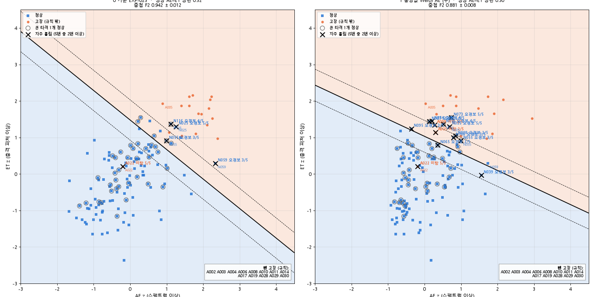
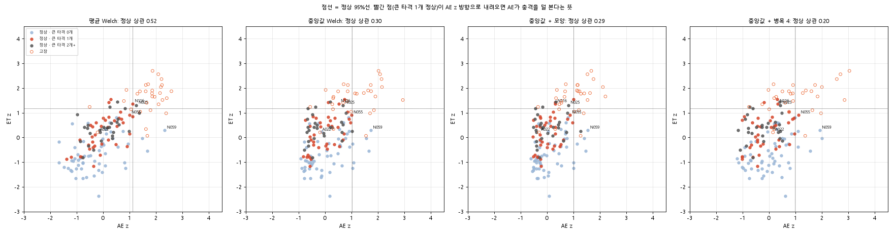
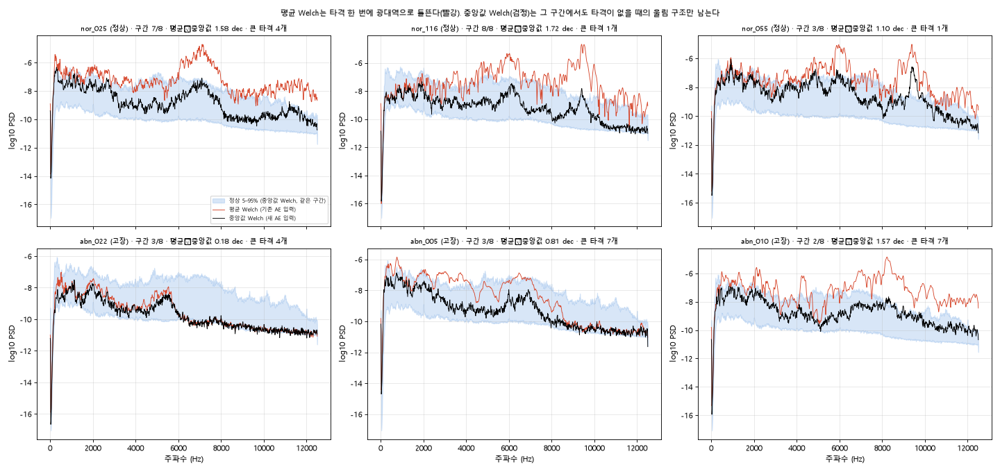
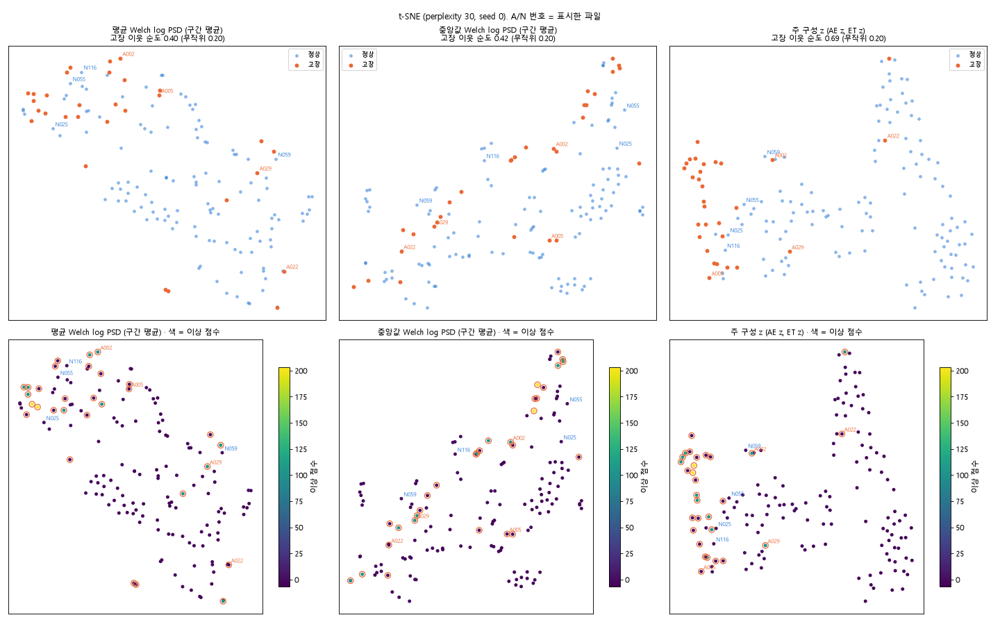

# EXP-032 정상상태 AE — 충격을 뺀 스펙트럼으로 AE와 ET의 역할 나누기

노션 카드 (실험 DB에 그대로 옮긴다)

| 팀원 | 모델 | F2 점수 | 변경 사항 | 메모 |
|---|---|---|---|---|
| 이동훈 | ET + 중앙값 Welch 스펙트럼 AE → 로지스틱 + 8.3k·유격 규칙 | 0.881 ± 0.008 | EXP-025의 AE 입력을 1초 평균 Welch PSD → 중앙값 Welch PSD(충격 프레임 무시)로. 비교: + 모양(게인 제거), + 병목 4 (H2, H3, H1) |  |

- 가설: H2, H3, H1 ([물리가설](../../../1_기준·기록/물리가설.md))
- 실행: 2026-11-16 · git `28b8ed8+수정중` · 코드 [run.py](run.py)
- 평가: 중첩 CV (바깥 5 × 안쪽 4, seed 5개). 자주 놓침 = seed 5번 중 3번 이상

## 결과

| 구성 | F2 | 재현율 | 오경보율 | 정밀도 | F2 (고장 10%·40%) | 자주 놓침 | 오경보 3회+ |
|---|---|---|---|---|---|---|---|
| 중첩: 1 중앙값 Welch AE (주) | 0.881 ± 0.008 | 0.920 | 0.075 | 0.757 | 0.822 · 0.914 | 009 022 | 9 |
| 중첩: 0 기준 EXP-025 | 0.942 ± 0.012 | 0.960 | 0.033 | 0.880 | 0.913 · 0.958 | 022 | 4 |
| 중첩: 2 중앙값 + 모양 | 0.871 ± 0.037 | 0.900 | 0.067 | 0.777 | 0.818 · 0.900 | 009 022 | 6 |
| 중첩: 3 중앙값 + 병목 4 | 0.863 ± 0.018 | 0.900 | 0.078 | 0.744 | 0.803 · 0.897 | 009 022 025 | 9 |

## 해석

<!-- key-figs: 자동 (save_fig key=True) -->

*logistic_plane* — 규칙 밖 고장과 정상만 남긴 AE z × ET z 평면. 중앙값 AE에서 큰 타격 1개 정상(회색 고리)이 왼쪽으로 빠지고 오경보 ×가 줄어드는가

<!-- /key-figs -->

## 그림

### role_split
AE 설정마다 정상의 AE z–ET z 상관과 큰 타격 1개 정상(빨강)의 AE z가 내려가는가

### mean_vs_median
타격이 든 구간에서 평균 Welch(빨강)는 정상 띠 위로 들뜨고 중앙값 Welch(검정)는 띠 안으로 돌아오는가 (정상 025·116·055), 고장은 중앙값으로도 띠 밖에 남는가

### tsne
중앙값 Welch 공간에서 고장이 더 모이는가, 오경보 정상·022는 어디인가

