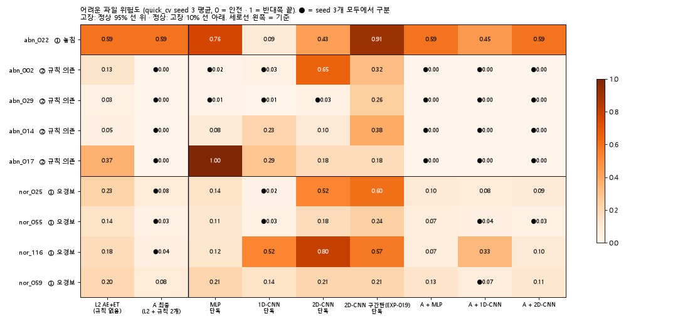
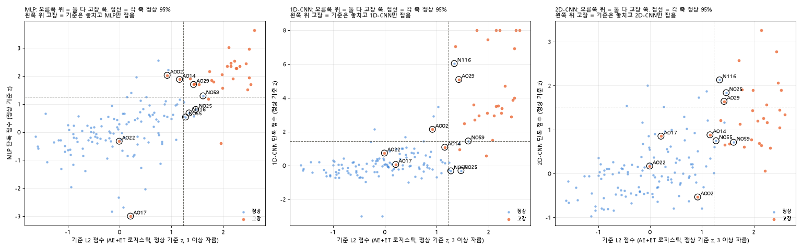
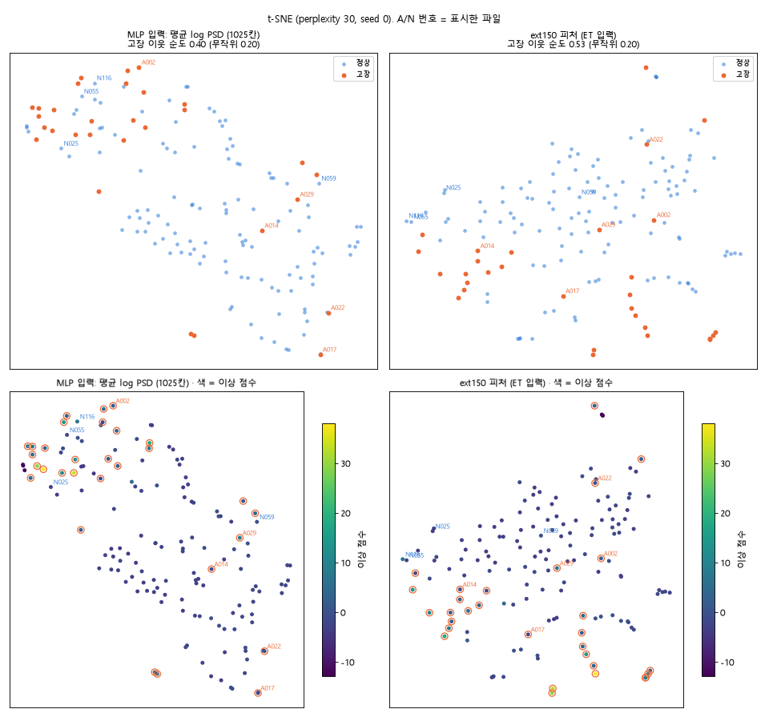
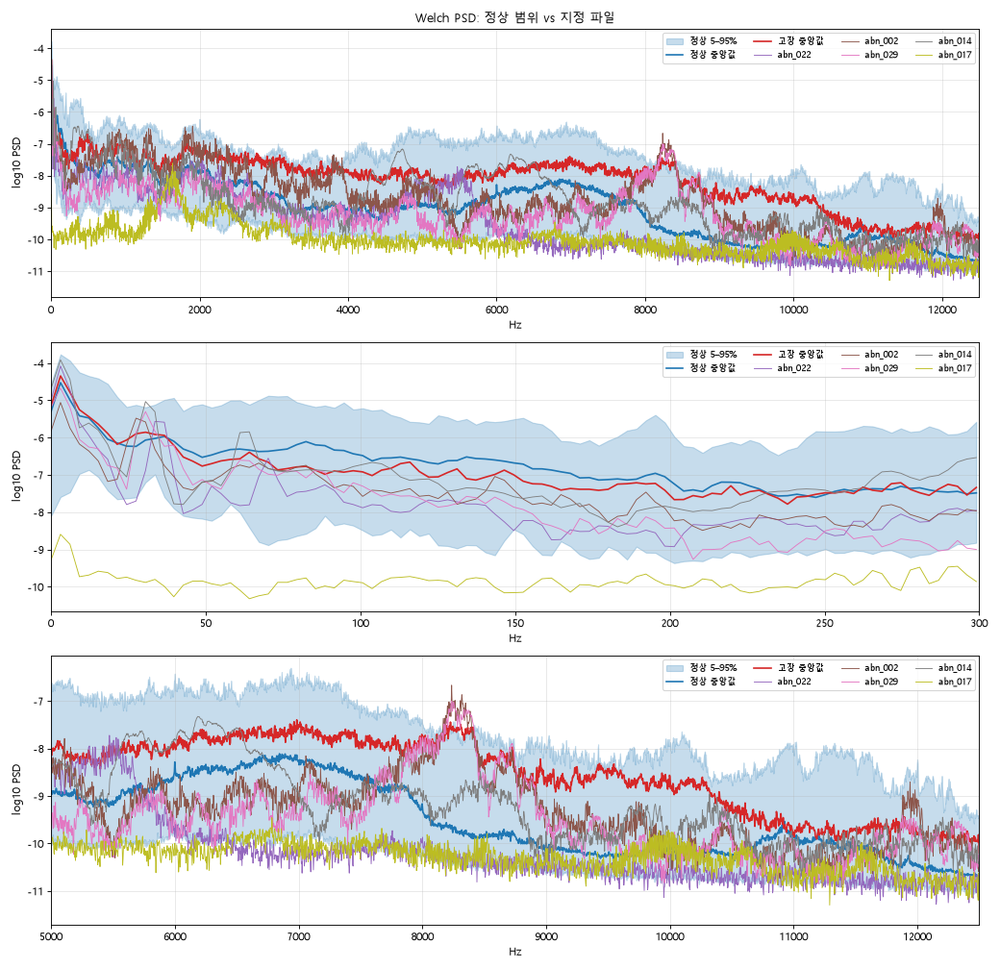

# EXP-033 딥러닝 검토 — 기준이 못 가르는 파일을 MLP·1D-CNN·2D-CNN이 가르는가

노션 카드 (실험 DB에 그대로 옮긴다)

| 팀원 | 모델 | F2 점수 | 변경 사항 | 메모 |
|---|---|---|---|---|
| 이동훈 | MLP(스펙트럼) · 1D-CNN(원신호 창 MIL) · 2D-CNN(2초 STFT 전체), 단독 / 최종 구성에 추가 |  | 입력별 신경망 3종을 같은 분할로 학습해 어려운 파일 9개(022 · 규칙 의존 고장 4 · 오경보 정상 4)의 구분 여부 판정 (H1, H2, H3) |  |

- 가설: H1, H2, H3 ([물리가설](../../../1_기준·기록/물리가설.md))
- 실행: 2026-11-16 · git `28b8ed8+수정중` · 코드 [run.py](run.py)

## 해석

<!-- key-figs: 자동 (save_fig key=True) -->

*hard_files* — 기준이 못 가르는 파일 9개를 신경망 3종이 가르는가 (● = 구분)

*logistic_plane* — 기준 점수(가로) × 신경망 점수(세로), OOF seed 0. 동그라미 = 어려운 파일 9개

<!-- /key-figs -->

## 그림

### tsne
입력 공간에서 어려운 파일의 위치와 1D-CNN 단독 점수(2행 색)

### psd_missed
어려운 고장 5개의 PSD가 정상 범위(파란 띠) 밖으로 나가는 주파수가 있는가

