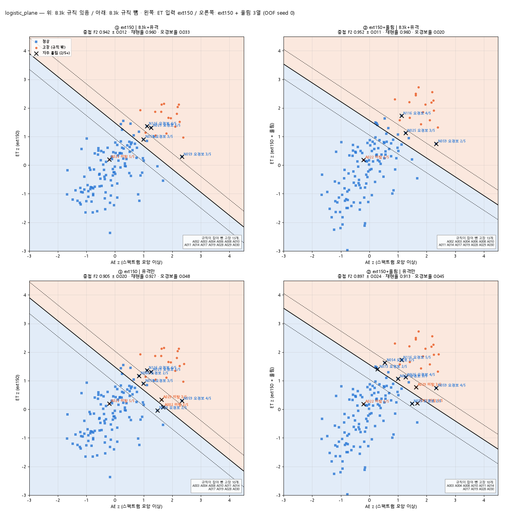
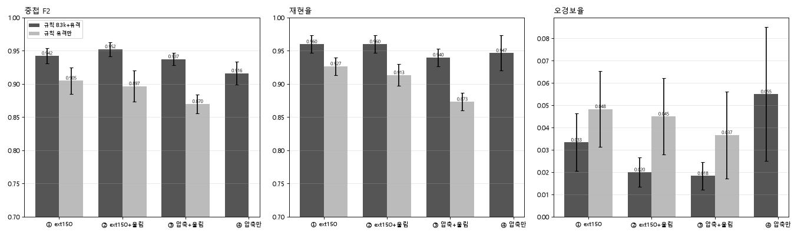
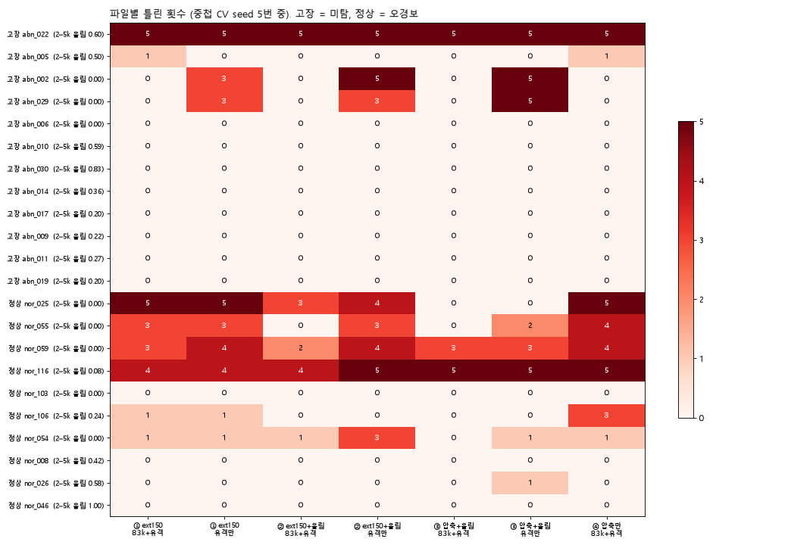
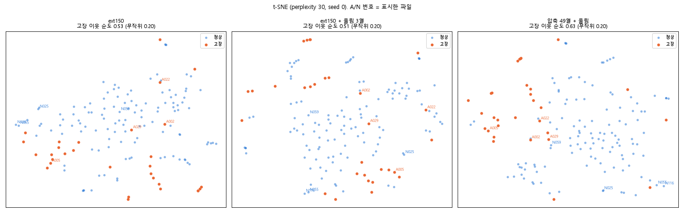
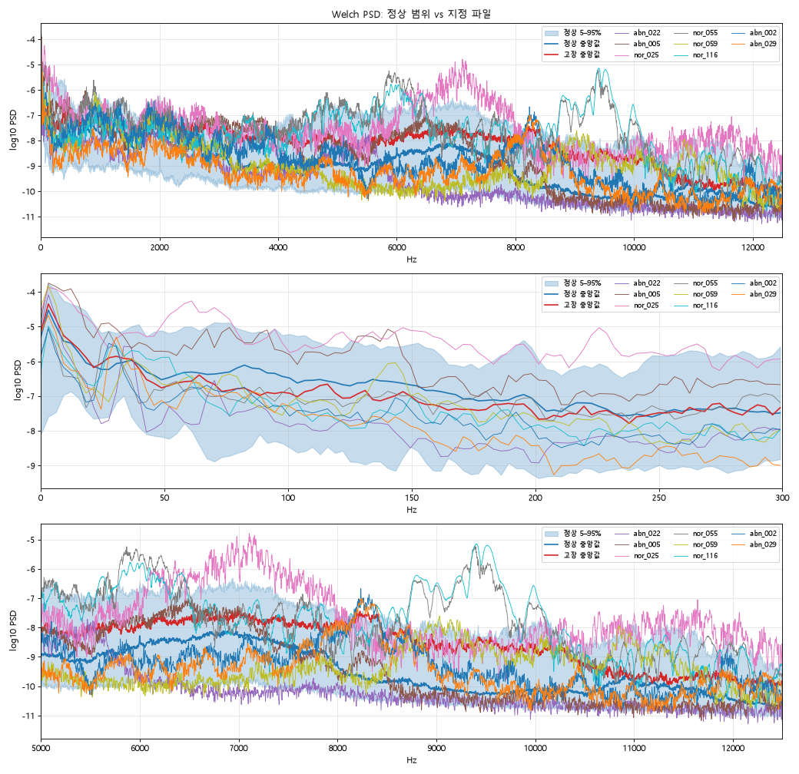

# EXP-034 울림 피처 + ext 압축 — 8.3 kHz 규칙 유무

노션 카드 (실험 DB에 그대로 옮긴다)

| 팀원 | 모델 | F2 점수 | 변경 사항 | 메모 |
|---|---|---|---|---|
| 이동훈 | AE + ET(입력 변경) → 로지스틱 + 유격 규칙 (± 8.3k 규칙) | 0.952 ± 0.011 | ET 입력에 충격 울림 3열(2–5 kHz 울림 비율 등, 2-16) 추가 · ext150을 폴드 안 상관 군집 대표로 압축. 8.3k 규칙 있음/없음 비교 (H1, H2) | 울림 3열 추가로 오경보율 0.033 → 0.020(055 · 059 · 025 감소), F2 +0.010은 sd 안. 8.3k 규칙을 빼면 002 · 029를 놓쳐 0.87–0.91 → 규칙 필수. 022는 그대로. 압축만 0.916(하락), 압축+울림 0.937(기준 수준, 52열) |

- 가설: H1, H2 ([물리가설](../../../../1_기준·기록/물리가설.md))
- 실행: 2026-11-16 · git `f4975d6+수정중` · 코드 [run.py](../../run.py)
- 평가: 중첩 CV (바깥 5 × 안쪽 4, seed 5개). 자주 놓침 = seed 5번 중 3번 이상

## 결과

| 구성 | F2 | 재현율 | 오경보율 | 정밀도 | F2 (고장 10%·40%) | 자주 놓침 | 오경보 3회+ |
|---|---|---|---|---|---|---|---|
| 중첩: ① ext150 \| 8.3k+유격 | 0.942 ± 0.012 | 0.960 | 0.033 | 0.880 | 0.913 · 0.958 | 022 | 4 |
| 중첩: ① ext150 \| 유격만 | 0.905 ± 0.020 | 0.927 | 0.048 | 0.830 | 0.864 · 0.927 | 002 022 029 | 4 |
| 중첩: ② ext150+울림 \| 8.3k+유격 | 0.952 ± 0.011 | 0.960 | 0.020 | 0.924 | 0.934 · 0.962 | 022 | 2 |
| 중첩: ② ext150+울림 \| 유격만 | 0.897 ± 0.024 | 0.913 | 0.045 | 0.838 | 0.859 · 0.917 | 002 022 029 | 5 |
| 중첩: ③ 압축+울림 \| 8.3k+유격 | 0.937 ± 0.009 | 0.940 | 0.018 | 0.928 | 0.921 · 0.946 | 022 | 2 |
| 중첩: ③ 압축+울림 \| 유격만 | 0.870 ± 0.014 | 0.873 | 0.037 | 0.861 | 0.839 · 0.886 | 002 022 029 | 2 |
| 중첩: ④ 압축만 \| 8.3k+유격 | 0.916 ± 0.017 | 0.947 | 0.055 | 0.820 | 0.870 · 0.941 | 022 | 5 |

## 해석

**울림 3열을 ET에 넣으면 오경보가 줄어든다(오경보율 0.033 → 0.020, 재현율 0.960 그대로, F2 0.942 → 0.952). 다만 F2 차이(+0.010)는 sd(0.012) 안이다. 8.3 kHz 규칙은 울림 피처로 대신할 수 없다.** 규칙을 빼면 어떤 입력이든 002 · 029를 놓쳐 F2가 0.87–0.91로 떨어진다. 가장 기대했던 미탐 022는 울림을 넣어도 5/5 그대로다. ext를 압축만 하면(150 → 약 49열) 0.916으로 sd 넘게 떨어진다. 울림 3열을 함께 넣으면 0.937로 기준 수준을 되찾는다.

<!-- key-figs: 자동 (save_fig key=True) -->

*logistic_plane* — 울림 피처를 넣으면 경계 근처 파일(022·005·025)이 맞는 쪽으로 옮겨 가는가, 8.3k 규칙을 빼면 002·029 등이 어디로 가는가

<!-- /key-figs -->

**그림 읽는 법**: 가로 = AE z(스펙트럼 모양이 정상과 얼마나 다른가), 세로 = ET z(충격 피처가 정상과 얼마나 다른가). 실선 = 로지스틱 경계, 주황 바탕 = 고장 쪽. 규칙이 잡은 고장은 그림에서 빼고 오른쪽 아래 상자에 적었다. × = 5번 중 2번 이상 틀린 파일. 위 두 칸 = 8.3k 규칙 있음, 아래 두 칸 = 뺌. 왼쪽 = ET 입력 ext150, 오른쪽 = ext150 + 울림.

1. **울림은 오경보를 줄인다 (위 오른쪽)**
   - 정상 055는 3/5 → 0, 059는 3/5 → 2/5, 025는 5/5 → 3/5로 줄었다
   - 정상 무리 전체가 아래로 내려가고 경계는 위로 올라갔다. 노면 충격(5–8 kHz 울림) 정상의 ET 점수가 낮아졌다는 뜻이다(2-16 해석과 같음)
   - 116은 4/5 그대로다. 116의 큰 충격은 9.5 kHz로 울려 2–5 kHz 축으로는 가려지지 않는다
2. **022는 움직이지 않는다**
   - `ring_2_5k`는 0.60으로 정상 95%(0.40)를 넘지만, 022는 충격이 5개뿐이고 다른 충격 피처가 모두 정상 범위라 ET가 이 한 열로 판정을 바꾸지 않는다
   - 022는 여전히 평면 왼쪽 아래(AE z −0.2, ET z 0.2)에 있다
3. **8.3 kHz 규칙은 꼭 필요하다 (아래 두 칸)**
   - 규칙을 빼면 002 · 029가 평면으로 돌아와 경계 근처에서 미탐이 된다(002는 울림을 넣으면 오히려 5/5)
   - 2-16에서 본 대로 002 · 029의 충격은 8.25 kHz로 울린다. 우리는 8 kHz 이상 울림을 일부러 입력에서 뺐으므로(오경보 055 · 059 · 116을 올리기 때문) 울림 3열이 이 둘을 대신할 수 없다
   - 8.3 kHz 규칙(좁은 8.20–8.45 kHz + 넓은 봉우리)이 이 정보를 오경보 없이 쓰는 유일한 방법이다
4. **압축 (③ · ④)**
   - 압축만 하면(④) 0.916으로 떨어지고 오경보가 늘어난다(오경보율 0.055)
   - 압축 + 울림(③)은 0.937 ± 0.009로 기준과 같은 수준이고, 오경보율이 가장 낮다(0.018, 025 · 055 = 0/5)
   - 대신 고장 015 · 025를 가끔 놓쳐(2/5) 재현율이 0.940으로 내려간다
   - 피처 150 → 52개로 같은 수준을 낸다는 것은 "피처가 많아서 좋은 게 아니다"의 근거가 된다. 다만 F2 기준으로는 ②가 낫다
5. **결론 후보**
   - 성능 기준이면 **② ext150 + 울림 3열 + 8.3k · 유격 규칙**이다. 차이가 sd 안이라 우리 기준(sd 넘는 개선)으로는 "같은 수준, 오경보만 줄어듦"이다
   - 피처 수를 줄이는 것이 목적이면 ③도 같은 수준이다
   - 최종 구성 교체는 사용자 결정이다(결정.md "최종 구성 고정")
6. **한계**
   - 울림 대역 경계(2/5/8 kHz)는 팀원이 데이터를 보고 정한 값이라 점수가 낙관적일 수 있다
   - 울림 피처는 다른 차종에서 AUC가 0.53–0.62로 무너졌다(권소린 보고서). 측정 조건이 바뀌면 가장 먼저 흔들리는 피처다

## 그림

### scores
ET 입력별 · 8.3k 규칙 유무별 중첩 F2 · 재현율 · 오경보율 (막대 = 평균, 선 = sd)

### hard_files
어느 파일이 구성마다 맞고 틀리는가 (울림이 022·005·025를, 8.3k 규칙이 002·029·006·010·030을)

### tsne
입력 공간마다 고장이 정상과 따로 모이는가, 문제 파일은 어디에 있는가 (울림 3열은 ×3 가중으로 눈에 띄게)

### psd_missed
문제 파일의 PSD가 정상 범위 밖으로 나가는 주파수

