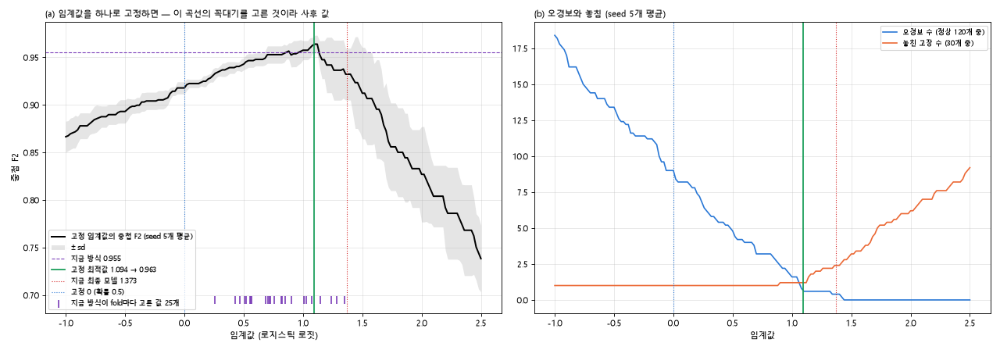
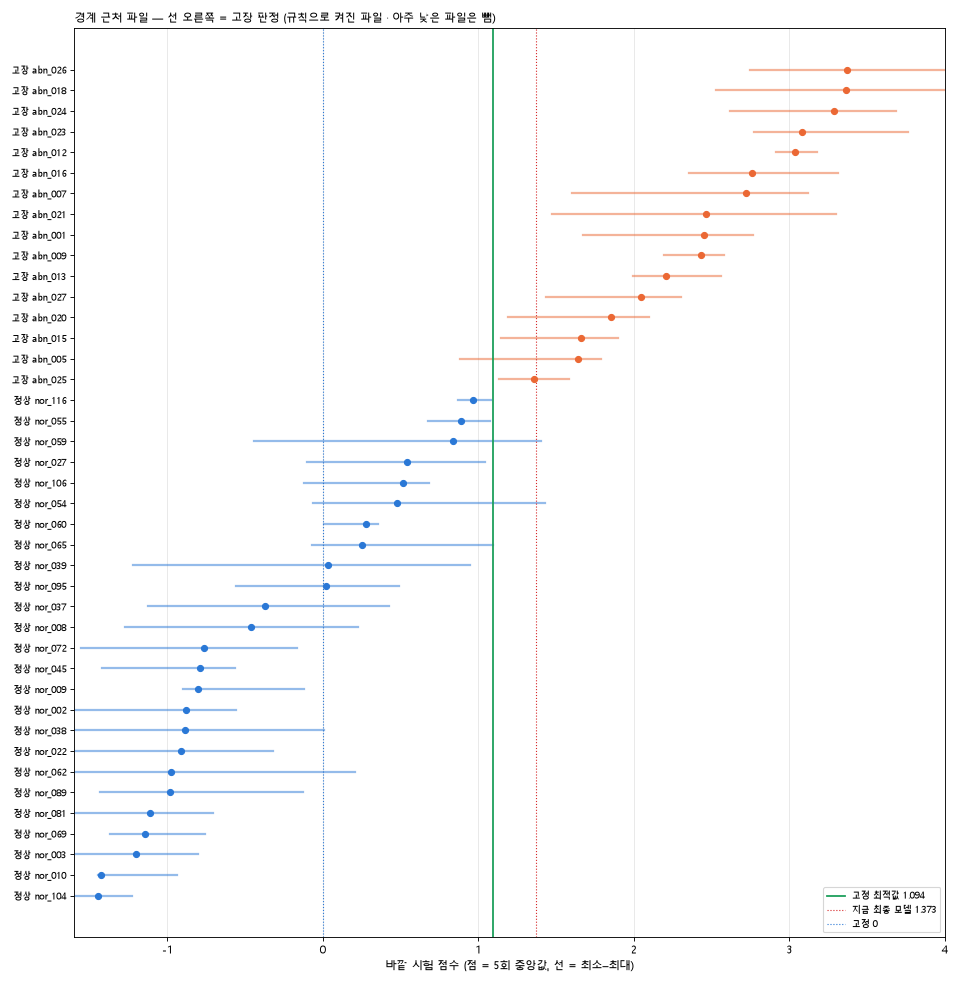
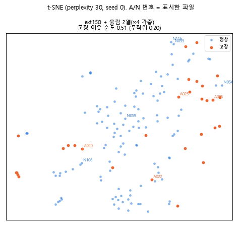
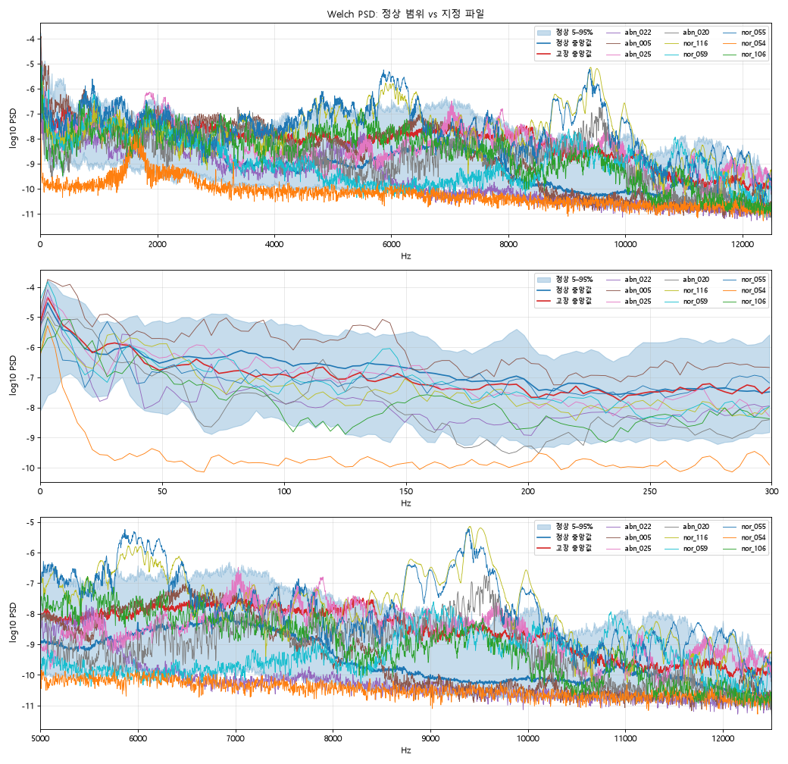

# EXP-035 고정 임계값 — 지금 검증 방식 그대로, 제출 임계값만 고정 최적값 (EXP-034 c)

노션 카드 (실험 DB에 그대로 옮긴다)

| 팀원 | 모델 | F2 점수 | 변경 사항 | 메모 |
|---|---|---|---|---|
| 이동훈 | EXP-034 c 그대로 (AE + ET(ext150 + 울림 2열) → 로지스틱 + 유격 + 8.3k(스펙트럼 OR 공진) + 본체 내림) | 0.963 ± 0.008 | 제출용 임계값: fold마다 고르기 → 하나로 고정(중첩 CV 바깥 점수에서 F2 최대인 값). 나영님 '고정 임계값' 방식 (-) |  |

- 가설: - ([물리가설](../../../1_기준·기록/물리가설.md))
- 실행: 2026-11-17 · git `a14b759+수정중` · 코드 [run.py](run.py)
- 평가: 중첩 CV (바깥 5 × 안쪽 4, seed 5개). 자주 놓침 = seed 5번 중 3번 이상

## 결과

| 구성 | F2 | 재현율 | 오경보율 | 정밀도 | F2 (고장 10%·40%) | 자주 놓침 | 오경보 3회+ |
|---|---|---|---|---|---|---|---|
| 지금 방식 (fold마다 안쪽 OOF로 고름) | 0.955 ± 0.007 | 0.967 | 0.023 | 0.913 | 0.934 · 0.966 | 022 | 2 |
| 고정 최적값 1.094 | 0.963 ± 0.008 | 0.960 | 0.007 | 0.973 | 0.956 · 0.966 | 022 | 0 |
| 고정 0 (확률 0.5) | 0.918 ± 0.006 | 0.967 | 0.075 | 0.764 | 0.857 · 0.952 | 022 | 10 |
| 고정 1.373 (지금 최종 모델) | 0.932 ± 0.027 | 0.920 | 0.003 | 0.986 | 0.929 · 0.934 | 022 025 | 0 |

## 해석

**지금 검증 방식(중첩 CV seed 5 × 바깥 5 × 안쪽 4) 그대로 바깥 시험 점수에서 임계값을 하나로 고정하면 최적값은 1.094이고 F2 0.963 ± 0.008이다(fold마다 고르는 지금 방식 0.955 ± 0.007).** 오경보율은 0.023 → 0.007로 줄고(116 · 055 · 027 · 039 해소), 놓침은 005가 1/5 늘었다. 지금 최종 모델에 박힌 1.373은 꼭대기 오른쪽 내리막이라 0.932 ± 0.027(025 · 005 · 015 · 020을 놓침)이고, 고정 0(확률 0.5)은 0.918이다. 단 1.094는 바깥 점수를 보고 고른 사후 값이고, 오른쪽이 가파르다(+0.1이면 0.942, −0.1이면 0.957). 정상 116(최대 1.08) · 055(최대 1.07) 바로 위, 고장 025(최소 1.13) 바로 아래에 놓인 값이라 여유가 0.01–0.04뿐이다.

<!-- key-figs: 자동 (save_fig key=True) -->

*threshold_sweep* — 임계값을 하나로 고정할 때 F2 · 오경보 · 놓침, 최적값과 지금 최종 모델 값의 위치

*edge_files* — 임계값 근처의 정상 · 고장과 분할에 따른 점수 흔들림

<!-- /key-figs -->

**그림 읽는 법**
- threshold_sweep (a): 가로 = 고정 임계값(로지스틱 로짓, 0 = 확률 0.5), 검은 선 = 그 값을 25개 바깥 fold 모두에 썼을 때 중첩 F2(seed 5개 평균), 회색 = ±sd. 보라 눈금 = 지금 방식이 fold마다 고른 값 25개(0.26–1.35, 중앙 0.76). (b) 오경보 수(파랑)와 놓친 고장 수(주황)
- edge_files: 점 = 파일의 바깥 점수 5회 중앙값, 선 = 최소–최대. 초록선 오른쪽이면 고장 판정

1. **왜 고정이 낫나**: 지금 방식이 fold마다 고른 값은 0.26–1.35로 흔들리고, 낮게 고른 fold에서 정상 116 · 055 · 059가 오경보가 된다. 고정하면 이 흔들림이 사라진다(나영님이 임계값을 고정한 이유와 같음)
2. **1.373(지금 최종 모델)이 나쁜 이유**: 학습 150개에서 seed 3개로 고른 값(1.441 · 0.457 · 1.373)의 중앙값이 꼭대기 오른쪽 내리막에 떨어졌다. 고장 025(1.13–1.59) · 005 · 015 · 020이 넘어간다
3. **최적값의 여유**: 1.094 바로 아래에 정상 116(0.87–1.08) · 055(0.67–1.07), 바로 위에 고장 025(1.13–1.59) · 005(0.88–1.79)가 있다. 왼쪽으로 0.25 옮겨도(0.844) 0.954로 지금 방식과 같지만, 오른쪽으로 0.1만 옮겨도 0.942로 떨어진다
4. **주의**: 최적값은 같은 150개의 바깥 점수에서 골라 0.963은 낙관적이다. 또 최종 모델은 150개 전체로 학습해 바깥 fold 모델(120개 학습)과 점수 눈금이 조금 다를 수 있다

## 그림

### tsne
입력 공간에서 경계 근처 파일은 어디에 있는가

### psd_missed
경계 근처 파일의 PSD가 정상 범위 밖으로 나가는 주파수

## 결정 (11-17, 사용자)
- 제출 임계값 = **고정 1.0** (`src/final.py` `FIXED_THR`). 최적값 1.094는 오른쪽 여유가 0.01–0.04뿐이라 왼쪽으로 옮긴 값. 1.0의 중첩 F2 0.957 ± 0.010 · 재현율 0.960 · 오경보율 0.013 (놓침 022 5/5 · 005 1/5, 오경보 055 · 059 2/5, 027 · 054 · 065 · 116 1/5)
- 다시 학습한 최종 모델 · 리허설 0.976 × 3 (고장 8/8, 오경보 1건씩). [7단계 README](../../../7_최종·제출/README.md)
