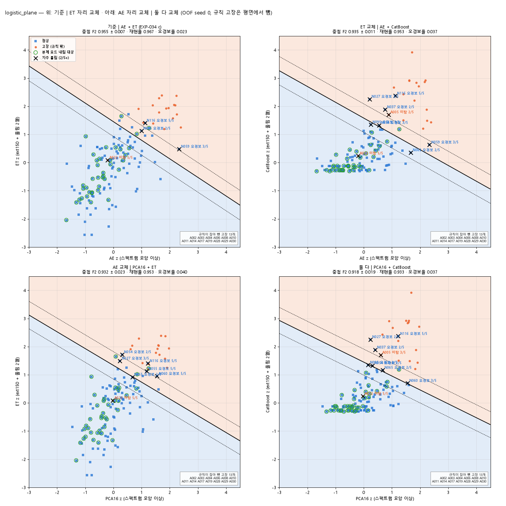
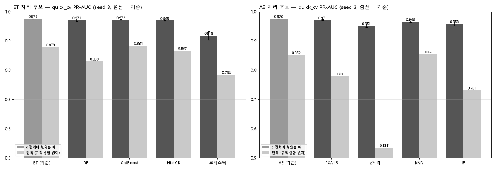
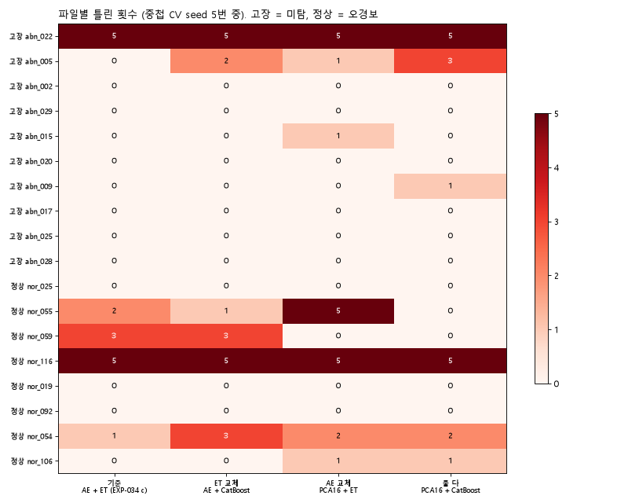
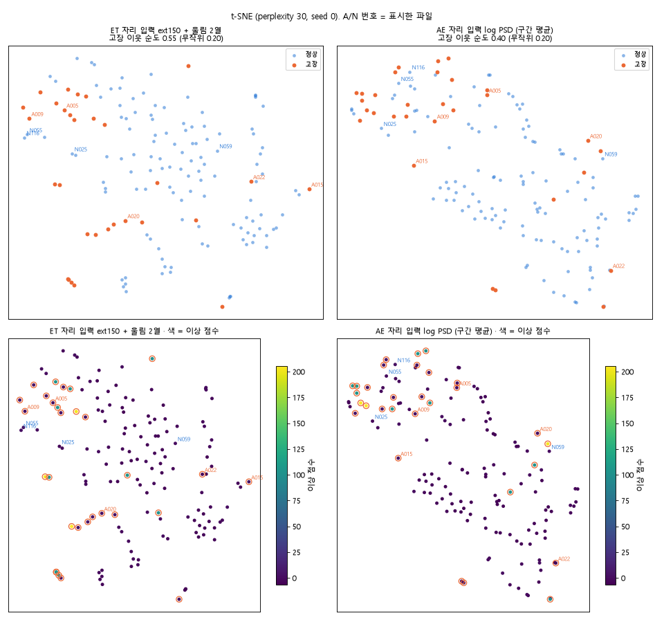
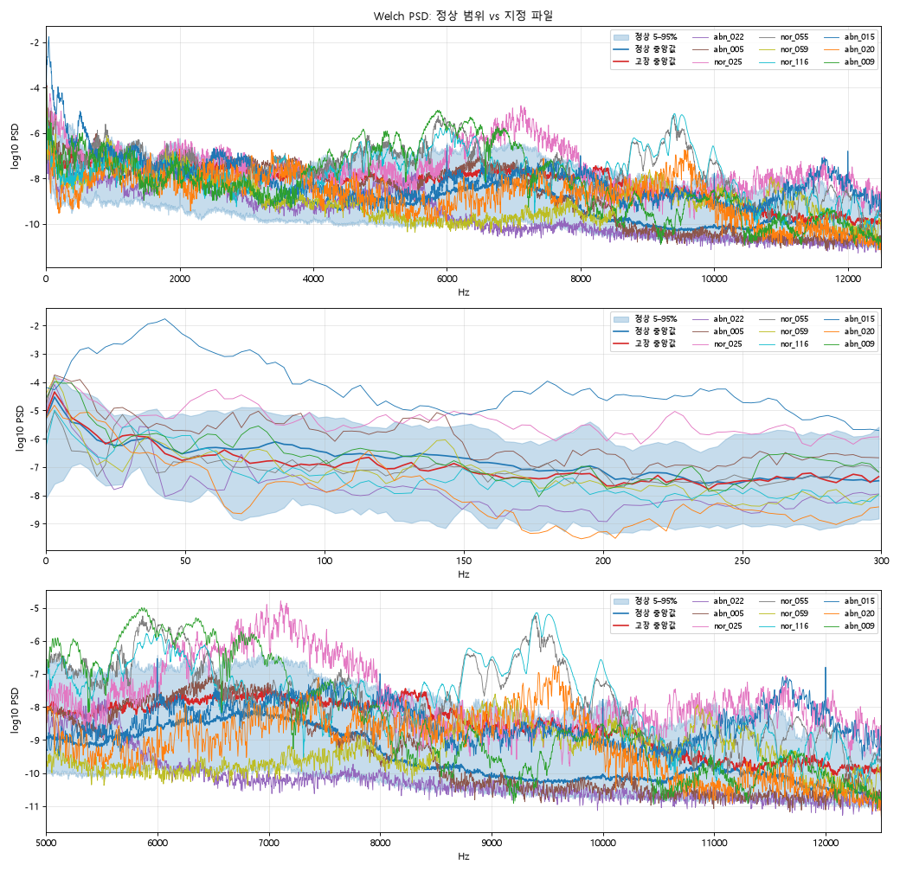

# EXP-037 AE · ET 자리 모델 교체 — 다른 모델로 지금 수준(EXP-034 c)이 나오는가

노션 카드 (실험 DB에 그대로 옮긴다)

| 팀원 | 모델 | F2 점수 | 변경 사항 | 메모 |
|---|---|---|---|---|
| 이동훈 | (AE 자리 후보) + (ET 자리 후보) → 로지스틱 + 유격 · 8.3k(스펙트럼 OR 공진) · 본체 내림 규칙 | 0.918 ± 0.019 | EXP-034 c에서 입력·규칙은 그대로, AE 자리(PCA·z거리·kNN·IF)와 ET 자리(RF·CatBoost·HistGB·로지스틱)의 모델만 교체 (H1, H2) | 기각. 모델만 바꾸면 어느 조합도 지금 수준(0.955 ± 0.007)에 못 미침: ET→CatBoost 0.935 · AE→PCA16 0.932 · 둘 다 0.918. 재현율은 비슷하고 오경보가 늘어남(0.023 → 0.037–0.040). 022 미탐 · 116 오경보는 모든 구성에서 5/5 = 입력 정보 한계 |

- 가설: H1, H2 ([물리가설](../../../1_기준·기록/물리가설.md))
- 실행: 2026-11-17 · git `a46605e+수정중` · 코드 [run.py](run.py)
- 평가: 중첩 CV (바깥 5 × 안쪽 4, seed 5개). 자주 놓침 = seed 5번 중 3번 이상

## 결과

| 구성 | F2 | 재현율 | 오경보율 | 정밀도 | F2 (고장 10%·40%) | 자주 놓침 | 오경보 3회+ |
|---|---|---|---|---|---|---|---|
| 중첩: 기준 \| AE + ET (EXP-034 c) | 0.955 ± 0.007 | 0.967 | 0.023 | 0.913 | 0.934 · 0.966 | 022 | 2 |
| 중첩: ET 교체 \| AE + CatBoost | 0.935 ± 0.011 | 0.953 | 0.037 | 0.867 | 0.902 · 0.952 | 022 | 3 |
| 중첩: AE 교체 \| PCA16 + ET | 0.932 ± 0.023 | 0.953 | 0.040 | 0.857 | 0.897 · 0.951 | 022 | 4 |
| 중첩: 둘 다 \| PCA16 + CatBoost | 0.918 ± 0.019 | 0.933 | 0.037 | 0.865 | 0.887 · 0.936 | 005 022 | 2 |

## 해석

**기각. 입력과 규칙을 그대로 두고 모델만 바꾸면 어느 조합도 지금 수준(EXP-034 c 0.955 ± 0.007)에 못 미친다. ET 자리를 CatBoost로 바꾸면 0.935 ± 0.011, AE 자리를 PCA16(선형 AE)으로 바꾸면 0.932 ± 0.023, 둘 다 바꾸면 0.918 ± 0.019다. 재현율은 0.933–0.953으로 거의 같고, 차이는 오경보다(0.023 → 0.037–0.040). 바뀐 모델은 회색 정상을 다른 곳으로 옮길 뿐 줄이지 못한다. 022 미탐 5/5와 116 오경보 5/5는 네 구성 모두 같다. quick_cv에서도 8개 후보가 모두 기준(PR-AUC 0.976)보다 낮았다(CatBoost 0.972 · RF 0.971 · PCA16 0.971 · HistGB 0.969 · kNN 0.966 · IF 0.958 · z거리 0.951 · 로지스틱 0.918). 지금의 ET(ExtraTrees)와 AE(MLP 128-16-128)를 유지한다**

<!-- key-figs: 자동 (save_fig key=True) -->

*logistic_plane* — 모델을 바꾸면 경계 근처 파일(022 · 005 · 025 · 116 · 059)의 위치가 달라지는가

*screening* — 자리마다 어떤 모델이 기준만큼 나오는가. 단독이 약해도 c 전체에서는 비슷할 수 있다

<!-- /key-figs -->

**그림 읽는 법**: logistic_plane의 가로축은 AE 자리 z, 세로축은 ET 자리 z다. OOF seed 0이며, 규칙이 잡은 고장 13개는 평면에서 뺐다. 실선은 설명용 로지스틱 경계이고 × 표시는 중첩 CV에서 2/5 이상 틀린 파일이다. screening은 자리마다 진한 막대 = c 전체에 넣었을 때의 PR-AUC, 연한 막대 = 그 모델 혼자 낸 PR-AUC다.

1. **CatBoost(ET 자리)**: 단독 PR-AUC는 ET와 비슷하다(0.884 vs 0.879). 그런데 정상 대부분을 z ≈ 0 근처에 납작하게 모으고, 회색 정상 몇 개(027 · 037 · 054 · 095 · 062)는 z 1.3–2.3으로 위로 띄운다. 부스팅은 학습 파일에 강하게 맞추기 때문에, 고장과 비슷한 정상 몇 개에만 확신을 준다. 그 결과 오경보가 기준의 3개 파일에서 7개 파일로 퍼지고, 고장 005가 경계 근처로 내려와 2/5 놓친다.
2. **PCA16(AE 자리)**: 병목 16은 AE와 같은데 선형이다. 정상 055 · 060의 AE z가 오른쪽으로 밀려 5/5 오경보가 된다. 대신 059는 0/5로 풀린다. 비선형 AE가 정상 스펙트럼의 변형(하중·속도 차이로 보이는 휨)까지 정상으로 복원하던 몫을, 선형 복원은 오차로 남긴다. 단독 PR-AUC도 AE 0.852 → PCA 0.780으로 낮다.
3. **둘 다 교체**: 두 약점이 더해진다. 005 미탐이 3/5로 늘어 "자주 놓침"에 들어간다.
4. **안 바뀌는 것**: 022(미탐)와 116(오경보)은 어떤 모델에서도 5/5다. 이 두 파일의 문제는 모델이 아니라 입력 정보에 있다. EXP-004 · 015 · 019 · 031과 같은 결론이다.
5. **나머지 후보**: RF · HistGB도 c 전체 PR-AUC 0.969–0.971로 CatBoost와 비슷해 중첩까지 가지 않았다. 로지스틱(선형, 0.918)과 z거리(모델 없음, 0.951)는 크게 낮다. 그래도 z거리가 c 전체에서 0.951이나 나오는 것은 규칙과 ET가 점수의 대부분을 만들고 있다는 뜻이다.
- 모든 설정은 실행 전에 고정했고 튜닝하지 않았다. 1등은 quick_cv로 자동으로 골랐다. 튜닝하면 조금 오를 수 있지만, 튜닝은 기준보다 낮아진다는 결과가 이미 있다(EXP-018 · 026).

## 그림

### hard_files
모델을 바꿔도 같은 파일을 틀리는가(정보 한계) 다른 파일을 틀리는가(모델 차이)

### tsne
입력 공간마다 고장이 따로 모이는가. 2행 색 = ET 자리 CatBoost 구성의 OOF 점수(seed 0)

### psd_missed
문제 파일의 PSD가 정상 범위 밖으로 나가는 주파수

