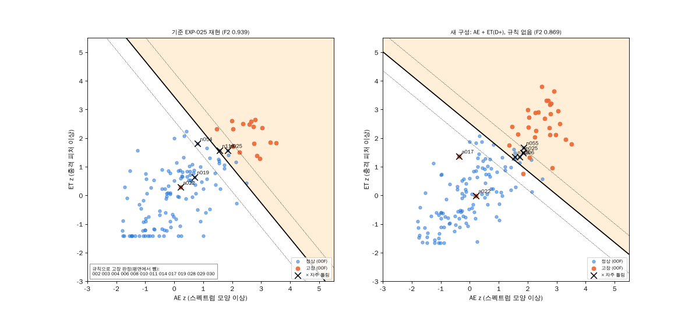
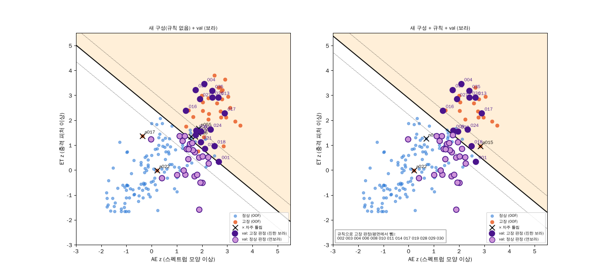
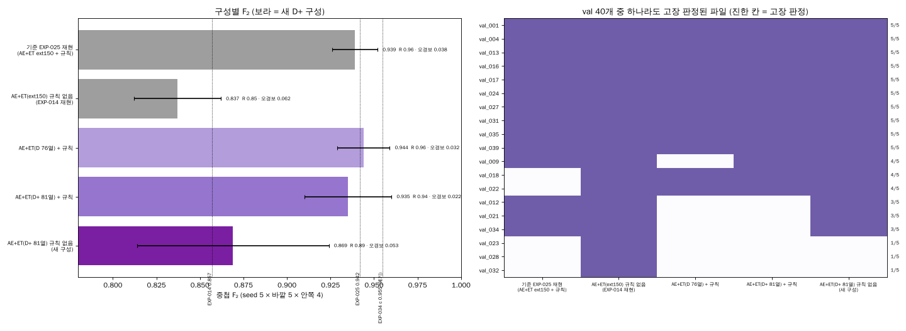
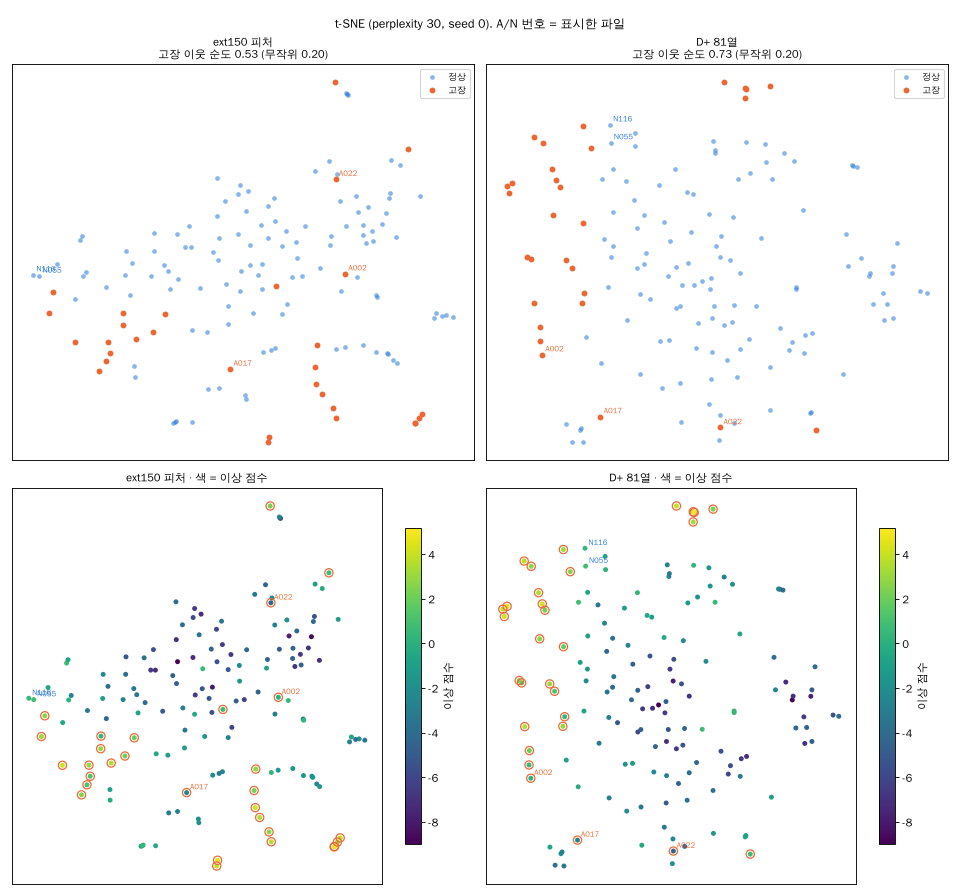

# EXP-039 D+ 피처로 규칙을 모델 안으로 (AE + ET(D+))

노션 카드 (실험 DB에 그대로 옮긴다)

| 팀원 | 모델 | F2 점수 | 변경 사항 | 메모 |
|---|---|---|---|---|
| 이동훈 | AE + ET(D+ 81열) → 로지스틱 (규칙 없음 / + 규칙) | 0.869 ± 0.055 | ET 입력을 ext150 → D+(대표 62 + 울림 4 + 물리 10 + 규칙 기반 5)로 교체, 규칙 유무 비교 (H1, H2′) | 규칙의 기반 수치(P83·W83·K1–K3)를 ET 입력에 넣은 새 구성(규칙 없음)은 F₂ 0.869 ± 0.055로 EXP-014 재현(0.837 ± 0.025)보다 +0.032 높고 002 · 014 · 029를 규칙 없이 잡았지만 sd가 커서 확정할 수 없고, 규칙을 포함한 구성은 기준(0.939, 기록 0.942)을 넘지 못했다(D 76열 0.944 · D+ 81열 0.935, 모두 sd 안). 채택하지 않는다. |

## 주요 변경점 (기준 EXP-025 대비)

- ET 입력을 ext150 → **D+ 81열**로 교체 (대표 62 + 울림 4 + 물리 10 + 규칙 기반 5)
- 규칙이 쓰는 연속 수치(P83 · W83 · K1–K3)를 ET 입력에 넣어 **규칙 없이** 판단 (규칙 있는 구성도 같이 비교)
- AE는 그대로 (스펙트럼 log-PSD, 정상만 학습)

- 가설: H1, H2′ ([물리가설](../../../1_기준·기록/물리가설.md))
- 실행: 2026-11-19 · git `07c53a9+수정중` · 코드 [run.py](run.py)
- 평가: 중첩 CV (바깥 5 × 안쪽 4, seed 5개). 자주 놓침 = seed 5번 중 3번 이상

## 결과

| 구성 | F2 | 재현율 | 오경보율 | 정밀도 | F2 (고장 10%·40%) | 자주 놓침 | 오경보 3회+ |
|---|---|---|---|---|---|---|---|
| AE+ET(D+ 81열) 규칙 없음 (새 구성) | 0.869 ± 0.055 | 0.887 | 0.053 | 0.812 | 0.826 · 0.893 | 017 022 | 4 |

## 해석

**규칙 없는 새 구성은 EXP-014 재현(0.837)보다 +0.032 높지만 sd 0.055라 확정할 수 없고, 규칙 포함 구성은 기준(0.939)을 넘지 못했다. 채택하지 않는다.** 002 · 014 · 029를 규칙 없이 잡은 점은 이후 EXP-043–044의 8.3k 규칙 설계로 이어졌다.

<!-- key-figs: 자동 (save_fig key=True) -->

*logistic_plane* — AE z × ET z 평면의 로지스틱 경계(굵은 선 = 임계값, 점선 ±1). 기준은 규칙으로 잡힌 고장을 뺐고 새 구성은 규칙 없이 전부 보인다. ×는 5 seed 중 3번 이상 틀린 파일

*val_plane* — 새 구성에 val 40개를 보라색으로 겹침. 진한 보라 = 고장 판정. 왼쪽은 규칙 없이, 오른쪽은 규칙을 더했을 때

*summary* — 구성별 F₂ 비교와 val 판정 일치도 (한 장 요약)

<!-- /key-figs -->

**읽는 법**
- 가로 = AE z, 세로 = ET z, 주황 바탕 = 고장 쪽. 새 구성에서는 고장 002 · 014가 경계 위로 올라오지만 정상 025 · 055 · 106 · 116이 경계 근처에 남는다.
- val: 5개 구성이 모두 고장으로 본 10개는 001 004 013 016 017 024 027 031 035 039. 구성마다 임계값이 달라 판정 수가 12–19로 갈리므로 val은 경계 영역에 밀집해 있다.

**상세**
1. **규칙 없음**: 0.837 → 0.869 (+0.032, sd 안). 놓침 002 014 017 022 029 → 017 022 (002 5/5 → 2/5, 014 3/5 → 1/5, 029 4/5 → 1/5), 오경보 3회+ 6 → 4개. 휴대폰 분석 18번의 3 seed 값 0.897은 5 seed에서 0.869 ± 0.055로 내려갔다 → 3 seed는 낙관적이었다.
2. **규칙 포함**: 기준 0.939 vs D 76열 0.944 ± 0.015 vs D+ 0.935 ± 0.025 — 모두 sd 안. D+ + 규칙은 오경보율이 0.022로 가장 낮고 025 · 116 오경보를 해소했지만 015를 새로 놓친다(3/5).
3. **임계값**: 규칙 없는 구성은 바깥 fold별 임계값이 −0.65–1.19로 흔들린다. D+ + 규칙은 중앙값 0.91 (사분위 0.80–1.12)로 기준(0.73)보다 좁다.
4. **한계**: 017 · 022는 규칙 없는 모든 구성에서 5/5 놓친다(022는 규칙 포함에서도 5/5). 학습 폴드에 닮은 고장이 없는 단독 유형이라 규칙 채택 기준 C2에 걸린다. 규칙 기반 5열 정의는 002 등을 본 뒤 설계돼 규칙과 같은 낙관 편향이 있다.
5. val 점수는 train 150 전체로 학습한 모델 점수이고 train 점은 OOF라 눈금이 조금 다를 수 있다.

**다음**: ① 고정 임계값 재결정(EXP-035 방식), ② seed를 늘려 규칙 없는 D+의 sd 확인, ③ val AE z 이동 진단.

## 그림

### tsne
ext150과 D+ 입력 공간에서 고장이 정상과 따로 모이는가. 아래 줄 = 새 구성의 OOF 이상 점수

## 중간 단계 결과 (비교 · 절제 · 이전 실험 값)

| 구성 | F2 | 재현율 | 오경보율 | 정밀도 | F2 (고장 10%·40%) | 자주 놓침 | 오경보 3회+ |
|---|---|---|---|---|---|---|---|
| 기준 EXP-025 재현 (AE+ET ext150 + 규칙) | 0.939 ± 0.013 | 0.960 | 0.038 | 0.863 | 0.905 · 0.957 | 022 | 4 |
| AE+ET(ext150) 규칙 없음 (EXP-014 재현) | 0.837 ± 0.025 | 0.853 | 0.062 | 0.781 | 0.789 · 0.863 | 002 014 017 022 029 | 6 |
| AE+ET(D 76열) + 규칙 | 0.944 ± 0.015 | 0.960 | 0.032 | 0.884 | 0.915 · 0.959 | 022 | 3 |
| AE+ET(D+ 81열) + 규칙 | 0.935 ± 0.025 | 0.940 | 0.022 | 0.916 | 0.915 · 0.945 | 015 022 | 1 |

## 사용한 피처

**모델 입력 두 가지**: ① ET(ExtraTrees 300그루) ← D+ 81열 피처, ② AE ← 신호의 로그 스펙트럼(피처 열 아님: 평균 제거 → 200 Hz 고역통과 → 1초 구간 8개 → log10 Welch PSD, 정상만 학습, 복원 오차 = AE 점수). 두 점수를 로지스틱으로 결합. 변환(분위수 정규화)과 군집은 학습 파일로만 fit, 라벨 안 씀.

**D+ 81열 = 62 + 4 + 10 + 5**

| 묶음 | 열 수 | 열 이름 · 의미 |
|---|---|---|
| ext150 대표 | 62 | 150개 후보를 상관 군집(\|ρ\| ≥ 0.85)으로 줄인 대표. 아래 표 |
| 울림 | 4 | ring24 · ring_body (충격 뒤 울림 주파수 칸) · res83 (8.3 kHz 공진 맞춤) · nimp (충격 수) |
| 물리 | 10 | ring_f · ring_zeta · ring_peak_rms (충격 정렬 평균의 울림 주파수 · 감쇠비 · 피크/RMS) · SK_2-4k · SK_5.5-7.75k · SK_8-8.7k · SK_9-10k (대역별 스펙트럼 첨도) · slope_lo · slope_hi (PSD 기울기 200–2000 · 2000–12000 Hz) · log_rms |
| 규칙 기반 | 5 | P83 · W83 (8.3 kHz 봉우리 돌출 · 폭) · K1 · K2 · K3 (유격 반복: 정상 중심 거리 2개 + 비율). 8.3k · 유격 규칙이 쓰는 연속 수치 |

**ext150 대표 62열**

| 계열 | 열 수 | 의미 | 열 이름 |
|---|---|---|---|
| T 시간 | 9 | 파형 통계 | T01_rms · T03_peak_to_peak · T06_raw_mean · T08_skewness · T11_shape · T12_clearance · T15_hjorth_complexity · T18_tkeo_kurtosis · T20_zcr |
| W 창 | 4 | 0.2초 창 10개의 변동 | W01_win_rms_max_to_mean · W02_win_rms_std · W03_win_kurtosis_max · W04_win_zcr_std |
| F 스펙트럼 | 6 | 전체 스펙트럼 모양·봉우리 | F01_spectral_centroid · F05_spectral_entropy · F07_peak1_freq · F08_peak1_amp · F09_peak2_freq · F09_peak3_freq |
| B04 대역 비율 | 14 | 625 Hz 칸 20개 중 대역 에너지 비율 (이름 = 시작 Hz) | 00625 · 01250 · 01875 · 02500 · 03125 · 04375 · 05625 · 06250 · 06875 · 07500 · 08125 · 09375 · 10625 · 11875 |
| P02 대역 필터 후 충격 | 21 | 1.25 kHz 폭 대역통과 뒤의 RMS · 피크 · 첨도 · crest (이름 = 시작 주파수, 037 = 3.75 kHz) | rms 000–112 10개 · kurtosis 012 025 037 050 062 087 100 · peak 000 012 025 · crest 000 |
| S01 스펙트로그램 | 8 | 대역별 에너지의 시간 변동 | kurtosis 012 025 037 050 062 087 100 · max_to_mean 000 |

