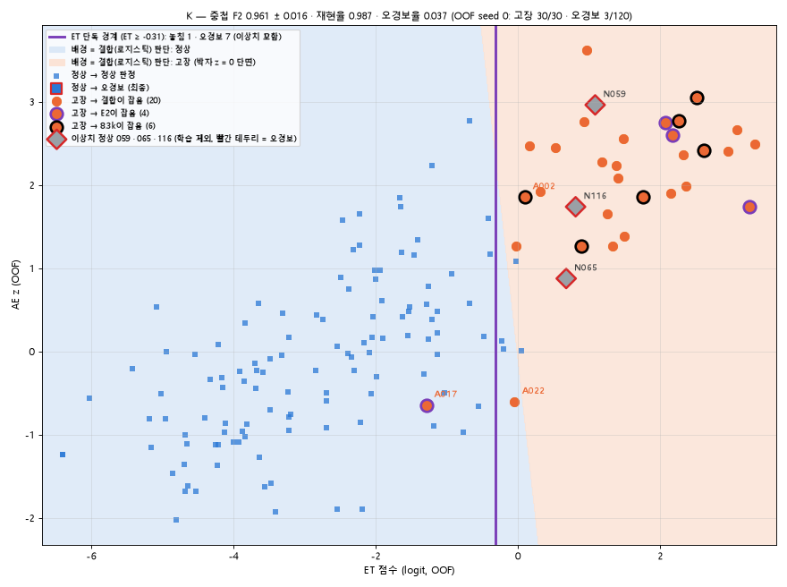
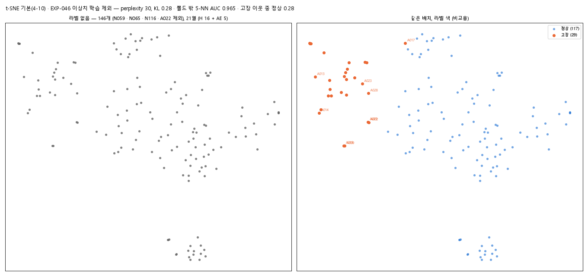
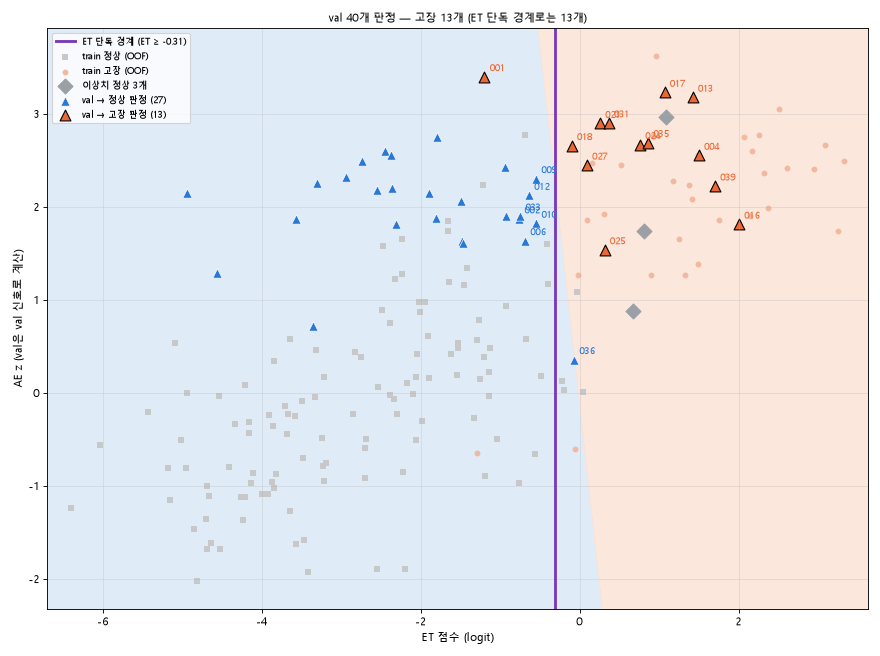

# EXP-046 J에서 이상치 정상 3개를 학습에서 제외

노션 카드 (실험 DB에 그대로 옮긴다)

| 팀원 | 모델 | F2 점수 | 변경 사항 | 메모 |
|---|---|---|---|---|
| 이동훈 | ET + 박자 z + AE z → 로지스틱 OR E2 OR 8.3k (정상 059 · 065 · 116 학습 제외) | 0.961 ± 0.016 | EXP-044 J에서 이상치 정상 3개를 학습에서만 뺌 (평가에는 포함) (H3, H2, H1) | **이상치 정상 3개를 학습에서 빼도 좋아지지 않는다: 중첩 F2 0.961 ± 0.016 (EXP-044 J 0.977 ± 0.010, −0.016).** 059 · 065 · 116은 여전히 오경보(3 · 4 · 5/5)이고 고장 022 · 009를 가끔 놓친다(1/5). |

## 주요 변경점 (기준 실험 대비)

- 정상 059 · 065 · 116을 학습에서 제외 (평가 · 결과 계산에는 포함)
- 나머지는 EXP-044 J와 같음

- 가설: H3, H2, H1 ([물리가설](../../../1_기준·기록/물리가설.md))
- 실행: 2026-11-22 · git `fdfe336+수정중` · 코드 [run.py](run.py)
- 평가: 중첩 CV (바깥 5 × 안쪽 4, seed 5개). 자주 놓침 = seed 5번 중 3번 이상

## 결과

| 구성 | F2 | 재현율 | 오경보율 | 정밀도 | F2 (고장 10%·40%) | 자주 놓침 | 오경보 3회+ |
|---|---|---|---|---|---|---|---|
| 중첩: K \| J, 이상치 3개 학습 제외 (150개 평가) | 0.961 ± 0.016 | 0.987 | 0.037 | 0.871 | 0.928 · 0.979 | — | 3 |

## 해석

**이상치 정상 3개를 학습에서 빼도 좋아지지 않는다: 중첩 F2 0.961 ± 0.016 (EXP-044 J 0.977 ± 0.010, −0.016).** 059 · 065 · 116은 여전히 오경보(3 · 4 · 5/5)이고 고장 022 · 009를 가끔 놓친다(1/5).

<!-- key-figs: 자동 (save_fig key=True) -->

*logistic_plane* — ET × AE 평면 (OOF seed 0). 배경 = 결합(로지스틱) 판단, 보라 세로선 = ET 단독 판단 경계, ◆ = 학습에서 뺀 이상치 정상 3개

*tsne_라벨* — 기본 t-SNE(4-10): 왼쪽 라벨 없음, 오른쪽 라벨 색. 빨간 원 = 오경보. 폴드 밖 5-NN AUC 0.965

<!-- /key-figs -->

- val 고장 판정이 10개 → 13개로 늘었다(018 021 025 추가): [val_판정.md](val_판정.md)
- 이 3개를 평가에서도 빼면 F2 0.976 (참고, 중간 단계 결과 표)
- 오류 분석: [오류분석_표.md](오류분석_표.md). 예전 EXP-028 · 038(못 가르는 정상 제외)도 기준 아래였다

## 그림

### val_판정
val 40개를 train OOF 위에 겹침. 배경 = 결합(로지스틱) 판단, 보라 세로선 = ET 단독 판단 경계

## 중간 단계 결과 (비교 · 절제 · 이전 실험 값)

| 구성 | F2 | 재현율 | 오경보율 | 정밀도 | F2 (고장 10%·40%) | 자주 놓침 | 오경보 3회+ |
|---|---|---|---|---|---|---|---|
| 중첩: J \| EXP-044 값 (이상치 포함 학습) | 0.977 ± 0.010 | 1.000 | 0.030 | 0.895 | 0.949 · 0.991 | — | 3 |
| 중첩: 참고 \| 같은 예측, 이상치 3개를 평가에서도 뺌 (147개) | 0.976 ± 0.017 | 0.987 | 0.017 | 0.938 | 0.960 · 0.984 | — | 0 |