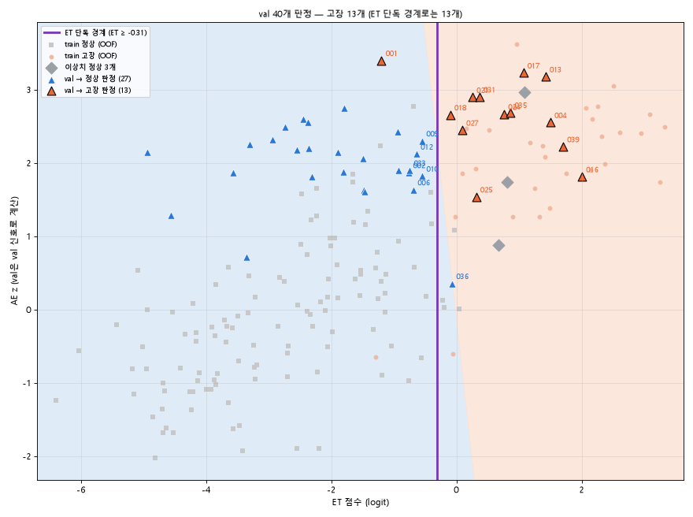

# EXP-046 val 판정 (학습 = 이상치 3개 뺀 147개, 제출 파일 아님)

고장 판정 13개: 001 004 013 016 017 018 021 024 025 027 031 035 039

| 파일 | 판정 | ET | ET단독 | AE_z | 박자z | 켠부품 |
|---|---|---|---|---|---|---|
| 001 | 고장 | -1.2 | 정상 | 3.4 | 0.0 | 8.3k |
| 002 | 정상 | -0.76 | 정상 | 1.87 | 0.0 | — |
| 003 | 정상 | -3.35 | 정상 | 0.72 | 0.0 | — |
| 004 | 고장 | 1.5 | 고장 | 2.55 | 0.0 | 결합 |
| 005 | 정상 | -3.3 | 정상 | 2.25 | 0.0 | — |
| 006 | 정상 | -0.68 | 정상 | 1.63 | 0.0 | — |
| 007 | 정상 | -4.56 | 정상 | 1.29 | 0.0 | — |
| 008 | 정상 | -1.9 | 정상 | 2.14 | 0.0 | — |
| 009 | 정상 | -0.55 | 정상 | 2.3 | -0.0 | — |
| 010 | 정상 | -0.55 | 정상 | 1.82 | 0.0 | — |
| 011 | 정상 | -2.31 | 정상 | 1.81 | 0.0 | — |
| 012 | 정상 | -0.64 | 정상 | 2.12 | 0.0 | — |
| 013 | 고장 | 1.42 | 고장 | 3.17 | 0.0 | 결합 |
| 014 | 정상 | -3.56 | 정상 | 1.86 | 0.0 | — |
| 015 | 정상 | -2.74 | 정상 | 2.49 | 0.0 | — |
| 016 | 고장 | 2.01 | 고장 | 1.81 | 0.0 | 결합 |
| 017 | 고장 | 1.07 | 고장 | 3.23 | 0.0 | 결합 |
| 018 | 고장 | -0.1 | 고장 | 2.65 | 0.0 | 결합 |
| 019 | 정상 | -2.36 | 정상 | 2.2 | 0.0 | — |
| 020 | 정상 | -4.94 | 정상 | 2.14 | 0.0 | — |
| 021 | 고장 | 0.26 | 고장 | 2.89 | 0.0 | 결합 |
| 022 | 정상 | -1.49 | 정상 | 2.05 | 0.6 | — |
| 023 | 정상 | -1.79 | 정상 | 2.74 | 0.0 | — |
| 024 | 고장 | 0.76 | 고장 | 2.66 | 0.0 | 결합 |
| 025 | 고장 | 0.31 | 고장 | 1.53 | 0.0 | 결합 |
| 026 | 정상 | -2.55 | 정상 | 2.18 | 0.0 | — |
| 027 | 고장 | 0.09 | 고장 | 2.44 | 1.2 | 결합 |
| 028 | 정상 | -2.44 | 정상 | 2.59 | 0.0 | — |
| 029 | 정상 | -1.81 | 정상 | 1.88 | 0.0 | — |
| 030 | 정상 | -2.94 | 정상 | 2.32 | 0.0 | — |
| 031 | 고장 | 0.37 | 고장 | 2.9 | 1.5 | 결합 |
| 032 | 정상 | -0.93 | 정상 | 1.9 | 0.0 | — |
| 033 | 정상 | -0.75 | 정상 | 1.9 | 0.0 | — |
| 034 | 정상 | -2.37 | 정상 | 2.56 | 0.0 | — |
| 035 | 고장 | 0.86 | 고장 | 2.69 | 0.0 | 결합 |
| 036 | 정상 | -0.07 | 고장 | 0.35 | 0.0 | — |
| 037 | 정상 | -0.94 | 정상 | 2.42 | 0.0 | — |
| 038 | 정상 | -1.48 | 정상 | 1.63 | 0.0 | — |
| 039 | 고장 | 1.7 | 고장 | 2.22 | 0.4 | 결합 |
| 040 | 정상 | -1.47 | 정상 | 1.61 | 0.0 | — |
