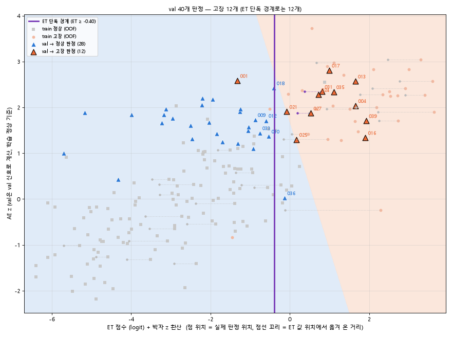

# EXP-047 val 판정 (train 150 전체 학습, 제출 파일 아님)

고장 판정 12개: 001 004 013 016 017 021 024 025 027 031 035 039 · J(EXP-044)와 다른 파일: 021 025

이웃고장(5) = 기본 t-SNE 공간(t-SNE 전)에서 가까운 train 5개 중 고장 수. 최근접거리_백분위 = 가장 가까운 train까지 거리가 train끼리 최근접 거리 분포의 몇 %인가(95 넘으면 train에서 먼 값). 최대z = 정상 기준 눈금에서 가장 벗어난 열

| 파일 | 판정 | J판정 | ET | ET단독 | AE_z | 박자z | 켠부품 | 이웃고장(5) | 최근접거리_백분위 | 최대z열 | 최대z |
|---|---|---|---|---|---|---|---|---|---|---|---|
| 001 | 고장 | 고장 | -1.32 | 정상 | 2.58 | 0.0 | 8.3k | 2 | 95 | H8_ring_2-4k | 5.0 |
| 002 | 정상 | 정상 | -1.06 | 정상 | 1.49 | 0.0 | — | 0 | 49 | H8_ring_2-4k | 3.3 |
| 003 | 정상 | 정상 | -4.33 | 정상 | 0.43 | 0.0 | — | 0 | 66 | H9_ring_4-8k | -5.7 |
| 004 | 고장 | 고장 | 1.65 | 고장 | 2.04 | 0.0 | 결합 | 5 | 82 | H3_kurt_1-2k | 6.9 |
| 005 | 정상 | 정상 | -3.99 | 정상 | 1.84 | 0.0 | — | 0 | 58 | AE_4-8k | 2.1 |
| 006 | 정상 | 정상 | -0.92 | 정상 | 1.1 | 0.0 | — | 0 | 66 | H15a_share_8-10k | 2.5 |
| 007 | 정상 | 정상 | -5.7 | 정상 | 1.01 | 0.0 | — | 0 | 32 | AE_4-8k | 1.3 |
| 008 | 정상 | 정상 | -2.04 | 정상 | 1.68 | 0.0 | — | 0 | 52 | H17_peak_w | 2.9 |
| 009 | 정상 | 정상 | -0.88 | 정상 | 1.73 | -0.0 | — | 0 | 75 | AE_8-12.5k | 2.7 |
| 010 | 정상 | 정상 | -0.53 | 정상 | 1.37 | 0.0 | — | 0 | 84 | H3_kurt_1-2k | 5.2 |
| 011 | 정상 | 정상 | -2.47 | 정상 | 1.32 | 0.0 | — | 0 | 65 | AE_8-12.5k | 2.0 |
| 012 | 정상 | 정상 | -0.61 | 정상 | 1.71 | 0.0 | — | 1 | 95 | H3_kurt_1-2k | 4.7 |
| 013 | 고장 | 고장 | 1.65 | 고장 | 2.57 | 0.0 | 결합 | 4 | 87 | H3_kurt_1-2k | 4.2 |
| 014 | 정상 | 정상 | -3.23 | 정상 | 1.67 | 0.0 | — | 0 | 64 | AE_1-2k | 2.5 |
| 015 | 정상 | 정상 | -3.13 | 정상 | 1.97 | 0.0 | — | 0 | 84 | H9_ring_4-8k | -5.7 |
| 016 | 고장 | 고장 | 1.9 | 고장 | 1.34 | 0.0 | 결합 | 5 | 87 | H3_kurt_1-2k | 5.7 |
| 017 | 고장 | 고장 | 0.99 | 고장 | 2.81 | 0.0 | 결합 | 4 | 84 | H8_ring_2-4k | 5.0 |
| 018 | 정상 | 정상 | -0.4 | 정상 | 2.42 | 0.0 | — | 2 | 88 | H8_ring_2-4k | 5.0 |
| 019 | 정상 | 정상 | -2.96 | 정상 | 1.76 | 0.0 | — | 0 | 52 | H7_ring_1-2k | 2.1 |
| 020 | 정상 | 정상 | -5.17 | 정상 | 1.89 | 0.0 | — | 0 | 40 | AE_4-8k | 2.3 |
| 021 | 고장 | 정상 | -0.08 | 고장 | 1.91 | 0.0 | 결합 | 3 | 88 | H10a_ring_8-10k | 5.6 |
| 022 | 정상 | 정상 | -1.45 | 정상 | 1.91 | 0.6 | — | 0 | 84 | H15a_share_8-10k | 2.8 |
| 023 | 정상 | 정상 | -1.95 | 정상 | 2.18 | 0.0 | — | 0 | 95 | H15b_share_10-12.5k | -4.4 |
| 024 | 고장 | 고장 | 0.72 | 고장 | 2.28 | 0.0 | 결합 | 4 | 73 | H3_kurt_1-2k | 4.3 |
| 025 | 고장 | 정상 | 0.17 | 고장 | 1.3 | 0.0 | 결합 | 0 | 73 | H3_kurt_1-2k | 3.7 |
| 026 | 정상 | 정상 | -2.51 | 정상 | 1.6 | 0.0 | — | 0 | 60 | AE_4-8k | 2.0 |
| 027 | 고장 | 고장 | 0.19 | 고장 | 1.87 | 1.2 | 결합 | 3 | 84 | H17_peak_w | 5.4 |
| 028 | 정상 | 정상 | -2.2 | 정상 | 2.2 | 0.0 | — | 0 | 87 | H9_ring_4-8k | -5.7 |
| 029 | 정상 | 정상 | -1.84 | 정상 | 1.43 | 0.0 | — | 0 | 58 | H17_peak_w | 3.0 |
| 030 | 정상 | 정상 | -3.18 | 정상 | 1.84 | 0.0 | — | 0 | 84 | H9_ring_4-8k | -5.7 |
| 031 | 고장 | 고장 | 0.37 | 고장 | 2.34 | 1.6 | 결합 | 5 | 100 | H17_peak_w | 21.3 |
| 032 | 정상 | 정상 | -1.04 | 정상 | 1.58 | 0.0 | — | 0 | 87 | H3_kurt_1-2k | 4.5 |
| 033 | 정상 | 정상 | -0.76 | 정상 | 1.44 | 0.0 | — | 1 | 84 | H3_kurt_1-2k | 6.0 |
| 034 | 정상 | 정상 | -2.21 | 정상 | 2.06 | 0.0 | — | 0 | 64 | AE_8-12.5k | 3.0 |
| 035 | 고장 | 고장 | 1.1 | 고장 | 2.34 | 0.0 | 결합 | 5 | 100 | H17_peak_w | 20.7 |
| 036 | 정상 | 정상 | -0.13 | 고장 | 0.02 | 0.0 | — | 1 | 87 | H3_kurt_1-2k | 6.6 |
| 037 | 정상 | 정상 | -1.25 | 정상 | 1.97 | 0.0 | — | 0 | 69 | H9_ring_4-8k | -2.8 |
| 038 | 정상 | 정상 | -1.32 | 정상 | 1.21 | 0.0 | — | 0 | 57 | H3_kurt_1-2k | 5.1 |
| 039 | 고장 | 고장 | 1.81 | 고장 | 1.71 | 0.4 | 결합 | 5 | 76 | H17_peak_w | 4.8 |
| 040 | 정상 | 정상 | -1.7 | 정상 | 1.25 | 0.0 | — | 0 | 64 | H17_peak_w | 6.8 |
