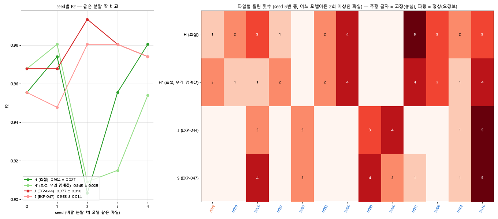
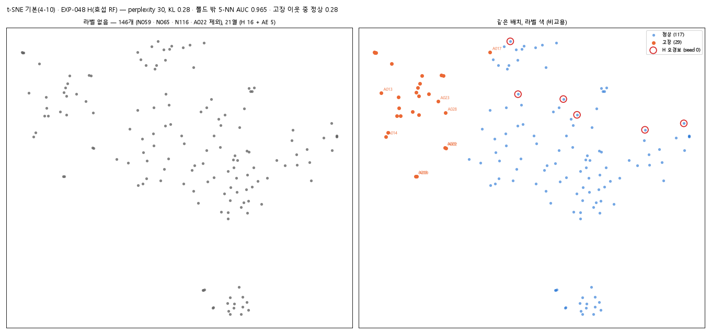
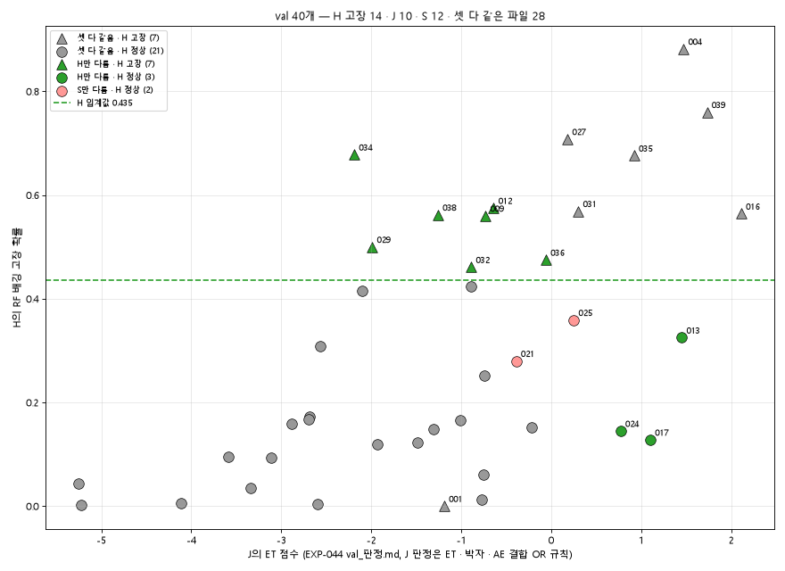

# EXP-048 신효섭 RF 배깅 + 8.3k를 같은 틀에서 J · S와 비교

노션 카드 (실험 DB에 그대로 옮긴다)

| 팀원 | 모델 | F2 점수 | 변경 사항 | 메모 |
|---|---|---|---|---|
| 이동훈 (모델: 신효섭) | RF 배깅(피처 32개 중 10개 선택 × 10번) OR 8.3k 스펙트럼 규칙 — vs J · S | 0.954 ± 0.027 | 효섭 11-19 최종 모델을 우리 중첩 CV 분할(바깥 5 × seed 5)에 넣어 J · S와 seed별 짝 비교 (H1, H2, H3) | **같은 분할에서 효섭 RF(H) 0.954 ± 0.027 < S 0.968 ± 0.014 < J 0.977 ± 0.010.** seed별 H vs J는 2승 3패(평균 −0.023). H는 재현율 0.987 · 오경보율 0.047로 J(1.000 · 0.030)보다 둘 다 나쁘다. 오경보 파일은 거의 겹치지 않는다(H 073 · 055 · 088 / J 065 · 059). |

## 주요 변경점 (기준 실험 대비)

- 모델 = 신효섭 최종모델.py 그대로 (src/rf_hyoseop.py)
- 평가 = 우리 바깥 분할 · seed 5개 · 지표 (J · S와 같은 파일로 학습 · 채점)
- 임계값 = 효섭 방식(H) · 우리 방식(H′) 둘 다
- J · S는 같은 seed로 다시 실행

- 가설: H1, H2, H3 ([물리가설](../../../1_기준·기록/물리가설.md))
- 실행: 2026-11-22 · git `fdfe336+수정중` · 코드 [run.py](run.py)
- 평가: 중첩 CV (바깥 5 × 안쪽 4, seed 5개). 자주 놓침 = seed 5번 중 3번 이상

## 결과

| 구성 | F2 | 재현율 | 오경보율 | 정밀도 | F2 (고장 10%·40%) | 자주 놓침 | 오경보 3회+ |
|---|---|---|---|---|---|---|---|
| 중첩: H \| 효섭 RF 배깅 + 8.3k (효섭 임계값 방식) | 0.954 ± 0.027 | 0.987 | 0.047 | 0.843 | 0.912 · 0.976 | — | 5 |

## 해석

**같은 분할에서 효섭 RF(H) 0.954 ± 0.027 < S 0.968 ± 0.014 < J 0.977 ± 0.010.** H − J = −0.023이지만 seed별로는 H가 2번 이기고 3번 진다(좋아짐 2 · 나빠짐 3). H의 sd가 커서 우열이 확실하다고 할 수는 없다. 다만 J는 5개 seed 모두 0.968 이상이고, H는 seed 2에서 0.903까지 떨어진다. H는 재현율 0.987(013 · 017 각각 1/5 놓침), 오경보율 0.047로 J(1.000 · 0.030)보다 둘 다 나쁘다. 임계값을 우리 방식으로 바꾼 H′도 0.945로 J보다 낮다.

<!-- key-figs: 자동 (save_fig key=True) -->

*짝비교* — 왼쪽 = seed별 F2(같은 바깥 분할), 오른쪽 = 파일별 틀린 횟수. 고장은 놓친 횟수, 정상은 오경보 횟수

*tsne_라벨* — 기본 t-SNE(4-10): 왼쪽 라벨 없음, 오른쪽 라벨 색. 빨간 원 = H 오경보(seed 0). 폴드 밖 5-NN AUC 0.965

<!-- /key-figs -->

- 읽는 법: 왼쪽 그림의 네 모델은 seed마다 같은 120개로 학습하고 같은 30개로 채점했다. 오른쪽 칸의 숫자는 seed 5번 중 틀린 횟수다.
- **틀리는 파일이 다르다.** H의 오경보는 첨도가 튀는 정상 파일에서 난다: 073 5/5, 055 4/5, 088 · 025 · 116 3/5. J · S의 오경보는 8.3k 근처 이상치 정상 116 · 065 · 059와 025에서 난다. 두 쪽 모두에서 겹치는 오경보는 116 · 025뿐이다.
- 8.3k 규칙이 H에 보태는 몫은 +0.024다(규칙 없이 0.930, 002를 5/5 놓침). J와 같은 공진 규칙을 더해도 0.955로 거의 같다. **H와 J의 차이는 규칙이 아니라 본체(RF 배깅 vs ET · 박자 · AE 결합)에서 나온다.**
- 8.3k 스펙트럼 문턱은 H · J 모두 같은 사후 값이다. 효섭님 계산과 우리 `rule83_flags`의 켜짐은 train 150/150 · val 40/40 일치한다. 따라서 이 비교에서 사후 문턱은 어느 한쪽만 유리하게 만들지 않는다. J의 공진 규칙만 추가 사후 몫이다.
- 효섭님 틀(20회 반복)에서 잰 0.956과 우리 틀에서 잰 0.954는 거의 같다. 우리 틀에서 고른 임계값은 평균 0.343으로, 전체 학습 때의 0.435보다 낮다.
- val(제출 파일 아님): H 14 · J 10 · S 12개. 셋 다 고장인 파일은 7개(001 004 016 027 031 035 039)다. H만 고장으로 본 7개(009 012 029 032 034 036 038)는 J의 ET 점수가 모두 음수다. 효섭님 제출 csv와 40/40 일치해 재현을 확인했다. [val_판정.md](val_판정.md) · [오류분석_표.md](오류분석_표.md)

## 그림

### val_판정
val 40개: 가로 = J의 ET 점수, 세로 = H 확률. 색 = 세 모델 판정의 일치, ▲ = H 고장 판정

## 중간 단계 결과 (비교 · 절제 · 이전 실험 값)

| 구성 | F2 | 재현율 | 오경보율 | 정밀도 | F2 (고장 10%·40%) | 자주 놓침 | 오경보 3회+ |
|---|---|---|---|---|---|---|---|
| 중첩: H-8.3k없음 \| H에서 8.3k 규칙 뺌 (RF 배깅 단독) | 0.930 ± 0.019 | 0.960 | 0.050 | 0.830 | 0.887 · 0.953 | 002 | 5 |
| 중첩: H+공진 \| H의 8.3k를 J와 같은 스펙트럼 OR 공진으로 | 0.955 ± 0.027 | 0.987 | 0.045 | 0.847 | 0.915 · 0.976 | — | 4 |
| 중첩: H′ \| H, 임계값 = 우리 방식 (안쪽 4겹 OOF F2 최대) | 0.945 ± 0.028 | 0.967 | 0.037 | 0.869 | 0.913 · 0.962 | — | 4 |
| 중첩: J \| EXP-044 다시 실행 (같은 seed) | 0.977 ± 0.010 | 1.000 | 0.030 | 0.895 | 0.949 · 0.991 | — | 3 |
| 중첩: S \| EXP-047 다시 실행 (같은 seed) | 0.968 ± 0.014 | 0.993 | 0.035 | 0.878 | 0.936 · 0.984 | — | 3 |