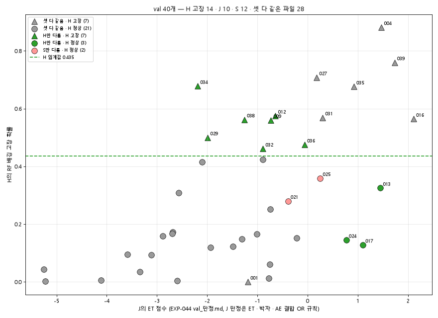

# EXP-048 val 판정 (train 150 전체 학습, 제출 파일 아님)

H 고장 14개: 001 004 009 012 016 027 029 031 032 034 035 036 038 039
J 10개 · S 12개 · 셋 다 고장: 001 004 016 027 031 035 039

| 파일 | H | H_확률 | H_8_3k | 효섭_제출 | J | S | J_ET | 일치 |
|---|---|---|---|---|---|---|---|---|
| 001 | 고장 | 0.0 | 켜짐 | 고장 | 고장 | 고장 | -1.19 | 셋 다 같음 |
| 002 | 정상 | 0.251 | — | 정상 | 정상 | 정상 | -0.74 | 셋 다 같음 |
| 003 | 정상 | 0.005 | — | 정상 | 정상 | 정상 | -4.11 | 셋 다 같음 |
| 004 | 고장 | 0.882 | — | 고장 | 고장 | 고장 | 1.47 | 셋 다 같음 |
| 005 | 정상 | 0.095 | — | 정상 | 정상 | 정상 | -3.59 | 셋 다 같음 |
| 006 | 정상 | 0.424 | — | 정상 | 정상 | 정상 | -0.89 | 셋 다 같음 |
| 007 | 정상 | 0.044 | — | 정상 | 정상 | 정상 | -5.25 | 셋 다 같음 |
| 008 | 정상 | 0.415 | — | 정상 | 정상 | 정상 | -2.1 | 셋 다 같음 |
| 009 | 고장 | 0.56 | — | 고장 | 정상 | 정상 | -0.73 | H만 다름 |
| 010 | 정상 | 0.06 | — | 정상 | 정상 | 정상 | -0.75 | 셋 다 같음 |
| 011 | 정상 | 0.004 | — | 정상 | 정상 | 정상 | -2.6 | 셋 다 같음 |
| 012 | 고장 | 0.575 | — | 고장 | 정상 | 정상 | -0.64 | H만 다름 |
| 013 | 정상 | 0.325 | — | 정상 | 고장 | 고장 | 1.45 | H만 다름 |
| 014 | 정상 | 0.034 | — | 정상 | 정상 | 정상 | -3.34 | 셋 다 같음 |
| 015 | 정상 | 0.159 | — | 정상 | 정상 | 정상 | -2.88 | 셋 다 같음 |
| 016 | 고장 | 0.564 | — | 고장 | 고장 | 고장 | 2.11 | 셋 다 같음 |
| 017 | 정상 | 0.128 | — | 정상 | 고장 | 고장 | 1.1 | H만 다름 |
| 018 | 정상 | 0.151 | — | 정상 | 정상 | 정상 | -0.22 | 셋 다 같음 |
| 019 | 정상 | 0.172 | — | 정상 | 정상 | 정상 | -2.69 | 셋 다 같음 |
| 020 | 정상 | 0.002 | — | 정상 | 정상 | 정상 | -5.22 | 셋 다 같음 |
| 021 | 정상 | 0.28 | — | 정상 | 정상 | 고장 | -0.39 | S만 다름 |
| 022 | 정상 | 0.148 | — | 정상 | 정상 | 정상 | -1.31 | 셋 다 같음 |
| 023 | 정상 | 0.119 | — | 정상 | 정상 | 정상 | -1.93 | 셋 다 같음 |
| 024 | 정상 | 0.145 | — | 정상 | 고장 | 고장 | 0.77 | H만 다름 |
| 025 | 정상 | 0.359 | — | 정상 | 정상 | 고장 | 0.25 | S만 다름 |
| 026 | 정상 | 0.308 | — | 정상 | 정상 | 정상 | -2.57 | 셋 다 같음 |
| 027 | 고장 | 0.708 | — | 고장 | 고장 | 고장 | 0.18 | 셋 다 같음 |
| 028 | 정상 | 0.167 | — | 정상 | 정상 | 정상 | -2.7 | 셋 다 같음 |
| 029 | 고장 | 0.5 | — | 고장 | 정상 | 정상 | -1.99 | H만 다름 |
| 030 | 정상 | 0.094 | — | 정상 | 정상 | 정상 | -3.11 | 셋 다 같음 |
| 031 | 고장 | 0.569 | — | 고장 | 고장 | 고장 | 0.3 | 셋 다 같음 |
| 032 | 고장 | 0.461 | — | 고장 | 정상 | 정상 | -0.89 | H만 다름 |
| 033 | 정상 | 0.013 | — | 정상 | 정상 | 정상 | -0.77 | 셋 다 같음 |
| 034 | 고장 | 0.678 | — | 고장 | 정상 | 정상 | -2.19 | H만 다름 |
| 035 | 고장 | 0.676 | — | 고장 | 고장 | 고장 | 0.92 | 셋 다 같음 |
| 036 | 고장 | 0.475 | — | 고장 | 정상 | 정상 | -0.06 | H만 다름 |
| 037 | 정상 | 0.165 | — | 정상 | 정상 | 정상 | -1.01 | 셋 다 같음 |
| 038 | 고장 | 0.562 | — | 고장 | 정상 | 정상 | -1.26 | H만 다름 |
| 039 | 고장 | 0.76 | — | 고장 | 고장 | 고장 | 1.73 | 셋 다 같음 |
| 040 | 정상 | 0.122 | — | 정상 | 정상 | 정상 | -1.49 | 셋 다 같음 |
