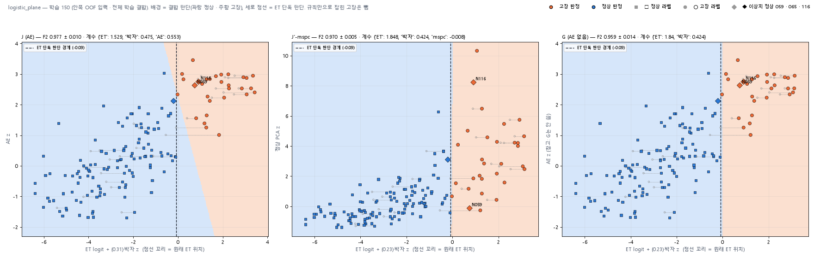
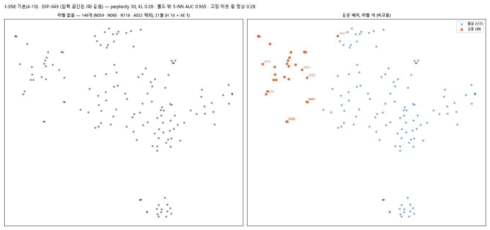
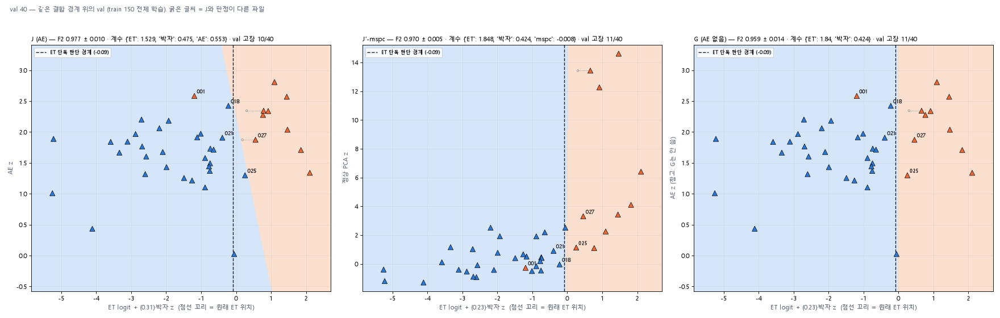

# EXP-049 정상 PCA(mspc) full 재확인 — J · J′-mspc · G

노션 카드 (실험 DB에 그대로 옮긴다)

| 팀원 | 모델 | F2 점수 | 변경 사항 | 메모 |
|---|---|---|---|---|
| 이동훈 | ET + 박자 + {AE | 정상 PCA | 없음} → 로지스틱 OR E2 OR 8.3k | 0.970 ± 0.005 | J의 AE z 자리에 ext150 정상 PCA(T² + SPE) z, 비교로 AE 없는 G. seed 5 · ET 300, 같은 분할 (PHO-009 재확인) (H3) | 정상 PCA는 J를 못 넘음(0.970 vs J 0.977, sd 안). 결합 계수 −0.008로 무게 0. val에 덜 흔들리는 장점은 결합에서 쓰이지 않음 → 기각, J 유지 |

## 주요 변경점 (기준 실험 대비)

- AE z → 정상 PCA z (J′-mspc)
- AE 없음 (G)
- full 모드 seed 5 · ET 300, 세 구성 같은 바깥 분할
- 이상치 학습 제외 안 함(EXP-044 · PHO-009와 같은 조건)

- 가설: H3 ([물리가설](../../../1_기준·기록/물리가설.md))
- 실행: 2026-11-22 · git `81aacd4+수정중` · 코드 [run.py](run.py)
- 평가: 중첩 CV (바깥 5 × 안쪽 4) · 모드 seed 5 · ET 300. 자주 놓침 · 오경보 n회+ = seed 과반. quick 수치는 선별용, 기록 수치는 QE_FULL=1

## 결과

| 구성 | F2 | 재현율 | 오경보율 | 정밀도 | F2 (고장 10%·40%) | 자주 놓침 | 오경보 3회+ |
|---|---|---|---|---|---|---|---|
| J′-mspc | 0.970 ± 0.005 | 1.000 | 0.038 | 0.868 | 0.935 · 0.989 | — | 3 |

## 해석

**정상 PCA는 J를 넘지 못한다(J′-mspc 0.970 ± 0.005 vs J 0.977 ± 0.010, 차이 −0.007로 sd 안).** full 모드에서 J는 EXP-044 값을 그대로 재현했고, AE를 뺀 G는 0.959로 EXP-043과 같다. 정상 PCA의 결합 계수는 −0.008이라 모델이 쓰지 않는다. PHO-009(seed 2)의 "J′-mspc > J"는 seed 2개의 흔들림이었다 → **기각, J 유지.**

<!-- key-figs: 자동 (save_fig key=True) -->

*logistic_plane* — J · J′-mspc · G의 결합 경계. 세로축 = 세 번째 입력(G는 AE z를 참고로만 표시)

*tsne_라벨* — 기본 t-SNE(4-10). 빨간 원 = J 오경보

<!-- /key-figs -->

**그림 읽는 법**: 가로 = ET logit에 박자 몫을 더한 값(결합 계수 비율), 세로 = 세 번째 입력(J는 AE z, J′는 정상 PCA z, G는 AE z를 참고로만). 배경 = 결합 판단, 세로 점선 = ET 단독 판단. J′-mspc와 G는 배경 경계가 세로선이라 세 번째 입력이 판정에 안 쓰인다. J만 경계가 기울어 AE가 정상 쪽 파일(낮은 AE z)을 정상으로 당긴다.

| 구성 (같은 분할, seed 5 · ET 300) | F2 | 오경보율 | 결합 계수 [ET · 박자 · 3번째] | val 고장 |
|---|---|---|---|---|
| **J (AE)** | **0.977 ± 0.010** | **0.030** | 1.53 · 0.48 · 0.55 | 10/40 |
| J′-mspc (정상 PCA) | 0.970 ± 0.005 | 0.038 | 1.85 · 0.42 · −0.01 | 11/40 (+025) |
| G (AE 없음) | 0.959 ± 0.014 | 0.047 | 1.84 · 0.43 · — | 11/40 (+025) |

- 정상 PCA 단독 성질은 PHO-009와 같다: 고장 중앙 z +2.74(AE +2.53), val 중 정상 95% 위 17%(AE 40%). 정상/고장을 가르고 val에도 덜 흔들리지만, 정보가 ET와 겹쳐 결합에서 몫이 없다
- AE의 역할은 **오경보 줄이기**다: AE가 빠지면(J′ · G) 065 4 → 5, 110 0 → 2 · 3, 073 0 → 2, 070 · 043이 새로 켜진다. 025(2 → 1) · 106(1 → 0)만 줄어든다 ([오류분석_표.md](오류분석_표.md))
- val에서는 AE가 빠지면 025(ET 0.25, AE z 1.3)가 고장으로 바뀐다. 027은 박자로 세 구성 모두 고장 ([val_판정.md](val_판정.md))
- 남은 오경보 116 · 065 · 059는 세 구성 모두 그대로

## 그림

### val_판정
세 구성의 val 판정. 세로축 = 세 번째 입력(G는 AE z 참고)

## 중간 단계 결과 (비교 · 절제 · 이전 실험 값)

| 구성 | F2 | 재현율 | 오경보율 | 정밀도 | F2 (고장 10%·40%) | 자주 놓침 | 오경보 3회+ |
|---|---|---|---|---|---|---|---|
| J (AE) | 0.977 ± 0.010 | 1.000 | 0.030 | 0.895 | 0.949 · 0.991 | — | 3 |
| G (AE 없음) | 0.959 ± 0.014 | 0.993 | 0.047 | 0.843 | 0.917 · 0.981 | — | 5 |