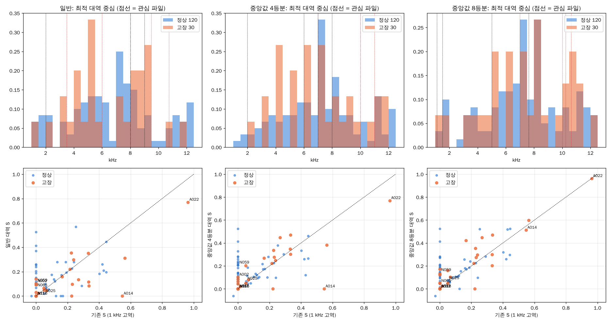

# PHO-002 커토그램 (EDA + quick_cv)

| 팀원 | 모델 | F2 점수 | 변경 사항 | 메모 |
|---|---|---|---|---|
| 이동훈 | 기준 W(ET H15 + 박자 → 로지스틱)에 하나씩 | — (탐색, PR-AUC만) | 파일별 커토그램 최적 대역(일반 · 4등분 중앙값 · 8등분 중앙값)으로 ① K_max·중심 추가 ② 박자 S 재계산 ③ 4등분 중앙값 K_max 1열 추가 (H1, H2) | **대역 기반 충격·박자 재계산은 기각**(S AUC 0.70 → 0.64–0.69, 정상 059 · 065에 가짜 충격·박자). **K_max4 1열은 0.968 → 0.971로 sd 안**(확실 정상 85 → 100, 017 순위 0.23 → 0.12, 대신 116 · 059 고장다움 상승). 중첩 CV 미실시 |

- 실행: 2026-11-22 · 휴대폰(클라우드) 세션 · [run.py](run.py)(커토그램 169대역 · K1 · K2) · [eda2.py](eda2.py)(세 방식 비교) · [k4.py](k4.py)(K_max4) · 로그 `log*.txt` · `result*.json` · 그림 `figs/`
- 커토그램: 대역폭 4000–250 Hz 5층, 중심 간격 = 폭/2, 1–12.4 kHz, 복소 포락선 첨도 K = E|c|⁴/(E|c|²)² − 2. 값은 실행 전 고정

## 결과

| 구성 | PR-AUC | 위험 정상 | 확실 고장 · 정상 | 고장 순위 002 · 014 · 017 · 022 |
|---|---|---|---|---|
| 기준 W | 0.968 ± 0.006 | 2.3 | 23 · 85 | 0.06 · 0.01 · 0.23 · 0.00 |
| K1 + 일반 K_max · 중심 | 0.965 ± 0.005 | 3.0 | 20 · 89 | 0.06 · 0.01 · 0.19 · 0.04 |
| K2 박자 S를 커토그램 대역 S로 교체 | 0.953 ± 0.008 | 3.7 | 16 · 85 | 0.06 · 0.03 · 0.25 · 0.05 |
| K4 + 4등분 중앙값 K_max | 0.971 ± 0.005 | 1.7 | 20 · 100 | 0.03 · 0.00 · 0.12 · 0.01 |

## 해석

- 최적 대역의 **중심은 정상·고장이 갈리지 않는다**(세 방식 모두 p > 0.7, 둘 다 약 7 kHz). 갈리는 것은 폭(고장이 넓음)과 K 크기. 방식을 바꾸면 150개 중 135–141개 파일의 대역이 바뀌어 대역 선택 자체가 불안정하다.
- 좁은 대역(±125–250 Hz)으로 충격을 다시 잡으면 노이즈 봉우리까지 충격이 되어 정상 059(충격 3 → 9–21, S 0 → 0.11–0.21), 065(1 → 5–10)에 가짜 박자가 생기고, 고장 014는 두 방식에서 박자를 잃는다(0.546 → 0). 정상 S 최대 0.445 → 0.525–0.568.
- 4등분 중앙값 K_max는 단독 AUC 0.88, 기존 피처와 |ρ| ≤ 0.64(일반 K_max는 H5와 0.86). W에 넣으면 정상 대부분이 확실해지지만 오경보 116 · 059는 더 고장처럼 보인다 → J 위 중첩 CV로만 판정 가능.

