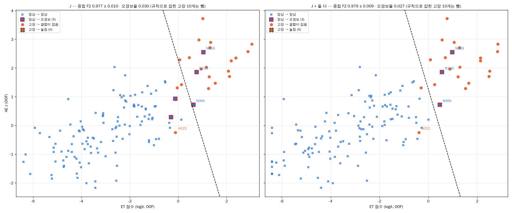
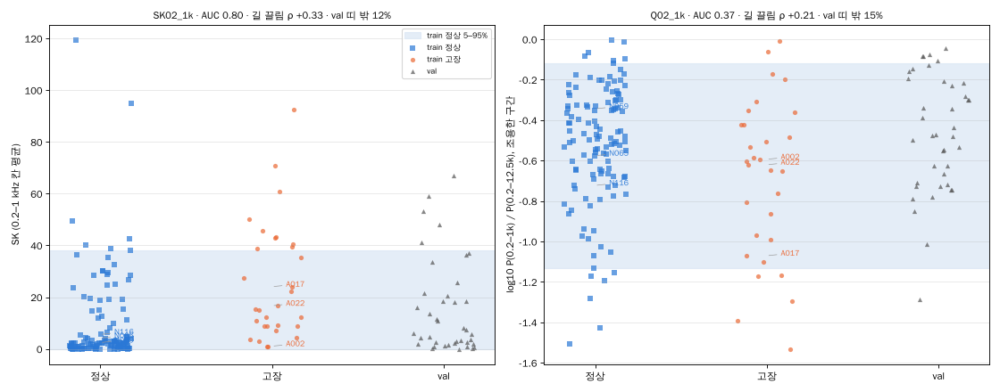

# PHO-006 저대역 0.2–1 kHz 피처 2열 (팀원 피처 검토)

노션 카드 (실험 DB에 그대로 옮긴다)

| 팀원 | 모델 | F2 점수 | 변경 사항 | 메모 |
|---|---|---|---|---|
| 이동훈 | J + ET 입력에 SK02_1k · Q02_1k | 0.979 ± 0.009 | J(EXP-044)의 ET 입력에 0.2–1 kHz 스펙트럼 첨도 · 조용한 구간 0.2–1k PSD 몫 추가 (효섭 SK_200_3k · 나영 조용한 구간 저주파) (H1, H2) | 0.2–1k 2열: 중첩 F2 0.979 ± 0.009 (J 0.977 ± 0.010), sd 안 → 기각 |

## 주요 변경점 (기준 실험 대비)

- ET 입력에 SK02_1k(0.2–1 kHz 스펙트럼 첨도) 추가
- ET 입력에 Q02_1k(충격 없는 구간의 0.2–1k PSD 몫) 추가
- AE · 박자 · E2 · 8.3k 규칙 · 문턱은 J와 같음

- 가설: H1, H2 ([물리가설](../../1_기준·기록/물리가설.md))
- 실행: 2026-11-22 · git `44d484f+수정중` · 코드 [run.py](run.py)
- 평가: 중첩 CV (바깥 5 × 안쪽 4, seed 5개). 자주 놓침 = seed 5번 중 3번 이상

## 결과

| 구성 | F2 | 재현율 | 오경보율 | 정밀도 | F2 (고장 10%·40%) | 자주 놓침 | 오경보 3회+ |
|---|---|---|---|---|---|---|---|
| 중첩: J + 둘 다 | 0.979 ± 0.009 | 1.000 | 0.027 | 0.905 | 0.954 · 0.992 | — | 3 |

## 해석

J에 저대역 0.2–1 kHz 2열을 넣어도 중첩 F2 0.977 ± 0.010 → 0.979 ± 0.009로 sd 안이고, 새로 잡은 고장도 없다 → 기각. 오경보 116(5/5) · 059(3/5)는 그대로이고 065만 4 → 3회로 줄었다. 하나씩 넣으면 오히려 하락(SK 0.974 · Q 0.968, 둘 다 009를 1회 놓침).

<!-- key-figs: 자동 (save_fig key=True) -->

*logistic_plane* — ET × AE 평면 (OOF seed 0, 박자 z = 0 단면 경계). 왼쪽 J, 오른쪽 J + 저대역 2열

<!-- /key-figs -->

**그림 읽는 법**: 가로 = ET 점수, 세로 = AE z, 점선 = 결합 경계(박자 z = 0 단면). 빨간 테두리 네모가 오경보 정상이다. OOF seed 0 한 번에서는 오경보가 5 → 3개로 줄어 보이지만, 중첩 CV 5 seed 합계로는 18 → 16회로 작은 차이다. 경계 근처 정상(N065 · 037)이 조금 밀려났을 뿐이고 N116 · N059는 고장 무리 안에 그대로 있다.

**quick_cv (기준 W = ET H15 + 박자, PR-AUC)**: 기준 0.968 ± 0.006 · + SK02_1k 0.965 ± 0.007 · + Q02_1k 0.959 ± 0.005 · + 둘 다 0.968 ± 0.004. 모두 sd 안.

**피처 점검** (`figs/피처_분포.png`)

| 피처 | 단독 AUC | 길 끌림 ρ (정상 RMS) | val 정상 5–95% 밖 | N116 · N065 · N059 (정상 중 %) | A002 · A017 · A022 |
|---|---|---|---|---|---|
| SK02_1k | 0.80 | +0.33 | 12% | 71 · 67 · 54 | 32 · 84 · 79 |
| Q02_1k | 0.37 (고장 쪽이 낮음) | +0.21 | 15% | 20 · 34 · 68 | 34 · 7 · 32 |

- SK는 단독으로 고장을 잘 가르지만(0.80), 그 정보는 1 kHz 위 첨도(H3 · H5)와 겹친다. 정상에도 SK 40–120인 파일이 10개 넘게 있고, 놓치기 쉬운 고장 002 · 022는 정상 범위 안이다
- Q(조용한 구간의 0.2–1k 몫)는 약하고, 오경보 116은 정상 하위 20%라 오히려 고장 쪽이다 → 116을 내려 주지 못한다
- 길 끌림은 SK가 1 kHz 위 H 블록(ρ 약 0.26)보다 조금 크다. 1 kHz 고역 결정(결정.md)의 우려가 실제로 보인다
- val 이동에는 둔감(12–15%, 기대 10%). 그래도 val 고장 판정은 J 10/40 → 12/40(018 · 025 추가)

**결론**: 팀원 피처(효섭 SK_200_3k · 나영 조용한 구간 저주파)를 0.2–1 kHz로 옮긴 두 열은 J의 정보와 겹친다. 오경보 116 · 059가 "정보 한계"라는 판단(2-19 · 4-9)은 그대로다. 백색화(AR 잔차)는 사용자 판단으로 넣지 않았다(오경보를 키울 우려).

## 그림

### 피처_분포
새 2열의 정상 5–95% 띠와 고장 · val 분포. 관심 파일 = 놓치기 쉬운 고장 002 017 022, J 오경보 116 065 059

## 중간 단계 결과 (비교 · 절제 · 이전 실험 값)

| 구성 | F2 | 재현율 | 오경보율 | 정밀도 | F2 (고장 10%·40%) | 자주 놓침 | 오경보 3회+ |
|---|---|---|---|---|---|---|---|
| 중첩: J (EXP-044 재실행) | 0.977 ± 0.010 | 1.000 | 0.030 | 0.895 | 0.949 · 0.991 | — | 3 |
| 중첩: J + SK02_1k | 0.974 ± 0.016 | 0.993 | 0.027 | 0.905 | 0.949 · 0.987 | — | 3 |
| 중첩: J + Q02_1k | 0.968 ± 0.015 | 0.993 | 0.035 | 0.879 | 0.936 · 0.984 | — | 3 |