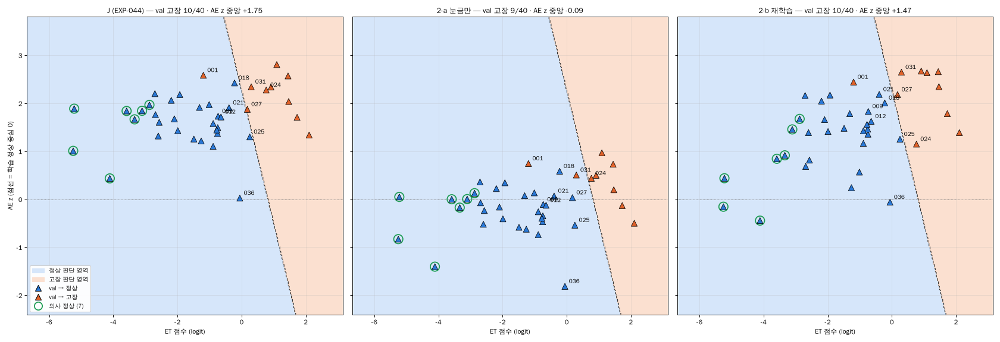
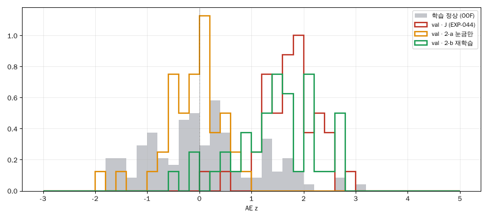

# PHO-007 val 의사 정상으로 AE 기준 다시 맞추기

노션 카드 (실험 DB에 그대로 옮긴다)

| 팀원 | 모델 | F2 점수 | 변경 사항 | 메모 |
|---|---|---|---|---|
| 이동훈 | J + AE 기준 재보정 (2-a 눈금 · 2-b 재학습) | — (학습 성능 불변) | val 중 ET로 고른 의사 정상으로 AE z 중심을 옮기거나(2-a) AE를 다시 학습(2-b). 라벨 안 씀, 학습 150 성능 불변 (H3) | AE 재보정해도 val 판정 10 → 9(2-a, 027만) · 10(2-b). 판정은 사실상 ET가 가름 |

## 주요 변경점 (기준 실험 대비)

- 의사 정상 = val 중 ET < 학습 정상 ET 중앙값 · 박자 z ≤ 0 · 규칙 꺼짐 (AE 안 씀)
- 2-a: AE z 중심만 의사 정상 중앙값으로
- 2-b: 학습 정상 + 의사 정상으로 AE 재학습

- 가설: H3 ([물리가설](../../../1_기준·기록/물리가설.md))
- 실행: 2026-11-22 · git `559ec9e+수정중` · 코드 [run.py](run.py)

## 해석

<!-- key-figs: 자동 (save_fig key=True) -->

*val_평면_3구성* — val 40개. 왼쪽 J, 가운데 2-a(AE z 중심만 의사 정상으로), 오른쪽 2-b(AE 재학습). 배경 = J 결합 경계(박자 z = 0 단면)

<!-- /key-figs -->

## 그림

### AE_z_분포
학습 정상(OOF) AE z와 val AE z 분포. 재보정 후 val이 0 근처로 오는지

