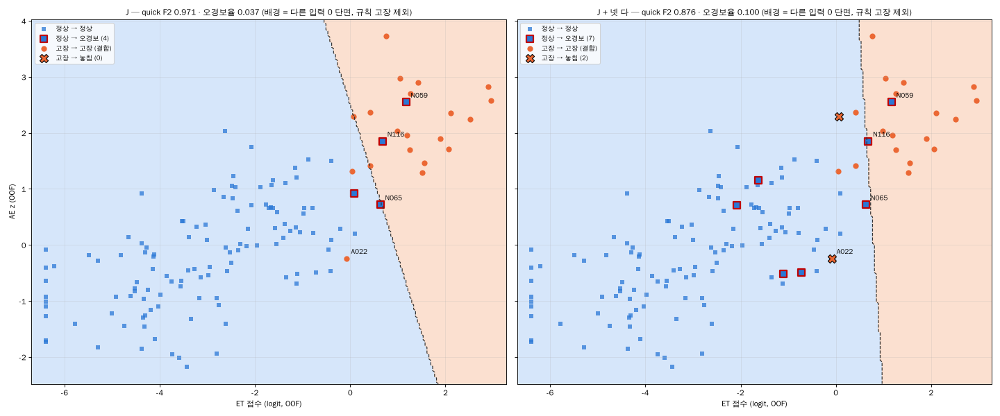

# PHO-008 ET 기준 쌓기 (정보가 다른 1단 전문가 추가)

노션 카드 (실험 DB에 그대로 옮긴다)

| 팀원 | 모델 | F2 점수 | 변경 사항 | 메모 |
|---|---|---|---|---|
| 이동훈 | J + 1단 전문가(ext · shape · mspc · knn) → 로지스틱 OR E2 OR 8.3k | 0.974 ± 0.000 | J의 2단 로지스틱 입력에 ext150 ET · 모양 AE · 정상 PCA · 정상 kNN 점수를 하나씩 / 모두 추가 (H1, H2, H3) | 쌓기 4종 모두 J +0.010 미달(최고 shape +0.003) → 기각. 116 · 065 · 059 그대로 |

## 주요 변경점 (기준 실험 대비)

- 1단 전문가 후보 4개(ext · shape · mspc · knn)를 하나씩, 그리고 모두
- 2단 로지스틱 · 규칙 · 문턱은 J와 같음
- quick 선별 → full 확인 (사전 고정 규칙)

- 가설: H1, H2, H3 ([물리가설](../../1_기준·기록/물리가설.md))
- 실행: 2026-11-22 · git `0a48cdf+수정중` · 코드 [run.py](run.py)
- 평가: 중첩 CV (바깥 5 × 안쪽 4) · 모드 seed 2 · ET 100. 자주 놓침 · 오경보 n회+ = seed 과반. quick 수치는 선별용, 기록 수치는 QE_FULL=1

## 결과

| 구성 | F2 | 재현율 | 오경보율 | 정밀도 | F2 (고장 10%·40%) | 자주 놓침 | 오경보 3회+ |
|---|---|---|---|---|---|---|---|

## 해석

<!-- key-figs: 자동 (save_fig key=True) -->

*logistic_plane* — ET × AE 평면 (OOF seed 0). 왼쪽 J, 오른쪽 J + 전문가 넷. 배경 = 결합 판단 영역(박자 · 새 전문가 z = 0 단면)

<!-- /key-figs -->

## 해석

J에 정보가 다른 1단 전문가를 쌓아도 quick 중첩 F2가 J(0.971)보다 +0.010 이상 오른 구성이 없다 → 사전 규칙대로 full 확인 없이 기각. 가장 나은 것은 J + shape(모양 AE) 0.974(+0.003, 오경보 1회 감소)이고, ext · mspc는 고장을 1회씩 놓치며, knn을 넣으면 크게 하락(0.886)한다.

<!-- key-figs: 자동 (save_fig key=True) -->

*logistic_plane* — ET × AE 평면 (OOF seed 0). 왼쪽 J, 오른쪽 J + 전문가 넷. 배경 = 결합 판단 영역(박자 · 새 전문가 z = 0 단면)

<!-- /key-figs -->

**그림 읽는 법**: 배경 = 결합이 정상(파랑) · 고장(주황)으로 판단하는 영역(박자 · 새 전문가 z = 0 단면). 오른쪽(넷 다)은 경계가 거의 세로가 되고 AE 축의 기울기가 사라진다. 2단 계수(전체 학습) = ET 1.31 · 박자 0.30 · AE 0.10 · ext 0.08 · shape 0.06 · mspc 0.01 · knn 0.00 → 새 전문가가 ET에 더하는 몫이 거의 없다.

| 구성 (quick, seed 2 · ET 100) | F2 | 재현율 | 오경보율 | 놓침 (2회 중) | 116 · 065 · 059 오경보 |
|---|---|---|---|---|---|
| J | 0.971 | 1.000 | 0.037 | — | 2 · 2 · 2 |
| J + ext (ET on ext150) | 0.948 ± 0.033 | 0.967 | 0.033 | 014 1 · 022 1 | 2 · 2 · 2 |
| **J + shape (모양 AE)** | **0.974** | 1.000 | 0.033 | — | 2 · 2 · 2 |
| J + mspc (정상 PCA) | 0.958 ± 0.016 | 0.983 | 0.037 | 022 1 | 2 · 2 · 2 |
| J + knn (H 정상 5-NN) | 0.886 ± 0.017 | 0.933 | 0.083 | 022 2 · 005 · 009 | 2 · 2 · 2 |
| J + 넷 다 | 0.876 ± 0.027 | 0.933 | 0.100 | 022 2 · 005 · 009 | 2 · 2 · 2 |

- 어떤 전문가도 **116 · 065 · 059를 내리지 못했다**(모든 구성에서 2/2). 정보 한계 판단(2-19 · 4-9 · PHO-006)과 같다
- shape의 +0.003은 037 오경보 1회가 줄어든 것뿐이다(sd 기준 0.010 안)
- ext · mspc는 J가 이미 쓰는 정보(ext150 계열)와 겹치고, 2단 입력이 늘어 경계 파일(022 · 014)이 흔들린다
- knn: 계수가 0인데 성능이 크게 떨어졌다. 정상 5-NN 거리의 강건 z가 극단값을 만들어 결합 문턱을 흔든 것으로 보인다(척도 점검 안 함). knn 정보 자체가 쓸모없다는 결론은 아니다
- 결론: J의 2단에 같은 학습 데이터로 만든 점수를 더 쌓는 방식으로는 이득이 없다. 남은 오류는 모델 수가 아니라 정보 쪽 문제다

## 그림

## 중간 단계 결과 (비교 · 절제 · 이전 실험 값)

| 구성 | F2 | 재현율 | 오경보율 | 정밀도 | F2 (고장 10%·40%) | 자주 놓침 | 오경보 3회+ |
|---|---|---|---|---|---|---|---|
| quick: J | 0.971 ± 0.003 | 1.000 | 0.037 | 0.870 | 0.937 · 0.989 | — | 3 |
| quick: J + ext | 0.948 ± 0.033 | 0.967 | 0.033 | 0.879 | 0.918 · 0.963 | — | 3 |
| quick: J + shape | 0.974 ± 0.000 | 1.000 | 0.033 | 0.882 | 0.943 · 0.990 | — | 3 |
| quick: J + mspc | 0.958 ± 0.016 | 0.983 | 0.037 | 0.868 | 0.924 · 0.976 | — | 3 |
| quick: J + knn | 0.886 ± 0.017 | 0.933 | 0.083 | 0.741 | 0.821 · 0.923 | 022 | 7 |
| quick: J + 넷 다 | 0.876 ± 0.027 | 0.933 | 0.100 | 0.711 | 0.800 · 0.918 | 022 | 7 |