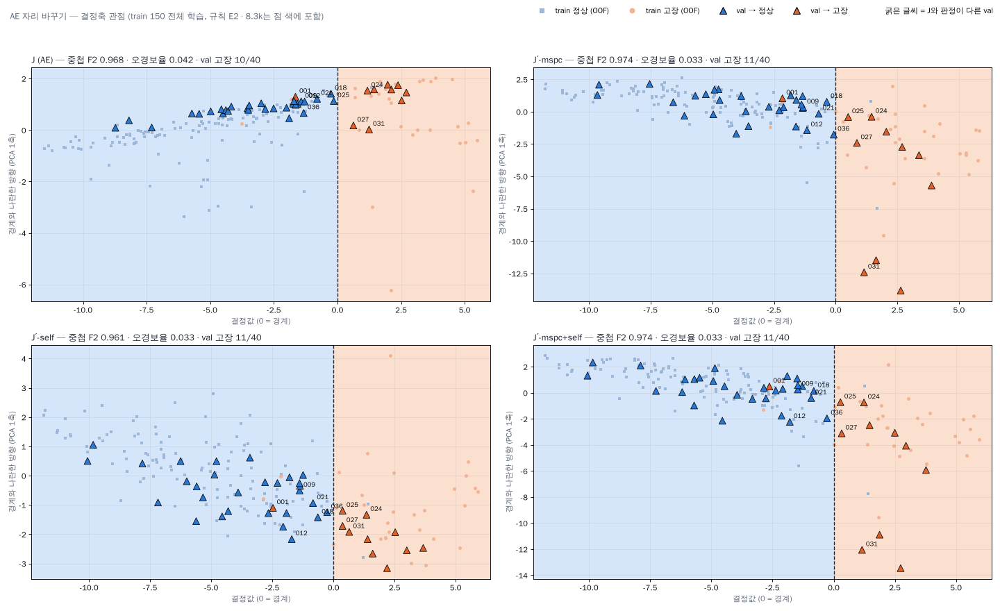

# PHO-009 AE 자리 바꾸기 (정상 PCA · 자기기준 AE)

노션 카드 (실험 DB에 그대로 옮긴다)

| 팀원 | 모델 | F2 점수 | 변경 사항 | 메모 |
|---|---|---|---|---|
| 이동훈 | ET + 박자 + {AE | 정상 PCA | 자기기준 AE} → 로지스틱 OR E2 OR 8.3k | 0.974 ± 0.006 | J의 AE 입력을 val 측정 조건에 덜 흔들리는 정상 비교 모델(ext150 정상 PCA · 자기기준 AE)로 교체 (H3) | AE → 정상 PCA · 자기기준 AE로 교체: val 이동은 줄지만 결합 계수 ≈ 0 → 사실상 ET + 박자. F2 sd 안, val 025만 바뀜 → 기각 |

## 주요 변경점 (기준 실험 대비)

- AE 대신 mspc(ext150 정상 PCA T² + SPE)
- AE 대신 자기기준 AE(파일 자신의 중앙값 스펙트럼 대비)
- 둘 다(AE 없이)
- 중첩 CV seed 2 · ET 300

- 가설: H3 ([물리가설](../../1_기준·기록/물리가설.md))
- 실행: 2026-11-22 · git `7d8e475+수정중` · 코드 [run.py](run.py)
- 평가: 중첩 CV (바깥 5 × 안쪽 4) · 모드 seed 2 · ET 300. 자주 놓침 · 오경보 n회+ = seed 과반. quick 수치는 선별용, 기록 수치는 QE_FULL=1

## 결과

| 구성 | F2 | 재현율 | 오경보율 | 정밀도 | F2 (고장 10%·40%) | 자주 놓침 | 오경보 3회+ |
|---|---|---|---|---|---|---|---|
| 중첩: J′-mspc | 0.974 ± 0.006 | 1.000 | 0.033 | 0.883 | 0.943 · 0.990 | — | 3 |
| 중첩: J′-self | 0.961 ± 0.019 | 0.983 | 0.033 | 0.881 | 0.931 · 0.977 | — | 3 |
| 중첩: J′-mspc+self | 0.974 ± 0.006 | 1.000 | 0.033 | 0.883 | 0.943 · 0.990 | — | 3 |

## 해석

<!-- key-figs: 자동 (save_fig key=True) -->

*결정축_4구성* — 가로 = 결정값(모든 입력 반영, 0 = 경계), 세로 = 경계와 나란한 방향. 왼쪽 위 J, 나머지 AE 자리 교체

<!-- /key-figs -->

## 해석

AE 자리를 정상 PCA(mspc)나 자기기준 AE로 바꾸면 val 이동은 줄지만(정상 95% 위 비율 40% → 17% · 25%), 2단 로지스틱이 바꾼 입력에 거의 무게를 주지 않는다(mspc 계수 −0.01, self −0.26). 결과적으로 'ET + 박자'만 남은 모델이 되고, 학습 F2는 0.968 → 0.974(seed 2, sd 안), val 판정은 025가 고장으로 바뀌어 11/40이다 → 기각.

<!-- key-figs: 자동 (save_fig key=True) -->

*결정축_4구성* — 가로 = 결정값(모든 입력 반영, 0 = 경계), 세로 = 경계와 나란한 방향. 왼쪽 위 J, 나머지 AE 자리 교체

<!-- /key-figs -->

**그림 읽는 법**: 가로 = 결정값(모든 입력 반영, 0 = 경계, 모든 파일에 정확), 세로 = 경계와 나란한 방향(PCA 1축, 판정과 무관). J는 val이 위쪽 한 줄로 몰리고(AE 이동), 교체 구성은 val이 train 정상 무리 안에 섞인다.

| 입력 | train 정상 중앙 | train 고장 중앙 | val 중앙 | val 중 train 정상 95% 위 |
|---|---|---|---|---|
| AE (J) | 0 | +2.53 | +1.75 | 40% |
| mspc (정상 PCA) | 0 | +2.74 | +0.58 | 17% |
| self (자기기준 AE) | 0 | +1.27 | +0.93 | 25% |

| 구성 (중첩 seed 2 · ET 300) | F2 | 오경보율 | val 고장 | J와 다른 val | 2단 계수 [ET, 박자, 3번째(, 4번째)] |
|---|---|---|---|---|---|
| J (AE) | 0.968 | 0.042 | 10 | — | 1.53 · 0.47 · 0.55 |
| J′-mspc | 0.974 ± 0.006 | 0.033 | 11 | 025 | 1.85 · 0.42 · −0.01 |
| J′-self | 0.961 ± 0.019 | 0.033 | 11 | 025 | 1.92 · 0.40 · −0.26 |
| J′-mspc+self | 0.974 ± 0.006 | 0.033 | 11 | 025 | 1.90 · 0.40 · 0.06 · −0.31 |

- 정상 PCA 확인: 학습 정상만으로 표준화 · PCA(ext150 150열 → 주성분 15개, 분산 90%) → T² + SPE. 학습 정상 OOF 중앙 0, 고장 +2.74로 단독으로는 정상/고장을 가른다. 그러나 ET와 겹쳐 결합에서는 무게가 0
- 자기기준 AE는 val 이동이 작지만(25%) 고장 분리도 약하다(고장 중앙 +1.27). J′-self는 고장을 1회 놓침
- AE를 빼면 val 판정은 ET가 가른다 → ET 단독 경계와 같은 쪽으로 025가 고장. 027은 박자로 여전히 고장
- 결론: '정상 비교' 입력을 바꿔도 이득 없음. AE가 J에서 하는 일(학습 F2 0.968 vs AE 없는 구성 0.974, 차이 sd 안)은 val에서 027 · 025 두 경계 파일의 판정 정도다

## 그림

## 중간 단계 결과 (비교 · 절제 · 이전 실험 값)

| 구성 | F2 | 재현율 | 오경보율 | 정밀도 | F2 (고장 10%·40%) | 자주 놓침 | 오경보 3회+ |
|---|---|---|---|---|---|---|---|
| 중첩: J (AE) | 0.968 ± 0.000 | 1.000 | 0.042 | 0.857 | 0.930 · 0.988 | — | 3 |