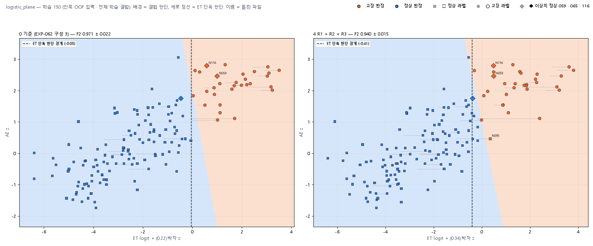
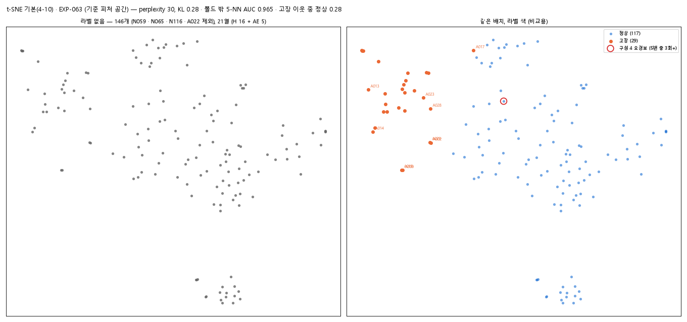
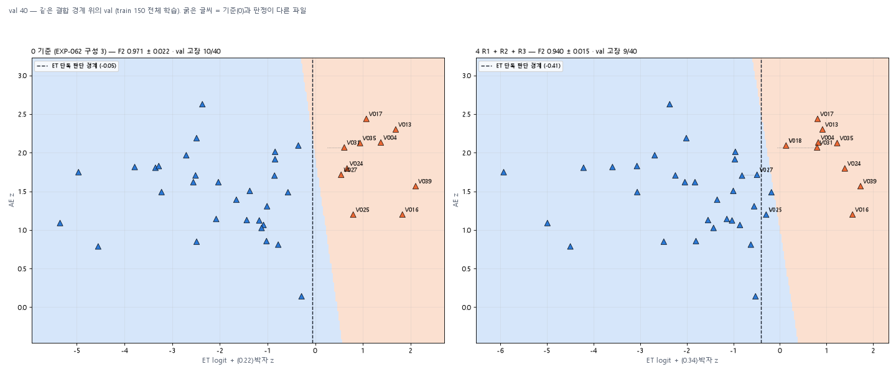

# EXP-063 검출기 다듬기 R1–R3

노션 카드 (실험 DB에 그대로 옮긴다)

| 팀원 | 모델 | F2 점수 | 변경 사항 | 메모 |
|---|---|---|---|---|
| 이동훈 | J-축소 + K83 (src/final.py JShrink) · 11 kHz 상한 · 검출기 다듬기 | 0.940 ± 0.015 | EXP-062 구성 3에 R1 25 ms 이벤트 · R2 50 Hz 울림 사전 · R3 RES 새 검출기 (하나씩 · 셋 다). 이상치 학습 포함, 그룹 CV, full (H1, H2) | 기준 0.971 대비 R1 0.940 · R2 0.953 · R3 0.971(같음) · 셋 다 0.940. 채택 없음(R3 중립) |

## 주요 변경점 (기준 실험 대비)

- R1: 충격 수 · 2위/1위 · 울림 비율 · 박자 hit를 25 ms 이벤트 단위로 (j_tables events=True)
- R2: 울림 주파수 · ζ = 50 Hz 사전 (atoms="50")
- R3: RES = 새 검출기(1–11 kHz) + 50 Hz 사전, 문턱 0.7 그대로 (res_new=True)
- 분할 · 모델 · 다른 피처 = EXP-062 구성 3 그대로

- 가설: H1, H2 ([물리가설](../../../1_기준·기록/물리가설.md))
- 실행: 2026-11-25 · git `bd9a50a+수정중` · 코드 [run.py](자료/run.py)
- 평가: 중첩 CV (바깥 5 × 안쪽 4) · 모드 seed 5 · ET 300. 자주 놓침 · 오경보 n회+ = seed 과반. quick 수치는 선별용, 기록 수치는 QE_FULL=1

## 결과

| 구성 | F2 | 재현율 | 오경보율 | 정밀도 | F2 (고장 10%·40%) | 자주 놓침 | 오경보 3회+ |
|---|---|---|---|---|---|---|---|
| 0 기준 (EXP-062 구성 3) | 0.971 ± 0.022 | 0.987 | 0.023 | 0.914 | 0.949 · 0.982 | — | 2 |
| 1 + R1 이벤트 | 0.940 ± 0.017 | 0.960 | 0.037 | 0.869 | 0.907 · 0.957 | 014 | 3 |
| 2 + R2 50 Hz 사전 | 0.953 ± 0.029 | 0.973 | 0.033 | 0.881 | 0.923 · 0.969 | — | 2 |
| 3 + R3 RES 새 검출기 | 0.971 ± 0.022 | 0.987 | 0.023 | 0.914 | 0.949 · 0.982 | — | 2 |
| 4 R1 + R2 + R3 | 0.940 ± 0.015 | 0.953 | 0.030 | 0.888 | 0.913 · 0.954 | 014 | 3 |

## 해석

같은 분할에서 R1(25 ms 이벤트)은 0.971 → 0.940(쌍 차이 −0.031 ± 0.032, 기준 sd 0.022보다 큼), R2(50 Hz 사전)는 0.953(−0.018, sd 안), R3(RES 새 검출기)는 0.971 그대로(모든 seed 차이 0), 셋 다는 0.940(−0.031). **어느 것도 F2를 올리지 못했다.** R3는 train RES에 A013 · A030을 더하지만 둘 다 이미 결합 · 스펙트럼 규칙으로 잡혀 판정이 바뀌지 않고, val도 같다(정상 · val RES 켜짐 0).

<!-- key-figs: 자동 (save_fig key=True) -->

*logistic_plane* — 기준(0) vs R1 + R2 + R3(4)의 결합 경계

*tsne_라벨* — 기본 t-SNE(4-10, 기준 피처). 빨간 원 = 구성 4 오경보

<!-- /key-figs -->

- 그림: 왼쪽 = 기준(0), 오른쪽 = 셋 다(4). 결합 계수 ET 1.76 → 1.73 · 박자 0.39 → 0.58 · AE 0.41 → 0.46, 문턱 1.03 → 0.58 (이벤트로 박자 hit가 바뀌어 박자 몫이 커짐)
- 쌍 비교 (seed별 F2 차이, seed 0–4): R1 +0.027 · −0.071 · −0.039 · −0.045 · −0.026 / R2 +0.021 · −0.080 · −0.013 · 0 · −0.019 / R3 모두 0 / 4 +0.027 · −0.059 · −0.033 · −0.059 · −0.033
- 파일별 (seed 5번 중 횟수)
  - 0 · 3: 놓침 021 · 028 1 · 오경보 059 · 116 5 · 065 2 · 016 · 055 1
  - 1: 놓침 **014 4** · 022 · 023 1 · 오경보 059 · 116 5 · **095 3** · 037 · 055 · 065 2 · 016 · 025 · 110 1
  - 2: 놓침 028 2 · 014 · 022 1 · 오경보 059 · 116 5 · 055 · 065 · 095 2 · 016 · 022 · 030 · 073 1
  - 4: 놓침 **014 5** · 022 · 023 1 · 오경보 059 5 · **095 4** · 116 4 · 016 · 030 · 054 · 055 · 065 1
- 규칙(전체 학습, 고장/정상): E2 4/0(A004 · A011 · A017 · A019) 모든 구성 같음. 8.3k 스펙트럼 5/0(A002 · A006 · A010 · A029 · A030) 모든 구성 같음. RES: 0 · 1 · 2 = 5/0(A002 · A003 · A006 · A010 · A029, 예전 검출기) → 3 = 7/0(+ A013 · A030) → 4 = 6/0(이벤트로 A006이 빠짐: 8.3k 울림이 묶음의 가장 큰 검출이 아님). 8.3k 합은 3 · 4에서 A013 하나 늘어남(A013은 결합으로 이미 5/5). val: E2 · 스펙트럼 · RES 모두 0개, val RES 최대 0.575(예전) → 0(새)
- val(라벨 없음, 고르지 않음): 고장 판정 0 10 · 1 10 · 2 9 · 3 10 · 4 9. 기준 대비 바뀐 파일 1 V018+ · V027− / 2 V025− / 3 없음 / 4 V018+ · V025− · V027−. V025는 EXP-061 · 062에서도 뒤집히던 경계 파일. 표 [val_판정.md](자료/val_판정.md)
- 판단(규칙 "sd 넘게 오르거나, 같은 점수에 val이 더 안정할 때만 채택"): R1 · R2 · 4 기각(점수 하락, val 3개까지 흔들림). R3는 점수 · val 모두 같아 채택 근거가 없다(중립). 물리적으로 더 맞는 정의(2-36)라도 지금 모델에서는 이득이 없다
- 한계: 이벤트 높이 · 시점 = 묶음 안 가장 큰 검출(height_x 기준). R1은 H1 · H2 · H7–H10 · L1 hit를 한꺼번에 바꿔 어느 피처가 A014 놓침을 만들었는지는 나누지 않았다. JShrink 안쪽 4겹 OOF는 그룹을 쓰지 않는다(FinalJ와 같음)

## 그림

### val_판정
기준 vs R1 + R2 + R3의 val 판정

