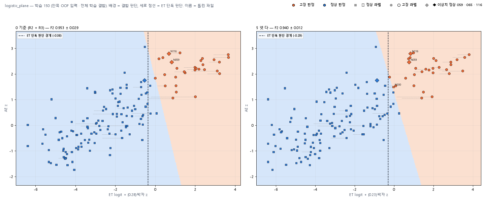
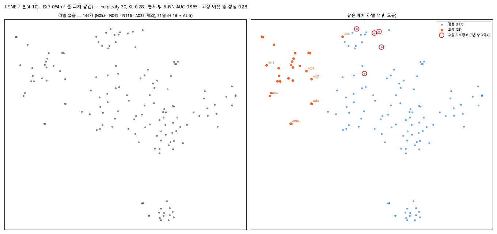
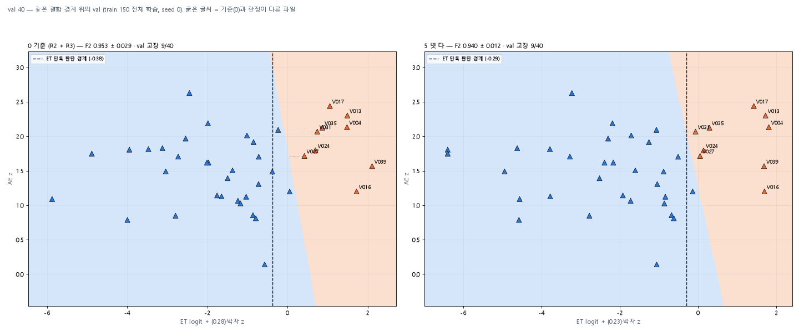
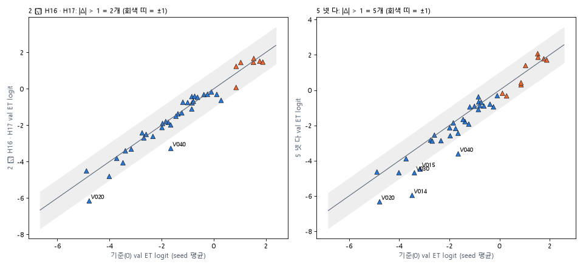

# EXP-064 피처 정리 (H2 → D_K1 · − H16 · H17 · − H13 · − H7)

노션 카드 (실험 DB에 그대로 옮긴다)

| 팀원 | 모델 | F2 점수 | 변경 사항 | 메모 |
|---|---|---|---|---|
| 이동훈 | J-축소 + K83 (src/final.py JShrink) · 11 kHz 상한 · R2 + R3 검출기 | 0.953 ± 0.029 | 기준 = R2 + R3(50 Hz 울림 사전 · RES 새 검출기). 피처 하나씩: H2 → D_K1 · − H16 · H17 · − H13 · − H7 · 넷 다. 이상치 학습 포함, 그룹 CV, full (H1, H1′, H2) | 넷 다 쌍 차이 sd 안(−0.021–0.000), val 안정성 개선도 없음 → 채택 제안 없음(−H16·H17만 보류) |

## 주요 변경점 (기준 실험 대비)

- 기준 검출기 = R2 + R3 (j_tables atoms="50", res_new=True). EXP-062 구성 3 대비 바뀜
- 1: H2(2위/1위) → D_K1(두 번째 충격 높이 ÷ σ, JShrink cols)
- 2: 봉우리 H16 · H17 뺌 (JShrink peak=[])
- 3: H13 몫 2–4k 뺌
- 4: H7 울림 1–2k 뺌 (축소는 남은 울림 열)
- 5: 넷 다
- 이름 변경(값 같음): H18_hfl → L2_hfl, L1_S → L1_lock

- 가설: H1, H1′, H2 ([물리가설](../../../1_기준·기록/물리가설.md))
- 실행: 2026-11-25 · git `bd9a50a+수정중` · 코드 [run.py](자료/run.py)
- 평가: 중첩 CV (바깥 5 × 안쪽 4) · 모드 seed 5 · ET 300. 자주 놓침 · 오경보 n회+ = seed 과반. quick 수치는 선별용, 기록 수치는 QE_FULL=1

## 결과

| 구성 | F2 | 재현율 | 오경보율 | 정밀도 | F2 (고장 10%·40%) | 자주 놓침 | 오경보 3회+ |
|---|---|---|---|---|---|---|---|
| 0 기준 (R2 + R3) | 0.953 ± 0.029 | 0.973 | 0.033 | 0.881 | 0.923 · 0.969 | — | 2 |
| 1 H2 → D_K1 | 0.932 ± 0.012 | 0.960 | 0.048 | 0.837 | 0.890 · 0.954 | 028 | 4 |
| 2 − H16 · H17 | 0.953 ± 0.014 | 0.980 | 0.040 | 0.862 | 0.918 · 0.972 | — | 3 |
| 3 − H13 | 0.938 ± 0.027 | 0.953 | 0.032 | 0.885 | 0.910 · 0.953 | 028 | 2 |
| 4 − H7 | 0.947 ± 0.028 | 0.960 | 0.027 | 0.901 | 0.923 · 0.960 | 028 | 2 |
| 5 넷 다 | 0.940 ± 0.012 | 0.987 | 0.065 | 0.794 | 0.885 · 0.970 | — | 7 |

## 해석

R2 + R3 기준 0.953 ± 0.029 위에서 넷 중 어느 것도 F2를 sd 넘게 올리지 못했다(쌍 차이 D_K1 −0.021 · −H16·H17 0.000 · −H13 −0.015 · −H7 −0.006 · 넷 다 −0.012, 모두 sd 안). val 안정성 개선 조건까지 채운 구성도 없다 → **채택 제안 없음, 기준 그대로**. −H16·H17만 "보류(사용자 판단)": 점수 같고 seed sd 0.029 → 0.014, val |여유| 2.65 → 2.81이지만, val 판정 9 → 7(V027 · V031 정상으로), seed 흔들림 0 → 1(V035), 오경보율 0.033 → 0.040이고 val ET가 train 정상보다 위에 있는 차이(1.60 → 1.72)는 줄지 않았다.

<!-- key-figs: 자동 (save_fig key=True) -->

*logistic_plane* — 기준(0, R2 + R3) vs 넷 다(5)의 결합 경계

*tsne_라벨* — 기본 t-SNE(4-10, 기준 피처). 빨간 원 = 구성 5 오경보

<!-- /key-figs -->

**구성별 (쌍 차이 = seed별 F2 − 기준, 평균 ± sd. 놓침 · 오경보 = 5번 중 횟수)**

| 구성 | 쌍 차이 | 놓친 고장 | 오경보 2회+ | val 고장(seed 0) · 바뀐 파일 | seed 흔들림 val | val \|여유\| 중앙 | ET \|Δ\|>1 val | 제안 |
|---|---|---|---|---|---|---|---|---|
| 0 기준 R2 + R3 | — | 028 2 · 014 1 · 022 1 | 059 5 · 116 5 · 055 · 065 · 095 2 | 9 | 0 | 2.65 | — | 기준 |
| 1 H2 → D_K1 | −0.021 ± 0.030 | 028 4 · 009 · 022 1 | 095 4 · 054 3 · 106 2 외 | 9 · 없음 | 0 | 2.66 | 0 | 안 함 (오경보율 0.048) |
| 2 − H16 · H17 | 0.000 ± 0.031 | 009 · 018 · 028 1 | N030 3 · N009 · N054 2 | 7 · V027− V031− | 1 (V035) | 2.81 | 2 (V020 · V040 ↓) | 보류 |
| 3 − H13 | −0.015 ± 0.030 | 028 3 · 022 2 · 009 · 021 1 | 065 · 095 2 | 9 · 없음 | 0 | 2.52 | 0 | 안 함 |
| 4 − H7 | −0.006 ± 0.021 | 028 3 · 014 2 · 022 1 | 055 2 (오경보율 0.027, 가장 낮음) | 9 · 없음 | 2 (V018 · V025) | 2.62 | 0 | 안 함 (val 흔들림 늘어남) |
| 5 넷 다 | −0.012 ± 0.031 | 016 2 | 054 4 · 009 · 030 · 045 · 095 3 | 9 · 없음 | 0 | 2.87 | 5 | 안 함 (오경보율 0.065) |

- 규칙 켜짐(E2 4/0 · 8.3k 스펙트럼 5/0 · RES 7/0, val 0)은 여섯 구성 모두 같다. 피처 변경은 결합(ET) 쪽에만 영향.
- 기준 자체: R2 + R3는 EXP-062 구성 3(옛 검출기 0.971 ± 0.022)보다 −0.018 ± 0.034(sd 안). 차이는 R2(50 Hz 사전) 몫이다(EXP-063 R2 단독 0.953, R3는 판정 불변). val 10 → 9(V025).
- D_K1(H1′)은 고장 028을 더 놓치고(2 → 4) 충격성 정상 054 · 095 · 106 오경보를 올린다(4-15에서 예고한 위험이 그대로 나타남). H1′ 검증 = 지금 입력에서는 이득 없음.
- 봉우리 열(H16 · H17)을 빼면 val ET logit이 전반적으로 내려가지만 train 정상도 같이 내려가(중앙 −2.86 → −3.11) "val 배경 이동 통로" 가설(4-18)은 이 지표로는 확인되지 않았다. 학습에서는 정상 030 · 009 오경보가 새로 생긴다.
- 넷 다 빼면 열이 9 + D_K1로 줄어 ET가 정상을 덜 구분한다(오경보 3회+ 2 → 7). 하나씩은 중립이어도 합치면 나빠진다.
- D_K1 정의(이 실험): `src/features2.py d_k1` = log10(두 번째로 큰 충격의 포락선 높이 ÷ 1.4826·MAD(검출기 입력 1–11 kHz)), 충격 < 2개 = log10(4.5·√(2 ln 2)) ≈ 0.724. 4-15 정의(200 Hz 고역 · |h| > 8σ 사건 · 10 ms 묶음 · 바닥 log10 8)와 대역 · 사건 정의가 다르다.

## 그림

### val_판정
기준 vs 넷 다의 val 판정

### val_ET이동
봉우리 열을 뺐을 때 val ET logit 이동 (색 = seed 과반 판정)

## 중간 단계 결과 (비교 · 절제 · 이전 실험 값)

| 구성 | F2 | 재현율 | 오경보율 | 정밀도 | F2 (고장 10%·40%) | 자주 놓침 | 오경보 3회+ |
|---|---|---|---|---|---|---|---|
| 참고 EXP-062 구성 3 (옛 검출기) | 0.971 ± 0.022 | 0.987 | 0.023 | 0.914 | 0.949 · 0.982 | — | 2 |