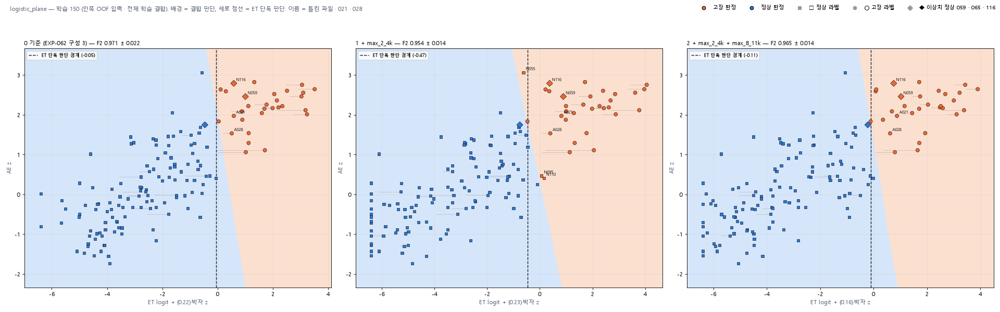
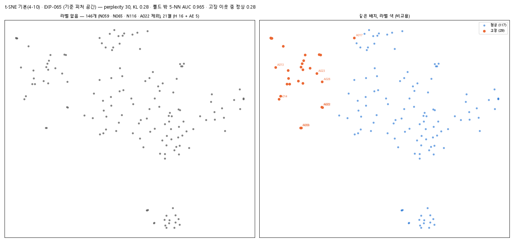
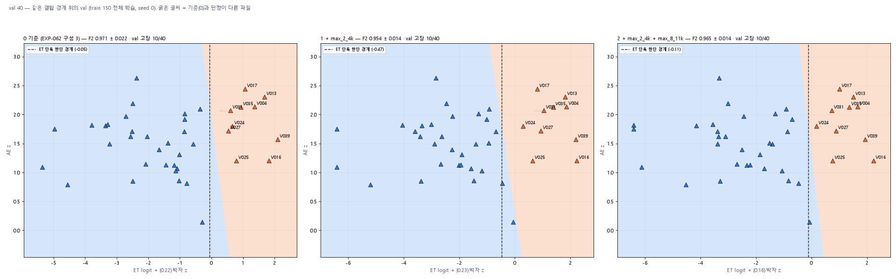

# EXP-065 대역별 최대 충격 배수 (+ max_2_4k · + max_8_11k)

노션 카드 (실험 DB에 그대로 옮긴다)

| 팀원 | 모델 | F2 점수 | 변경 사항 | 메모 |
|---|---|---|---|---|
| 이동훈 | J-축소 + K83 (src/final.py JShrink) · 11 kHz 상한 (EXP-062 구성 3) | 0.971 ± 0.022 | 기준 = EXP-062 구성 3. ET 열 추가: + max_2_4k · + max_2_4k + max_8_11k (대역별 최대 충격 배수, 4-19). 이상치 학습 포함, 그룹 CV, full (H1) | 쌍 차이 −0.017 · −0.006(sd 안). 구성 2: 021 · 028 5/5, val 여유↑, 오경보 14 → 19회(065 · 095) → 채택 제안 없음 |

## 주요 변경점 (기준 실험 대비)

- 기준 = EXP-062 구성 3 (옛 검출기 250 Hz 사전 · 옛 RES), 같은 분할
- 1: ET 열 + max_2_4k (2–4 kHz로 운 충격 중 최대 배수, JShrink cols)
- 2: ET 열 + max_2_4k + max_8_11k
- 울림 축소 · E2 · 8.3k 규칙은 그대로

- 가설: H1 ([물리가설](../../../1_기준·기록/물리가설.md))
- 실행: 2026-11-25 · git `bd9a50a+수정중` · 코드 [run.py](자료/run.py)
- 평가: 중첩 CV (바깥 5 × 안쪽 4) · 모드 seed 5 · ET 300. 자주 놓침 · 오경보 n회+ = seed 과반. quick 수치는 선별용, 기록 수치는 QE_FULL=1

## 결과

| 구성 | F2 | 재현율 | 오경보율 | 정밀도 | F2 (고장 10%·40%) | 자주 놓침 | 오경보 3회+ |
|---|---|---|---|---|---|---|---|
| 0 기준 (EXP-062 구성 3) | 0.971 ± 0.022 | 0.987 | 0.023 | 0.914 | 0.949 · 0.982 | — | 2 |
| 1 + max_2_4k | 0.954 ± 0.014 | 0.973 | 0.032 | 0.887 | 0.926 · 0.969 | 028 | 4 |
| 2 + max_2_4k + max_8_11k | 0.965 ± 0.014 | 0.987 | 0.032 | 0.886 | 0.936 · 0.980 | — | 3 |

## 해석

기준(EXP-062 구성 3)은 0.971 ± 0.022로 재현됐다. 새 열은 둘 다 F2를 올리지 못했다(쌍 차이 + max_2_4k −0.017 ± 0.019 · 둘 다 −0.006 ± 0.017, sd 안, 아래쪽). 구성 2는 021 · 028을 5/5 잡고 val 여유가 커졌지만(|여유| 중앙 2.89 → 3.35, seed 흔들림 0), 오경보가 늘었다(14 → 19회: 065 2 → 5 · 095 0 → 2) → **채택 제안 없음, 기준 그대로** (사용자 판단).

<!-- key-figs: 자동 (save_fig key=True) -->

*logistic_plane* — 기준(0) vs + max_2_4k(1) vs + max_2_4k + max_8_11k(2)의 결합 경계

*tsne_라벨* — 기본 t-SNE(4-10, 기준 피처). 빨간 원 = 구성 2 오경보

<!-- /key-figs -->

**구성별 (쌍 차이 = seed별 F2 − 기준, 평균 ± sd. 놓침 · 오경보 = 5번 중 횟수)**

| 구성 | 쌍 차이 (seed 0–4) | 놓친 고장 | 오경보 | 021 · 028 잡음 | 059 · 065 · 116 · 046 · 095 · 110 오경보 | val 고장 · 바뀐 파일 | seed 흔들림 val | val \|여유\| 중앙 | 제안 |
|---|---|---|---|---|---|---|---|---|---|
| 0 기준 | — | 021 1 · 028 1 (계 2) | 059 5 · 116 5 · 065 2 · 016 · 055 1 (계 14) | 4 · 4 | 5 · 2 · 5 · 0 · 0 · 0 | 10 | 0 | 2.89 | 기준 |
| 1 + max_2_4k | −0.017 ± 0.019 (+.014 −.013 −.013 −.033 −.041) | 028 3 · 009 1 (계 4) | 059 5 · 065 4 · 116 4 · 095 3 · 016 · 055 · 110 1 (계 19) | 5 · 2 | 5 · 4 · 4 · 0 · 3 · 1 | 10 · 없음 | 3 (V009 V018 V036) | 3.00 | 안 함 |
| 2 + max_2_4k + max_8_11k | −0.006 ± 0.017 (+.021 −.006 −.006 −.006 −.033) | 009 1 · 022 1 (계 2) | 059 · 065 · 116 5 · 095 2 · 016 · 025 1 (계 19) | 5 · 5 | 5 · 5 · 5 · 0 · 2 · 0 | 10 · 없음 | 0 | 3.35 | 안 함 (보류 가능) |

- 중복(Spearman ρ, train 150): max_2_4k ~ H8 **+0.90**(정상만 +0.83), max_8_11k ~ H10 **+0.82**(정상만 +0.55), 둘 사이 +0.31. 4-19 관문(|ρ| < 0.8)을 둘 다 넘지 못한다. ET 중요도는 max_2_4k 0.17로 1위지만 H8 · H9 몫을 가져간 것(0.098 → 0.071 · 0.133 → 0.092)이다.
- max_2_4k 단독: 021은 5/5로 올라가지만 028을 더 놓치고(1 → 3) 2–4k 충격이 센 정상 095 · 110을 올린다(4-19 "고장 하위 10 % 선을 넘는 정상 26개"가 그대로 나타남).
- max_8_11k를 더하면 028이 다시 5/5(4-19의 95 백분위 신호)지만, 예고대로 이상치 정상 065가 2 → 5회. 059 · 116은 이미 5/5라 변화 없음.
- 규칙 켜짐(E2 4/0 · 8.3k 스펙트럼 5/0 · RES 5/0, val 0)은 세 구성 모두 같다. val 판정 10/40, seed 0에서 세 구성 같은 파일(과반 판정 수도 10 · 10 · 10).
- val ET logit 평균이 내려가지만(−1.30 → −1.61) train 정상도 같이 내려가(−2.80 → −3.65) val 여유가 커진 것은 척도 변화일 수 있다. 라벨이 없으니 val로 고르지 않는다.
- 새 표의 기존 열(H · S · L · LP · 8.3k 재료 · RES)은 EXP-062 캐시와 같고, 새 열은 4-19 files.csv와 같다(result.json "새 표 = EXP-062 캐시 · 4-19").

## 그림

### val_판정
기준 vs 구성 1 · 2의 val 판정

