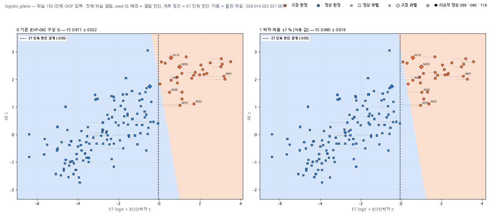
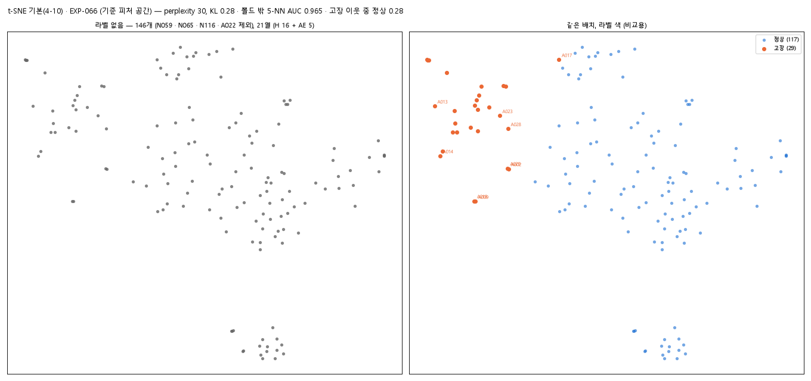
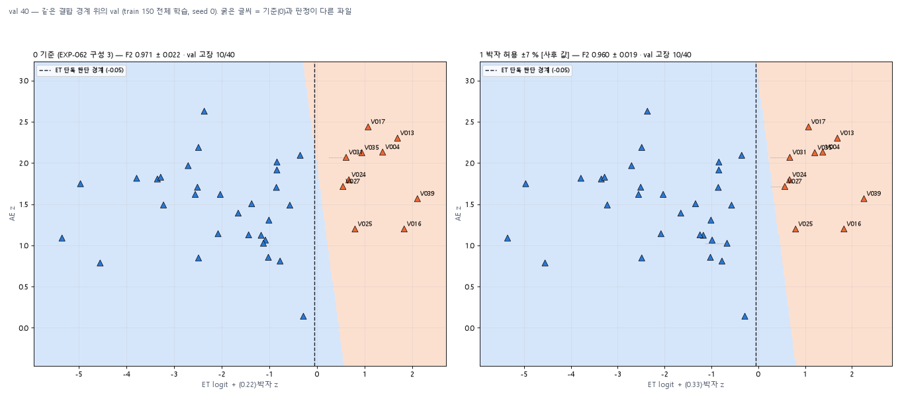

# EXP-066 박자(L1_lock) hit 허용 ±3 % → ±7 % [사후 값]

노션 카드 (실험 DB에 그대로 옮긴다)

| 팀원 | 모델 | F2 점수 | 변경 사항 | 메모 |
|---|---|---|---|---|
| 이동훈 | J-축소 + K83 (src/final.py JShrink) · 11 kHz 상한 (EXP-062 구성 3) | 0.971 ± 0.022 | 기준 = EXP-062 구성 3. L1_lock hit 허용 ±3 % → ±7 % (lock_S tol, [사후 값]: train 라벨을 본 뒤 고른 값). 이상치 학습 포함, 그룹 CV, full (H3) | [사후 값] ±7 %는 0.960 ± 0.019로 기준(0.971 ± 0.022)보다 낮다(쌍 차이 −0.011 ± 0.009, seed 5개 중 3개 하락 · 2개 같음, 오르는 seed 없음). |

## 주요 변경점 (기준 실험 대비)

- 기준 = EXP-062 구성 3, 같은 분할
- 1: L1_lock hit 허용 ±7 % (j_tables lock_tol=0.07) — 박자 S 한 열만 바뀜 [사후 값]
- ET 열 · 울림 축소 · E2 · 8.3k 규칙은 그대로

- 가설: H3 ([물리가설](../../../1_기준·기록/물리가설.md))
- 실행: 2026-11-25 · git `bd9a50a+수정중` · 코드 [run.py](자료/run.py)
- 평가: 중첩 CV (바깥 5 × 안쪽 4) · 모드 seed 5 · ET 300. 자주 놓침 · 오경보 n회+ = seed 과반. quick 수치는 선별용, 기록 수치는 QE_FULL=1

## 결과

| 구성 | F2 | 재현율 | 오경보율 | 정밀도 | F2 (고장 10%·40%) | 자주 놓침 | 오경보 3회+ |
|---|---|---|---|---|---|---|---|
| 0 기준 (EXP-062 구성 3) | 0.971 ± 0.022 | 0.987 | 0.023 | 0.914 | 0.949 · 0.982 | — | 2 |
| 1 박자 허용 ±7 % [사후 값] | 0.960 ± 0.019 | 0.973 | 0.023 | 0.914 | 0.939 · 0.972 | — | 2 |

## 해석

[사후 값] ±7 %는 0.960 ± 0.019로 기준(0.971 ± 0.022)보다 낮다(쌍 차이 −0.011 ± 0.009, seed 5개 중 3개 하락 · 2개 같음, 오르는 seed 없음). 028은 4 → 5/5로 잡지만 021 4 → 3 · 022 5 → 4 · 009 새로 1회 놓침(놓침 2 → 4회), 오경보는 14 → 14회(065 2 → 0, 025 · 054 새로 1회). val 판정 10/40 같은 파일, 대신 V025가 seed 1번 흔들림 · |여유| 중앙 2.89 → 2.80 → **채택 제안 없음, 기준 그대로** (사용자 판단).

<!-- key-figs: 자동 (save_fig key=True) -->

*logistic_plane* — 기준(0) vs 박자 허용 ±7 %(1)의 결합 경계

*tsne_라벨* — 기본 t-SNE(4-10, 기준 피처). 빨간 원 = 구성 1 오경보

<!-- /key-figs -->

**주목 파일** (hit = 충격 중 T ± 허용 안에 다른 충격이 있는 비율. 여유 = 결합 점수 − 문턱, seed 0–4 전체 학습의 안쪽 OOF 입력 중앙값 · 근사. 5번 중 = 중첩 CV 고장 판정 횟수)

| 파일 | hit ±3 → ±7 % | 박자 z 0 → 1 | 여유 0 → 1 | 5번 중 0 → 1 |
|---|---|---|---|---|
| A028 | 0.23 → 0.77 | 1.35 → 2.47 | +0.69 → +1.16 | 4 → 5 |
| A014 | 0.67 → 0.78 | 4.48 → 2.85 | +1.41 → +0.93 | 5 → 5 |
| A022 | 1.00 → 1.00 | 7.89 → 4.31 | +2.65 → +1.68 | 5 → 4 |
| A001 | 0.69 → 0.77 | 4.62 → 2.80 | +5.93 → +5.24 | 5 → 5 |
| A021 | 0 → 0 | 0 → 0 | +0.91 → +0.39 | 4 → 3 |
| N048 · N103 · N091 | — | 3.49 · 3.51 · 3.64 → 2.33 · 2.67 · 1.99 | −4.8 · −5.7 · −6.4 → −4.9 · −5.9 · −7.2 | 0 → 0 |
| N059 · N116 · N065 | 0 → 0 | 0 → 0 | +1.52 · +1.36 · −0.91 → +1.02 · +0.95 · −1.30 | 5 · 5 · 2 → 5 · 5 · 0 |

- 왜 내려가나: 창을 넓히면 정상의 hit도 같이 오른다 → 정상 S 척도(1.4826·MAD) 0.122 → 0.223으로 커져 **박자 z가 대부분 줄어든다**(022 7.9 → 4.3, 001 4.6 → 2.8). 028만 hit가 크게 올라 z가 오른다. 로지스틱은 박자 계수를 0.39 → 0.56으로 올리고 문턱도 1.05 → 1.33(seed 평균)으로 올려, 박자 0인 고장(021)의 여유가 줄었다(+0.91 → +0.39).
- 정상 z > 2: 7개(N048 N073 N091 N092 N103 N118 N119) → 6개(N018 N048 N073 N092 N103 N118). 정상 99 % 3.51 → 2.36, 고장 z > 2도 7 → 6. 분리가 좋아진 것이 아니라 척도가 바뀐 것.
- 결합 계수 (seed 0–4 평균, ET · 박자 · AE): 0 = 1.90 · 0.39 · 0.22, 문턱 1.05 / 1 = 1.87 · 0.56 · 0.22, 문턱 1.33. E2 4/0 · 8.3k 6/0 규칙 켜짐은 같음.
- val: 판정 10/40, 기준과 같은 파일(seed 0 · 과반 모두). 박자 z > 2인 val 없음. 여유는 대부분 0.3–0.5 줄었다(척도 변화).
- [사후 값] 주의: ±7 %는 train 라벨(028 · 014 · 022 여유)을 본 뒤 고른 값이라 이 F2도 낙관 쪽이다. 그런데도 기준보다 낮다. 정상 T 추정 불확실성은 ~1 %라 ±7 %의 근거가 되지 않는다.
- 새 표(jtab_*_11k_tol07)의 S 외 열은 EXP-062 캐시와 같다(result.json "±7 % 표 = 기준 캐시").

## 그림

### val_판정
기준 vs 구성 1의 val 판정

