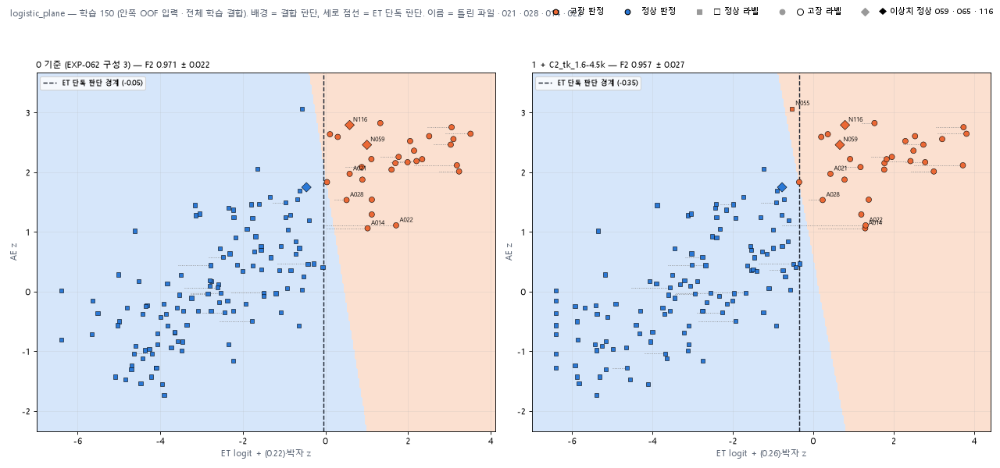
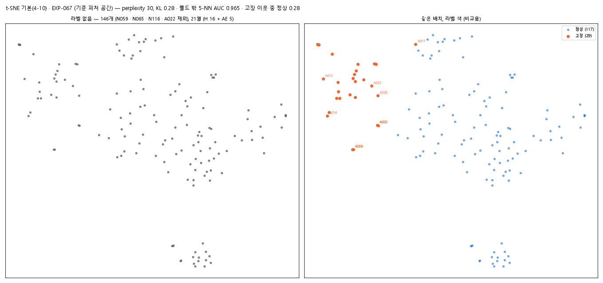
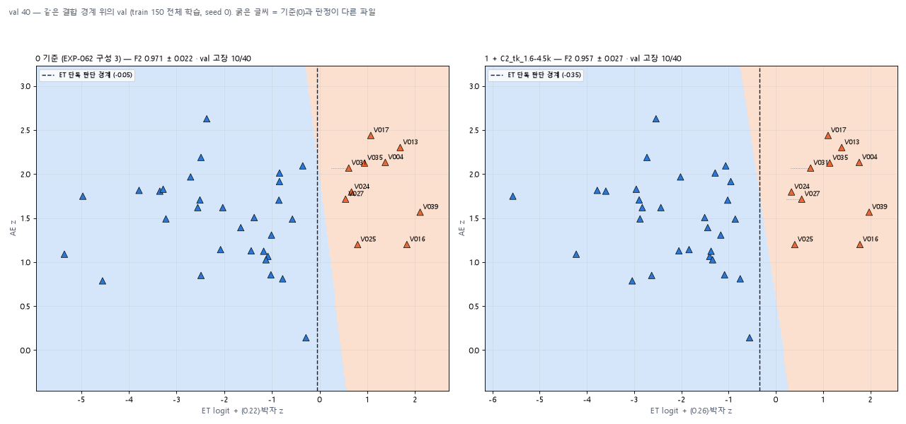

# EXP-067 1–5 kHz 피처 (+ C2 TKEO 파고율 1.6–4.5k, 관문 미통과 · 참고)

노션 카드 (실험 DB에 그대로 옮긴다)

| 팀원 | 모델 | F2 점수 | 변경 사항 | 메모 |
|---|---|---|---|---|
| 이동훈 | J-축소 + K83 (src/final.py JShrink) · 11 kHz 상한 (EXP-062 구성 3) | 0.971 ± 0.022 | 기준 = EXP-062 구성 3. ET 열 추가: + C2_tk_1.6-4.5k (TKEO P99/P50, 4-20에서 CI 하한 최고 · 관문 미통과 → 참고). 이상치 학습 포함, 그룹 CV, full (H1) | 관문 미통과 · 참고. 쌍 차이 −0.014 ± 0.023(sd 안, 아래쪽). 021 4 → 5/5지만 022 5 → 3 · 028 4 → 3, 오경보 14 → 17회. val 10/40 같은 파일 → 채택 제안 없음 |

## 주요 변경점 (기준 실험 대비)

- 기준 = EXP-062 구성 3 (옛 검출기 250 Hz 사전 · 옛 RES), 같은 분할
- 1: ET 열 + C2_tk_1.6-4.5k (1.6–4.5 kHz TKEO log10(P99 ÷ P50), JShrink cols). 4-20 관문 미통과(095 정상 99 % 위 · 반쪽 ρ 0.38) → 참고
- 울림 축소 · E2 · 8.3k 규칙은 그대로

- 가설: H1 ([물리가설](../../../1_기준·기록/물리가설.md))
- 실행: 2026-11-25 · git `bd9a50a+수정중` · 코드 [run.py](자료/run.py)
- 평가: 중첩 CV (바깥 5 × 안쪽 4) · 모드 seed 5 · ET 300. 자주 놓침 · 오경보 n회+ = seed 과반. quick 수치는 선별용, 기록 수치는 QE_FULL=1

## 결과

| 구성 | F2 | 재현율 | 오경보율 | 정밀도 | F2 (고장 10%·40%) | 자주 놓침 | 오경보 3회+ |
|---|---|---|---|---|---|---|---|
| 0 기준 (EXP-062 구성 3) | 0.971 ± 0.022 | 0.987 | 0.023 | 0.914 | 0.949 · 0.982 | — | 2 |
| 1 + C2_tk_1.6-4.5k | 0.957 ± 0.027 | 0.973 | 0.028 | 0.896 | 0.931 · 0.970 | — | 2 |

## 해석

**관문 미통과 · 참고 실험.** [4-20](../../../4_피처/4-6_후보/4-20_1-5kHz후보/README.md)에서 통과한 후보가 없어 CI 하한이 가장 높은 C2_tk_1.6-4.5k만 넣었다. 기준은 0.971 ± 0.022로 재현됐고, + C2는 0.957 ± 0.027(쌍 차이 −0.014 ± 0.023, sd 안 아래쪽, 오르는 seed 없음). 021은 5/5로 올라가지만 022 · 028을 더 놓치고 오경보가 늘어(14 → 17회) **채택 제안 없음, 기준 그대로** (사용자 판단).

<!-- key-figs: 자동 (save_fig key=True) -->

*logistic_plane* — 기준(0) vs + C2_tk_1.6-4.5k(1)의 결합 경계

*tsne_라벨* — 기본 t-SNE(4-10, 기준 피처). 빨간 원 = 구성 1 오경보

<!-- /key-figs -->

그림 읽는 법: 배경 = 결합(로지스틱) 판단(파랑 정상 · 주황 고장), 세로 점선 = ET 단독 판단 경계, 점 색 = 최종 판정, ◆ = 이상치 정상. 규칙(E2 · 8.3k)으로만 잡힌 고장은 평면에서 뺐다.

**구성별 (쌍 차이 = seed별 F2 − 기준. 놓침 · 오경보 = 5번 중 횟수)**

| 구성 | 쌍 차이 (seed 0–4) | 놓친 고장 | 오경보 | 021 · 028 · 014 · 022 잡음 | 059 · 065 · 116 · 095 · 110 · 046 · 025 오경보 | val 고장 · 바뀐 파일 | seed 흔들림 val | val \|여유\| 중앙 | 제안 |
|---|---|---|---|---|---|---|---|---|---|
| 0 기준 | — | 021 1 · 028 1 (계 2) | 059 5 · 116 5 · 065 2 · 016 · 055 1 (계 14) | 4 · 4 · 5 · 5 | 5 · 2 · 5 · 0 · 0 · 0 · 0 | 10 | 0 | 2.89 | 기준 |
| 1 + C2_tk_1.6-4.5k | −0.014 ± 0.023 (0 −.059 0 0 −.013) | 022 2 · 028 2 (계 4) | 059 5 · 116 5 · 065 2 · 016 · 025 · 055 · 070 · 095 1 (계 17) | 5 · 3 · 5 · 3 | 5 · 2 · 5 · 1 · 0 · 0 · 1 | 10 · 없음 | 0 | 2.81 | 안 함 |

- 중복: C2 ~ H3(첨도 1–2k) ρ +0.79(정상만 +0.76), ~ H8 +0.58. ET 중요도 0.089로 쓰이지만 H9 · H16 · H8 몫을 나눠 가진 것(0.133 → 0.112 · 0.100 → 0.082 · 0.098 → 0.089).
- 4-20에서 본 대로 정상 095(99 백분위) · 025(93)가 1회씩 오경보로 나타났다. 이상치 059 · 065 · 116은 변화 없음.
- 022(박자형, 4-20 백분위 65) · 028(저주파형, 69)은 C2가 낮은 고장이라, C2가 ET 안에서 H8 · H9 몫을 가져가면 ET logit이 내려가 경계에 걸린다(결합 계수 ET 1.76 → 1.57, 문턱 1.03 → 0.55).
- val: seed 0 판정 10/40 같은 파일, seed 흔들림 0, |여유| 중앙 2.89 → 2.81. ET logit이 1 넘게 바뀐 val은 V003(+1.3) · V007(+1.2)뿐이고 둘 다 정상 판정 그대로. val 라벨이 없으니 val로 고르지 않는다.
- 규칙 켜짐(E2 4/0 · 8.3k 스펙트럼 5/0 · RES 5/0, val 0)은 두 구성 같다. 새 표의 기존 열은 EXP-062 캐시와 같고, 새 열은 4-20 files.csv와 같다(result.json).

## 그림

### val_판정
기준 vs 구성 1의 val 판정

