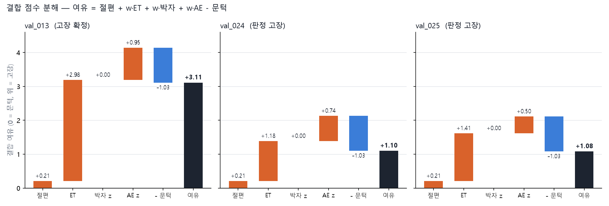
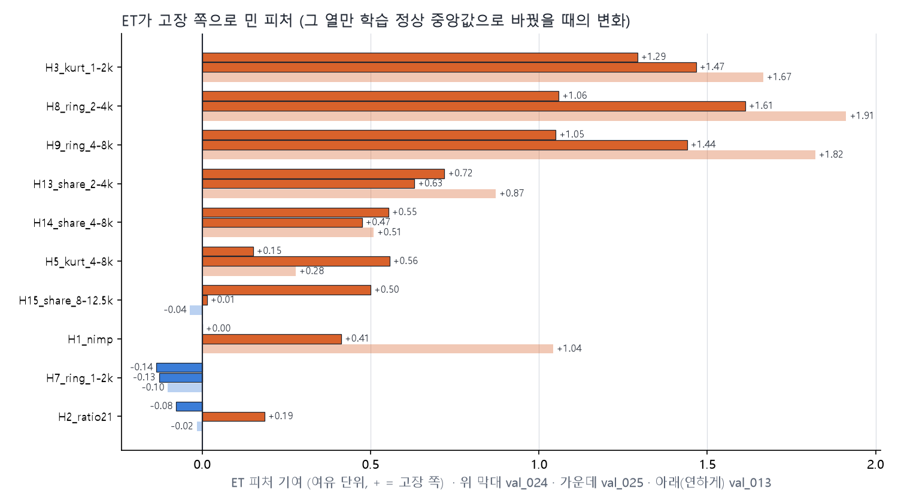
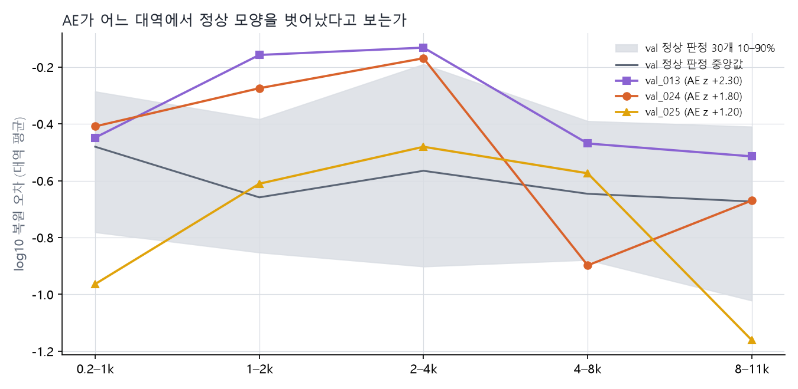

# 6-10 val_024 · val_025 피처 기여 (11-27, 최종 모델 EXP-062 구성 3)

**결론: 024와 025는 여유가 +1.10 · +1.08로 거의 같고(문턱 1.03 바로 위), 둘 다 ET가 "울림이 2–4 kHz로 높고 4–8 kHz로는 낮다 + 1–2 kHz 첨도가 높다"를 고장 신호로 읽은 결과다. 차이는 AE다. 024는 1–4 kHz 대역 AE 오차가 val 정상 범위 위쪽이라 AE 몫이 +0.74이고, 025는 대역별로는 정상 범위 안이라 +0.50이다.** 규칙(E2 · 8.3k)은 둘 다 안 켜졌고 박자 z도 0이다. 고장 확정 013(여유 +3.11)에 비하면 둘 다 약하다.

여유 = 절편 + w·ET + w·박자 + w·AE − 문턱. 막대가 이어 붙은 폭포 그림이다. 진한 막대가 최종 여유.

그 열 하나만 학습 정상 중앙값으로 바꿨을 때 ET logit이 얼마나 내려가는지(× w_ET, 여유 단위). 열끼리 겹쳐서 **합이 ET 항(024 +1.18 · 025 +1.41)보다 크다** — 크기 비교용이다.

## 읽기
- **둘 다 H3(1–2k 첨도) · H8(2–4k 울림 비율) · H9(4–8k 울림 비율)가 주도**한다. H8은 정상 백분위 100 %(학습 정상에 이만큼 높은 파일 없음). 6-6에서 본 "울림이 2 kHz 대역 경계에 걸림"과 같은 계열이다.
- **024**: 충격 4개(H1 기여 0). H13(2–4k 에너지 몫)이 정상 100 %, AE가 1–4 kHz에서 013과 비슷하게 높다(+0.38 · +0.40, val 정상 중앙값 대비). 반면 4–8 kHz는 오히려 낮다.
- **025**: 충격 6개(H1 +0.41). H8 기여가 024보다 크다(+1.61 vs +1.06). AE는 대역별로 val 정상 범위 안인데 합친 z가 +1.2 — val 공통 배경 상승 쪽이다.
- **정상 쪽으로 미는 열**은 H7(1–2k 울림 비율, −0.1) 하나뿐이다.
- 둘 다 train에서 H8이 높은 파일은 고장(77 % 지점)에 가깝지만, 같은 울림이 정상에도 있어 확정은 못 한다(6-6: 2000 Hz 격자 문제는 11 kHz 상한 버전에서도 H8이 100 %).

## 효섭 RF와의 차이 (참고)
효섭 RF는 013 · 024 · 025를 정상으로 봤다. 우리 쪽 근거는 H3 · H8 · H9에 몰려 있어, 효섭 피처가 이 울림 비율을 안 쓰면 갈릴 수 있다. 어느 쪽이 고장인지는 이 자료로 가를 수 없다.

수치: [표_V024_V025.md](자료/표_V024_V025.md) · 코드 [run.py](자료/run.py) (저장된 모델만 읽음, 학습 · 임계값 변경 없음. 판정은 제출 근거표와 일치 확인)
