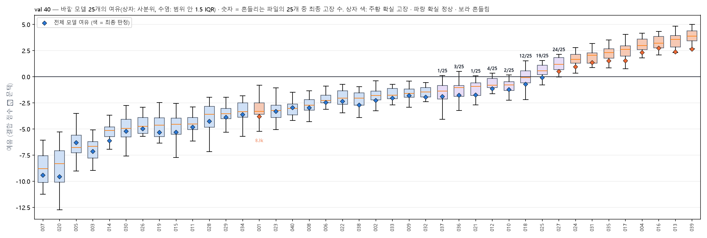
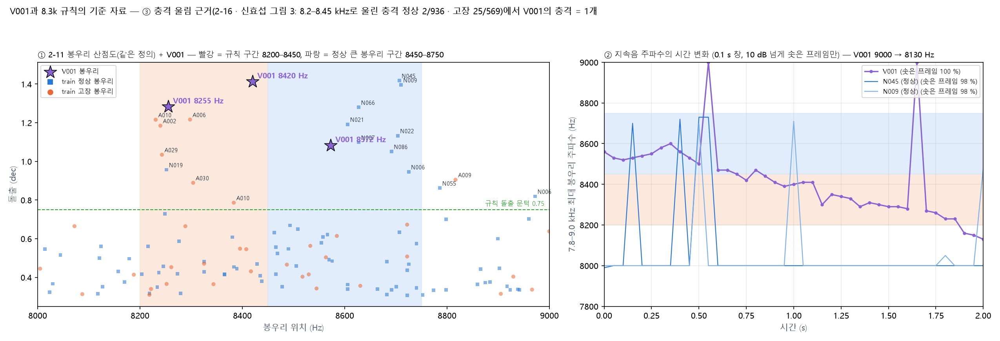

# 6-4 val 확실도 · 경계 val 점검 (11-22, 기준 구성 J-축소) (옛 6-7)

**결론: val 40개 중 31개는 확실하다(정상 23 · 고장 8). 결과가 바뀔 수 있는 건 001(8.3k 규칙만으로 고장) · 025 · 018(반반) 세 개다. 001은 학습 데이터에 없던 새로운 모양이다.** 규칙의 기준 자료(2-11 봉우리 산점도)로 보면 001은 "정상이 없던 자리"(8.20–8.45 kHz, 돌출 0.75 이상)에 큰 봉우리가 있어 고장 쪽이다. 하지만 그 봉우리는 고정된 공진이 아니다. 하나의 지속음이 2초 동안 8.56 → 8.13 kHz로 미끄러지며 만든 것이고, 8.3 kHz로 울린 충격도 없다. 정상 쪽 근거가 조금 더 많지만 확실하지 않다(11-22, 처음의 "규칙 오작동 가능성 큼"을 정정).

중첩 CV 바깥 모델 25개(seed 0–4 × 5폴드, 각 120개 학습)의 val 여유(결합 점수 − 문턱)를 그렸다. 상자는 사분위, 마름모는 제출용 전체 모델(150개 학습)의 여유다. 숫자는 흔들리는 파일에서 25개 중 최종 고장 판정 수다. 표는 [표_val확실도.md](자료/표_val확실도.md), 코드는 [run.py](자료/run.py).

## val 확실도
| 분류 | 파일 |
|---|---|
| 확실 고장 (25/25) | 016 · 039 · 013 · 004 · 017 · 035 · 031 · 024 |
| 규칙(8.3k)만으로 고장 | 001 (결합 점수로는 25개 모두 정상) |
| 흔들림 | 027 (24/25, 제출 고장) · **025 (19/25)** · **018 (12/25)** · 012 (4) · 036 (3) · 010 (2) · 021 · 037 (1) — 027 빼고 제출 정상 |
| 확실 정상 (0/25) | 나머지 23개 |

- **제출용 전체 모델이 체계적으로 정상 쪽이다.** 마름모가 거의 모든 파일에서 상자 아래에 있다. 전체 모델의 문턱(1.14)이 120개로 학습한 모델들보다 높기 때문이다(EXP-051 배깅에서 본 것과 같은 현상의 반대편). 그래서 바깥 모델들은 val 고장을 10–15개(중앙 12)로 보는데, 제출 모델은 10개다.

## 001 점검 — 8.3k 규칙이 맞게 켜졌나
| | 001 | 학습 고장 중 8.3k 규칙 켜진 6개 | 학습 정상 |
|---|---|---|---|
| 스펙트럼 돌출 P83 (문턱 0.75) | **1.41** | 0.19–1.22 | 최대 0.96 (폭 92 Hz라 규칙 미달) |
| 봉우리 폭 W83 (문턱 150 Hz) | **430 Hz** | 229–275 Hz (003은 55) | — |
| 공진 fit (문턱 0.7) | 0.00 | 0.00–0.85 | 최대 0.55 |
| 충격 | **없음** | 있음 (큰 타격 · 울림) | — |
| 8 kHz 대 좁은 지속음(10 dB 넘게 솟은 0.1 s 프레임 비율) | **1.00, 21 dB** | 0.39–0.63, 약 10 dB | ≥ 0.8인 파일 9개 |
| 주파수 흐름 | **−191 Hz/s** (8.41 kHz) | +269 – −64 | — |
| 절반 주파수 짝 | **4.20 kHz, 프레임 1.00** | 0.10–0.41 | N014 · N053: 8000 · 4000 Hz 짝 (정상) |

- 브라우저(EDA 뷰어, 한 개씩 보기)에서도 001은 "충격 없음 · 잡음·연속형"이다. 스펙트로그램에는 8.4 kHz와 4.2 kHz 가로줄이 2초 내내 이어지고, 조금씩 아래로 기운다. 같은 규칙으로 잡힌 고장 A030은 큰 타격의 광대역 세로줄이고, 8 kHz 가로줄은 없다.
- **해석**: 8.3k 규칙의 근거는 "부싱 이상 → 8.3 kHz 공진이 충격으로 울림"(H2, 2-9 · 2-16)이다. 001은 충격 없이 **주파수가 흐르는 지속음과 그 절반 주파수 짝**만 있다. 이건 구조 공진(주파수가 고정)보다 회전 · 전기 쪽 소리에 가깝고, 정상 N014 · N053의 "8000 · 4000 Hz 지속음 짝"과 같은 종류다. 폭 조건도 진짜 넓은 공진이라서가 아니라, 주파수가 2초 동안 약 380 Hz 흘러서 봉우리가 퍼진 탓으로 보인다.
- **한계**: 001의 라벨은 모른다. 지속음을 내는 고장 유형이 있을 수도 있다. 다만 학습 고장 30개 중 8 kHz 대 지속음(≥ 0.8)을 가진 파일은 0개, 정상은 9개다.
- 같은 모양의 val: 017(7.84 kHz · 절반 3.94 kHz, −269 Hz/s)은 검사 구간 밖이라 규칙이 안 켜졌고, 결합 점수로 확실한 고장이다. 012 · 028도 8 kHz 대 지속음이 있다.
### 규칙의 기준 자료 위에 올려 보기 (사용자 요청)

- **① 2-11 봉우리 산점도**(규칙을 만든 자료와 같은 정의): 기준 자료의 결론은 "큰 봉우리가 8.20–8.45 kHz면 고장(정상은 N019 하나), 8.45–8.75 kHz면 정상(고장 0)"이었다. 001은 **고장 구간에 8255 Hz 1.28 · 8420 Hz 1.41**, **정상 구간에도 8572 Hz 1.08** 봉우리가 있다. 두 구간 모두에 큰 봉우리가 있는 파일은 학습 데이터에 없었다. 002 · 029는 정상 구간 봉우리가 작았다(0.51 · 0.67)
- **② 시간 추적**: 세 봉우리는 지속음 하나가 2초 동안 **8.56 → 8.13 kHz**로 미끄러지며 평균 스펙트럼에 번진 것이다. 지속음이 머문 시간은 고장 구간 51 %, 정상 구간 37 %다. 학습 고장의 8.24–8.30 kHz 봉우리는 고정된 공진이다
- **③ 충격 울림 근거(2-16 · 신효섭 그림 3)**: 8.2–8.45 kHz로 울린 충격은 정상 2/936 · 고장 25/569다. 001은 충격 1개(새 정의, 뷰어 예전 정의로는 0개)가 **3.1 kHz**로 울려 이 근거로는 고장 신호가 없다
- → 001은 규칙의 전제(충격이 울리는 고정된 8.3 kHz 공진)와 다른 모양이다. 정상 쪽 근거(지속음 · 충격 울림 없음 · 결합 점수 25/25 정상)가 조금 더 많다. 그러나 평균 스펙트럼으로는 고장 자리에 있고, 돌출이 학습 고장 최대값보다도 크다 → **확실하지 않다**. F2(놓침 1 = 오경보 4)로는 고장으로 두는 것도 합리적이다
- 코드 · 값: [V001_기준자료비교.py](자료/V001_기준자료비교.py) → [V001_기준자료비교.txt](자료/V001_기준자료비교.txt)

- 코드 · 값: [V001_지속음.py](자료/V001_지속음.py) → [V001_지속음.txt](자료/V001_지속음.txt), 규칙 값 비교 [V001_규칙값.txt](자료/V001_규칙값.txt)

## 다음
- 018 점검(12/25, 반반)
- 회의 안건 3으로 올림 ([회의자료](../../5_모델실험/검토문서/회의_1123/회의자료.md) 4절). 모델은 바꾸지 않고, 바꾼다면 제출 판정만 근거와 함께 조정하는 것으로
- (모델 쪽 후보, 실험 전) 8.3k 스펙트럼 규칙에 "충격이 있을 것" 또는 "지속음이 아닐 것" 조건을 넣기. 학습 고장 6개가 모두 충격 파일인지 먼저 확인해야 한다
