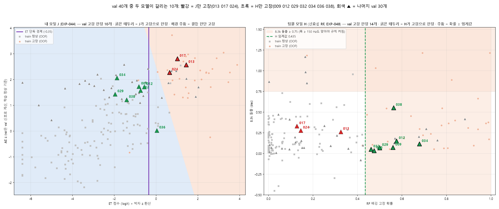

# 6-5 val에서 J와 H가 갈리는 10개 (H 임계값 0.435)

| 파일 | 갈림 | J_ET | J_AE_z | J_박자z | J판정 | H_확률 | H임계값대비 | H_8_3k돌출 | H판정 |
|---|---|---|---|---|---|---|---|---|---|
| 009 | H만 고장 | -0.82 | 1.73 | -0.0 | 정상 | 0.56 | 0.125 | 0.07 | 고장 |
| 012 | H만 고장 | -0.57 | 1.71 | 0.0 | 정상 | 0.575 | 0.14 | 0.15 | 고장 |
| 013 | J만 고장 | 1.44 | 2.57 | 0.0 | 고장 | 0.325 | -0.11 | 0.26 | 정상 |
| 017 | J만 고장 | 1.02 | 2.81 | 0.0 | 고장 | 0.128 | -0.307 | 0.33 | 정상 |
| 024 | J만 고장 | 0.64 | 2.28 | 0.0 | 고장 | 0.145 | -0.29 | 0.28 | 정상 |
| 029 | H만 고장 | -1.96 | 1.43 | 0.0 | 정상 | 0.5 | 0.065 | 0.07 | 고장 |
| 032 | H만 고장 | -0.74 | 1.58 | 0.0 | 정상 | 0.461 | 0.026 | 0.05 | 고장 |
| 034 | H만 고장 | -1.87 | 2.06 | 0.0 | 정상 | 0.678 | 0.243 | 0.12 | 고장 |
| 036 | H만 고장 | 0.04 | 0.02 | 0.0 | 정상 | 0.475 | 0.04 | 0.03 | 고장 |
| 038 | H만 고장 | -1.41 | 1.21 | 0.0 | 정상 | 0.562 | 0.127 | 0.55 | 고장 |
