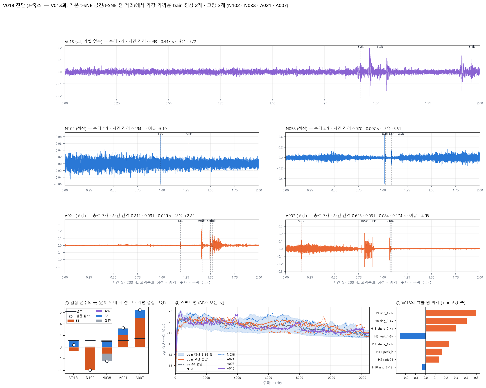

# 6-7 V018 진단 (11-22, 기준 구성 J-축소) (옛 6-8)

**결론: V018은 "약한 충격 몇 개가 3.2 kHz로 울리고, AE 오차가 높은" 파일이다. 고장 쪽으로 미는 건 주로 AE(+1.14)이고, ET는 정상 쪽(−0.71)이다.** 충격 모양(1.4–1.55 s에 몰린 묶음, 3.0–3.2 kHz 울림)은 가장 가까운 고장 A021과 닮았다. 하지만 세기가 0.10 g로 A021(0.29 g)의 3분의 1이고, 검출된 충격도 3개뿐이다. AE 오차는 학습 정상 최상위(100 %)인데, val 전체의 배경이 train보다 높은 현상(2-26)과 같은 방향이라 그대로 믿기 어렵다. 바깥 모델 25개 중 12개가 고장이라 정말 반반이다(6-7).

맨 위는 V018 파형이다. 그 아래는 기본 t-SNE 공간(t-SNE 전 거리, 라벨 없는 공간)에서 가장 가까운 train 정상 2개(N102 · N038)와 고장 2개(A021 · A007)다(200 Hz 고역통과, 점선 = 충격, 숫자 = 울림 주파수). 아래 왼쪽은 결합 점수의 몫, 가운데는 스펙트럼, 오른쪽은 V018의 ET를 민 피처다. 수치는 [표_V018.md](자료/표_V018.md), 코드는 [run.py](자료/run.py)(6-6과 같은 틀).

## 결합 분해 (J-축소, 여유 = ET + 박자 + AE + 절편 − 문턱)
| 파일 | ET | 박자 | AE | 절편 | 문턱 | 여유 |
|---|---|---|---|---|---|---|
| V018 | **−0.71** | 0.00 | **+1.14** | 0.00 | 1.14 | **−0.72** |
| N102 (정상) | −3.94 | 0.00 | −0.05 | +0.08 | 1.19 | −5.10 |
| N038 (정상) | −2.10 | 0.00 | +0.98 | −1.31 | 1.08 | −3.51 |
| A021 (고장) | +2.04 | 0.00 | +1.08 | +0.19 | 1.10 | +2.22 |
| A007 (고장) | +5.04 | 0.00 | +1.37 | −0.01 | 1.44 | +4.95 |

- **AE +1.14**: 복원 오차 평균이 학습 정상의 100 %(가장 높음), 대역별로는 1–2k 99 % · 2–4k 100 % · 4–8k 99 %다. 고장들과 비슷한 수준이다(A021 +1.08). val 전체가 3–5 kHz 배경 +10.9 dB 높은 현상(2-26)과 같은 방향이라, 측정 조건 몫이 섞여 있을 수 있다.
- **ET −0.71**: 충격이 3개뿐이고 약하다(최대 0.10 g, 정상 중앙 0.13 g). 고장 쪽으로 민 피처는 H9 4–8k 울림 비율(축소 뒤 0.42, 낮아서) +0.50 · H8 2–4k 울림 비율 +0.40 · H13 2–4k 에너지 몫 +0.30(정상 · 고장 모두 100 %)이다.
- 박자는 0이고 규칙은 켜지지 않는다.

## 충격 · 울림
- 검출된 충격 3개(1.425 · 1.518 · 1.961 s)는 모두 **3.15 kHz**로 운다(촘촘한 맞춤 3150 Hz · FFT 3107–3131 Hz). 파형에는 1.40–1.55 s에 작은 묶음이 더 보이지만, 검출 문턱(바탕의 8배)을 넘은 건 3개다.
- **A021(고장)과 모양이 닮았다.** A021도 1.19–1.52 s에 충격이 몰려 있고 3.0–3.2 kHz로 운다. 다만 충격 7개, 0.29 g로 V018보다 훨씬 크다.
- 간격은 불규칙하고(CV 0.65) 주기 잠금 점수는 0이다.

## 축소 효과 (J → J-축소)
- 축소 전 울림 비율은 2–4k 1.00이었다(충격 3개가 모두 3.2 kHz). 축소 뒤에는 0.52(2–4k) · 0.42(4–8k)가 되어, 여유가 −0.25(J)에서 −0.72(J-축소)로 내려갔다. 충격이 3개뿐이라 "모두 2–4k"를 덜 믿게 된 것이다(EXP-050의 의도대로).

## 얼마나 흔들리나
- 바깥 5폴드 모델(seed 0) + 전체 모델 6개의 여유: −0.14 · −1.03 · +0.93 · −0.23 · +0.28 · **−0.72(전체)** → 2/6 고장. seed 0–4 전체 25개로는 12/25(6-7)
- 가까운 train 5개: A021 · N102 · A007 · N038 · N106 → 고장 2/5

## 정리: 정상 쪽 근거 vs 고장 쪽 근거
| 정상 쪽 | 고장 쪽 |
|---|---|
| 충격이 3개뿐이고 약하다(0.10 g) → ET 정상 쪽(−0.71) | 충격 묶음 · 3.2 kHz 울림이 고장 A021과 닮았다 |
| AE가 높은 건 val 공통 배경 상승과 같은 방향이라 그대로 믿기 어렵다 | AE 오차가 학습 정상 최상위(100 %), 고장 수준 |
| 축소(충격 적을 때 울림 비율 덜 믿기)로 정상 쪽으로 이동 | 바깥 모델 25개 중 12개가 고장, 가까운 train 5개 중 고장 2개 |

025와 마찬가지로 데이터로는 가르기 어려운 경계 파일이다. 025는 ET(2 kHz 대역 경계)가 고장 쪽으로 밀었고, 018은 AE(val 배경)가 밀었다는 점이 다르다. 회의 안건 3([회의자료](../../5_모델실험/검토문서/회의_1123/회의자료.md) 4절)에서 함께 다룬다.
