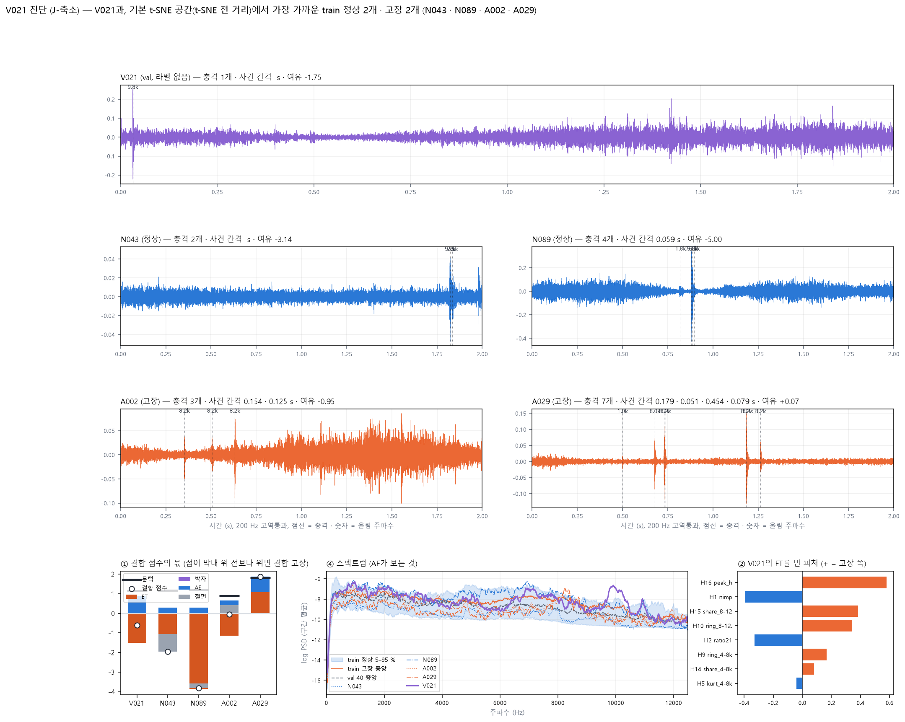

# 6-8 V021 진단 (11-22, 기준 구성 J-축소) (옛 6-9)

**결론: V021은 "파일 맨 앞(0.032 s)에 9.8 kHz로 우는 충격 한 번 + 2초 내내 9.9 kHz 좁은 지속음"인 파일이다. J-축소는 정상으로 꽤 확실히 본다(여유 −1.75, 폴드 모델 0/6, 바깥 모델 25개 중 1개).** 고장 쪽으로 미는 건 AE(+0.90, val 공통 배경 상승과 같은 방향)와 9.9 kHz 봉우리 높이(H16, 학습 정상 95 %)다. 모양은 정상 오경보 N065(10.2 kHz 지속음 + 충격 1개, 6-4 유형 B "고주파 한 번")와 같은 종류이고, 9.9 kHz 지속음 주파수는 정상 N039(9912 Hz)와 같다. 가까운 train 5개 중 3개가 고장(A002 · A029 · A013)이지만, A002 · A029는 8.2 kHz 고정 공진으로 우는 충격이 여러 개라 V021과 기전이 다르다.

맨 위는 V021 파형, 그 아래는 기본 t-SNE 공간(t-SNE 전 거리)에서 가장 가까운 train 정상 2개(N043 · N089)와 고장 2개(A002 · A029)다. 아래 왼쪽은 결합 점수의 몫, 가운데는 스펙트럼, 오른쪽은 V021의 ET를 민 피처다. 수치는 [표_V021.md](자료/표_V021.md), 코드는 [run.py](자료/run.py)(6-8과 같은 틀, 대상만 val_021).

## 결합 분해 (J-축소)
| 파일 | ET | 박자 | AE | 문턱 | 여유 |
|---|---|---|---|---|---|
| V021 | **−1.50** | 0.00 | **+0.90** | 1.14 | **−1.75** |
| A002 (고장, 8.3k 규칙) | −1.13 | 0.00 | +0.65 | 0.90 | −0.95 |
| A029 (고장, 8.3k 규칙) | +1.09 | 0.00 | +0.78 | 1.81 | +0.07 |

- ET 정상 쪽: 충격 1개(H1 정상 14 %)가 정상 쪽으로 −0.39. 고장 쪽은 H16 봉우리 높이 +0.58(9.9 kHz 지속음) · H15 8–12.5k 에너지 몫 +0.38 · H10 8–12.5k 울림 비율 +0.34
- AE +0.90: 평균 학습 정상 97 %, 8–12.5k 98 %. val 확실 정상 23개도 AE 평균이 학습 정상 95 % 자리라([6-9](../6-9_val분포이동/자료/결과.txt)) 이 몫의 상당 부분은 측정 조건 몫으로 보인다
- J(축소 없음)에서는 여유 −0.80이었다. 충격 1개의 울림 비율(8–12.5k 1.00)을 축소가 덜 믿게 해서 −1.75로 내려갔다

## 신호
- 가장 큰 진폭(0.25 g)이 0.032 s의 충격 하나. 울림 9.85 kHz(촘촘한 맞춤), 그 뒤 비슷한 충격 없음
- 9–11 kHz 최대 주파수가 2초 내내 9.86–9.96 kHz(고정) → 지속음. N039 9.81–10.06 · N065 10.11–10.16 · N116/N055 9.38–9.47 kHz와 같은 종류(2-9)
- 후반 배경이 커짐(후반/전반 rms 1.97). 학습 정상 86 % 자리 · 정상 25/120이 1.5 이상이라 흔한 모양([배경증가.txt](자료/배경증가.txt))

## 정리
| 정상 쪽 | 고장 쪽 |
|---|---|
| 충격 1개, 정상 오경보 N065와 같은 "지속음 + 고주파 한 번" 유형 | 가까운 train 5개 중 고장 3개(A002 · A029 · A013) |
| 9.9 kHz 지속음은 정상 N039와 같은 주파수, 고정(미끄러지지 않음) | AE 학습 정상 97 % (다만 val 공통 이동) |
| 8.2 kHz 고정 공진 · 8.3k 규칙 없음 | 지속음은 고장에도 있다(A013 9.48 kHz, 결정.md) |
| 폴드 모델 0/6, 바깥 모델 1/25 | |
