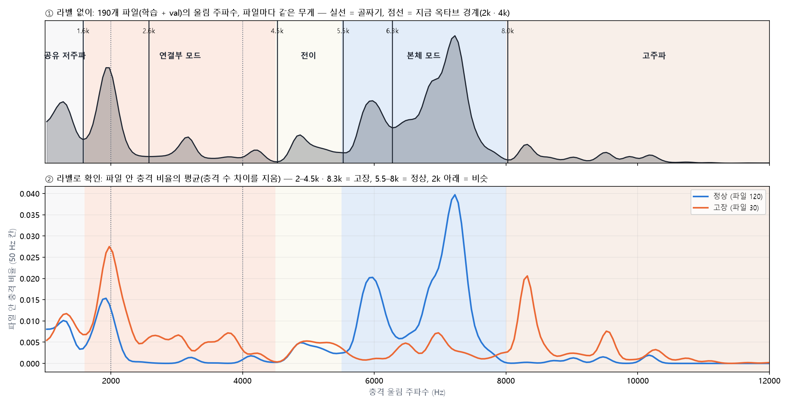
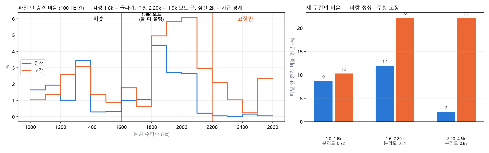
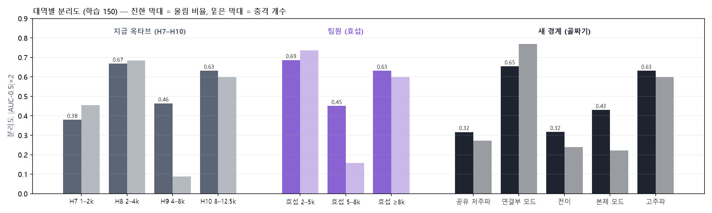
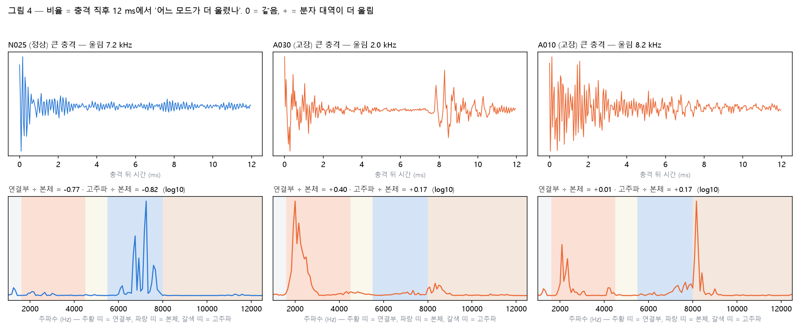
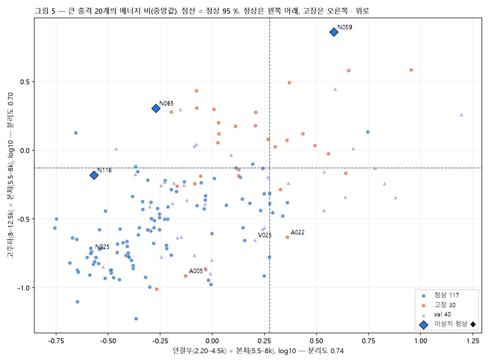

# 2-14 울림 모드로 대역 경계 정하기 · 소린 비율의 의미 (11-23)

상태: 1차, EDA만 함(모델 실험 없음). 코드 [run.py](run.py), 수치 [figs/결과.txt](figs/결과.txt), 파일별 값 [figs/파일표.csv](figs/파일표.csv)

**결론**
1. **경계는 옥타브(2 · 4 · 8k)가 아니라 울림 모드 사이의 골짜기에 둔다.** 라벨 없이 찾은 경계는 **1.6 · 4.5 · 5.5 · 8.0 kHz**다.
2. **2 kHz 아래는 정상과 고장이 같이 운다.** 1.0–1.6k는 차이가 없고, 1.9k 모드는 정상도 운다. 고장에서만 우는 구간은 **2.2–4.5k**부터다.
3. **소린님 비율 = "큰 충격이 어느 모드를 울렸나"를 에너지로 잰 값**이다. 우리 경계로 다시 만들어도 분리도가 같다(0.74). 이상치 정상 3개는 고주파 비율에서 위로 올라간다(정상 중 백분위 92–99).

## ① 경계: 울림 모드 지도

- **위(라벨 없음)**: 학습 + val 190개 파일의 충격 울림 주파수다. 파일마다 같은 무게로 셌다. 실선이 골짜기다.
- **아래(라벨로 확인)**: 파일 안에서 각 주파수가 차지하는 충격 비율이다. 고장 파일이 충격 자체가 많다는 차이(H1)는 지웠다.

| 대역 | 경계 근거 (라벨 없음) | 누가 우나 | 피처에서 |
|---|---|---|---|
| 공유 저주파 1.0–1.6k | 1.3k 봉우리, 1.6k 골짜기 | 둘 다 | **뺀다** |
| 연결부 모드 1.6–4.5k | 1.9 · 3.2k 봉우리, 4.5k 골짜기 | **고장** (1.9k는 정상도) | 쓴다 |
| 전이 4.5–5.5k | 4.9k 봉우리 | 둘 다 | 뺀다 |
| 본체 모드 5.5–8.0k | 6.0 · 7.2k 봉우리 (6.3k 골짜기는 둘 다 정상이라 합침) | **정상** | 비율의 분모 |
| 고주파 8.0–12.5k | 8.3 · 9.5k 봉우리 | **고장** + 이상치 정상 | 쓴다 |

- 지금 H9(4–8k)는 둘 다 우는 전이 구간을 본체 모드와 섞어서 센다.
- 지금 H8의 경계 2k는 1.9k 모드 한가운데를 자른다(2-29의 문제).

## ② 2 kHz 아래

| 구간 (파일 안 충격 비율 평균) | 정상 | 고장 | 분리도 |
|---|---|---|---|
| 1.0–1.6k | 9 % | 10 % | 0.32 |
| 1.6–2.2k (1.9k 모드) | 12 % | 22 % | 0.41 |
| **2.2–4.5k** | **2 %** | **22 %** | **0.65** |

- 2.2k는 1.9k 모드가 끝나는 지점이다. 라벨 없이, 모드 봉우리의 25 % 아래로 내려가는 첫 주파수로 정했다.
- 1.9k 모드는 정상에서 파일당 1–2번, 고장에서 여러 번 반복된다(2-29). 그래서 이 모드는 **비율이나 에너지보다 반복 횟수로** 센다.

## ③ 대역별 분리도

분리도는 |AUC − 0.5| × 2이고, 학습 150개 파일로 계산했다.

| 피처 | 분리도 |
|---|---|
| 지금 H8 2–4k 울림 비율 | 0.67 |
| 효섭님 2–5k 울림 비율 | 0.69 |
| 새 1.6–4.5k 울림 비율 | 0.65 |
| **새 1.6–4.5k 충격 수** | **0.77** |
| 소린님 2–5k ÷ 5–8k 에너지 | 0.74 |
| **새 2.2–4.5k ÷ 5.5–8k 에너지** | **0.74** |
| 새 1.6–4.5k ÷ 5.5–8k 에너지 (1.9k 모드 포함) | 0.70 |

- 울림 비율(충격 하나를 주파수 하나로 판정해서 센 값)은 경계를 옮겨도 거의 그대로다.
- 이득은 두 가지에서 나온다.
  - **1.9k 모드를 포함한 충격 수**: 반복 횟수를 살린다.
  - **1.9k 모드를 뺀 에너지 비**: 정상도 우는 모드를 분자에서 뺀다.
- 위 값은 피처 하나씩의 분리도다. ET에 넣었을 때의 효과는 실험으로 확인해야 한다.

## ④ 소린 비율이 재는 것

- **계산**: 큰 충격 20개마다 직후 12 ms 스펙트럼에서 √(분자 대역 에너지 ÷ 분모 대역 에너지)를 구한다. 20개의 중앙값을 내고 log10을 취한다.
- **의미**: 같은 충격이 **연결부 모드**(유격 → 금속끼리 부딪침)와 **본체 모드**(노면 → 암 전체가 맞음) 중 어느 쪽을 더 울렸나.
  - 0이면 두 대역이 같고, +면 분자 대역이 더 울렸다.
- **우리 울림 비율(H7–H10)과의 차이**

| | H7–H10 (우리) | 소린 비율 |
|---|---|---|
| 충격 하나의 표현 | 주파수 하나로 판정(딱 나눔) | 대역 에너지로 나눔(연속) |
| 여러 모드가 함께 울릴 때 | 하나만 남는다 | 모두 반영된다 (예: A010 = 2k + 8.2k) |
| 경계 근처 모드 | 값이 0 ↔ 1로 튄다 | 조금씩 바뀐다 |
| 충격 크기 · 센서 게인 | — | 분자와 분모에 같이 들어가 약분된다 |

## ⑤ 파일 지도: 두 비율

| 정상 95 % 선을 넘는 파일 | 연결부 ÷ 본체 | 고주파 ÷ 본체 | 둘 중 하나 |
|---|---|---|---|
| 정상 (120) | 6 | 6 | 10 |
| 고장 (30) | 11 | 19 | **22** |
| val (40) | 10 | 9 | 15 |

- **이상치 정상 N059 · N065 · N116**: 고주파 비율이 정상 중 백분위 99 · 98 · 92다. 사용자 방침에 따라 이 셋은 탐지할 수 없는 파일로 두고, **정상과 고장의 거리를 넓히는 쪽을 택한다.**
- **A022 · A005 · V025**: A022는 연결부 축에서 정상 95 % 선을 넘는다. A005는 정상 안에 있다. V025는 선 바로 아래에 있다.
- **val이 연결부 쪽으로 넓다**(10/40). 2-8 val 배경 이동과 같은 방향이라 주의가 필요하다.

## 피처 후보 (다음 실험용, 아직 안 돌림)

| 후보 | 대신하는 것 | 근거 |
|---|---|---|
| 연결부(1.6–4.5k) 충격 수 | H7 · H8 | 분리도 0.77. 1.9k 모드의 반복을 살린다 |
| log 에너지 비 2.2–4.5k ÷ 5.5–8k | H8 · H9 | 0.74. 정상도 우는 1.9k 모드를 뺀다 |
| log 에너지 비 8–12.5k ÷ 5.5–8k | H10 | 0.70. 이상치 정상은 올라가는 것을 감수한다 |
| 1.0–1.6k · 4.5–5.5k | — | 피처로 쓰지 않는다 (공유 대역) |

## 주의
- 경계 1.6 · 2.2 · 4.5 · 5.5 · 8.0k는 라벨 없이 정했다. 단, 6.3k 골짜기를 합친 것과 공유 대역을 뺀 것은 아래 그림(라벨)을 보고 판단했다.
- 울림 주파수는 감쇠 사인파 하나로 맞춘 근사값이다(50 Hz 간격). 충격이 없는 파일(정상 17 · val 4)은 비율을 정상 중앙값으로 채웠다.
- 소린 비율 재현값과 4-3 팀원 값의 순위 상관은 ρ 0.89(2–5/5–8), 0.93(8–11/5–8)이다. 충격 검출 정의가 달라서 완전히 같지는 않다.
