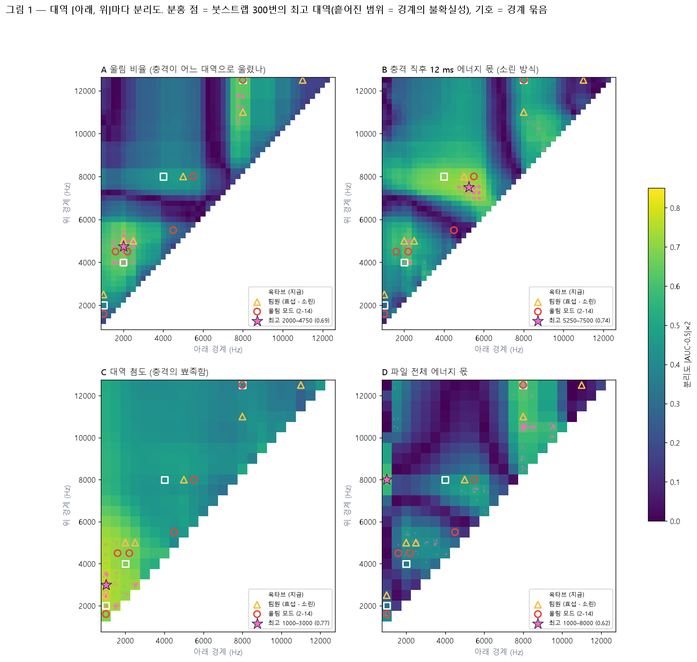

# 2-15 대역 경계 지도 (11-23)

**질문**: 대역 경계를 옥타브에서 울림 모드(2-14)나 팀원 경계로 바꿔야 하나? CV 성능이 아니라 **정상과 고장이 잘 갈리는지**(분리도)로 본다.

**결론**
- **경계는 바꿀 이유가 약하다.** 세 경계 묶음 모두 같은 "좋은 영역" 위에 있다. 차이는 0.05 이하로, 붓스트랩 90% 구간(약 ±0.12) 안이다.
- **경계보다 중요한 것은 "피처 종류 × 대역"의 짝이다.** 피처 종류마다 잘 갈리는 대역이 다르다.

| 피처 | 잘 갈리는 대역 (최고) | 옥타브 | 팀원 | 울림 모드 |
|---|---|---|---|---|
| A 울림 비율 | 2–5k (0.69) · 8k 위 | 2–4k **0.67** | 2–5k **0.69** | 1.6–4.5k **0.66** |
| B 충격 직후 몫 | 5–8k 본체 (0.74) | 4–8k **0.69** | 5–8k **0.72** | 5.5–8k **0.70** |
| C 대역 첨도 | 1–3k (0.77) | 1–2k **0.74** | 1–2.5k **0.76** | 1.5–4.5k **0.72** · 1–1.5k 0.69 |
| D 전체 에너지 몫 | 8k 위 (0.62, 불안정) | 8–12.5k **0.62** | 8–11k **0.61** | 8–12.5k **0.62** |

- 피하는 대역은 세 묶음에서 같다. 전이 4.5–5.5k, 11k 위, 그리고 울림 비율 · 몫에서 1–1.6k가 해당한다.
- 1–1.6k는 울림 비율로는 쓸모없지만(0.28) **첨도로는 좋다**(0.69). 같은 대역이라도 피처 종류에 따라 쓸모가 갈린다.

**그림 읽는 법**
- 칸 하나가 대역 하나다. 가로는 아래 경계, 세로는 위 경계, 색은 분리도(노랑일수록 잘 갈림)다.
- 분홍 점은 학습 150개를 다시 뽑은 300번에서 각각 가장 좋았던 대역이다. 점이 넓게 퍼질수록 경계를 정확히 정할 수 없다는 뜻이다.
- □ 옥타브 · △ 팀원 · ○ 울림 모드. 셋 다 같은 밝은 영역 안이나 가장자리에 있다.

**방법**
- **분리도**: |AUC − 0.5| × 2를 학습 150개(이상치 정상 포함)로 계산했다. 피처 정의는 아래와 같다.
  - A 울림 비율: 충격 울림 주파수(2-14 캐시)가 대역 안인 비율, 충격 없음 = −1
  - B 충격 직후 몫: 큰 충격 20개의 12 ms 에너지 중 대역 몫, log10 중앙값
  - C 대역 첨도: 4차 Butterworth 대역통과 후 log10 첨도
  - D 전체 에너지 몫: Welch 파워의 1 kHz 위 몫, log10
- **격자**: A · B는 250 Hz, C · D는 500 Hz다. C · D에서는 1.6k를 1.5k로, 2.2k를 2.0k로 가장 가까운 격자에 맞췄다.
- 수치 전체는 `figs/결과.txt` · `figs/경계별_분리도.csv`, 코드는 `run.py`, 대역 첨도 캐시는 `figs/kurt500.npy`에 있다.
