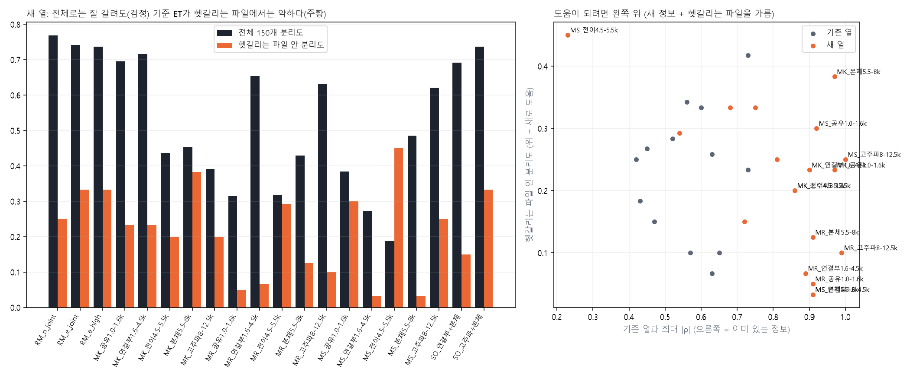
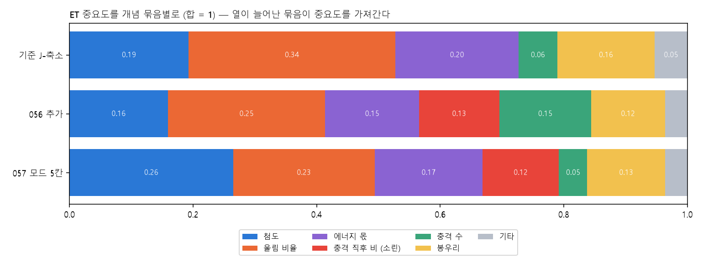
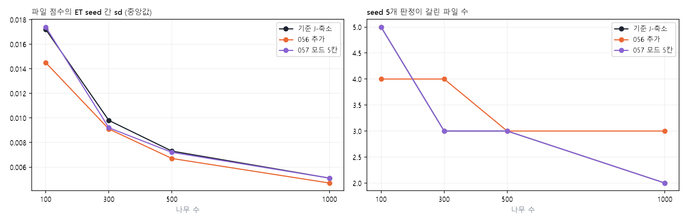

# 4-13 ET 진단 — 의미 있는 피처를 넣었는데 왜 안 오르나 (11-23)

**질문**: 분리도가 높은 새 피처(울림 모드 · 소린 비율)를 넣어도 성능이 그대로이거나 떨어진다. ET 안에서 무슨 일이 일어나나? 나무 수를 300 → 500으로 늘려야 하나?

**결론**
1. **새 피처는 대부분 이미 있는 정보다.** 새 열과 기존 열의 |ρ|는 0.7–1.0이다(모드 칸은 0.86–1.00). 전체 분리도가 높아도 기존 열을 다시 잰 것에 가깝다.
2. **새 피처는 ET가 이미 맞히는 파일만 가른다.** 전체 분리도는 0.7대인데, 기준 ET가 헷갈리는 파일(고장 10 · 정상 12) 안에서는 0.03–0.38로 떨어진다.
3. **같은 개념의 열이 늘면 그 개념의 표가 커진다(057이 떨어진 이유).** 057에서 첨도 열이 2개에서 5개로 늘자 첨도 묶음의 중요도가 0.19에서 0.26으로 올랐다. 그 결과 충격성 정상의 고장 투표 비율이 올랐다(N027 0.30 → 0.68, N054 0.33 → 0.71). A022는 울림 비율 · 에너지 몫 경로로 잡히던 고장인데, 0.50 → 0.29로 내려갔다.
4. **056 추가는 이득과 손해가 섞여 같은 점수가 됐다.** 소린 비 · 연결부 충격 수가 중요도 0.28을 가져갔다. 그 결과 N025는 0.29 → 0.18, A022는 0.50 → 0.57로 좋아졌지만, N054는 0.33 → 0.46, N002는 0.25 → 0.35로 나빠졌다.
5. **나무 수는 300이면 충분하다.** 300 → 500에서 점수 sd는 0.010 → 0.007로 줄지만, 판정이 뒤집히는 파일 수는 3 → 3으로 같다. 뒤집히는 A002 · N037은 나무 1000에서도 뒤집힌다. 문턱 위에 걸친 파일이라 나무 수와 상관이 없다. quick(100)에서는 5개가 뒤집혀 흔들림이 크다.

- **왼쪽**: 새 열의 전체 분리도(검정)와 헷갈리는 파일 안 분리도(주황)
- **오른쪽**: 가로는 기존 열과의 최대 |ρ|(오른쪽일수록 중복), 세로는 헷갈리는 파일 안 분리도(위일수록 도움)
- 도움이 되는 열은 왼쪽 위에 있어야 하는데 거의 없다. MS_전이 4.5–5.5k(ρ 0.23, 0.45)는 전체 분리도가 0.19로 약하다.

| 초점 파일 | 라벨 | 기준 | 056 추가 | 057 |
|---|---|---|---|---|
| A022 | 고장 | 0.50 | 0.57 | **0.29** |
| A028 | 고장 | 0.62 | 0.57 | 0.51 |
| N025 | 정상 | 0.29 | **0.18** | 0.22 |
| N027 | 정상 | 0.30 | 0.27 | **0.68** |
| N054 | 정상 | 0.33 | 0.46 | **0.71** |
| N002 | 정상 | 0.25 | 0.35 | 0.46 |

값은 고장으로 투표한 나무의 비율이다(폴드 밖, 나무 1000). 고장 투표 경로에 쓰인 열은 `figs/결과.txt`에 있다.

**방법**
- ET 단독 OOF만 계산했다(결합 · AE · 규칙 없음). 5겹은 같은 분할로 두고 ET seed만 5개를 바꿨다. 나무 1000그루를 키운 뒤 앞의 N그루를 "나무 N개 숲"으로 썼다.
- ET 입력은 J-축소와 같다. 울림 비율은 충격 수로 축소(α = 3)했고, 봉우리 H16 · H17을 넣었고, 기준 값은 폴드 안 정상으로 잡았다.
- 헷갈리는 파일은 기준 ET 점수가 고장 하위 1/3인 고장과 정상 상위 10%인 정상이다. 라벨과 OOF를 보고 고른 진단용이다.
- 수치는 `figs/결과.txt` · `figs/열별_중복·새정보.csv`, 코드는 `run.py`(약 3분)다.
