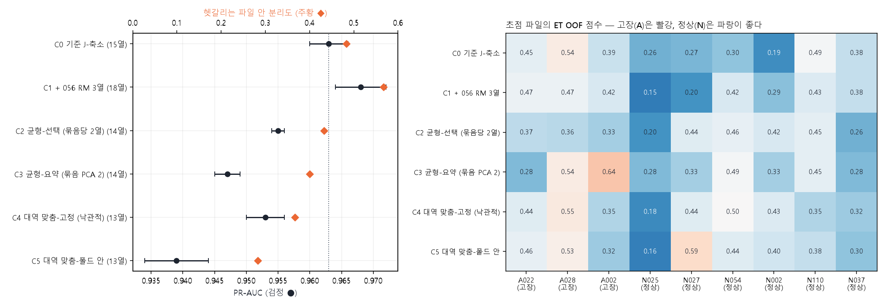
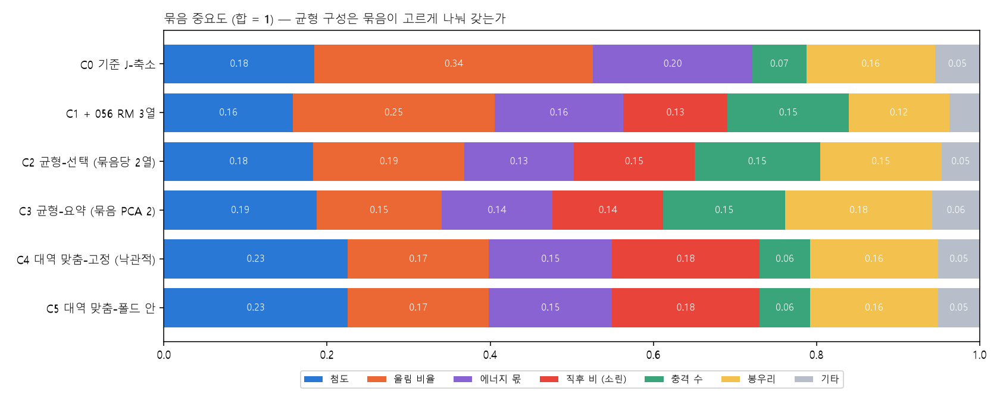

# 4-14 묶음 균형 · 대역 맞춤 (11-23)

**질문**
- 4-13: 같은 개념의 열이 늘면 그 개념이 표를 더 가져간다. 그렇다면 개념 묶음마다 열 수를 맞추면 나아지나?
- 2-15: 피처 종류마다 잘 갈리는 대역이 다르다. 그렇다면 종류마다 맞춤 대역을 쓰면 나아지나?

**결론**
- **균형도 맞춤 대역도 기준보다 나아지지 않았다.** 지금 구성에서 좋아진 것은 기준에 소린 비율 · 연결부 충격 수 3열을 **더한** 것(C1)뿐이다. PR-AUC 0.963 → 0.968, 헷갈리는 파일 안 분리도 0.48 → 0.57.
- **나빠진 이유는 "전체 분리도로 열을 고르면, 약해 보이는 열을 버리게 된다"는 것이다.** 전체 분리도는 낮아도 헷갈리는 파일을 가르는 열이 있다. 1–2k 에너지 몫 H12(전체 0.32 → 헷갈리는 파일 안 0.42), H1 충격 수(0.60 → 0.34), H7 1–2k 울림(0.29 → 0.33)이 그렇다(4-13 표). 균형-선택(C2)과 맞춤 대역(C4 · C5)은 이런 열을 빼고 "전체로 잘 갈리는" 열만 남겨, 이미 맞히던 파일만 다시 맞혔다.
- **묶음 중요도는 고르게 맞춰졌다**(그림 2). 그러나 N027 · N002 같은 충격성 정상이 오히려 올라갔다(C2: N027 0.27 → 0.44, N002 0.19 → 0.42). 표가 고르게 나뉘는 것 자체가 목적은 아니다.
- **맞춤 대역은 폴드마다 고르는 대역이 흔들린다.** 울림 비율 대역이 5겹에서 5가지로 나왔다(2-15의 넓은 평원과 같은 이야기). 150개 전체로 고른 고정 대역(C4, 낙관적)조차 기준보다 낮다.

| 구성 | 열 | PR-AUC | 헷갈리는 파일 안 분리도 |
|---|---|---|---|
| C0 기준 J-축소 | 15 | 0.963 ± 0.003 | 0.48 |
| **C1 + 056 RM 3열** | 18 | **0.968 ± 0.004** | **0.57** |
| C2 균형-선택 (묶음당 2열) | 14 | 0.955 | 0.43 |
| C3 균형-요약 (묶음 PCA 2성분) | 14 | 0.947 | 0.40 |
| C4 대역 맞춤-고정 (낙관적) | 13 | 0.953 | 0.37 |
| C5 대역 맞춤-폴드 안 | 13 | 0.939 | 0.28 |

**그림 읽는 법**
- **왼쪽**: 검정 ●은 ET 단독 OOF의 PR-AUC다. 오차 막대는 ET seed 5개의 sd로, 분할 운은 들어 있지 않다. 주황 ◆은 기준 ET가 헷갈리는 파일(고장 10 · 정상 12) 안 분리도다.
- **오른쪽**: 초점 파일의 점수다. 고장(A)은 빨강, 정상(N)은 파랑일수록 좋다.

**피처 조합에 주는 의미**
- 열을 고르는 기준은 전체 분리도가 아니라 **"헷갈리는 파일을 새로 가르는가"**여야 한다(4-13 그림 1의 왼쪽 위).
- 지금 그 조건을 만족하는 것은 소린 비율 · 연결부 충격 수(056의 3열)다. 옥타브 열은 빼지 않는다. 약해 보이는 옥타브 열이 헷갈리는 파일을 받친다.

**방법**
- ET 단독 OOF만 계산했다(결합 · AE · 규칙 없음, F2 아님). 같은 5겹 분할, ET 300그루, seed 5개다. 모든 구성에 H2 · H18 · 봉우리 H16 · H17이 들어가고, 울림 비율은 충격 수로 축소했다(α = 3).
- **C2**: 묶음마다 학습 폴드 분리도 1위와, 1위와 |ρ| < 0.8인 열 중 1위를 고른다.
- **C3**: 묶음마다 폴드 안 정상 기준으로 표준화한 뒤 PCA 2성분을 쓴다(라벨 안 씀).
- **C4 · C5**: 2-15 격자 피처(A 울림 비율 · B 직후 몫 · C 첨도 · D 전체 몫)에서 종류마다 대역 2개를 고른다. 두 대역은 겹침 ≤ 25%, |ρ| < 0.8이다. C4는 150개 전체로, C5는 학습 폴드로만 고른다.
- 수치는 `figs/결과.txt` · `figs/구성비교.csv`, 코드는 `run.py`(약 1.5분)다. 격자 피처는 2-15의 `figs/격자피처.npz`를 쓴다.
