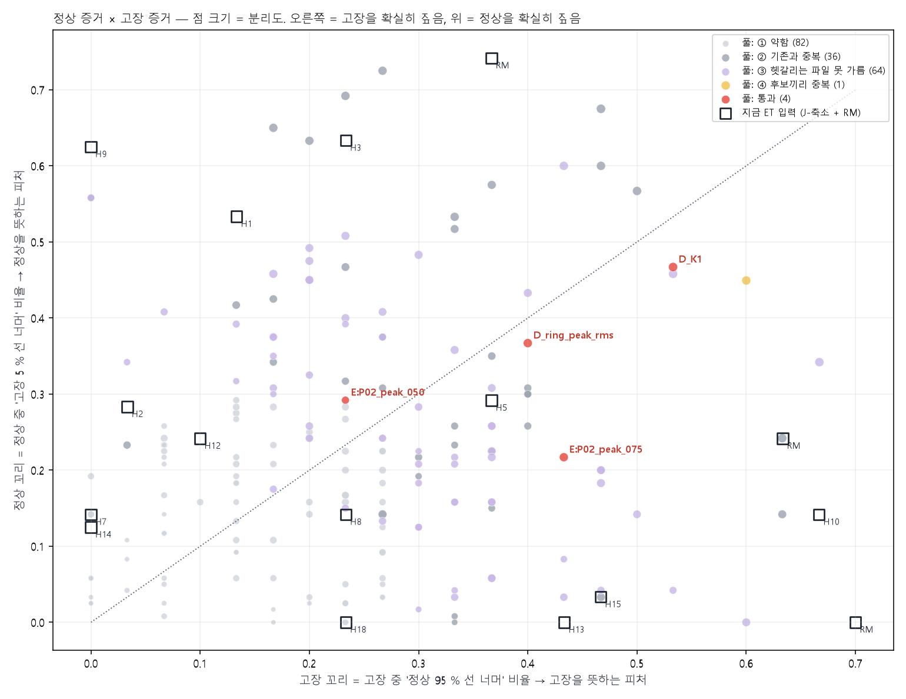

# 4-15 피처 풀 선별 — 정상 증거 · 고장 증거 (11-24)

**질문**: ext150 · D+ · 우리 모드 피처(187열) 가운데 지금 ET 입력(J-축소 + RM 3열, 기준 구성)에 더할 만한 것이 있나? ET는 "정상을 뜻하는 피처"와 "고장을 뜻하는 피처"를 둘 다 가져야 한다.

**결론**
- **187열 중 관문을 통과한 것은 4개다. 이 가운데 쓸 만한 것은 "충격이 얼마나 센가" 축의 D+ 두 열이다.** 이 축은 지금 ET 입력에 없다.
- **D_K1이 1순위 후보다.** 두 번째로 큰 타격 ÷ 바탕 잡음, log10이다. 고장 꼬리 0.53과 정상 꼬리 0.47을 함께 가진다. 정상 증거와 고장 증거를 동시에 주는 드문 피처다.
- **D_ring_peak_rms는 같은 축이다**(D_K1과 ρ 0.79). 충격 정렬 평균의 첫 피크 ÷ 파일 RMS다. 둘 중 하나만 써도 되고, 둘 다 넣어도 이득은 작다.
- E:P02_peak_075는 7.5–8.75k의 절대 피크(g)라서 **게인에 의존한다**(결정.md "게인"). 그래서 보류한다. E:P02_peak_050은 더해도 변화가 없어 기각한다.

**그림 읽는 법**
- 점 하나가 피처 하나다. 점이 오른쪽에 있을수록 고장을 확실히 짚고, 위에 있을수록 정상을 확실히 짚는다.
- □는 지금 ET 입력이다. 정상 증거 쪽은 H9 · H3 · H1 · RM_e_joint가 맡고, 고장 증거 쪽은 RM_n_joint · H10 · RM_e_high · H13 · H15가 맡는다. **양쪽을 다 가진 열은 RM_e_joint뿐이다.**
- 풀 피처 대부분은 회색(기존과 중복)이나 보라(헷갈리는 파일을 못 가름)다. 분리도가 높아도 이미 있는 정보이거나 이미 맞히는 파일만 가른다(4-13과 같은 결론).
- 빨강(통과) 중 **D_K1은 대각선 위 오른쪽**에 있다. 양쪽 증거를 모두 가진 자리다.

| 구성 (ET 단독 OOF, seed 5 · ET 300, 같은 5겹) | PR-AUC | 헷갈리는 파일 안 분리도 |
|---|---|---|
| 기준 J-축소 + RM | 0.968 ± 0.004 | 0.52 |
| + D_K1 | 0.972 ± 0.003 | **0.60** |
| + D_ring_peak_rms | 0.973 ± 0.002 | 0.58 |
| + E:P02_peak_075 (게인 의존) | 0.973 ± 0.003 | 0.58 |
| + E:P02_peak_050 | 0.968 ± 0.002 | 0.52 |
| + D_K1 + D_ring_peak_rms | 0.975 ± 0.003 | 0.62 |
| + 통과 3개 모두 | 0.976 ± 0.002 | 0.65 |

## 선별 절차 (미리 정한 관문)

| 단계 | 기준 | 남은 수 |
|---|---|---|
| 풀 | ext150 150 · D+ 고유 19(울림 4 · 물리 10 · 규칙 5) · 우리 모드 18 (값 종류 ≤ 3인 열 제외) | 187 |
| ① 강함 | 분리도 ≥ 0.45 또는 고장 꼬리 ≥ 0.30 또는 정상 꼬리 ≥ 0.30 | 105 (82 탈락) |
| ② 새 축 | 지금 ET 입력 18열과 최대 \|ρ\| < 0.8 | 69 (36 탈락) |
| ③ 헷갈리는 파일 | 헷갈리는 파일(고장 10 · 정상 12, 기준 ET OOF로 고름) 안 분리도 ≥ 0.30, 방향이 전체와 같음 | 5 (64 탈락) |
| ④ 후보끼리 | \|ρ\| ≥ 0.8이면 헷갈림 분리도 높은 하나만 | **4** |
| ⑤ 더하기 | 하나씩 더해 PR-AUC · 헷갈림 분리도가 둘 다 떨어지지 않음 | 3 |

- **꼬리의 정의**: 고장 꼬리는 고장 중 '정상 95 % 선 너머'의 비율이다. 그 값이면 고장이라고 말할 수 있다. 정상 꼬리는 정상 중 '고장 5 % 선 너머'의 비율이다. 그 값이면 정상이라고 말할 수 있다.
- 이 결과는 ET 단독 OOF다(결합 · AE · 규칙 없음, F2 아님). 채택하려면 정식 실험(중첩 CV)이 필요하다.

## 피처별 정리

| 피처 | 판정 | 한 줄 |
|---|---|---|
| [D_K1](피처_D_K1/README.md) | **채택 후보 (1순위)** | 두 번째 큰 타격의 세기. 큰 타격이 1번 이하면 바닥값 = 정상 증거, 크게 여러 번 = 고장 증거 |
| [D_ring_peak_rms](피처_D_ring_peak_rms/README.md) | 채택 후보 (D_K1과 같은 축, 대안) | 대표 충격의 세기 ÷ 파일 RMS |
| [E:P02_peak_075](피처_E_P02_peak_075/README.md) | 보류 (게인 의존) | 7.5–8.75k 절대 피크(g). 정규화판(crest · 첨도)은 H5와 중복 |
| [E:P02_peak_050](피처_E_P02_peak_050/README.md) | 기각 | 5–6.25k 절대 피크. 더해도 변화 0 |

**코드 · 수치**: `run.py`(선별 · 더하기, 약 3분) · `run_2_피처별.py`(꼬리 지도 · 피처별 그림) · `figs/풀_전체지표.csv`(187열 전부, 관문 사유 포함) · `figs/단계3_더하기.csv` · `figs/지금입력_꼬리.csv` · `figs/결과.txt`
