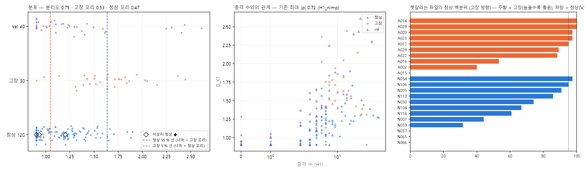

# D_K1 — 두 번째로 큰 타격의 세기 (채택 후보, 1순위)

**정의** (`src/features.py` `extract_features_knock`, D+ 규칙 블록)
- 200 Hz 고역통과한 뒤 σ = 1.4826 · MAD(바탕 잡음)를 구한다. |h| > 8σ인 구간을 사건으로 보고, 10 ms 안은 한 사건으로 묶는다.
- **D_K1 = log10(두 번째로 큰 사건 높이 ÷ σ)**이다. 사건이 2개보다 적으면 log10(8) = 0.90으로 바닥값이 된다.
- 예전 유격 반복 규칙(EXP-025, K1 · K2)의 재료였다. 지금 J-축소에는 규칙으로도 피처로도 없다.

| 지표 | 값 |
|---|---|
| 분리도 (방향) | 0.75 (고장이 큼) |
| 고장 꼬리 / 정상 꼬리 | **0.53 / 0.47**: 양쪽 증거를 모두 가진 드문 열 |
| 헷갈리는 파일 안 분리도 | 0.41 |
| 지금 입력과 최대 \|ρ\| | 0.72 (H1 충격 수) |
| val 이동도 | 0.12 (작음) |
| ET OOF에 더하기 | PR-AUC 0.968 → 0.972, 헷갈림 분리도 0.52 → **0.60** (4개 중 최대) |

**왜 쓸 만한가**
- **정상 증거**: 큰 타격이 1번 이하인 정상은 바닥값(0.90)에 모인다. 고장은 이 값을 거의 갖지 않는다(왼쪽 그림의 주황 점선 왼쪽).
- **고장 증거**: 두 번째 타격도 바탕의 수십 배면 고장 쪽이다. 고장 중 53 %가 정상 95 % 선 너머다.
- **충격 수(H1)와 다른 정보다.** H1은 "몇 번 쳤나"를 센다. D_K1은 "두 번째로 센 타격이 얼마나 센가"를 잰다. 가운데 그림에서 충격 수가 같아도(10개 근처) 고장이 위에 있다.
- 헷갈리는 고장 A014 · A028 · A009 · A023 · A017을 정상 95백분위 이상으로 올린다.
- 물리 가설 **H1(유격 → 금속 타격 반복)**과 맞는다.

**주의**
- 헷갈리는 정상 N054 · N106 · N095도 90백분위 이상으로 올라간다. 충격성 정상이다(4-13). 전체로는 이득이지만, 정식 실험에서 오경보율을 확인해야 한다.
- 이상치 정상(◆ 059 · 065 · 116)은 바닥값 근처라 끌어올리지 않는다.

**판정: 채택 후보 1순위.** 정식 실험(J-축소 + RM + D_K1, 중첩 CV)으로 확인한다.
